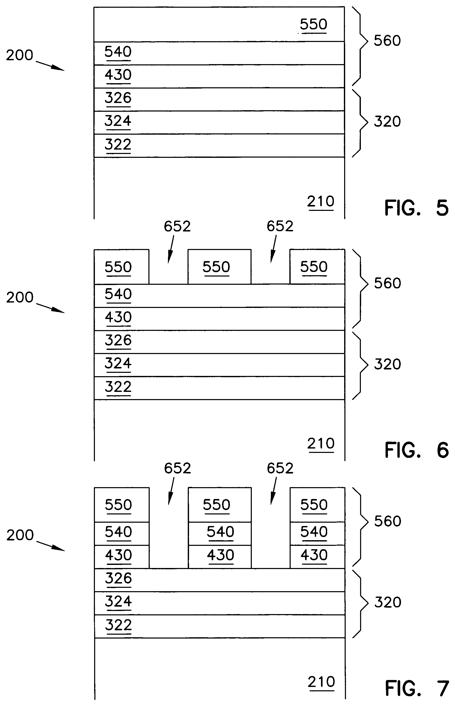
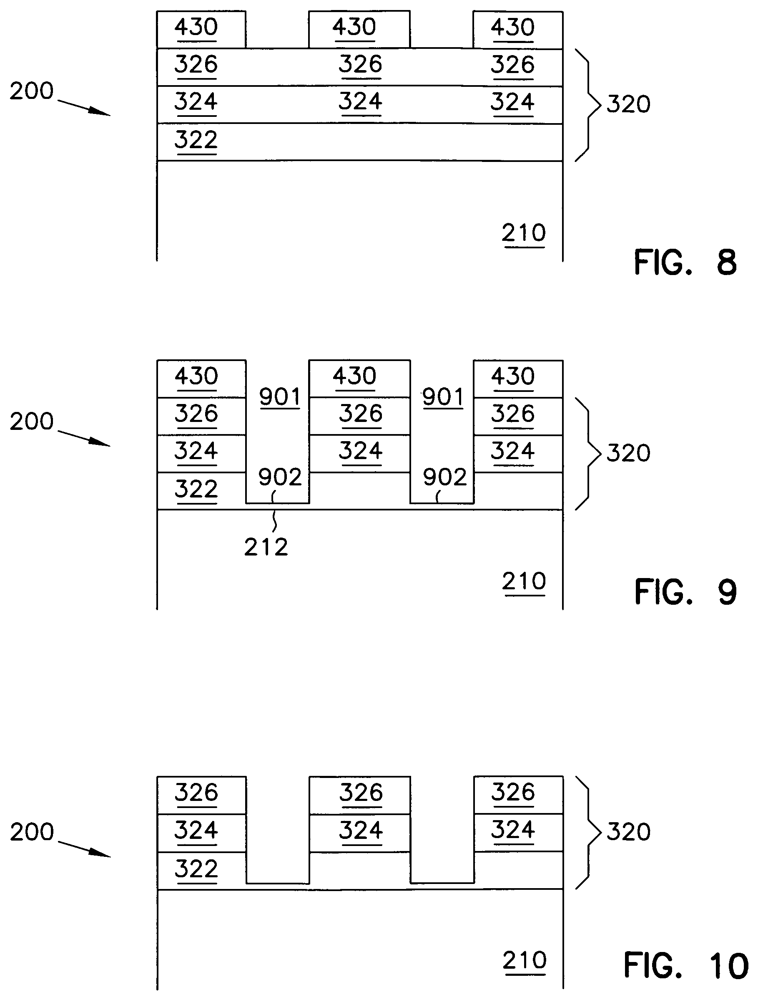
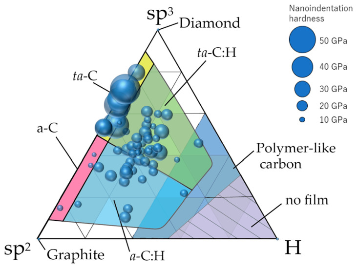
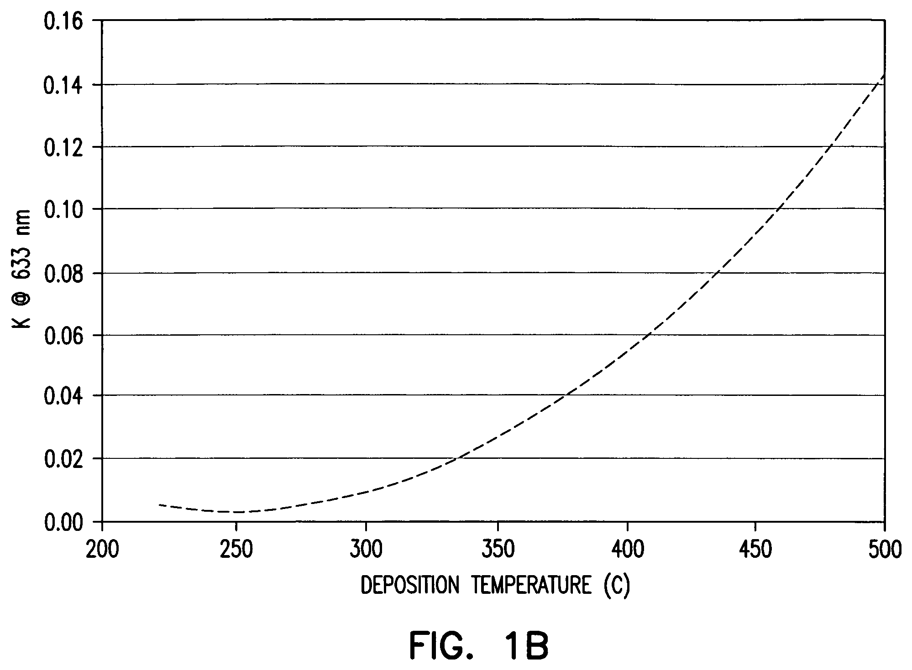
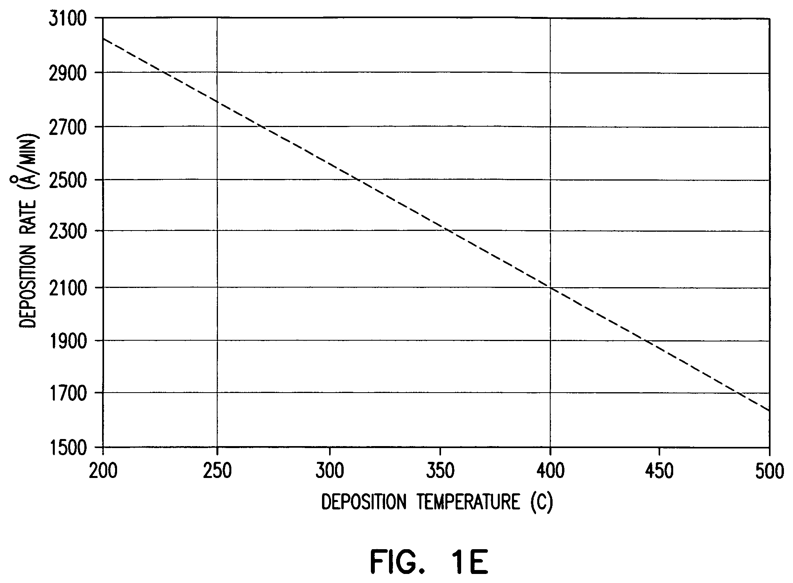
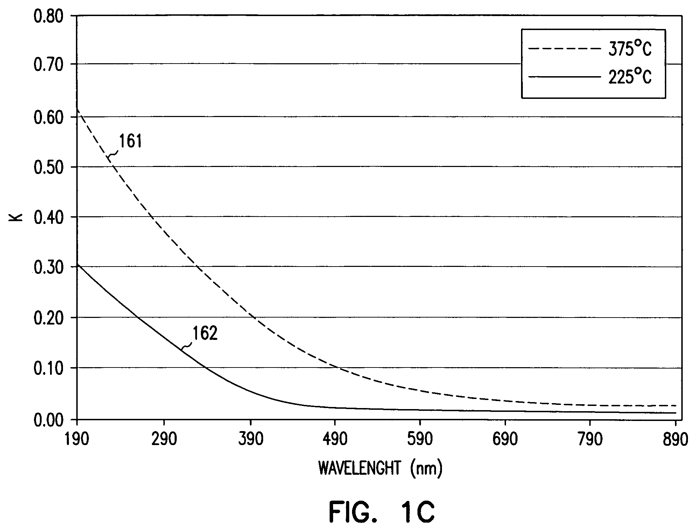
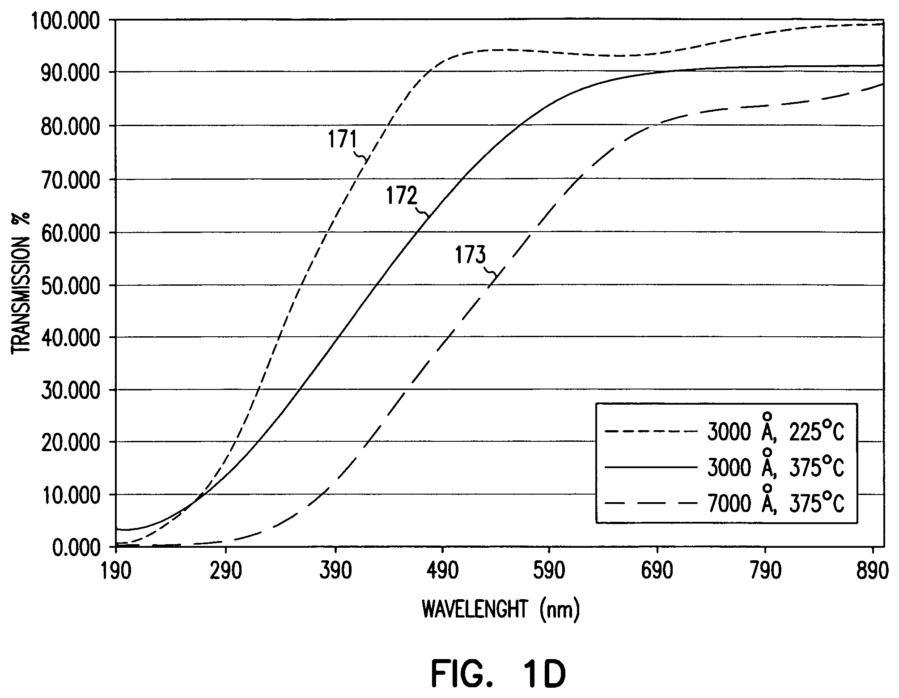
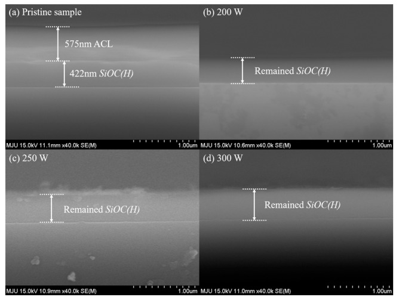
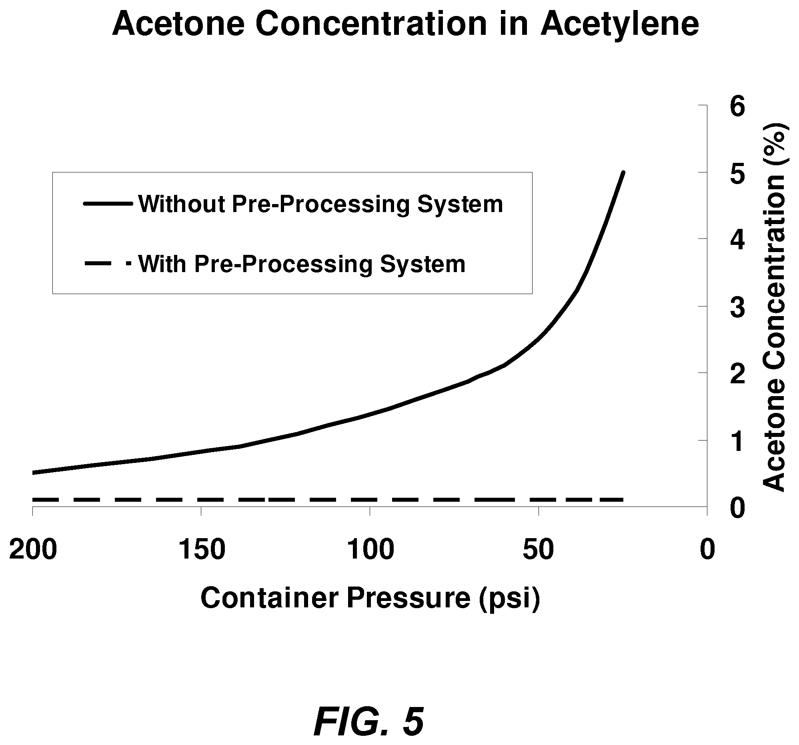
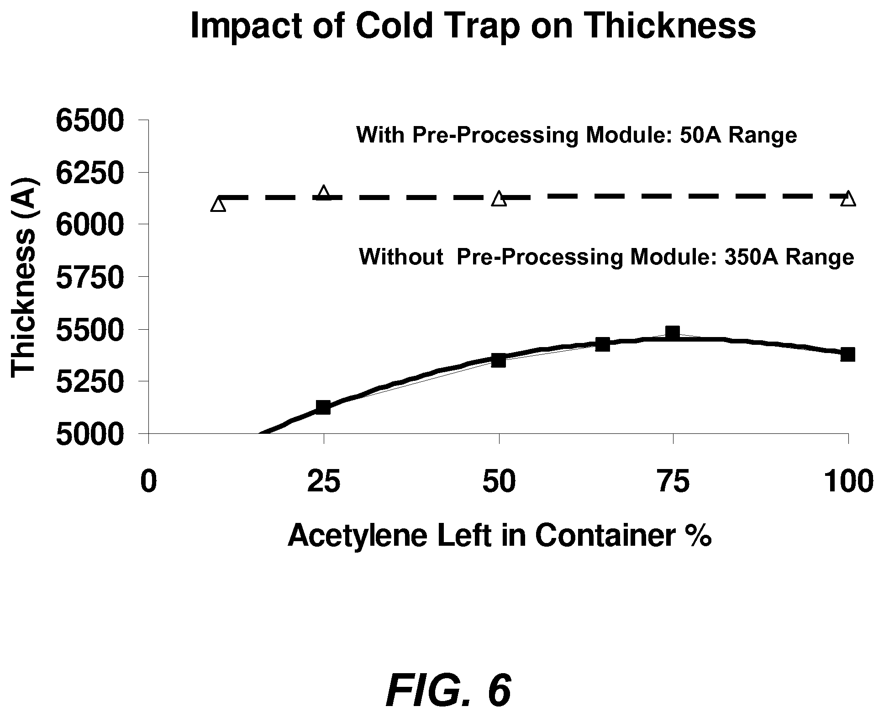

# 03-01 · ACL — Amorphous Carbon Layer 

> 근거 번호 `[S##]`는 `03-01_ACL_자료수집.md`의 ID다. 논문은 초록 수준까지만 확인했다.
>
> 근거 표시 — **[논문]** 동료심사 논문에 보고된 실험값 · **[특허]** 특허 명세서의 주장·실시예(독립 검증 아님) · **[리뷰]** 리뷰·교과서 수준의 정설 · **[계산]** 가정을 명시한 교육용 계산 · **[현장]** 문헌으로 못 박지 못한 현장 통념. 자기 장비에서 확인이 필요하다.

---

## 0. 요약

ACL은 PECVD로 증착하는 수소화 비정질 탄소(a-C:H) 막이다. 반도체에서는 거의 전적으로 **식각 Hardmask**, 그중에서도 쓰고 난 뒤 O₂ Plasma로 태워 없앨 수 있는 **Ashable Hardmask(AHM)** 로 쓴다. CVD 엔지니어에게 ACL은 “두껍게, 빨리, 균일하게”와 “식각에 덜 깎이게, 정렬광은 통과하게, 웨이퍼는 휘지 않게”를 한 Recipe 안에서 동시에 맞추는 문제다.

| 항목 | 내용 |
|---|---|
| 조성식 | a-C:H(수소화 비정질 탄소). a-는 비정질(amorphous), :H는 결합한 수소를 품었다는 뜻이다. 정해진 조성식이 없고, sp²·sp³ 탄소와 수소의 비율이 증착 조건에 따라 변한다(§2.1) |
| 역할 | 패턴 전사용 희생 Hardmask. 식각 후 Ash로 제거 |
| 증착 방식 | PECVD (CCP, 13.56 MHz HF ± 수백 kHz LF) |
| 전구체 | C₃H₆(주력) · C₂H₂ · CH₄ · C₆H₁₂(액상) + He / Ar / N₂ / H₂ |
| 증착 온도 | 저온 투명형 200–500 °C [특허 S10] ↔ 고온형 400–650 °C [특허 S21] |
| 압력 · RF | 4–8 Torr · 100–1,000 W (특허 실시예 범위 [S21]. 현행 300 mm 장비 값은 아님) |
| 증착 속도 | 550 °C에서 5,050–6,360 Å/min [논문 S08] |
| 밀도 | 550 °C 막 1.45–1.48 g/cm³ [논문 S08]. a-C:H 전체로는 1.2–2.4 [리뷰 S01] |
| 소광계수 k @633 nm | 저온 투명형 0.001–0.15 [특허 S10] ↔ 550 °C 막 약 0.5 [논문 S08] |
| 수소 함량 | 대략 15–40 at%. 증착 온도가 오르면 줄어든다 [리뷰 S01·S03에서 끌어온 구간] |
| 응력 | a-C:H는 대체로 압축 [리뷰]. 치밀화할수록 커진다 [특허 S11]. Hardmask ACL의 조건별 실측값은 미확보 |
| 대표 적용 | DRAM Capacitor·Contact 고종횡비(HAR) 식각, 3D NAND Channel Hole·Slit, STI·Gate·Bit Line 패터닝, SADP Core |
| 핵심 Trade-off | 식각 내성(밀도↑·수소↓) ↔ 정렬광 투명도(k↓) ↔ 응력·Wiggling ↔ 생산성(DR·Clean 주기) |

**증착 반응식.** 원료 탄화수소가 Plasma에서 쪼개져 탄소는 막에 남고 수소 대부분이 H₂로 빠진다. a-C:H는 조성이 하나로 정해지지 않으므로 막을 CHₓ로 놓고 원소 수를 맞췄다 [계산]. x는 막의 H/C 원자 비이고, 수소 15–40 at%는 x 약 0.18–0.67에 해당한다 [계산]. 마지막 줄은 막을 쓰고 난 뒤 O₂ Plasma로 태워 없애는 Ash 반응이다.

$$
\mathrm{C_3H_6} \rightarrow 3\,\mathrm{CH}_x(\text{막}) + \left(3 - \tfrac{3}{2}x\right)\mathrm{H_2} \qquad (\text{PECVD, 주력 원료})
\mathrm{C_2H_2} \rightarrow 2\,\mathrm{CH}_x(\text{막}) + (1 - x)\,\mathrm{H_2} \qquad (\text{PECVD})
\mathrm{CH}_x(\text{막}) + \left(1 + \tfrac{x}{4}\right)\mathrm{O_2} \rightarrow \mathrm{CO_2} + \tfrac{x}{2}\,\mathrm{H_2O} \qquad (\text{제거, O₂ Plasma Ash})
$$

---

## 1. 용도와 필요성

ACL을 이해하려면 먼저 반도체 공정이 왜 이런 막을 필요로 하는지 알아야 한다. 이 절에서는 Photoresist만으로는 깊은 패턴을 팔 수 없는 이유에서 출발해, 여러 막을 번갈아 쌓는 다층 Hardmask가 어떻게 패턴을 옮기는지, 그리고 ACL이 어디에 쓰이는지 살펴본다.

### 1.1 Photoresist 단독 식각 마스크의 한계

미세 패턴일수록 PR은 얇아진다. 선폭 대비 높이가 약 3 : 1을 넘으면 현상 중 표면장력으로 패턴이 쓰러지고, 초점심도(DOF)도 두꺼운 PR을 허용하지 않는다. 그래서 수십 nm Pitch에서는 PR 두께가 100 nm 안팎에 머문다 [현장]. 게다가 ArF용 PR은 Acrylate 계열이라 Plasma에 약하다.

유기 재료의 식각 내성은 경험식인 **Ohnishi Parameter**로 가늠한다 [논문 S15]. 값이 작을수록 덜 깎인다.

$$
\text{Ohnishi Number} = \frac{N_{\mathrm{total}}}{N_{\mathrm{C}} - N_{\mathrm{O}}}
$$

여기서 $N$은 반복 단위 안의 원자 수이다. PMMA는 약 5, Poly(hydroxystyrene)은 약 2.5이다.

산소가 없고 수소가 30 at%인 a-C:H는 $N_{\mathrm{total}}/N_{C} = 1/0.7 \approx 1.4$다 [계산]. 순수 탄소의 하한인 1에 가깝다. 탄소막이 유기계 마스크 중 식각 내성이 가장 좋은 쪽에 있는 이유이고, 동시에 **막 안의 수소를 줄이는 것이 ACL 식각 내성 개선의 기본 방향**인 이유다.

### 1.2 다층 Hardmask와 선택비 교대

얇은 PR의 패턴을 깊은 구조까지 옮기려면 유기막과 무기막을 번갈아 쌓고, 단계마다 “한쪽만 깎는 Chemistry”를 쓴다. ACL 위에는 보통 PECVD SiON을 얇게 올린다. 이 SiON은 식각 중간 마스크이면서 노광 반사를 줄이는 DARC(Dielectric ARC) 역할도 겸한다(→ 03-08 SiON).

*Figure 1. ACL Hardmask를 쓰는 패턴 전사의 앞 단계. FIG. 5는 식각할 막들(320: 322·324·326) 위에 ACL(430), Cap 층(540), Photoresist(550)를 차례로 쌓은 상태다. 특허는 Cap 층의 예로 SiON과 Si-rich 산화막을 들고, 이 층이 노광 반사를 줄이는 역할도 한다고 적었다. FIG. 6은 PR에 개구(652)를 낸 상태, FIG. 7은 그 PR을 마스크로 Cap 층과 ACL까지 뚫은 상태다.*

*출처: US 7,132,201 (Micron Technology, 2006), FIG. 5–7. 미국 특허 도면. [Google Patents](https://patents.google.com/patent/US7132201B2/en)*

*Figure 1 (이어서). FIG. 8은 PR과 Cap 층을 걷어 내고 ACL(430)만 마스크로 남긴 상태, FIG. 9는 그 ACL을 마스크로 아래 막을 식각해 Trench(901)를 판 상태, FIG. 10은 ACL을 O₂ Plasma Ash로 제거한 뒤의 모습이다. 특허는 O₂에 CF₄를 섞은 Ash도 예로 든다. 아래 표의 ②–⑤ 단계를 실제 단면으로 따라가 볼 수 있다.*

*출처: US 7,132,201 (Micron Technology, 2006), FIG. 8–10. 미국 특허 도면. [Google Patents](https://patents.google.com/patent/US7132201B2/en)*

| 단계 | 깎는 막 | 마스크 | Plasma Chemistry | 이 단계에서 일어나는 일 |
|---|---|---|---|---|
| ② SiON Open | SiON (무기) | PR (유기) | CF₄ · CHF₃ 등 F 기반 | SiON이 수십 nm로 얇아서 PR 100 nm로 충분하다. |
| ③ ACL Open | ACL (유기) | SiON (무기) | O₂ 기반 + 측벽 보호 가스 | O₂는 탄소를 CO·CO₂로 날리지만 SiON은 거의 못 깎는다. 얇은 SiON으로 수백 nm ~ 수 µm ACL을 뚫는다. PR은 여기서 같이 타 없어진다. |
| ④ Target 식각 | SiO₂ · SiN · Si (무기) | ACL (유기) | Fluorocarbon + O₂ + Ar | F 기반 Plasma는 산화막을 빨리, 탄소막을 천천히 깎는다. 이 속도 비가 선택비다. |
| ⑤ Ash | 잔여 ACL | — | O₂ (또는 N₂/H₂) | 남은 ACL을 태워 제거한다. 무기 Hardmask와 달리 Wet Strip이 필요 없다. |

> **핵심 원리.** 유기막(PR·ACL)은 O₂에 약하고 F에 강하다. 무기막(SiON·SiO₂)은 그 반대다. 다층 Hardmask는 이 비대칭을 번갈아 써서 100 nm PR의 패턴을 µm 깊이까지 증폭한다. CVD 엔지니어가 맡는 ACL과 SiON은 이 사슬의 가운데 두 고리다.

### 1.3 적용처와 두께 스케일

ACL은 깊은 식각이 필요한 곳이라면 어디에나 쓰인다. 다만 적용처마다 필요한 두께와 가장 까다로운 요구가 다르다.

| 적용 | ACL 두께 스케일 | 가장 까다로운 요구 |
|---|---|---|
| DRAM Capacitor Mold · Contact (HAR Hole) | 수백 nm ~ 1 µm급 | 산화막 대비 선택비, Hole 왜곡(Distortion), Bowing |
| 3D NAND Channel Hole · Slit | 1 µm ~ 수 µm | 두께 자체. 응력에 의한 Wafer Bow, 정렬광 투과, 증착·Clean 시간 |
| STI · Gate · Bit Line (Line/Space) | 100 ~ 300 nm | Line Wiggling, LER/LWR |
| SADP/SAQP Core(Mandrel) | 수십 ~ 100 nm대 | 측벽 수직도, Spacer 증착 온도를 견디는 내열성 |

두께 스케일은 감을 잡기 위한 값이다 [현장]. 제품·세대마다 다르다. 다만 방향은 분명하다. 깊이가 깊어질수록 ACL은 두꺼워지고, 두꺼워질수록 응력·투명도·생산성 문제가 두께에 비례해 커진다.

### 1.4 CVD ACL과 Spin-on Carbon(SOC)의 차이

탄소 Hardmask를 만드는 방법은 CVD만 있는 것이 아니다. 고분자 용액을 Wafer에 도포하고 구워서 만드는 Spin-on Carbon(SOC)도 널리 쓰인다. 두 방법은 다음과 같이 다르다.

| 항목 | CVD ACL | Spin-on Carbon (SOC / SOH) |
|---|---|---|
| 형성 | PECVD, 수백 °C | Track 도포 후 Bake |
| 단차 대응 | 단차를 따라 덮는다. 평탄화가 안 된다. | Gap-fill과 평탄화가 된다. |
| 식각 내성 | 높다. 온도·이온 조건으로 밀도와 수소를 조절할 수 있다. | 상대적으로 낮다. 고분자 골격이 남는다. |
| 내열성 | 증착 온도까지는 안정하다. | Bake 온도 이상에서 Outgassing·수축이 생긴다. |
| 두꺼운 막 | µm급까지 가능하나 응력과 Clean 부담이 커진다. | 두께에 한계가 있다. |
| 비용 | 장비·Clean 시간 비용이 크다. | 공정이 단순하고 싸다. |

평탄화가 필요하고 식각이 얕으면 SOC, 깊은 식각을 버텨야 하면 CVD ACL이다 [현장]. HAR 식각이 계속 깊어지는 메모리에서 CVD ACL이 살아남는 이유다.

> 이해 확인: ACL Open 단계에서 PR은 이미 다 타 없어진다. 그런데도 패턴이 유지되는 이유는 무엇이며, 어떤 막이 그 역할을 하는가?

---

## 2. a-C:H 네트워크와 물성

같은 탄소 막이라도 증착 조건에 따라 성질이 크게 달라진다. 탄소 원자가 서로 결합하는 방식과 막 속에 들어간 수소의 양이 다르기 때문이다. 이 절에서는 a-C:H 막의 구조를 sp², sp³, 수소라는 세 가지 축으로 설명하고, 이 구조가 식각 내성, 투명도, 응력 같은 Hardmask 성능과 어떻게 연결되는지 살펴본다.

### 2.1 sp², sp³, 그리고 수소

탄소는 세 이웃과 평면으로 결합하는 sp²(Graphite형)와 네 이웃과 입체로 결합하는 sp³(Diamond형)를 모두 만든다. a-C:H는 이 둘이 무질서하게 섞이고, 일부 결합 자리를 수소가 막고 있는 네트워크다. 성질은 **sp² 분율, sp³ 분율, 수소 함량** 세 축으로 정리한다 [리뷰 S01].

*Figure 2. 여러 방법으로 만든 비정질 탄소 막 74종의 sp³ 비율(NEXAFS)과 수소 함량(RBS–ERDA)을 같은 조건으로 측정해 삼원 상도에 찍은 그림이다. 원의 크기는 Nanoindentation 경도이다. 영역 이름(a-C, ta-C, a-C:H, ta-C:H, Polymer-like carbon)은 저자들의 분류로, 아래 표의 PLCH·DLCH·GLCH와 이름이 조금 다르다.*

*출처: Ohtake 등, Materials 14(2), 315 (2021), Figure 11. CC BY 4.0. [PMC](https://pmc.ncbi.nlm.nih.gov/articles/PMC7827220/)*

측정한 막은 대부분 공구·부품용 DLC 코팅이고 Hardmask ACL은 들어 있지 않다. 수소가 적고 sp²가 많은 고온 Hardmask ACL은 왼쪽 아래 sp² 꼭짓점 가까운 a-C:H 영역에, 수소가 많은 저온 투명형 ACL은 그보다 오른쪽 Polymer-like 쪽에 놓일 것으로 본다. 이 위치는 [논문 S27]의 분류에 비추어 본 추정이다.

| 분류 | 수소 (at%) | 밀도 (g/cm³) | Optical Gap (eV) | 성격 |
|---|---|---|---|---|
| PLCH · Polymer-like | 40–60 | 1.2–1.6 | 2–4 | 무르고 투명하다. sp³가 많지만 대부분 C–H로 끝나 있어 골격이 약하다. |
| DLCH · Diamond-like | 20–40 | 1.6–2.2 | 1–2 | C–C sp³ 가교가 늘어 단단하다. 압축 응력이 크다. |
| ta-C:H | 25–30 | ~2.4 | 2.0–2.5 | 고밀도 Plasma와 높은 이온 에너지에서 얻는다. 매우 단단하다. |
| GLCH · Graphite-like | <20 | — | <1 | sp² 고리가 뭉쳐 있다. 검고(k 큼) 전도성이 생긴다. |
| 참고: Graphite / Diamond | 0 | 2.27 / 3.52 | 0 / 5.5 | 결정질 기준점 |

수치는 [리뷰 S01·S03]의 분류 값이다. 550 °C Hardmask ACL은 밀도 1.45–1.48 g/cm³, $k \approx 0.5$로 보고된다 [논문 S08]. 수소가 적고 sp²가 많은 GLCH 계열이지만 Graphite(2.27)보다 훨씬 성기다. “고온 ACL = 치밀한 막”이 아니라 **“수소가 빠지고 sp²가 뭉친, 그러나 아직 성긴 막”** 으로 이해해야 고밀도 Carbon이 왜 따로 개발되는지 보인다(§9).

### 2.2 물성끼리의 연결

a-C:H의 여러 물성은 서로 독립적이지 않다. 같은 구조 변화가 여러 물성을 함께 움직이기 때문이다. 아래 표는 각 물성을 무엇이 결정하는지, 그리고 그 물성이 Hardmask 성능에서 어떤 의미를 가지는지 정리한 것이다.

| 물성 | 무엇이 결정하는가 | Hardmask 성능에서의 의미 |
|---|---|---|
| 식각 내성 | 단위 부피당 탄소 원자 수(밀도·수소), C–C 가교도 | 같은 깊이를 파는 데 필요한 마스크 두께를 정한다. |
| 소광계수 k (가시광) | sp² 고리 군집의 크기. 군집이 클수록 Optical Gap이 줄고 k가 커진다. | 하부 Alignment Mark가 보이는지를 정한다. |
| 응력 | 이온 충돌(압축), 수소 방출에 의한 수축(인장 방향), 열팽창 차이 | Wafer Bow, Line Wiggling, Peeling |
| Modulus · Hardness | C–C 가교 밀도. 수소가 많으면 낮다. | 식각 중 마스크 변형(Wiggling) 저항 |
| 내열성 | 증착 온도. 그 이상에서 수소·탄화수소가 빠진다. | 후속 공정(SiON 증착 등)에서의 Outgassing |

> **기본 Trade-off.** 증착 온도를 올리면 수소가 빠지고 밀도가 올라 식각 내성이 좋아진다. 그런데 같은 변화가 sp² 군집을 키워 k를 올린다. 즉 **온도 하나로는 “잘 버티면서 투명한” 막을 만들 수 없다.** 식각 내성과 투명도를 따로 움직이려면 이온 에너지, 희석 가스, 도핑 같은 다른 조절 변수가 필요하다. ACL 개발사는 이 문장을 푸는 과정이다.

### 2.3 온도와 전구체에 따른 물성 변화

Lee 등(2011)은 PECVD에서 C₆H₁₂(1-hexene)와 C₃H₆(Propylene)로 ACL을 증착해 비교했다 [논문 S08]. 두 전구체 모두 증착 온도가 오르면 **증착 속도·Dry Etch Rate·탄화수소(C–H) 함량은 줄고, k와 밀도는 늘었다.** 앞의 Trade-off가 실측으로 그대로 나타난다.

| 550 °C 시편 | 증착 속도 (Å/min) | 밀도 (g/cm³) | k | Dry Etch Rate (Å/min) |
|---|---|---|---|---|
| C₆H₁₂ (1-hexene) | 5,050 | 1.48 | 0.51 | 1,770 |
| C₃H₆ (Propylene) | 6,360 | 1.45 | 0.48 | 1,840 |

이 표에서 읽어 낼 점은 세 가지이다.

1. 550 °C에서 두 전구체의 차이는 작다(밀도 2 %, Etch Rate 4 %, k 0.03). 반면 온도를 바꾸면 k는 저온의 0.15 이하 [특허 S10]에서 550 °C의 0.5 수준까지 몇 배로 움직인다. **막질을 가장 크게 움직이는 조절 변수는 전구체 종류가 아니라 온도다.**
2. 공급 탄소 몰수로 정규화하면 C₆H₁₂의 증착 효율이 1.64배 높다. 절대 DR만 보고 전구체 생산성을 판단하면 틀린다.
3. 이 Etch Rate는 ACL 단독의 값이다. 선택비가 아니므로 Target 막의 Etch Rate와 같은 조건에서 짝지어야 의미가 생긴다.

온도의 효과는 특허에 공개된 실측 그래프에서도 그대로 보인다 [특허 S10].

*증착 온도와 흡수 계수 k(633 nm). 약 225–250 °C에서 0.005 수준이던 k가 375 °C에서 약 0.04, 500 °C에서 약 0.14로 오른다(그래프에서 읽은 값). 225 °C와 500 °C 사이에서 약 30배 차이다. 낮은 k는 수소가 많다는 뜻이므로 식각 내성·내열성과 맞바꾸는 값이다(§6.1, §6.3).*

*출처: US 7,132,201 (Micron Technology, 2006), FIG. 1B. 미국 특허 도면. [Google Patents](https://patents.google.com/patent/US7132201B2/en)*

> 이해 확인: 550 °C ACL은 밀도가 Graphite보다 훨씬 낮은데도 k가 0.5로 크다. 그 이유를 sp² 군집과 수소의 관점에서 설명해 보자.

---

## 3. 전구체 · Plasma · 표면 반응

막의 구조는 Chamber 안에서 원료가 어떻게 쪼개지고, 어떤 조각이 표면에 도달해 어떻게 붙는지에 따라 정해진다. 이 절에서는 원료의 종류, Plasma 속의 반응, 라디칼이 표면에서 사라지는 확률, 그리고 이온과 원자 수소가 성장에서 하는 역할을 차례로 설명한다. 특히 온도를 올리면 증착 속도가 오히려 줄어드는 ACL만의 특징이 왜 생기는지 이해하는 것이 목표이다.

### 3.1 전구체 비교

ACL의 원료로는 여러 탄화수소를 쓸 수 있다. 원료마다 수소와 탄소의 비(H/C), 쪼개지기 쉬운 정도, 공급 방법이 다르며, 이 차이가 막의 수소 함량과 증착 속도에 영향을 준다.

| 전구체 | H/C | 이온화 에너지 (eV) | 상태 · 공급 | 특징 |
|---|---|---|---|---|
| CH₄ | 4 | 12.6 | 기체 | 해리가 어렵고 DR이 낮다. 수소가 많이 들어간다. Hardmask 양산용으로는 드물다. |
| C₂H₂ | 1 | 11.4 | 기체. 용제에 녹여 저장 | H/C가 가장 낮고 DR이 높다. 저수소·고밀도 막에 유리하다. 용제 Carryover(§7.4)와 Particle 관리가 필요하다. |
| C₂H₄ | 2 | 10.5 | 기체 | 중간 성격 |
| C₃H₆ | 2 | 9.7 | 액화가스 | 주력. 취급이 쉽다. Allyl 위치의 C–H 결합이 약해(약 3.8 eV, 일반 C–H는 약 4.3–4.5 eV) 낮은 에너지에서도 잘 활성화된다. |
| C₆H₁₂ (1-hexene) | 2 | 9.4 | 액체 → 기화 공급 | 분자당 탄소가 많아 탄소 기준 증착 효율이 높다 [논문 S08]. 기화기와 배관 가열이 필요하다. |

표의 이온화 에너지는 공개 데이터베이스의 값이다 [리뷰 S07]. Plasma의 평균 전자온도는 수 eV지만, 분포 꼬리에 있는 10 eV 안팎의 전자가 해리와 이온화를 맡는다. 이온화 에너지가 낮은 분자일수록 같은 RF에서 더 많이 쪼개지고 더 많이 이온화된다 [리뷰].

### 3.2 기상 반응

원료가 Plasma에 들어가면 전자와 부딪혀 여러 반응이 일어난다. 이 반응들이 표면에 도달할 성장종의 종류와 양을 정한다.

| 과정 | 반응 형태 | 결과 |
|---|---|---|
| 전자 충돌 해리 | CₓHᵧ + e → 라디칼 + H | 성장종과 원자 H가 생긴다. |
| 이온화 | CₓHᵧ + e → CₓHᵧ⁺ + 2e | Sheath에서 가속돼 표면을 때리는 이온이 생긴다. |
| Penning 이온화 | He*(19.8 eV), Ar*(11.5 eV) + CₓHᵧ → CₓHᵧ⁺ | He*는 모든 탄화수소를 이온화한다. Ar*는 C₃H₆·C₂H₂·C₂H₄는 되지만 CH₄(12.6 eV)는 못 한다. |
| H 추출 | H + CₓHᵧ → H₂ + CₓHᵧ₋₁ | 불포화 라디칼이 늘어난다. |
| 기상 중합 | 라디칼·이온 + 분자 → 더 큰 분자 | 압력과 체류시간이 크면 Particle의 씨앗이 된다(§7.3). |

### 3.3 표면 손실 확률 β

라디칼이 표면에 한 번 부딪혔을 때 기상에서 사라질 확률을 표면 손실 확률 β라 한다. Hopf 등은 Cavity 안쪽에 쌓이는 막의 분포로 β를 측정했다 [논문 S04].

| 라디칼 | 불포화 탄소의 혼성 | β |
|---|---|---|
| C₂H | sp | 0.80 ± 0.05 |
| C₂H₃ | sp² | 0.35 ± 0.1 |
| C₂H₅ | sp³ | < 10⁻³ |
| CH₃ | sp³ | < 10⁻² |

주의할 점이 하나 있다. β는 “붙을 확률”이 아니라 “사라질 확률”이다. 막에 편입되는 경우와 표면에서 재결합해 안정 분자로 날아가는 경우를 합친 값이다. C₂H는 재결합 손실이 주라는 후속 해석도 있다 [논문 S05].

이 표가 실무에서 말해 주는 것은 다음과 같다.

- **β가 큰 종은 처음 닿는 곳에 쌓인다.** Showerhead에서 Wafer까지의 직선 경로, Wafer 상면, Showerhead 면에 집중된다. C₂H₂ Plasma가 DR이 높고 단차 피복이 나쁜 이유다.
- **β가 작은 종과 안정 분자는 멀리 간다.** 수천 번 튕기면서 Wafer Bevel과 Backside, Heater 아래, Pumping Liner, Foreline, Bellows까지 도달한다. Chamber 구석의 탄소 퇴적과 Bevel 막은 주로 이런 종이 만든다 [리뷰 수준의 추론].
- 그래서 “Wafer 위 막질”과 “Chamber 구석 퇴적물”은 같은 탄소라도 성분이 다르다. 구석의 것은 차가운 벽에서 이온 충돌 없이 자란 수소 많은 Polymer성 막이다(§7.1).

### 3.4 성장 속도의 공급·활성화 모델

수소로 덮인 a-C:H 표면에는 CH₃ 같은 포화 라디칼이 거의 붙지 못한다. 붙으려면 누군가 표면 수소를 떼어 Dangling Bond를 만들어 줘야 한다. 그 일을 하는 것이 이온과 원자 H다 [리뷰 S01].

| 표면에 오는 것 | 하는 일 | 막에 미치는 영향 |
|---|---|---|
| 탄화수소 라디칼 | 탄소 공급 | DR을 정한다. |
| 이온 (수십 ~ 백 eV) | 표면 H 제거, 표면 아래 수 층에 박힘(Subplantation), 약한 결합 제거 | 치밀화, 수소 감소, 압축 응력 증가 |
| 원자 H | 표면 H 추출로 Dangling Bond 생성. 동시에 약하게 결합된 탄소를 CH₄ 등으로 떼어냄 | 성장 촉진과 식각이 동시에 일어난다. |

따라서 **순 성장 = 증착 − 식각**이다. RF를 올렸는데 DR이 안 오르거나 오히려 줄어드는 구간은 공급 증가와 제거 증가가 상쇄되는 구간이다.

### 3.5 수 Torr PECVD의 이온 에너지

DLC 문헌의 치밀화는 대부분 100 eV 안팎의 이온으로 얻는다. 그런데 Hardmask ACL은 수 Torr에서 증착한다. 이 압력에서 이온이 얼마나 에너지를 갖고 도착하는지 따져 보면 [계산]:

$$
\lambda \approx \frac{5\times10^{-3}\ \mathrm{cm\cdot Torr}}{P} \qquad (\text{상온})
5\ \mathrm{Torr},\ \text{상온}: \quad \lambda \approx 10\ \mathrm{µm}
5\ \mathrm{Torr},\ 550\ \mathrm{°C}\ \text{가스}: \quad \lambda \approx 10\ \mathrm{µm} \times \frac{823}{300} \approx 27\ \mathrm{µm}
\text{Sheath 두께} \approx \text{수백}\ \mathrm{µm}
$$

이온은 Sheath를 지나는 동안 열 번 이상 충돌한다. Sheath 전압이 수백 V여도 충돌할 때마다 에너지를 잃어 수 eV ~ 수십 eV로 도착한다. 결론은 두 가지다.

- **수 Torr CCP에서 수소를 빼는 주된 조절 변수는 이온이 아니라 온도다.** 고온 ACL이 표준이 된 이유다.
- 이온 에너지를 쓰려면 LF(수백 kHz)를 더하거나, 압력을 낮추거나, 전극 간격을 좁히고 전력 밀도를 올려야 한다. DLC형 고밀도 Carbon이 일반 ACL과 다른 Regime(저압·고이온에너지 PECVD, PVD)에서 나오는 것은 이 때문이다(§9).

### 3.6 온도 상승에 따른 증착 속도 감소

열 CVD에서는 온도를 올리면 빨라진다. ACL PECVD는 반대다. 온도가 오르면 DR이 줄어든다 [논문 S08]. 해리는 Plasma가 하므로 온도가 공급을 늘려 주지 못하고, 표면에서는 세 가지가 모두 DR을 깎는 방향으로 움직인다 [리뷰 S01].

1. **체류시간 감소.** 표면에 약하게 붙어 있던 라디칼과 분자가 막에 편입되기 전에 떨어져 나간다. 체류시간은 $\exp(E_{\mathrm{des}}/k T)$에 비례해 줄어든다.
2. **원자 H 식각 가속.** 약한 결합상을 떼어내는 반응이 온도와 함께 빨라진다.
3. **막 수축.** 수소가 빠지면서 같은 탄소량이 더 얇고 치밀한 막이 된다. DR은 두께 속도이므로 줄어든 것으로 보인다.

실무적 함의는 **히터 온도 분포가 곧 두께 분포이자 k 분포**라는 것이다. Wafer Edge가 차가우면 Edge가 두껍고 k가 낮다(더 투명하다). 두께 Map과 k Map이 같은 모양으로 움직이면 온도 분포를 먼저 의심한다 [현장].

특허에 공개된 실측도 같은 방향이다 [특허 S10].

*증착 온도와 증착 속도. 200 °C의 약 3,000 Å/min에서 500 °C의 약 1,600 Å/min까지 온도가 오를수록 줄어든다(그래프에서 읽은 값). 열 CVD와 반대 방향이다.*

*출처: US 7,132,201 (Micron Technology, 2006), FIG. 1E. 미국 특허 도면. [Google Patents](https://patents.google.com/patent/US7132201B2/en)*

### 3.7 희석·첨가 가스

ACL 공정에서는 원료와 함께 He, Ar, H₂, N₂ 같은 가스를 섞어 쓴다. 이 가스들은 Plasma를 안정시키거나 막질을 조절하는 조절 변수 역할을 한다.

| 가스 | 주된 작용 | 막에 미치는 경향 |
|---|---|---|
| He | Plasma 안정화, Penning 이온화. 가벼워서 Sputter가 약하다. | 균일도 개선. 막질 영향은 완만하다. |
| Ar | 무거운 이온 충격. Penning 이온화 | 치밀화, 압축 응력 증가 |
| H₂ | 원자 H 공급. 약한 결합상 식각 | DR 감소, 밀도 증가 경향 [리뷰] |
| N₂ | 막에 N 혼입 | 응력·광학 상수 조절에 쓴다. 식각 내성은 떨어진다는 보고가 있다 [논문 S26]. |

> 이해 확인: 같은 RF 전력에서 C₃H₆ 대신 CH₄를 쓰면 DR과 막 속 수소 함량이 어떻게 달라질지 예상하고, 그 이유를 이온화 에너지와 H/C 비로 설명해 보자.

---

## 4. Process Window와 공정 변수별 응답

앞 절에서 배운 메커니즘을 실제 공정 조건과 연결해 보자. 이 절에서는 공개 문헌에 나타난 조건의 범위를 확인하고, 온도, RF 전력, 압력, 유량 같은 조절 변수를 하나씩 바꿀 때 막이 어떻게 변하는지 정리한다. 또 여러 조절 변수를 하나로 묶어 보는 W/FM이라는 변수와, Wafer 안의 균일도를 만드는 요인도 살펴본다.

### 4.1 공개 문헌의 조건 범위

아래 표는 Recipe가 아니라, 특허 실시예와 논문 조건에서 확인되는 범위이다. 대부분 200 mm ~ 초기 300 mm 장비 기준이라 현행 장비의 유량·전력 절댓값과는 다르다.

| 항목 | 범위 | 출처 |
|---|---|---|
| 온도 | 투명형 200–500 °C / B-doped 포함 일반형 400–650 °C(선호 약 550 °C) | [특허 S10, S21] |
| 압력 | 4–8 Torr | [특허 S21] |
| RF Power | 100–1,000 W | [특허 S21] |
| C₃H₆ 유량 | 500–2,000 sccm | [특허 S10 계열] |
| 증착 속도 | 5,050–6,360 Å/min @550 °C | [논문 S08] |

### 4.2 공정 변수별 응답

아래 표는 다른 조건을 그대로 두고 조절 변수 하나만 올렸을 때의 일반적인 경향이다 [리뷰·현장]. 온도 행의 앞 네 칸만 논문 실측 [S08]이다. 공급 제한 영역인지 에너지 제한 영역인지(§4.3)에 따라 뒤집힐 수 있으므로 자기 장비의 DOE로 확인한다.

| 조절 변수 ↑ | DR | 수소 | 밀도 · 식각 내성 | k | 압축 응력 | 메커니즘과 주의점 |
|---|---|---|---|---|---|---|
| 온도 | ↓ | ↓ | ↑ | ↑ | 막마다 다름 | §3.6. 가장 강한 조절 변수. 균일도와 직결된다. |
| HF Power | ↑ 후 포화 | ↓ 소폭 | ↑ 소폭 | ↑ 소폭 | ↑ | 해리와 이온 Flux 증가. 과하면 기상 핵생성과 Arcing 위험이 커진다. |
| LF Power | ↓ 소폭 | ↓ | ↑ | ↑ | ↑↑ | 이온 에너지 증가. 치밀화의 대가는 응력이다. |
| 압력 | ↑ | ↑ | ↓ | ↓ | ↓ | 라디칼 밀도와 체류시간 증가. Sheath 충돌이 늘어 이온 에너지는 감소. Particle 위험이 커진다. |
| 전구체 유량 | ↑ | ↑ | ↓ | ↓ | ↓ | 분자당 에너지(W/FM) 감소. 덜 쪼개진 조각이 들어가 Polymer성이 된다. |
| 희석 가스 비율 | ↓ | ↓ | ↑ | ↑ | ↑ | 전구체 분압 감소, 분자당 에너지 증가. Ar이면 이온 충격 효과가 더해진다. |
| 전극 간격 ↓ | ↑ | — | ↑ 소폭 | — | — | Plasma 밀도 증가, 체류시간 감소. 막질보다 균일도 Profile이 크게 변한다. |

### 4.3 복합 변수 W/FM

Plasma 중합에서는 전력 W, 유량 F, 분자량 M을 묶은 **W/FM**(전구체 단위 질량당 투입 에너지)으로 영역을 나눈다 [리뷰 S06].

| 영역 | 조건 | DR의 거동 | 막의 성격 |
|---|---|---|---|
| Monomer-rich (에너지 부족) | W/FM 작음 | 전력에 비례해 증가. 유량을 올려도 안 오른다. | 덜 쪼개진 조각이 들어간다. 수소가 많고 무르다. |
| Energy-rich (전구체 부족) | W/FM 큼 | 유량에 비례해 증가. 전력을 올려도 안 오른다. | 많이 쪼개지고 가교가 많다. 단단하고 응력이 크다. |

쓸모는 두 가지다. 첫째, 전력과 유량을 동시에 바꾸는 DOE에서 결과를 W/FM 한 축에 놓으면 흩어진 점들이 한 곡선에 모이는 경우가 많다. 둘째, DR을 올리려고 유량만 올리면 W/FM이 떨어져 식각 내성이 나빠지는 이유를 설명한다. 생산성을 올릴 때는 유량과 전력을 같이 올려 W/FM을 지켜야 한다.

### 4.4 균일도 결정 요인

Wafer 안의 두께와 막질 분포는 온도, 가스, Plasma, 배기, Wafer 안착의 분포가 겹쳐서 만들어진다. 각 요인은 특유의 모양을 남기므로, Map의 모양과 간단한 시험으로 구별할 수 있다.

| 요인 | 나타나는 모양 | 구별법 |
|---|---|---|
| 히터 온도 분포 | 동심원. 두께와 k가 같이 움직인다(차가운 곳이 두껍고 투명). | 두께 Map과 k Map의 상관 |
| 가스 분포(Showerhead) | 동심원 또는 국부 얼룩. 막힌 Hole 자리가 얇다. | Clean 전후, Showerhead 교체 전후 비교 |
| Plasma 분포(간격, Edge Ring, 접지) | Edge 수 mm ~ 수십 mm에서 급변 | 간격·Edge Ring 조건 변경에 민감 |
| 배기 비대칭 | 한쪽으로 기운 Profile | Pumping Port 방향과 일치 |
| Wafer 안착(Pocket, Lift Pin) | 편심 또는 Pin 자리 국부 이상 | Notch 방향을 돌려 증착했을 때 Map이 따라 도는지 |

이 표는 문헌으로 확정하지 못한 현장의 경험을 정리한 것이므로, 자기 장비에서 확인해야 한다 [현장].

> 이해 확인: DR을 20 % 올리려고 전구체 유량만 20 % 늘렸다. W/FM의 관점에서 식각 내성은 어떻게 변할 것으로 예상되며, 이를 막으려면 무엇을 함께 바꾸어야 하는가?

---

## 5. 선택비와 마스크 두께 예산

Hardmask를 얼마나 두껍게 쌓아야 하는지는 식각 선택비로 정해진다. 이 절에서는 선택비와 필요한 마스크 두께의 관계를 식으로 세우고, 계산 예를 통해 선택비가 바뀌면 두께와 마스크의 종횡비가 어떻게 달라지는지 확인한다.

### 5.1 필요한 ACL 두께

선택비 S는 같은 식각 조건에서 Target 막과 ACL의 Etch Rate 비다.

$$
S = \frac{\mathrm{ER}_{\mathrm{target}}}{\mathrm{ER}_{\mathrm{ACL}}}
t_{\mathrm{ACL}} \ge \frac{D}{S}\,(1 + \mathrm{OE}) + t_{\mathrm{facet}} + t_{\mathrm{remain}}
$$

여기서 $D$는 식각 깊이, OE는 Overetch 비율이다. $t_{\mathrm{facet}}$은 마스크 상단 모서리가 깎여 나가는 몫으로, Blanket 소모량에는 잡히지 않는다. $t_{\mathrm{remain}}$은 식각이 끝날 때 남겨야 하는 잔막으로, 0이 되면 Top CD가 벌어진다.

문헌의 선택비 스케일은 다음과 같다. CHF₃ 계 이중주파수 CCP에서 SiO₂/ACL 선택비가 6을 넘는다는 보고 [논문 S17], 얇은 PVD a-C 마스크와 C₄F₈/CH₂F₂/O₂/Ar에서 가스 비율을 맞추면 훨씬 높은 선택비 창이 열린다는 보고 [논문 S16]가 있다. 후자는 선택비가 **마스크 위에 쌓이는 Fluorocarbon Polymer와 산화막 위 Polymer의 차이**에서 나온다고 해석한다. 선택비는 ACL 막질만의 값이 아니라 막질과 식각 Chemistry가 함께 정하는 값이다.

### 5.2 계산 예 [계산]

이제 숫자를 넣어 계산해 보자. 아래의 숫자는 계산 방법을 익히기 위한 가상의 예이다.

**예 1. HAR Contact, 깊이 1,600 nm**

$$
D = 1,600\ \mathrm{nm},\quad S = 6,\quad \mathrm{OE} = 15\,\%,\quad t_{\mathrm{facet}} = 80\ \mathrm{nm},\quad t_{\mathrm{remain}} = 100\ \mathrm{nm}
\text{소모량} = \frac{1,600}{6} \times 1.15 = 307\ \mathrm{nm}
\text{필요 두께} = 307 + 80 + 100 \approx 490\ \mathrm{nm}
\text{마스크 종횡비 (Hole CD 60 nm)} = \frac{490}{60} \approx 8 : 1
$$

**예 2. 깊이 4,000 nm, 선택비가 낮은 적층막**

$$
D = 4,000\ \mathrm{nm},\quad S = 4,\quad \mathrm{OE} = 10\,\%,\quad t_{\mathrm{facet}} = 150\ \mathrm{nm},\quad t_{\mathrm{remain}} = 200\ \mathrm{nm}
\text{소모량} = \frac{4,000}{4} \times 1.10 = 1,100\ \mathrm{nm}
\text{필요 두께} = 1,100 + 150 + 200 = 1,450\ \mathrm{nm}
\text{마스크 종횡비 (Hole CD 100 nm)} = 14.5 : 1
\text{증착 시간 (DR 6,000 Å/min)} \approx 2.4\ \mathrm{min}
$$

같은 구조에서 $S = 8$이면 다음과 같다.

$$
\text{필요 두께} = 550 + 150 + 200 = 900\ \mathrm{nm},\qquad \text{마스크 종횡비} = 9 : 1
$$

### 5.3 계산 결과의 해석

- **마스크 두께는 선택비에 반비례한다.** 선택비를 두 배로 올리면 소모량이 절반이 된다. 깊이가 깊어지는 세대에서 선택비가 그대로면 두께가 깊이에 비례해 늘어난다.
- **두꺼운 마스크는 그 자체가 HAR 구조다.** 예 2의 14.5 : 1 마스크를 O₂로 뚫는 ACL Open이 별도의 HAR 식각 문제가 된다(§6.6). 마스크 Hole이 휘거나 좁아지면 그 모양이 Target에 그대로 전사된다.
- **두께는 응력·투명도·생산성 문제를 모두 키운다.** Wafer Bow는 응력 × 두께에 비례하고(§8.2), 정렬광 투과는 두께에 지수적으로 줄며(§6.1), 증착 시간과 Clean 부담은 두께에 비례한다.
- 그래서 방향은 둘이다. **막질로 선택비를 올려 얇게 쓰거나(고밀도·Doped Carbon, §9), 투명하고 응력이 낮은 막으로 두껍게 쓰거나.**

> 이해 확인: 선택비가 5에서 10으로 좋아지면 깊이 2,000 nm 식각에 필요한 마스크 소모량은 어떻게 변하는가? Facet과 잔막 여유가 그대로라면 전체 두께도 절반이 되는가?

---

## 6. 집적 이슈와 불량 모드

ACL은 홀로 쓰이지 않고 위아래의 막, 노광, 식각과 함께 작동한다. 그래서 막 자체의 성질뿐 아니라 다른 공정과 만날 때 생기는 문제를 알아야 한다. 이 절에서는 정렬, 응력, 내열성, 접착, Bevel, 식각 Profile, Ash 잔류물의 일곱 가지 문제를 차례로 설명한다.

### 6.1 정렬(Alignment) Mark 인식

노광기는 가시광~근적외 레이저로 하부의 Alignment Mark를 읽는다. 빛은 ACL을 두 번 통과한다. 계면 반사와 간섭을 무시하면 왕복 투과율은 다음과 같다 [계산].

$$
\alpha = \frac{4\pi k}{\lambda} \qquad (\text{흡수 계수})
T = \exp(-2\alpha t) = \exp\left(-\frac{8\pi k t}{\lambda}\right)
$$

**$\lambda = 633\ \mathrm{nm}$에서의 왕복 투과율**

| k | $t = 300\ \mathrm{nm}$ | 500 nm | 1,000 nm | 2,000 nm |
|---|---|---|---|---|
| 0.02 | 79 % | 67 % | 45 % | 20 % |
| 0.05 | 55 % | 37 % | 14 % | 1.9 % |
| 0.10 | 30 % | 14 % | 1.9 % | 0.04 % |
| 0.30 | 2.8 % | 0.26 % | ~10⁻³ % | 사실상 0 |
| 0.50 | 0.26 % | 0.005 % | 사실상 0 | 사실상 0 |

550 °C 막$(k \approx 0.5)$은 500 nm만 돼도 신호가 2만 분의 1로 줄어든다. 고온 ACL을 두껍게 쓸 수 없는 일차 이유가 식각이 아니라 정렬이라는 뜻이다. 대응은 네 가지다.

| 대응 | 내용 | 대가 |
|---|---|---|
| 투명 ACL | 저온 증착으로 k를 0.15 이하로 낮춘다 [특허 S10]. | 수소가 많아져 식각 내성과 내열성이 떨어진다. |
| Key Open | Mark 영역의 ACL만 추가 Litho·식각으로 걷어낸다. | 공정 2–3 Step 추가 |
| 장파장 정렬 | k는 파장이 길수록 작다. 근적외 채널을 쓴다. | 노광기 사양에 의존 |
| 단차 기반 Mark | Mark의 단차가 ACL 표면에 남도록 한다. | CVD ACL이 단차를 따라 덮는 성질을 이용. 두꺼우면 무뎌진다. |

표의 ‘투명 ACL’과 ‘장파장 정렬’은 다음 두 그래프가 뒷받침한다 [특허 S10].

*파장과 k. 위 곡선이 375 °C, 아래 곡선이 225 °C 증착 막이다. 두 막 모두 파장이 길수록 k가 작아진다. 장파장 정렬 채널이 유리한 이유다.*

*출처: US 7,132,201 (Micron Technology, 2006), FIG. 1C. 미국 특허 도면. [Google Patents](https://patents.google.com/patent/US7132201B2/en)*

*파장과 투과율. 3,000 Å·225 °C, 3,000 Å·375 °C, 7,000 Å·375 °C 세 막의 비교다. 두께를 줄이거나 증착 온도를 낮추면 투과율이 오른다.*

*출처: US 7,132,201 (Micron Technology, 2006), FIG. 1D. 미국 특허 도면. [Google Patents](https://patents.google.com/patent/US7132201B2/en)*

CVD 엔지니어에게 이것은 **k와 두께가 Overlay 관리 항목**이라는 뜻이다. k가 0.05만 흔들려도 1 µm 막에서 신호는 여러 배 변한다. 두께만 관리하고 k를 놓치면 Litho에서 정렬 실패로 돌아온다.

### 6.2 응력에 의한 Wafer Bow와 Line Wiggling

**Wafer Bow.** 막 응력 × 두께가 Wafer를 휜다. 1 µm, −200 MPa 막이 300 mm Wafer에 만드는 Bow는 약 125 µm다(§8.2 계산). Chucking 불량, Overlay 왜곡, 후속 장비 반송 문제로 이어진다.

**Line Wiggling.** Line/Space 패턴을 식각하는 도중 마스크 Line이 뱀처럼 구불거리는 현상이다. 압축 응력을 받는 가늘고 높은 기둥이 좌굴하는 것이다. 좌굴 임계 응력의 스케일은 다음과 같다 [계산].

$$
\sigma_{\mathrm{crit}} \propto E \left(\frac{w}{h}\right)^2
$$

여기서 $w$는 선폭, $h$는 마스크 높이, $E$는 Modulus이다.

선폭이 절반이 되면 임계 응력은 1/4이 된다. 미세화가 진행될수록 같은 막이 갑자기 Wiggling을 일으키는 이유다. 알려진 사실은 다음과 같다.

- 막을 치밀화하면 선택비는 오르지만 압축 응력이 커져 Line Bending과 파손이 생긴다 [특허 S11].
- 식각 가스가 마스크 표면을 바꾼다. HBr을 넣으면 CD Loss는 줄지만 H 라디칼이 ACL 표면을 수소화해 표면 응력이 늘고 Wiggling이 심해진다. FEA로 그 응력 증가가 Wiggling을 일으키기에 충분함이 확인됐다 [논문 S20].

Wiggling은 증착 직후가 아니라 **식각 중에** 생긴다. 증착 막의 응력과 Modulus가 여유를 정하고, 식각 Chemistry가 그 여유를 깎는다. CVD 쪽 대응은 Modulus를 올리고(수소↓, 가교↑), 압축 응력을 낮추고, 선택비를 올려 마스크 높이 h를 줄이는 것이다.

### 6.3 내열성과 후속 공정 온도

ACL은 증착 온도까지만 안정하다. 그보다 뜨거워지면 수소와 탄화수소가 빠져나온다. 바로 위에 SiON을 덮은 상태에서 이 일이 생기면 가스가 계면에 갇혀 **Blister, Bubble, Peeling**이 된다. 규칙은 단순하다 [현장].

> SiON(DARC) 증착 온도와 그 이후의 모든 열 이력 ≤ ACL 증착 온도.

저온 투명 ACL을 쓸 때 이 제약이 가장 빡빡해진다. SADP Core로 쓸 때는 Spacer ALD 온도가 기준이 된다.

### 6.4 접착과 SiON 계면

- **하부막과의 접착.** 두껍고 응력이 큰 ACL은 계면에 걸리는 힘(응력 × 두께)이 커서 Bevel 근처에서 먼저 들뜬다. 증착 전 Plasma 전처리나 초기층 조건으로 대응한다 [현장].
- **SiON 증착 초기.** SiON 증착은 N₂O 같은 산화성 가스를 쓴다. Plasma를 켜는 순간 ACL 표면이 산화성 Plasma에 노출되면 표면이 타서 계면이 거칠어지고 접착이 약해진다. 초기 Step에서 산화성 Plasma 노출을 줄이는 순서가 필요하다 [현장].
- **대기 노출.** 수소가 많은 저온 ACL은 대기 중 흡습과 표면 산화로 광학 상수와 응력이 변할 수 있다. ACL → SiON 사이의 Q-time을 관리한다 [현장].

### 6.5 Bevel · Backside

Wafer Edge의 경사면과 뒷면에 쌓인 ACL은 두께와 막질이 제어되지 않는다. 후속 공정에서 벗겨져 Particle이 되고, Immersion 노광에서는 물과 닿아 Defect 원인이 된다. 증착 장비의 Shadow Ring·Edge 배제 설계로 줄이고, 별도의 Bevel Etch로 제거한다 [현장]. Edge 배제를 강하게 걸수록 Edge 두께 Profile이 급해지는 것이 Trade-off다.

### 6.6 ACL Open 프로파일

O₂ Plasma는 탄소를 수직뿐 아니라 수평으로도 깎는다. 두꺼운 ACL을 뚫으면 측벽이 배가 부르는 **Bowing**이 생기고 Hole이 찌그러진다 [특허 S19]. 대응은 측벽 Passivation 가스다.

- COS를 O₂에 넣으면 C–S 계 층이 측벽을 보호한다. ACL Hole 왜곡이 약 6 % 줄고, 이어지는 20 : 1 산화막 식각에서 마스크 선택비가 20 % 좋아졌다 [논문 S18].

이것은 식각 공정의 일이지만 CVD와 무관하지 않다. ACL의 밀도와 수소 함량이 깊이 방향으로 달라지면(증착 초기와 말기의 온도·Plasma 차이) O₂ 식각 속도가 깊이마다 달라져 Profile에 마디가 생긴다. **두꺼운 ACL은 깊이 방향 균질성도 사양이다** [현장].

### 6.7 Ash 잔류물

순수 ACL은 O₂ Plasma로 깨끗이 탄다. 잔류물이 남는 경우는 대개 다음 셋이다 [현장].

- SiON이 식각에서 다 소모되지 않고 남아 ACL 위를 덮고 있는 경우
- 식각 중 측벽에 쌓인 Fluorocarbon Polymer나 금속 함유 부산물
- 붕소 같은 도펀트. 산화물이 휘발하지 않는다(§9).

Ash는 ACL만 태우는 것이 아니라 그 아래 막도 Plasma에 노출한다. 아래 막이 Low-k(SiOC(H))이면 이것이 문제가 된다. 아래 사진은 ACL을 Low-k 위에 올렸다가 Strip한 실험이다 [논문 S28].

*(a) TMCTS 기반 SiOC(H) Low-k(422 nm) 위에 PECVD ACL(575 nm, C₃H₆ + He)을 올린 단면 SEM. (b)–(d) O₂/Ar Plasma(300 mTorr, 300초)로 ACL을 Strip한 뒤의 단면. RF Power는 각각 200, 250, 300 W이고 끝점을 넘겨 일부러 더 노출했다(Over-strip).*

*출처: Park 등, Materials 14(5), 1144 (2021), Figure 3. CC BY 4.0. [PMC](https://pmc.ncbi.nlm.nih.gov/articles/PMC7957736/)*

세 조건 모두 ACL이 남김없이 Ashing되어 제거되었다. 그러나 남은 SiOC(H)는 SEM에서 멀쩡해 보여도 FTIR·XPS로 보면 Si–O 결합 구조가 바뀌어 있었다. 같은 실험은 OES의 CO·O 발광 변화로 Strip 끝점을 잡았다.

> 이해 확인: 같은 ACL 막과 같은 마스크 높이에서 선폭만 40 nm에서 20 nm로 줄었다. Wiggling에 대한 여유는 어떻게 변하는가?

---

## 7. 챔버 · 하드웨어 관리

탄소 원료는 Wafer뿐 아니라 Chamber의 여러 곳에 막을 남기고, 이 퇴적물은 Particle과 공정 Drift의 원인이 된다. 이 절에서는 탄소가 어디에 쌓이는지, 하부 공간을 Purge로 어떻게 보호하는지, Particle과 반복성 Drift는 왜 생기는지, 그리고 Chamber를 어떻게 세정하고 안전하게 운영하는지 살펴본다.

### 7.1 Chamber 내부의 탄소 퇴적

탄소 원료가 만든 막은 Wafer에만 쌓이지 않는다. Chamber의 여러 부품에도 쌓이며, 위치마다 막의 성질과 일으키는 문제가 다르다.

| 위치 | 쌓이는 것 | 문제 |
|---|---|---|
| Showerhead 면 | Wafer와 비슷한 단단한 막. 고온·Plasma 직접 노출 | 열 Cycle에서 박리 → Wafer 위로 낙하. Hole이 좁아지면 유량 분포 변화 |
| Heater 가장자리 · Edge Ring | 두께·막질이 불균일한 막 | Edge Particle, Wafer 안착 불량 |
| Pumping Liner · 배기구 | 수소 많은 Polymer성 막. 온도가 낮을수록 무르고 끈적하다. | 배기 Conductance 변화 → 압력 제어와 균일도 Drift |
| Heater 하부 · Stem · Bellows | 역확산해 들어온 저-β 종과 안정 분자의 퇴적 | Bellows 주름에 쌓인 것이 Heater 구동 때 떨어져 Particle |
| Throttle Valve · Foreline | Polymer 분말, 기상 생성 Particle | Valve 고착, 압력 Hunting, Pump 부하 |
| Slit Valve Tunnel | 찬 면에 응축된 무른 막 | Wafer 반송 때 낙하 |

이 표는 문헌으로 확정하지 못한 현장의 경험을 정리한 것이므로, 자기 장비에서 확인해야 한다 [현장]. §3.3에서 본 대로 β가 작은 종이 멀리 간다. 구석으로 갈수록 온도가 낮고 이온 충돌이 없으므로 퇴적물은 Wafer 위 막보다 수소가 많고 무르다. O₂ Clean에는 잘 타지만 **Clean Plasma가 거기까지 닿지 않는 것**이 문제다.

### 7.2 하부 공간과 Bottom Purge

Heater 아래와 Bellows는 Plasma도 Clean 라디칼도 잘 닿지 않는 정체 공간이다. 공정 가스가 확산으로 들어가 쌓이는 것을 Bottom Purge로 막는다. 틈새를 지나는 Purge가 역확산을 얼마나 막는지는 Péclet 수로 가늠한다 [계산].

$$
\mathrm{Pe} = \frac{u L}{D}
\frac{C}{C_0} \approx \exp(-\mathrm{Pe}) \qquad (\text{1차원, 정상 상태})
$$

여기서 $u$는 틈새를 지나는 Purge 유속, $L$은 틈새 길이, $D$는 확산 계수이다. 유속과 확산 계수는 다음과 같이 구한다.

$$
u = \frac{Q_{\mathrm{std}}}{A} \times \frac{760}{P} \times \frac{T}{273}
D = D_0 \left(\frac{T}{300}\right)^{1.75} \frac{760}{P}
$$

$D_0$은 He 속 탄화수소의 1 atm, 300 K 값으로, 약 0.5 cm²/s로 추정했다.

**예.** Purge 500 sccm, 5 Torr, 400 K, 틈새 단면적 10 cm², 길이 2 cm

$$
u \approx 185\ \mathrm{cm/s},\quad D \approx 126\ \mathrm{cm^2/s},\quad \mathrm{Pe} \approx 2.9 \quad\rightarrow\quad C/C_0 \approx 5\,\%
$$

같은 조건에서 조절 변수를 하나씩 바꾸면:

| 변경 | Pe | C/C₀ |
|---|---|---|
| 기준 | 2.9 | 5 % |
| Purge 유량 2배 (1,000 sccm) | 5.9 | 0.3 % |
| 틈새 단면적 1/5 (2 cm²) | 14.7 | ~10⁻⁵ % |
| 압력 2배 (10 Torr) | 2.9 | 5 % (변화 없음) |

두 가지를 알 수 있다. 첫째, **압력은 Pe에 영향을 주지 않는다.** u와 D가 둘 다 1/P에 비례해 상쇄된다. 저압이라 확산이 빠른 만큼 Purge 유속도 빠르다. 둘째, **유량보다 틈새 형상이 훨씬 강한 조절 변수다.** 틈새를 좁히고 길게 만드는 쪽이 Purge를 늘리는 쪽보다 효과가 크다. Purge를 무작정 늘리면 Wafer Edge 쪽 공정 가스를 희석해 Edge 두께가 얇아진다.

이 식은 1차원 이상화다. 실제 형상에서는 재순환, 온도 구배에 의한 열영동, Plasma 꺼질 때의 과도 흐름이 겹치므로 CFD나 실측으로 확인해야 한다.

### 7.3 Particle

ACL 공정의 Particle은 크게 네 가지 원인에서 생긴다. 기상에서 입자가 자라는 경우, 벽에 쌓인 막이 벗겨지는 경우, 찬 면에 응축된 물질이 떨어지는 경우, 그리고 방전(Arcing)이다.

| 원인 | 메커니즘 | 대응 |
|---|---|---|
| 기상 핵생성 | 탄화수소 Plasma에서 음이온·라디칼 중합으로 입자가 자란다. C₂H₂에서 특히 심하다 [리뷰]. 입자는 음전하를 띠고 Plasma에 떠 있다가 RF가 꺼지는 순간 Wafer로 떨어진다. | 압력·체류시간 감소. RF 종료 순서(전구체 차단 → Purge → RF Off) 설계. Pumping 방향으로 쓸어 내기 |
| 벽면 박리 | 누적 막이 응력과 열 Cycle로 떨어진다. | Clean 주기 단축, Seasoning 조건, 부품 온도 안정화 |
| 응축물 낙하 | 찬 면의 무른 퇴적물 | Cold Spot 제거(가열), Purge |
| Arcing | 전도성 탄소막이 절연 부품 위에 쌓여 방전 경로가 생긴다. | Clean, RF Ramp, 부품 형상 |

ACL CVD의 Particle 저감은 독립된 특허 주제가 될 만큼 고질적이다 [특허 S12]. In-film Particle은 Hardmask에서 치명적이다. 막 속에 묻힌 입자는 그 자리에서 마스크 두께와 식각 속도를 바꿔 패턴 결함으로 전사된다.

### 7.4 반복성 Drift

- **C₂H₂ 용제 Carryover.** Acetylene은 Acetone·DMF 같은 용제에 녹여 저장한다. 꺼내 쓸 때 용제가 따라 나오며, 그 양은 용기 온도·압력·유량에 따라 약 0.1 % 이하에서 10 % 이상까지 변한다. 용제는 DR을 낮추고, 용기 잔량이 줄수록 심해진다. 상온에서는 용기의 약 50 %를 쓴 뒤로는 반도체 공정에 쓰기 어렵다. 냉각 Trap으로 용제 농도를 일정하게 만드는 전처리가 제안됐다 [특허 S14].
- **누적 막에 의한 Drift.** Showerhead와 벽에 막이 쌓이면 표면 재결합 확률, 복사율, RF 임피던스가 변해 Wafer마다 DR이 조금씩 움직인다. Carbon PECVD의 두께 반복성은 별도 특허 주제다 [특허 S13].
- **First Wafer Effect.** Clean 직후 벽은 맨 표면이다. 첫 Wafer는 벽이 라디칼을 더 많이 소모해 DR이 다르다. Seasoning(Pre-coat)으로 벽 상태를 맞춘다 [현장].

용제 Carryover의 크기는 특허의 두 그래프가 보여 준다 [특허 S14].

*용기 압력과 C₂H₂ 가스 흐름 속 Acetone 농도. 전처리를 하지 않으면(실선) 약 200 psi에서 0.5 %이던 농도가 약 25 psi에서 5 %까지 오른다. 냉각 Trap 전처리를 거치면(점선) 약 0.1 %로 일정하다(그래프에서 읽은 값). 용기를 쓸수록 압력이 내려가므로 뒤로 갈수록 용제가 많이 따라 나온다.*

*출처: US 7,820,556 (Novellus Systems, 2010), FIG. 5. 미국 특허 도면. [Google Patents](https://patents.google.com/patent/US7820556B2/en)*

*용기에 남은 C₂H₂ 양과 ACL 두께. 전처리가 없으면(아래 실선) 잔량 100 %에서 25 %로 가는 동안 두께가 약 350 Å 범위로 흔들리고, 전처리를 하면(위 점선) 약 50 Å로 줄어든다. 같은 Recipe인데 Cylinder 교체 주기를 따라 두께가 움직이면 이 그래프를 먼저 떠올린다.*

*출처: US 7,820,556 (Novellus Systems, 2010), FIG. 6. 미국 특허 도면. [Google Patents](https://patents.google.com/patent/US7820556B2/en)*

### 7.5 In-situ Clean

탄소 퇴적물은 산소로 태워 없앤다. 탄소는 산소 라디칼과 반응해 CO와 CO₂ 기체가 되어 배기되고, 수소는 H₂O나 OH가 된다.

$$
\mathrm{C(s)} + \mathrm{O^{*}} \rightarrow \mathrm{CO},\ \mathrm{CO_2} \qquad\qquad \mathrm{H} \rightarrow \mathrm{H_2O},\ \mathrm{OH}
$$

| 항목 | 내용 |
|---|---|
| 방식 | In-situ RF O₂ Plasma 또는 Remote Plasma의 O 라디칼 [현장] |
| Endpoint | OES에서 CO 대역(483.5, 519.8 nm)과 Hα(656.3 nm)가 줄고 O(777.4 nm)가 회복되는 시점. 또는 배기의 CO₂ 농도 [분광선은 리뷰 수준 데이터, 적용은 현장] |
| 주기 | 누적 두께 기준. µm급 막은 매 Wafer 또는 수 Wafer마다 [현장] |
| Clean 후 | Seasoning으로 벽 상태 복원 |
| 한계 | Plasma가 닿지 않는 Heater 하부·Bellows·Foreline은 잘 안 닦인다. 여기는 Purge로 애초에 못 들어오게 하는 것이 답이다. |

F 기반 Clean(NF₃)을 섞어 쓰는 설계라면 고온의 AlN Heater와 Al 부품에서 AlFₓ가 생겨 Showerhead에 재퇴적하고, 이것이 DR Drift와 Particle 원인이 된다는 점을 따로 관리해야 한다 [현장].

### 7.6 안전

ACL 공정은 가연성 원료와 산소 Clean을 같은 Chamber에서 쓰므로 안전 관리가 특히 중요하다.

| 물질 | 위험 |
|---|---|
| C₃H₆ | 가연성. 공기 중 연소 하한 약 2 % |
| C₂H₂ | 가연성(하한 약 2.5 %). 산소 없이도 가압 상태에서 분해 폭발한다. 공급 압력을 낮게 제한한다. |
| B₂H₆ (Doped Carbon) | 자연발화성, 고독성(허용 농도 0.1 ppm 수준) |

가장 중요한 것은 순서다. **탄화수소와 Clean용 O₂가 Chamber·Foreline·Pump 안에서 만나지 않도록** 증착과 Clean 사이에 충분한 Purge를 둔다. 배기 쪽은 N₂ 희석으로 연소 하한 아래를 유지한다 [현장].

> 이해 확인: Bottom Purge 유량을 두 배로 늘렸더니 Bellows의 퇴적은 줄었지만 Wafer Edge가 얇아졌다. 왜 이런 일이 생기며, 대신 무엇을 바꾸는 것이 좋은가?

---

## 8. 계측과 해석

ACL의 상태를 판단하려면 여러 계측을 함께 읽어야 한다. 이 절에서는 각 계측이 무엇을 알려 주는지 정리하고, Wafer의 휨으로 응력을 계산하는 방법을 익힌 뒤, 여러 계측의 변화를 조합해 원인을 좁히는 방법을 배운다.

### 8.1 계측법 개요

ACL의 막질은 하나의 계측으로 다 알 수 없다. 두께와 광학 상수, 수소의 결합, 탄소의 결합 구조, 밀도, 기계적 성질, 응력, 내열성, 식각 내성을 각각 다른 방법으로 측정한다.

| 계측 | 얻는 것 | 읽는 법과 함정 |
|---|---|---|
| Spectroscopic Ellipsometry | 두께, n, k | 두껍고 k가 큰 막은 하부 계면 신호가 약해 두께와 k가 서로 물린다. 장파장 대역을 쓰거나 Reflectometry와 병행한다. |
| FTIR | 결합된 수소의 환경 | sp³ CH₂ 2850·2920, sp³ CH₃ 2870·2960, sp² CH 3000–3060 cm⁻¹. 결합된 H만 보이고 흡수 단면적이 결합마다 달라 절대 정량은 어렵다. 같은 두께끼리 상대 비교에 쓴다. |
| Raman (가시광 여기) | sp² 군집 상태 | D(~1350)·G(~1580 cm⁻¹). G 위치 상승과 I(D)/I(G) 증가는 sp² 고리의 군집·질서화를 뜻한다 [논문 S02]. PL 배경 기울기/I(G)는 수소 함량의 지표다 [논문 S03]. sp³ 분율을 직접 주지는 않는다. |
| XRR | 밀도, 두께, 거칠기 | 밀도의 직접 측정. 수백 nm 이하 얇은 막에서 정확하다. |
| ERD / HFS (+RBS) | 수소 at% 절대값 | 수소 정량의 기준 계측. 외부 분석이라 느리다. |
| XPS C1s | 표면의 sp²/sp³ | 수 nm 표면만 본다. 대기 오염 탄소와 Sputter 손상에 민감하다. |
| Nanoindentation | Modulus, Hardness | 압입 깊이는 막 두께의 10 % 이내. 얇은 막은 기판 영향을 받는다. |
| Wafer Bow | 응력 | §8.2 |
| TDS | 승온 시 방출 가스 | 내열성과 Outgassing 온도를 직접 본다. §6.3의 판정 근거 |
| Blanket Dry Etch Rate | 식각 내성 | 반드시 Target 막 Wafer를 같은 조건으로 같이 돌려 선택비로 본다. |

### 8.2 Stoney 식에 의한 응력 계산

막의 응력은 직접 측정하기 어렵기 때문에, 막을 쌓기 전후의 Wafer 휨을 측정해 Stoney 식으로 계산한다. 막이 압축 응력을 받으면 Wafer는 막 쪽이 볼록하게 휘고, 인장 응력을 받으면 막 쪽이 오목하게 휜다.

$$
\sigma_f = \frac{E_s}{1 - \nu_s} \cdot \frac{t_s^2}{6\, t_f} \left(\frac{1}{R} - \frac{1}{R_0}\right)
\text{Si(100)}: \quad \frac{E_s}{1 - \nu_s} = 180.5\ \mathrm{GPa}
\text{300 mm Wafer}: \quad t_s = 775\ \mathrm{µm}
$$

**예** [계산]. 두께 1 µm, 응력 −200 MPa(압축)인 ACL

$$
\frac{1}{R} = \frac{6\,\sigma t_f}{M t_s^2} = \frac{6 \times 200\times10^{6} \times 1\times10^{-6}}{180.5\times10^{9} \times (775\times10^{-6})^2} \approx 0.0111\ \mathrm{m^{-1}}
R \approx 90\ \mathrm{m}
\mathrm{Bow} = \frac{d^2}{8R} = \frac{0.3^2}{8 \times 90} \approx 125\ \mathrm{µm}
$$

Bow는 $\sigma \times t_{f}$에 비례한다. 2 µm, −300 MPa면 375 µm다. µm급 ACL에서 응력 사양이 수십 MPa 단위로 조여지는 이유다.

### 8.3 계측 항목의 조합

한 가지 계측만으로는 원인을 가릴 수 없다. 예컨대 DR이 떨어졌다는 사실만으로는 온도가 올랐는지 공급이 줄었는지 알 수 없다. 그래서 여러 계측이 함께 어떻게 변했는지, 그 조합으로 읽는다 [리뷰 수준의 해석 틀].

| 관측 조합 | 가장 유력한 해석 |
|---|---|
| DR ↓, k ↑, 밀도 ↑, FTIR C–H ↓ | 실제 Wafer 온도가 올랐다. |
| DR ↓, k·밀도·FTIR 변화 없음 | 공급이 줄었다. 유량, Showerhead 막힘, C₂H₂ 용제 Carryover |
| 밀도 ↑, 압축 응력 ↑, k 소폭 ↑, DR 변화 작음 | 이온 충격이 늘었다. LF, 압력 저하, 간격 변화 |
| k ↓, FTIR C–H ↑, Etch Rate ↑ | Polymer성으로 갔다. 온도 저하 또는 W/FM 저하 |
| 두께 Map과 k Map이 같은 모양 | 온도 분포 문제 |
| 두께 Map만 변하고 k Map은 그대로 | 가스·Plasma 분포 문제 |

### 8.4 양산 Monitor

양산에서는 모든 계측을 매번 할 수 없으므로, 변화를 빨리 알아챌 수 있는 항목을 골라 주기적으로 측정한다.

| 항목 | 주기 | 이유 |
|---|---|---|
| 두께(다점), 균일도 | 매 Lot 또는 Monitor Wafer | DR Drift, Profile 변화 |
| n, k | 두께와 함께 | 정렬 신호와 막질의 가장 빠른 지표 |
| 응력(Bow) | 정기 | Wiggling·Bow 여유 |
| Particle | 정기 + Clean 후 | 벽면 상태 |
| Blanket Etch Rate | 정기 | 식각 내성은 n·k·두께만으로 보장되지 않는다. |

이 표는 문헌으로 확정하지 못한 현장의 경험을 정리한 것이므로, 자기 장비에서 확인해야 한다 [현장].

> 이해 확인: 두께 Map은 Edge가 두껍게 변했는데 k Map은 그대로이다. 온도 분포와 가스·Plasma 분포 가운데 어느 쪽을 먼저 의심해야 하는가?

---

## 9. Doped Carbon과 고밀도 Carbon

깊이는 계속 깊어지는데 일반 ACL의 선택비는 온도로 올릴 수 있는 한계에 와 있다(온도를 더 올리면 k와 응력이 막는다). 그래서 탄소 네트워크 자체를 바꾸는 두 방향이 나왔다.

### 9.1 Boron-doped Carbon

| 항목 | 내용 | 근거 |
|---|---|---|
| 증착 | C₃H₆ + B₂H₆(+He), 400–650 °C, 4–8 Torr, 100–1,000 W | [특허 S21] |
| 왜 붕소인가 | 붕소는 탄소의 산화를 억제한다. B 도핑은 Dry Etch 내성을 높이고, N 도핑은 낮춘다. | [논문 S26] |
| 선택비 | 미도핑 대비 개선. 수치는 특허마다 40–80 %에서 수 배까지 주장이 다르다. | [특허 S22] |
| 광학 | 붕소가 많으면 k가 매우 낮아진다(k < 0.01 주장). 정렬에 유리하다. | [특허 S22] |
| Modulus | 저온 B 막 약 100 GPa. 400 °C 이상 공정으로 200 GPa 이상 주장 | [특허 S23] |
| 문제 1: Strip | 붕소 산화물이 휘발하지 않아 O₂ Ash로 잘 안 지워진다. 기존 Strip에서 제거 속도가 크게 느리다. 전용 Strip이나 Wet 약액이 필요하다. | [특허 S22, S24] |
| 문제 2: Particle | In-film Particle이 별도 특허 주제가 될 정도로 고질적이다. | [특허 S25] |
| 문제 3: 안전 | B₂H₆ 취급 | §7.6 |

요약하면 **“Ashable”을 일부 포기하고 선택비와 투명도를 얻는 거래**다. 붕소 비율이 더 높아지면 탄소막이라기보다 붕소막에 가까워진다(→ 03-02 SiB).

### 9.2 고밀도 · 고Modulus Carbon

수소를 줄이고 C–C sp³ 가교를 늘려 DLCH~ta-C:H 쪽으로 가는 방향이다. Figure 2로 보면 왼쪽 아래 a-C:H 영역에서 위쪽 ta-C:H·ta-C 영역으로 올라가는 방향이며, 경도가 높은 막(큰 원)이 그쪽에 몰려 있다 [논문 S27]. §3.5에서 본 대로 수 Torr CCP로는 이온 에너지가 부족하므로 저압·고이온에너지 PECVD나 PVD를 쓴다. 얇은 PVD a-C 마스크로 매우 높은 SiO₂ 선택비 창을 얻은 보고가 있다 [논문 S16].

대가는 응력이다. 치밀화는 높은 압축 응력을 부르고 Line Bending으로 이어진다 [특허 S11]. 이온으로 다진 탄소막의 응력은 GPa급까지 올라간다 [리뷰 S01]. 그래서 이 계열은 **얇게** 쓴다. 선택비가 높아 얇아도 되고, 얇아야 응력 × 두께가 감당된다.

### 9.3 기술 동향

지금까지 본 방향들을 얻는 것과 잃는 것으로 정리하면 다음과 같다. 어느 방향도 모든 것을 얻지는 못하므로, 적용처에서 가장 까다로운 요구에 맞추어 고른다.

| 방향 | 얻는 것 | 잃는 것 |
|---|---|---|
| 고온 일반 ACL | 식각 내성, 내열성, 쉬운 Ash | 투명도(k↑) |
| 저온 투명 ACL | 투명도, 두껍게 쓸 수 있음 | 식각 내성, 내열성 |
| B-doped Carbon | 선택비, 투명도, Modulus | 쉬운 Strip, Particle 여유 |
| 고밀도 Carbon | 선택비, Modulus, 얇은 마스크 | 응력 여유, 증착 속도 |

> 이해 확인: B-doped Carbon으로 바꾸어 선택비를 얻었다면, 후속 공정에서 새로 확인해야 할 항목은 무엇인가?

---

## 10. Troubleshooting

이 절에서는 지금까지 배운 내용을 실제 문제 해결에 적용한다. 아래 표는 흔히 나타나는 증상에서 출발해 유력한 원인, 확인할 데이터, 조치 방향을 정리한 것이다. 표의 원인은 현장 경험에서 나온 출발점이므로 [현장], 바로 조치하기보다 “확인할 데이터” 열로 가설을 좁힌 뒤에 조치하는 것이 원칙이다. 예컨대 DR이 떨어졌을 때 k도 함께 변했는지 보면, §8.3에서 배운 대로 온도 문제와 공급 문제를 구별할 수 있다.

| 증상 | 유력 원인 | 확인할 데이터 | 조치 방향 |
|---|---|---|---|
| DR이 Wafer마다 서서히 하락 | 벽·Showerhead 누적 막, C₂H₂ 용제 Carryover 증가, Showerhead Hole 협착 | Clean 직후 회복 여부, 용기 잔량과의 상관, k 동반 변화 여부(§8.3) | Clean 주기, 용기 교체 기준, Showerhead 점검 |
| Clean 후 첫 Wafer만 DR·k 이탈 | Seasoning 부족 | Wafer 순번별 DR 추이 | Seasoning 두께·조건 조정 |
| 두께와 k가 같은 모양으로 틀어짐 | 히터 온도 분포, Wafer 안착 불량 | 두께 Map과 k Map 상관, Notch 회전 시험 | 히터 Zone 보정, Pocket·Lift Pin 점검 |
| Edge만 급격히 얇거나 두꺼움 | Edge Ring·Shadow Ring 마모, Bottom Purge 과다 | 부품 사용 시간, Purge 유량 변경 시 응답 | 부품 교체, Purge 재조정 |
| In-film Particle 증가 | 기상 핵생성, 벽면 박리 | 입자 위치 분포(중앙 집중이면 기상, Edge·편측이면 부품), 성분 | RF 종료 순서, 압력·체류시간, Clean 주기 |
| Heater 구동 후 Particle | Bellows·하부 퇴적물 낙하 | Heater 상하 구동 반복 시험 | Bottom Purge·틈새 형상, PM 때 하부 세정 |
| SiON 증착 후 Blister | ACL Outgassing(열 이력 초과), 흡습 | TDS, ACL→SiON Q-time, 온도 순서 | 온도 순서 재설계, Q-time 단축 |
| Bevel에서 Peeling | 응력 × 두께 과다, Bevel 막 | Bow, Bevel SEM | 응력 저감, Bevel Etch, Edge 배제 |
| Litho 정렬 실패 | k 또는 두께 상향 이탈 | k·두께 추이, §6.1 투과율 계산 | 온도·Recipe 복귀, k 관리 한계 설정 |
| 식각 후 Line Wiggling | 압축 응력 과다, Modulus 부족, 마스크 과도하게 높음, 식각 가스의 표면 수소화 | 응력, Nanoindentation, 마스크 종횡비, 식각 가스 조성 | 응력·수소 저감, 선택비 개선으로 두께 축소, 식각 Chemistry 협의 |
| 선택비 하락 | 수소 증가(온도 저하, W/FM 저하), 식각 조건 변화 | FTIR C–H, k, Blanket Etch Rate(Target 동시) | 원인 쪽 복귀. 증착과 식각을 분리해 판정 |
| Arcing | 절연 부품 위 전도성 막, Wafer Backside 이물 | RF 반사·Vpp 이력, Arc 흔적 위치 | Clean, RF Ramp, 부품 교체 |

> 이해 확인: Heater를 위아래로 움직인 뒤에만 Particle이 늘어난다. 어느 위치의 퇴적물을 의심하고, 어떤 시험으로 확인할 수 있는가?

---

## 11. 자가 점검

이 장의 핵심 내용을 질문으로 확인해 보자.

**Q1. ACL 위에 SiON을 올리는 이유를 식각 Chemistry로 설명하라.**
ACL을 뚫는 O₂ Plasma에 PR은 같이 타 버린다. O₂에 거의 안 깎이는 무기막이 중간 마스크로 필요하다. SiON은 F 기반으로 PR을 마스크 삼아 뚫고, 그 SiON을 마스크로 O₂로 ACL을 뚫는다. SiON은 노광 반사 방지막도 겸한다.

**Q2. 증착 온도를 올리면 식각 내성이 좋아지는데, 왜 계속 올리지 못하는가?**
수소가 빠지면서 sp² 군집이 커져 k가 올라간다. 두꺼운 막에서는 정렬광이 통과하지 못한다. $k = 0.5$, 500 nm에서 633 nm 왕복 투과율은 약 0.005 %다.

**Q3. 수 Torr PECVD에서 RF를 올려도 DLC처럼 치밀해지지 않는 이유는?**
평균자유행로(수십 µm)가 Sheath 두께(수백 µm)보다 훨씬 짧다. 이온이 Sheath에서 여러 번 충돌해 에너지를 잃고 수 eV ~ 수십 eV로 도착한다. 치밀화에 필요한 100 eV급에 못 미친다.

**Q4. C₂H₂ Plasma가 DR은 높고 단차 피복은 나쁜 이유는?**
주요 성장종 C₂H의 표면 손실 확률이 약 0.8로 크다. 처음 닿는 면에서 대부분 소모되므로 직선 경로의 면에 빨리 쌓이고 깊은 곳까지 가지 못한다.

**Q5. DR이 5 % 떨어졌다. k와 밀도는 그대로다. 온도 문제인가 공급 문제인가?**
공급 문제다. 온도가 올랐다면 k와 밀도가 함께 올랐어야 한다. 유량, Showerhead, C₂H₂라면 용제 Carryover를 본다.

**Q6. 깊이 3,000 nm, 선택비 5, Overetch 10 %, Facet 여유 100 nm, 잔막 150 nm일 때 필요한 ACL 두께는?**
$3{,}000/5 \times 1.1 = 660\ \mathrm{nm}$. $660 + 100 + 150 = 910\ \mathrm{nm}$.

**Q7. Bottom Purge 효과를 높이려 한다. 압력을 낮추는 것, 유량을 늘리는 것, 틈새를 좁히는 것 중 무엇이 효과적인가?**
1차원 근사에서 압력은 Pe에 영향이 없다(유속과 확산 계수가 같이 변한다). 유량은 Pe에 비례하고, 틈새 단면적은 반비례한다. 틈새를 좁히고 길게 만드는 것이 가장 효과적이며, 유량 증가는 Edge 희석이라는 부작용이 있다.

**Q8. B-doped Carbon이 일반 ACL보다 선택비가 좋은데도 전면 대체하지 못하는 이유는?**
붕소 산화물이 휘발하지 않아 O₂ Ash로 제거가 어렵다. 전용 Strip이 필요하고, In-film Particle과 B₂H₆ 취급 부담이 있다.

---

## 12. 참고 문헌

본문에서 수치를 직접 가져온 주 근거는 다음이다.

- [S01] Robertson, *Mater. Sci. Eng. R* 37, 129 (2002) — a-C:H 분류와 성장 메커니즘
- [S03] Casiraghi, Ferrari, Robertson, *Phys. Rev. B* 72, 085401 (2005) — PLCH/DLCH/GLCH 분류, Raman
- [S04] Hopf 등, *J. Appl. Phys.* 87, 2719 (2000) — 라디칼별 표면 손실 확률
- [S08] Lee 등, *Thin Solid Films* 519, 6683 (2011) — C₆H₁₂·C₃H₆ ACL의 DR·밀도·k·Etch Rate
- [S10] US 7,132,201 — 투명 ACL의 k와 증착 온도
- [S14] US 7,820,556 — C₂H₂ 용제 Carryover
- [S16–S18] SiO₂/ACL 선택비, COS 첨가 ACL 식각
- [S20] *Jpn. J. Appl. Phys.* 54, 06FH04 (2015) — Wiggling과 표면 수소화
- [S21–S26] Boron-doped Carbon
- [S27] Ohtake 등, *Materials* 14, 315 (2021) — 비정질 탄소 막 74종의 sp³·H·경도 분류(그림 출처)
- [S28] Park 등, *Materials* 14, 1144 (2021) — Low-k 위 ACL Strip의 단면 SEM(그림 출처), OES 끝점
