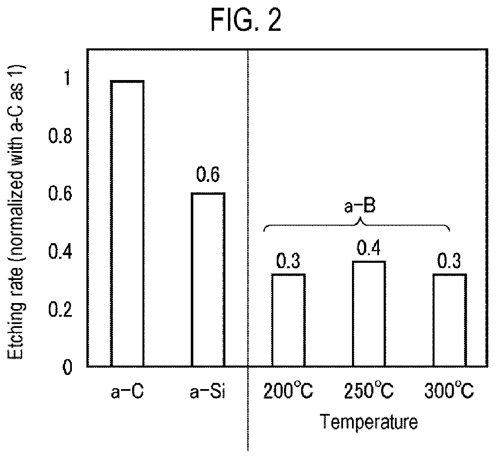
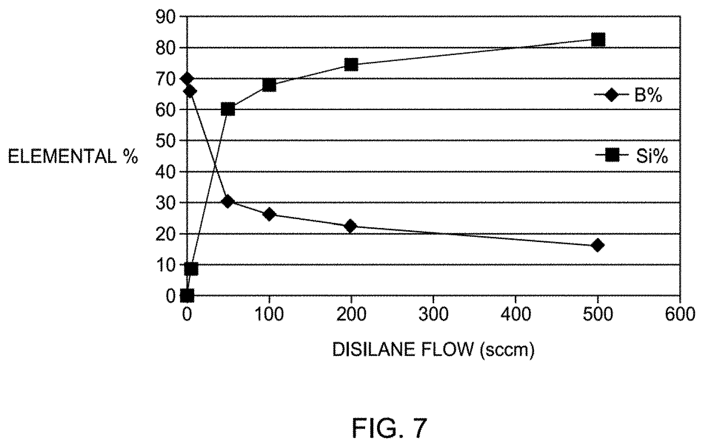
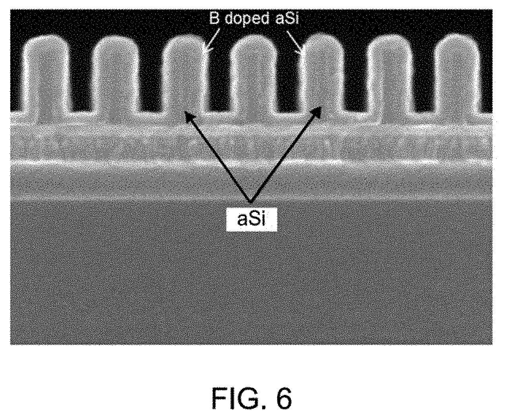
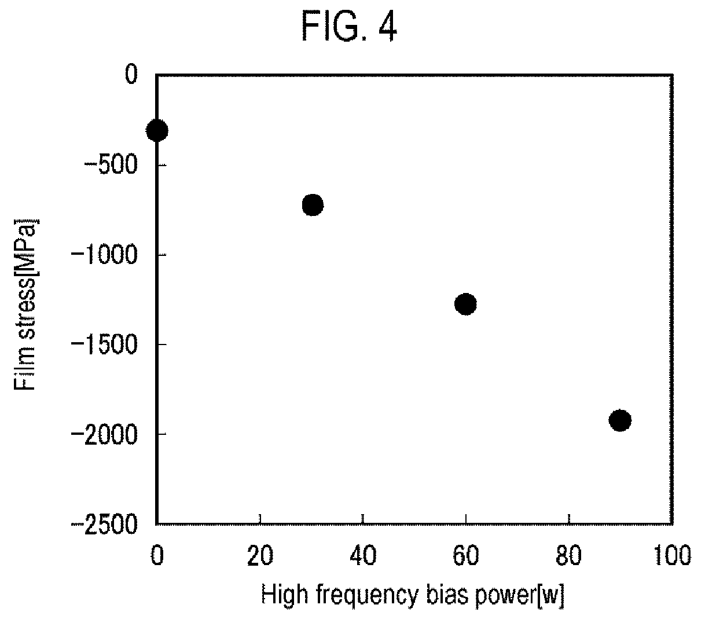
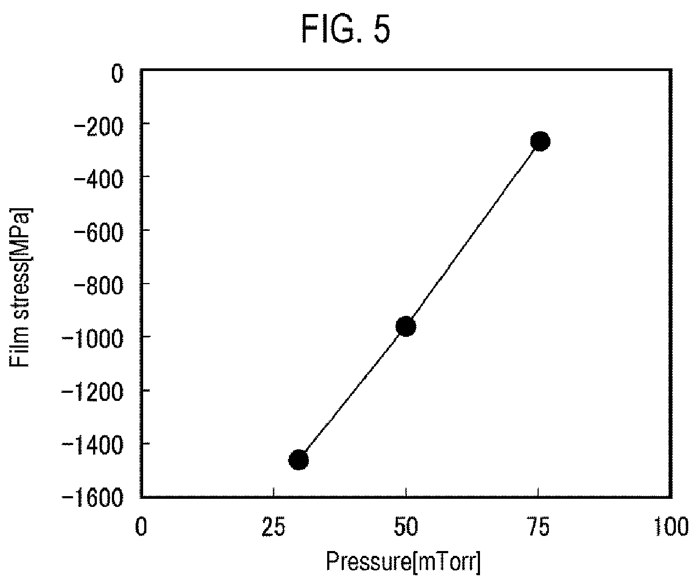
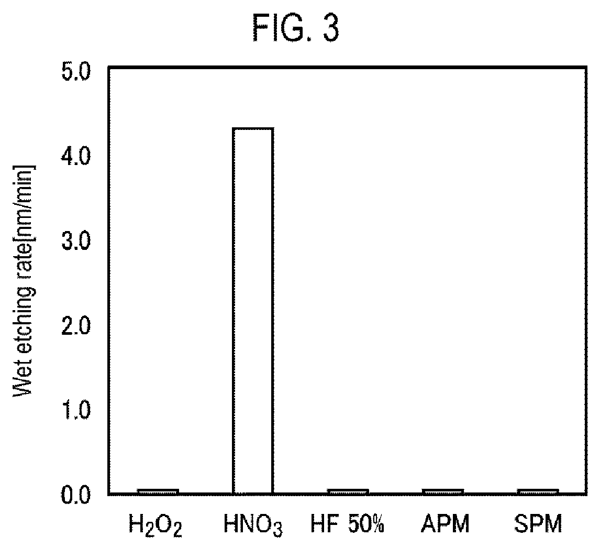

# 03-02 · SiB — Silicon Boron Hardmask 

> 근거 번호 `[S##]`는 `03-02_SiB_자료수집.md`의 ID다.
>
> **이 막질은 공개 논문이 거의 없다.** 수치는 대부분 특허 명세서의 주장이다. 근거 표시 — **[특허]** 특허의 주장·실시예(독립 검증 아님) · **[리뷰]** 교과서 수준의 정설 · **[계산]** 가정을 명시한 교육용 계산 · **[현장]** 문헌으로 못 박지 못한 현장 통념. 자기 장비에서 확인이 필요하다.

---

## 0. 요약

이 장에서는 붕소와 실리콘으로 만드는 무기 Hardmask인 SiB를 다룬다. SiB는 공개된 논문이 거의 없고 근거 대부분이 특허이므로, 이 장을 읽을 때는 각 수치가 어떤 수준의 근거인지 함께 확인해야 한다.

SiB는 붕소와 실리콘이 주성분인 비정질 무기 Hardmask다. 탄소 Hardmask(→ 03-01 ACL)로는 선택비가 모자라는 초고종횡비 식각에서 마스크를 얇게 가져가려고 쓴다. 탄소막과 달리 O₂로 태워 없앨 수 없다는 점이 가장 큰 차이다.

| 항목 | 내용 |
|---|---|
| 역할 | 고종횡비 식각용 무기 Hardmask |
| 조성 | B-rich a-B:Si:H. B/Si 비율이 핵심 설계 변수. 두께 방향으로 비율을 바꾸기도 한다 [특허 S02] |
| 증착 방식 | 열 CVD 또는 PECVD |
| 전구체 | B₂H₆(또는 다른 Borane) + SiH₄ 계 + H₂ / Ar / He |
| 온도 | B 전구체는 300 °C 이상에서 열반응 [특허 S07]. 선호 300–500 °C [특허 S09] |
| 증착 속도 | Borane 동시 공급 시 약 7,000 Å/min 실시예 [특허 S01] |
| 경도 · Modulus | a-B 경도 약 30 GPa [특허 S08]. 저온 B 계 막 Modulus 약 100 GPa [특허 S10] |
| 응력 | 높다. 조건에 따라 압축 300–1,500 MPa [특허 S08]. 200 MPa 미만 실시예도 있다 [특허 S01] |
| 선택비 | B 약 37 % 막이 산화막 식각에서 20 % 개선 [특허 S01]. B가 많을수록 하부 적층막 대비 선택비가 오른다 [특허 S03] |
| 제거 | Ash 불가. Wet 또는 할로겐 계 Dry |
| 핵심 Trade-off | B 함량(선택비) ↔ Mask Open 난이도 ↔ 응력 ↔ 제거 난이도 |

---

## 1. 용도와 필요성

SiB가 왜 필요한지는 탄소 Hardmask의 한계에서 출발하면 이해하기 쉽다. 이 절에서는 탄소 마스크가 부딪힌 한계, 붕소가 선택비를 주는 이유, 그리고 SiB가 적층 속에서 놓이는 위치와 그로 인해 생기는 딜레마를 살펴본다.

### 1.1 탄소 마스크의 한계

ACL Chapter의 두께 예산 식을 다시 보자.

$$
t_{\mathrm{mask}} \ge \frac{D}{S}\,(1 + \mathrm{OE}) + t_{\mathrm{facet}} + t_{\mathrm{remain}}
$$

식각 깊이 D가 세대마다 깊어지는데 선택비 S가 그대로면 마스크가 깊이에 비례해 두꺼워진다. 두꺼운 마스크는 그 자체가 고종횡비 구조가 되어 Mask Open이 어려워지고, 응력 × 두께로 Wafer가 휘고, 정렬광이 통과하지 못한다. 탄소막의 선택비를 올리는 수단(고온, B 도핑, 고밀도화)이 한계에 가까워지자 **탄소를 아예 빼고 붕소와 실리콘으로 마스크를 만드는** 방향이 나왔다.

### 1.2 붕소 첨가와 식각 선택비

특허들이 드는 근거는 두 가지다.

- **강한 결합.** Si–B, B–B 결합이 강해 RIE에서 잘 깎이지 않는다 [특허 S01].
- **경도.** 비정질 붕소의 경도는 약 30 GPa로 SiO₂(형성법에 따라 0.5–9 GPa)보다 훨씬 단단하다. 이온 충격에 의한 물리적 제거에 강하다 [특허 S08].

화학적으로는 붕소도 F와 반응해 휘발성 BF₃가 된다 [리뷰 S14]. 붕소 마스크가 “F에 안 깎이는 재료”라는 뜻이 아니다. 고종횡비 산화막 식각은 이온 충격과 Fluorocarbon Polymer 보호가 섞인 조건이고, 그 조건에서 단단하고 결합이 강한 막이 덜 깎인다는 뜻이다. 선택비는 ACL과 마찬가지로 **막과 식각 Chemistry가 함께 정하는 값**이다.

붕소 막의 식각 속도를 a-C, a-Si와 같은 조건에서 비교한 특허 그래프가 있다 [특허 S08]. 이 장에서 확인한 유일한 정량 비교다.

*CF 계 가스(Ar·O₂·N₂·H₂ 등 첨가) Dry Etch에서의 식각 속도. a-C를 1로 놓으면 a-Si가 0.6, 비정질 붕소(a-B)는 증착 온도 200–300 °C에서 0.3–0.4다. 같은 두께로 a-C의 2.5–3배를 버틴다는 뜻이다. Microwave Plasma CVD로 만든 붕소 막의 값이며 SiB 조성의 값은 아니다.*

*출처: US 11,145,522 (Tokyo Electron, 2021), FIG. 2. 미국 특허 도면. [Google Patents](https://patents.google.com/patent/US11145522B2/en)*

### 1.3 적층에서의 위치

탄소 마스크는 SiON을 중간 마스크로 삼아 O₂ Plasma로 뚫었다. SiB는 O₂에 안 깎이므로 그 방법을 쓸 수 없다. SiB 위에 산화막 Hardmask를 올리고, 할로겐 계 Plasma로 SiB를 뚫는다.

| 층 (위 → 아래) | 역할 | 뚫는 Chemistry |
|---|---|---|
| PR / 중간층 | 패턴 형성 | — |
| 산화막 Hardmask | SiB Open의 마스크 | F 기반 |
| **SiB** | Target 식각의 마스크 | 할로겐 계(Cl·Br·F). SiCl₄·BCl₃·SiF₄·BF₃가 모두 휘발성이다 [리뷰 S14] |
| Target (적층막 등) | — | Fluorocarbon 계 |

여기서 이 막질 특유의 딜레마가 생긴다. **B 함량을 올리면 Target 대비 선택비는 좋아지지만, SiB를 뚫을 때 위의 산화막 마스크 대비 선택비가 나빠진다.** B가 매우 높은 막은 적층막 대비 3 : 1 이상이어도 산화막 마스크 대비로는 2 : 1 이하가 된다. 그러면 산화막 마스크를 두껍게 해야 하고, 종횡비가 커지며 Local CD 균일도가 나빠진다 [특허 S03]. 잘 버티는 마스크는 뚫기도 어렵다.

> 이해 확인: B 함량이 매우 높은 SiB는 Target 대비 선택비가 좋은데도 공정 전체로 보면 불리할 수 있다. 그 이유를 Mask Open 단계의 선택비로 설명해 보자.

---

## 2. 재료의 구조와 물성

SiB의 성질은 붕소가 만드는 독특한 네트워크와, 그 안에 들어간 Si와 수소의 양에 따라 정해진다. 이 절에서는 비정질 붕소의 구조를 설명하고, 조성과 수소가 물성을 어떻게 바꾸는지 살펴본 뒤 ACL과 비교한다.

### 2.1 비정질 붕소 네트워크

붕소는 원자가 전자가 3개라 일반적인 2중심 결합만으로는 안정한 네트워크를 만들지 못한다. 그래서 B₁₂ 정이십면체 같은 다중심 결합 Cluster를 이룬다 [리뷰]. 이 구조가 붕소 계 재료의 높은 경도의 근원이다. CVD로 만든 막은 이런 Cluster가 무질서하게 이어지고, 결합 자리의 일부를 수소가 막고 있는 a-B:H다. 여기에 Si가 섞이면 Si–B 결합이 네트워크를 잇는다.

### 2.2 조성에 따른 성질

SiB의 성질은 B와 Si의 비율에 따라 크게 달라진다. 이 비율을 어떻게 고르느냐가 SiB 공정 설계의 출발점이다.

| B 함량 | 성격 | 선택비(Target 대비) | Mask Open | 비고 |
|---|---|---|---|---|
| 낮음 (B-doped a-Si) | a-Si에 가깝다. | 소폭 개선. B 37 %에서 20 % [특허 S01] | 쉽다. Si 식각과 비슷 | → 03-13 a-Si |
| 중간 | Si–B 혼합 네트워크 | 중간 | 중간 | 조성 Tuning의 주 영역 |
| 높음 (a-B에 가깝다) | 단단하고 응력이 크다. | 가장 높다 [특허 S03] | 어렵다. 산화막 마스크 대비 2 : 1 이하 [특허 S03] | Line Bending 위험 [특허 S09] |

### 2.3 수소

저온에서 증착한 붕소 계 막은 수소가 많고 Modulus가 약 100 GPa에 머문다. 온도를 400 °C 이상으로 올리면 수소가 줄고 붕소 함량이 늘어 Modulus가 올라간다는 주장이 있다 [특허 S10]. 방향은 ACL과 같다. **수소는 네트워크를 끊는 종결기**이고, 줄일수록 단단해지고 식각에 강해지며 응력이 커진다. 증착 후 Plasma·UV·Anneal로 수소를 빼면 인장 방향으로 응력이 이동한다 [특허 S07].

### 2.4 ACL과의 비교

지금까지 본 SiB의 성질을 앞 장의 ACL, 그리고 그 중간에 있는 B-doped Carbon과 나란히 놓고 비교해 보자.

| 항목 | ACL | B-doped Carbon | SiB |
|---|---|---|---|
| 주성분 | C, H | C, B, H | B, Si, H |
| 선택비(산화막 식각) | 기준 | 높다 | 더 높다 [특허 주장] |
| Mask Open | O₂ 계. SiON 마스크 | O₂ 계 + 첨가 | 할로겐 계. 산화막 마스크 |
| 제거 | O₂ Ash | 어렵다 | Ash 불가 |
| 응력 | 수십 ~ 수백 MPa | 조절 가능 | 높다 |
| 공개 자료 | 논문 다수 | 특허 중심 | 특허뿐 |

> 이해 확인: 수소를 줄이면 SiB 막의 Modulus와 응력은 각각 어느 방향으로 변하는가? ACL에서 배운 내용과 비교해 보자.

---

## 3. 전구체와 반응

SiB의 붕소 원료인 B₂H₆는 매우 불안정한 기체이다. 이 불안정성은 증착을 쉽게 만들기도 하지만 Particle 문제를 일으키기도 한다. 이 절에서는 B₂H₆가 분해되는 과정, Si 원료와 함께 넣었을 때의 상승 효과, 그리고 열 CVD와 PECVD의 차이를 설명한다.

### 3.1 B₂H₆의 분해

B₂H₆는 반도체 가스 중 열적으로 가장 불안정한 축에 든다 [리뷰 S12].

$$
\mathrm{B_2H_6} \rightleftharpoons 2\,\mathrm{BH_3} \qquad (\text{시작 단계})
\mathrm{BH_3} + \text{표면} \rightarrow \mathrm{B(s)} + \tfrac{3}{2}\,\mathrm{H_2} \qquad (\text{막 형성})
\mathrm{BH_3} + \mathrm{B_2H_6} \rightarrow \mathrm{B_3H_9} \rightarrow \mathrm{B_4H_{10}},\ \mathrm{B_5H_9} \ldots \mathrm{B_{10}H_{14}} \qquad (\text{기상 중합})
$$

- BH₃는 매우 반응성이 커서 표면에 닿는 대로 붙는다. 300 °C 이상에서 열반응만으로 막이 자란다 [특허 S07].
- 기상에서 BH₃가 B₂H₆와 만나면 고차 Borane으로 자란다. 이것이 **Particle과 배관 고형물의 근원**이다.
- H₂는 분해의 생성물이므로, H₂로 희석하면 기상 분해가 억제된다. B₂H₆를 H₂ Balance로 공급하고 Carrier로 H₂를 쓰는 이유다.

### 3.2 Si·B 동시 공급의 효과

SiH₄ 계 CVD에 B₂H₆를 넣으면 증착 속도가 크게 오른다. 표면의 붕소가 수소 탈착을 쉽게 만들어 성장 자리를 빨리 비워 주기 때문이다 [리뷰 S13]. Disilane 500 sccm만으로 약 20 Å/min이던 증착 속도가 Borane(DMAB)을 함께 넣자 약 7,000 Å/min으로 350배 올랐다는 실시예는 이 효과를 Hardmask·Spacer 증착에 쓴 것이다 [특허 S01]. 두꺼운 Hardmask에는 높은 증착 속도가 곧 생산성이므로, SiB에서 붕소는 물성 성분이자 **증착 촉진제**다.

같은 특허의 그림 두 장이다 [특허 S01].

*Disilane 유량과 막의 붕소 농도. Disilane 0 sccm에서 B 약 70 %, 50 sccm에서 30 %, 100 sccm에서 26 %, 200 sccm에서 22 %, 500 sccm에서 16 %다(그래프에서 읽은 값). 붕소 전구체와 Si 전구체의 유량비로 조성을 넓게 움직일 수 있다.*

*출처: US 10,410,872 (Applied Materials, 2019), FIG. 7. 미국 특허 도면. [Google Patents](https://patents.google.com/patent/US10410872B2/en)*

*a-Si Mandrel 위에 올린 B-doped a-Si의 단면 SEM. 특허는 단차 피복 90 % 초과, 패턴 Loading 10 % 미만이라고 적었다. Spacer로 쓰는 예다.*

*출처: US 10,410,872 (Applied Materials, 2019), FIG. 6. 미국 특허 도면. [Google Patents](https://patents.google.com/patent/US10410872B2/en)*

### 3.3 열 CVD와 PECVD

SiB는 열 CVD와 PECVD 두 방식으로 모두 증착할 수 있으며, 각각의 장단점은 다음과 같다.

| 방식 | 장점 | 단점 |
|---|---|---|
| 열 CVD | 단차 피복이 좋다. 이온 손상이 없다. | 온도로만 수소를 뺀다. 기상 분해 관리가 까다롭다. |
| PECVD | 저온에서 수소를 줄이고 치밀화할 수 있다. 응력을 압력·Bias로 조절한다. | 응력이 크게 변한다. 30 mTorr에서 약 1,500 MPa 압축 [특허 S08] |

> 이해 확인: B₂H₆를 쓰는 공정에서 배관과 Chamber에 고형물이 쌓이는 이유를 기상 반응으로 설명하고, H₂ 희석이 이를 어떻게 줄이는지 말해 보자.

---

## 4. 공정 윈도우와 공정 변수별 응답

이 절에서는 공개된 조건의 범위와 각 조절 변수가 막을 어떻게 바꾸는지 정리한다. 실측 논문이 거의 없으므로 특허의 서술과 일반 원리를 함께 쓰며, 응력을 조절하는 조절 변수와 두께 방향으로 조성을 바꾸는 방법을 특히 자세히 본다.

### 4.1 공개 조건 범위

아래 표는 Recipe가 아니라 특허에 공개된 조건의 범위이다.

| 항목 | 범위 | 출처 |
|---|---|---|
| 온도 | 100–1,000 °C, 선호 300–500 °C | [특허 S09] |
| 열반응 시작 | 300 °C 이상 | [특허 S07] |
| 증착 속도 | 약 7,000 Å/min (Borane 동시 공급) | [특허 S01] |
| 응력 | 75 mTorr 약 −300 MPa ↔ 30 mTorr 약 −1,500 MPa (Plasma CVD) | [특허 S08] |

### 4.2 공정 변수별 응답

특허 서술과 일반 원리를 합친 경향이다 [특허·현장]. 실측 논문이 없으므로 방향만 참고하고 자기 장비의 DOE로 확인한다.

| 조절 변수 ↑ | B 함량 | DR | 수소 | 응력 | 선택비 | 주의점 |
|---|---|---|---|---|---|---|
| B₂H₆ / SiH₄ 비 | ↑ | ↑ | — | ↑ | ↑ | Mask Open 선택비 ↓ [S03]. Particle ↑ |
| 온도 | ↑ [S10] | ↑ (열 CVD) | ↓ | ↑ [S10] | ↑ | 기상 분해 ↑. 균일도가 온도 분포를 따른다. |
| 압력 (PECVD) | — | ↑ | ↑ | 압축 ↓ [S08] | ↓ | 기상 중합·Particle ↑ |
| H₂ 희석 | — | ↓ | 복합 | — | — | 기상 분해 억제. Particle ↓ |
| RF · Bias | — | — | ↓ | 압축 ↑ | ↑ | Line Bending 여유를 깎는다. |
| 증착 후 수소 제거 처리 | — | — | ↓ | 인장 방향 [S07] | ↑ | 압축 응력 상쇄에 쓸 수 있다. |

Si 전구체의 종류(분자량)가 패턴 거칠기(LER/LWR)에 영향을 준다는 특허 주장도 있다 [특허 S06, 미재확인].

응력 조절 변수는 특허에 그래프로 공개돼 있다 [특허 S08]. Microwave Plasma CVD, 300 °C, B₂H₆(10 %, He·Ar 희석) 500 sccm, 수십 mTorr 조건이다. 수 Torr에서 도는 용량 결합 PECVD와는 압력 영역이 다르므로 방향만 가져온다.

*기판 Bias(고주파) Power와 막 응력. 음수가 압축이다. 0 W에서 약 −300 MPa, 30 W에서 −730, 60 W에서 −1,280, 90 W에서 −1,930 MPa다(그래프에서 읽은 값). 압력 50 mTorr 조건이다. 특허는 Bias Power를 응력을 정하는 가장 중요한 변수로 꼽는다.*

*출처: US 11,145,522 (Tokyo Electron, 2021), FIG. 4. 미국 특허 도면. [Google Patents](https://patents.google.com/patent/US11145522B2/en)*

*압력과 막 응력. 30 mTorr에서 약 −1,460 MPa, 50 mTorr에서 −960, 75 mTorr에서 −270 MPa다(그래프에서 읽은 값). 압력을 올리면 압축이 줄어든다.*

*출처: US 11,145,522 (Tokyo Electron, 2021), FIG. 5. 미국 특허 도면. [Google Patents](https://patents.google.com/patent/US11145522B2/en)*

두 그래프의 50 mTorr 값이 서로 다르다(−300 MPa와 −960 MPa). 특허 본문에서 조건 차이를 확인하지 못했다. 절대값이 아니라 기울기만 읽는다.

### 4.3 두께 방향 조성 구배

한 가지 조성으로는 §1.3의 딜레마를 풀 수 없다. 그래서 두께 방향으로 B/Si 비율을 바꾼다 [특허 S02].

| 위치 | 조성 방향 | 이유 |
|---|---|---|
| 하부 (Target에 가까운 쪽) | Etch Stop 대비 선택비 5 : 1 이상이 되도록 | 식각 말기까지 남아 Target을 지키는 부분 |
| 상부 (먼저 뚫리는 쪽) | 선택비를 낮게 | Mask Open을 쉽게 하고 산화막 마스크 부담을 줄인다. |

CVD 엔지니어에게 이것은 **증착 중 유량 비를 시간에 따라 Ramp하는 Recipe**와 **깊이 방향 조성 Profile의 계측**(SIMS)을 뜻한다.

> 이해 확인: Bias Power를 올려 막을 치밀하게 만들면 응력은 어떻게 변하는가? 응력을 줄이려면 어떤 조절 변수를 쓸 수 있는가?

---

## 5. 두께와 Bow 예산 [계산]

마스크를 바꿀 때는 선택비만 볼 것이 아니라, 그 결과로 Wafer가 얼마나 휘는지도 계산해야 한다. 이 절에서는 같은 식각 깊이에 대해 ACL과 SiB의 필요 두께와 Bow를 비교한다.

아래 숫자는 계산 방법을 익히기 위한 가상의 예이다. 조건은 깊이 4,000 nm, Overetch 10 %, Facet 150 nm, 잔막 200 nm.

| 마스크 | 가정 선택비 | 필요 두께 | 가정 응력 | 응력 × 두께 | 300 mm Bow |
|---|---|---|---|---|---|
| ACL | 4 | 1,450 nm | −100 MPa | 145 N/m | 약 90 µm |
| SiB | 8 | 900 nm | −300 MPa | 270 N/m | 약 170 µm |
| SiB | 12 | 720 nm | −300 MPa | 216 N/m | 약 135 µm |

$$
\mathrm{Bow} = \frac{d^2}{8R},\qquad \frac{1}{R} = \frac{6\,\sigma t_f}{M t_s^2}
M = 180.5\ \mathrm{GPa},\quad t_s = 775\ \mathrm{µm},\quad d = 300\ \mathrm{mm}
\rightarrow\ \mathrm{Bow}\,[\mathrm{µm}] \approx 0.623 \times (\sigma \times t_f)\,[\mathrm{N/m}]
$$

선택비가 두 배가 되어 마스크가 얇아져도 응력이 세 배면 Bow는 오히려 커진다. **SiB의 이득은 선택비만으로 계산되지 않는다. 응력을 같이 봐야 한다.** 특허들이 응력 저감(200 MPa 미만 [S01], 후처리로 인장 상쇄 [S07])을 따로 다루는 이유다.

> 이해 확인: 응력 −200 MPa, 두께 1,450 nm인 ACL을 SiB로 바꾸어 두께를 절반으로 줄이려 한다. Bow를 ACL 이하로 유지하려면 SiB의 응력은 얼마 이하여야 하는가?

---

## 6. 집적 이슈와 불량 모드

SiB를 실제 공정에 넣으면 막 자체의 성질 외에도 여러 문제가 생긴다. 이 절에서는 응력, Mask Open, 제거, 대기 노출, 붕소 오염의 다섯 가지 문제를 차례로 살펴본다.

### 6.1 응력과 Line Bending

비정질 붕소는 응력이 높아 Line Bending과 소자 손상을 일으키기 쉽다 [특허 S09]. Hole 패턴에서는 Hole 간 벽이 기울고(Tilting) Wafer 전체가 휜다. 대응은 압력을 올려 압축을 줄이거나 [S08], Si 비율을 올리거나, 증착 후 수소 제거 처리로 인장 성분을 더해 상쇄하는 것이다 [S07].

### 6.2 Mask Open

§1.3에서 본 대로 B가 많을수록 산화막 마스크 대비 선택비가 떨어진다 [특허 S03]. 조성 구배(§4.3)가 한 가지 답이다. Mask Open 식각 중 Profile이 깊이마다 달라지지 않으려면 **깊이 방향 조성이 의도대로 재현**돼야 한다. 증착 초기의 과도 상태(가스 안정화, 온도 Overshoot)에서 조성이 흔들리면 Mask Open 바닥에서 Profile 이상이 생긴다 [현장].

### 6.3 제거

ACL은 다 쓴 뒤 O₂ Ash로 태워 없앨 수 있었지만, SiB는 그렇지 않다. O₂ Plasma 속에서 붕소는 산화물 B₂O₃가 되는데, 이 산화물은 휘발하지 않고 표면에 남기 때문이다 [리뷰]. 그래서 다른 제거 방법이 필요하며, 쓸 수 있는 방법은 크게 둘이다 [현장].

| 방법 | 원리 | 문제 |
|---|---|---|
| Wet | 질산(HNO₃)에 녹는다. H₂O₂, HF 50 %, APM, SPM에는 거의 녹지 않는다 [특허 S08]. | Si 비율이 높으면 느려진다 [현장]. 고종횡비 구조에서 약액 침투와 건조 중 패턴 쓰러짐 |
| Dry (할로겐 계) | BF₃·BCl₃·SiF₄·SiCl₄로 휘발 | 방금 식각한 Target(SiO₂·SiN)과 하부 Si도 같은 가스에 깎인다. 선택비 확보가 어렵다. |

제거 난이도는 SiB 조성을 정하는 사양 항목이다. 선택비만 보고 B를 올리면 제거 공정에서 막힌다. Wet 식각 속도는 아래 특허 그래프가 이 장에서 확인한 유일한 공개 수치다. Dry 제거의 선택비를 다룬 자료는 찾지 못했다.

*Plasma CVD 붕소 막의 약액별 Wet 식각 속도. 질산(HNO₃)에서만 약 4.3 nm/min이고 H₂O₂, HF 50 %, APM, SPM에서는 0에 가깝다. SiO₂·SiN을 깎는 약액에 버틴다는 뜻이고, 동시에 제거에 쓸 수 있는 약액이 좁다는 뜻이다.*

*출처: US 11,145,522 (Tokyo Electron, 2021), FIG. 3. 미국 특허 도면. [Google Patents](https://patents.google.com/patent/US11145522B2/en)*

이 원고의 첫 판은 “붕소는 산화성 약액에 녹는다”고 적었다. 그림과 맞지 않아 고쳤다. H₂O₂와 SPM도 산화성 약액이지만 이 막을 깎지 못한다. 순수 붕소 막의 결과이므로 Si가 섞인 SiB에서는 다시 확인해야 한다.

### 6.4 대기 노출과 붕산

붕소가 많은 표면은 대기 중 수분과 반응해 붕산(H₃BO₃)을 만든다 [리뷰]. BPSG·BSG에서 잘 알려진 표면 결정 Defect와 같은 화학이다(→ 03-06, 03-07). 증착 후 다음 공정까지의 Q-time을 관리하고, 필요하면 표면을 Cap한다 [현장].

### 6.5 붕소 오염

붕소는 Si의 p형 도펀트다. 마스크 제거가 불완전해 붕소가 남거나, 장비 안의 붕소가 다른 Wafer로 옮겨 가면 전기적 문제가 된다. 붕소 공정 장비는 다른 막질과 Chamber를 공유하기 어렵다 [현장].

> 이해 확인: SiB를 HNO₃ 외의 약액으로 제거하기 어렵다는 사실은 공정 설계에서 어떤 제약이 되는가?

---

## 7. 챔버 · 하드웨어 관리

SiB 공정의 반복성은 원료 공급과 Chamber 관리에 크게 좌우된다. 특히 B₂H₆는 불안정하고 독성이 강해 공급, 배기, 안전 관리에 주의해야 한다. 아래 표는 Chamber와 하드웨어 관리의 주요 항목을 정리한 것이다.

| 항목 | 내용 | 근거 |
|---|---|---|
| Clean | NF₃ 계 F 라디칼. BF₃와 SiF₄가 모두 휘발성이라 원리적으로 잘 닦인다. | [리뷰 S14] |
| Memory Effect | Clean 후에도 벽·배관에 흡착된 붕소가 남아 다음 막에 들어간다. Seasoning으로 덮는다. | [현장] |
| B₂H₆ 공급 | 용기 안에서도 서서히 분해한다. H₂ Balance 희석 가스로 공급하고, **농도가 용기 수명에 따라 변한다.** 유량이 같아도 실제 B 공급량이 Drift한다. | [리뷰 S12] |
| 가스 라인 | 가열된 Showerhead 안에서 분해하면 Hole이 막히고 Particle이 된다. Showerhead 온도를 분해 온도 아래로 관리하거나 B₂H₆와 Si 전구체를 분리 공급한다. | [현장] |
| 배기 | 미반응 B₂H₆와 고차 Borane 고형물. 고차 Borane은 독성이 크고 일부는 충격에 민감하다. PM 때 개방 전 충분한 Purge가 필요하다. | [리뷰 S12] |
| 안전 | B₂H₆는 자연발화성, 허용 농도 0.1 ppm 수준 | [리뷰 S14] |

B₂H₆ 농도 Drift는 이 막질 반복성의 가장 흔한 원인이다. **조성이 곧 선택비와 응력**이므로, 두께만 맞고 조성이 틀어진 Wafer는 Inline 두께 계측을 통과하고 식각에서 실패한다.

> 이해 확인: 두께만 맞고 조성이 틀어진 Wafer가 Inline 계측을 통과하는 이유는 무엇이며, 이를 막으려면 무엇을 Monitor해야 하는가?

---

## 8. 계측과 해석

SiB는 조성이 곧 선택비와 응력을 정하므로, 두께뿐 아니라 조성을 측정하는 것이 중요하다. 아래 표는 각 계측이 무엇을 알려 주고 어떤 함정이 있는지 정리한 것이다.

| 계측 | 얻는 것 | 읽는 법과 함정 |
|---|---|---|
| Spectroscopic Ellipsometry | 두께, n, k | 조성이 바뀌면 n, k가 같이 변한다. n을 조성의 빠른 대리 지표로 쓸 수 있다. 조성 구배가 있으면 단일층 Model이 맞지 않는다. |
| XPS · SIMS | B/Si 조성, 깊이 Profile | SIMS는 구배 확인에 필수. XPS는 표면 산화층의 영향을 받는다. |
| ERD / HFS | 수소 at% | 경도·응력 해석의 기준 |
| FTIR | B–H(약 2,500 cm⁻¹), Si–H(약 2,100 cm⁻¹) | 수소가 어느 쪽에 붙어 있는지 상대 비교 |
| Nanoindentation | 경도, Modulus | 압입 깊이는 두께의 10 % 이내 |
| Wafer Bow | 응력 | §5. 시간에 따른 변화(대기 중 흡습)를 같이 본다. |
| Blanket Etch Rate | 식각 내성 | Target 막, 상부 산화막 마스크와 같은 조건에서 **두 가지 선택비**를 모두 본다. |

양산 Monitor에서 두께와 함께 반드시 조성 지표(n 또는 XRF/XPS)를 넣는다.

> 이해 확인: 같은 두께의 SiB 두 장의 식각 결과가 다르다. 계측 표에서 어떤 항목을 비교해 원인을 좁힐 수 있는가?

---

## 9. 파생 막과 차세대 기술

SiB 다음 세대로는 선택비를 더 높이기 위한 몇 가지 방향이 특허로 제안되어 있다.

- **Metal-doped Boron.** 붕소 막에 금속을 넣어 SiO·SiN 대비 선택비를 더 올린다. 금속이 경도를 낮출 수 있다는 점이 함께 언급된다 [특허 S04]. 금속이 들어간 붕소 막 대비 Si 함유막을 선택적으로 식각하는 공정도 별도로 출원돼 있다 [특허 S05].
- **Boron–Carbon.** 탄소 쪽에서 붕소를 늘려 온 계열(→ 03-01 §9)과 만난다. 탄소가 남아 있으면 제거가 조금 쉬워지고, 없애면 선택비가 오른다.

방향은 하나다. **선택비를 위해 제거 용이성을 조금씩 내주는 연속선** 위에 ACL → B-doped Carbon → SiB → Metal-doped Boron이 놓인다.

> 이해 확인: ACL → B-doped Carbon → SiB → Metal-doped Boron으로 갈수록 무엇을 얻고 무엇을 잃는가?

---

## 10. Troubleshooting

아래 표는 SiB 공정에서 흔히 나타나는 증상과 유력한 원인, 확인할 데이터, 조치 방향을 정리한 것이다. 표의 원인은 현장 경험에서 나온 출발점이므로 [현장], “확인할 데이터” 열로 가설을 좁힌 뒤에 조치해야 한다.

| 증상 | 유력 원인 | 확인할 데이터 | 조치 방향 |
|---|---|---|---|
| 두께는 정상인데 식각 선택비가 변동 | B₂H₆ 농도 Drift로 조성 변화 | n, XPS/XRF 조성, 용기 사용 기간과의 상관 | 조성 Monitor 추가, 용기 교체 기준, 농도 보정 |
| In-film Particle 증가 | 기상 중합, Showerhead 내 분해 | 입자 성분(B-rich), Showerhead 온도, 압력 | H₂ 희석 증가, 압력·체류시간 감소, Showerhead 온도 관리 |
| Wafer Bow 과다, Chucking Error | 압축 응력 과다 | Bow, 압력·RF 이력 | 압력 상향, 조성 조정, 후처리로 인장 상쇄 |
| 식각 후 Line Bending · Hole Tilting | 응력, 마스크 종횡비 과다 | 응력, 마스크 두께, Top-down SEM | 응력 저감, 선택비 개선으로 두께 축소 |
| Mask Open 바닥 Profile 이상 | 증착 초기 과도 구간의 조성 이탈 | SIMS 깊이 Profile | 가스 안정화 Step, Ramp Recipe 조정 |
| 대기 노출 후 표면 결정 Defect | 붕산 생성 | Q-time과 Defect 수의 상관, 성분 분석 | Q-time 단축, Cap |
| 제거 후 잔류물 | 조성이 설계보다 Si-rich 또는 B-rich | 잔류물 성분, 조성 이력 | 조성 복귀, 제거 조건 협의 |
| 후속 막에 붕소 혼입 | Memory Effect | SIMS | Clean·Seasoning 강화, Chamber 전용화 |

> 이해 확인: 증착 직후에는 정상이던 SiB Wafer에서 하루 뒤 표면 Defect가 늘었다. 어떤 반응을 의심해야 하며, 어떻게 막을 수 있는가?

---

## 11. 자가 점검

이 장의 핵심 내용을 질문으로 확인해 보자. 각 질문을 먼저 스스로 풀어 본 뒤 답을 펼쳐 비교한다.

**Q1. SiB를 ACL처럼 SiON 마스크와 O₂ Plasma로 뚫을 수 없는 이유는?**
SiB는 무기막이라 O₂에 휘발하지 않는다. 붕소와 실리콘의 산화물이 표면에 남는다. 할로겐 계 Plasma로 뚫어야 하고, 그 마스크로 산화막 Hardmask가 필요하다.

**Q2. B 함량을 올리면 생기는 이득과 손해를 하나씩 들라.**
이득은 Target 적층막 대비 선택비 상승이다. 손해는 SiB를 뚫을 때 상부 산화막 마스크 대비 선택비가 떨어지는 것이다(2 : 1 이하). 산화막 마스크가 두꺼워져 종횡비와 Local CDU가 나빠진다.

**Q3. 선택비가 ACL의 두 배인 SiB로 바꿨는데 Wafer Bow가 더 커졌다. 왜인가?**
Bow는 응력 × 두께에 비례한다. 두께는 절반 가까이 줄었지만 응력이 두 배 넘게 커지면 곱이 커진다.

**Q4. B₂H₆를 H₂로 희석해 공급하는 이유 두 가지는?**
H₂가 분해 반응의 생성물이라 용기와 기상에서의 분해를 억제한다. 그리고 농도를 낮춰 자연발화·독성 위험을 줄인다.

**Q5. 두께와 균일도는 정상인데 식각에서만 Lot 간 변동이 난다. 가장 먼저 볼 것은?**
조성이다. B₂H₆ 농도가 용기 수명에 따라 변하면 두께는 맞아도 B/Si 비가 달라진다. n이나 XPS/XRF로 조성을 확인한다.

**Q6. SiB 증착에 붕소를 넣으면 증착 속도가 오르는 이유는?**
표면의 붕소가 수소 탈착을 촉진해 성장 자리를 빨리 비운다. SiH₄ 계 증착에서 B₂H₆가 속도를 올리는 것과 같은 효과다.

---

## 12. 참고문헌

전체 서지, 링크, 확인 수준은 `03-02_SiB_자료수집.md`에 있다.

- [S01] US 10,410,872 — B-doped a-Si Hardmask, 선택비·DR·응력 실시예
- [S02] US 11,961,739 · US 12,205,818 — B/Si 조성 구배
- [S03] Boron Hardmask 특허군 — B 함량과 두 가지 선택비의 Trade-off
- [S04] US 12,707,911 — Metal-doped Boron
- [S07] US 7,704,816 — 300 °C 이상 열반응, 수소 제거 후처리
- [S08] US 11,145,522 — a-B 경도, 압력에 따른 응력
- [S10] US 10,418,243 — 온도와 Modulus
