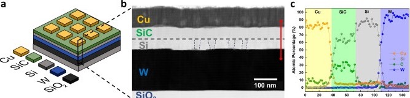
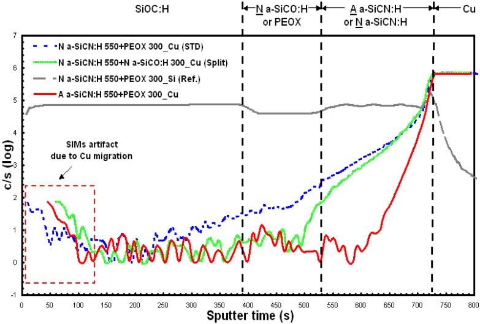

# 03-03 · SiC / SiCH 

> 근거 번호 `[S##]`는 `03-03_SiC_SiCH_자료수집.md`의 ID다. 논문은 초록 수준까지만 확인했다.
>
> 근거 표시 — **[논문]** 동료심사 논문에 보고된 값 · **[특허]** 특허의 주장·실시예 · **[리뷰]** 교과서 수준의 정설 · **[계산]** 가정을 명시한 교육용 계산 · **[현장]** 문헌으로 못 박지 못한 현장 통념. 자기 장비에서 확인이 필요하다.

---

## 0. 요약

여기서 다루는 SiC는 결정질 SiC(전력 반도체 기판)가 아니다. PECVD로 400 °C 이하에서 증착하는 **수소화 비정질 SiC(a-SiC:H, SiCH)** 다. 주 용도는 Cu 배선 위를 덮는 **Cap 층**이며, Cu 확산 Barrier와 Via 식각의 Etch Stop을 겸한다. k가 약 7인 SiN을 대체해 배선 간 유효 유전율을 낮추려고 도입됐다.

| 항목 | 내용 |
|---|---|
| 화학식 | a-SiC:H, 일반식 SiₓCᵧ:H. Si : C = 1 : 1인 결정 SiC와 달리 Si/C 비와 수소량이 원료와 조건에 따라 변한다. Si–C 골격에 Si–CH₃·Si–H·C–H가 결합 끝으로 남는다(§2.1) |
| 역할 | Cu Cap, Cu 확산 Barrier, Etch Stop, 수분 차단 |
| 증착 방식 | PECVD (CCP), BEOL 열 예산 내(400 °C 이하) |
| 전구체 | 3MS (CH₃)₃SiH · 4MS (CH₃)₄Si + He. 변형: + NH₃(SiCN) · + CO₂(SiCO) · + C₂H₄ |
| 유전율 | SiN 약 7.2 [논문 S05]. a-SiC:H 계 약 4–5 [현장]. 설계 전구체 SiCH로 3.1 [논문 S02] |
| 두께 | 수 nm ~ 수십 nm [현장] |
| 핵심 Trade-off | 낮은 k(성긴 막) ↔ Barrier·기밀성(치밀한 막) [논문 S01] |
| 변형막과의 관계 | N 첨가 → SiCN(→ 03-12). O 첨가 → SiCO. Low-k 본체는 SiCOH(→ 03-10) |

---

## 1. 용도와 필요성

SiC 계 Cap이 왜 필요한지 이해하려면 Cu 배선이 어떻게 만들어지는지부터 보아야 한다. 이 절에서는 Cu 배선의 윗면이 왜 보호되지 않는지, 이 자리를 덮던 SiN이 왜 SiC 계 막으로 바뀌었는지, 그리고 SiC 계 막에는 어떤 종류가 있는지 살펴본다.

### 1.1 Cu 배선 윗면의 확산 방지

Cu Damascene 배선은 Trench의 옆면과 바닥을 TaN/Ta 금속 Barrier가 감싼다. 그러나 CMP로 평탄화한 **윗면에는 금속 Barrier가 없다.** Cu는 SiO₂와 Low-k 속으로 쉽게 확산해 누설과 절연 파괴를 일으키므로, 윗면을 유전체로 덮어 막아야 한다. 이 유전체 Cap이 하는 일은 네 가지다 [리뷰 S10, 특허 S08].

| 기능 | 요구 |
|---|---|
| Cu 확산 Barrier | 열과 전계 아래에서 Cu⁺가 통과하지 못할 것 |
| Etch Stop | 위층 Via 식각이 여기서 멈출 것. Low-k(SiCOH) 대비 식각 선택비 |
| 기밀성 | 수분과 산소가 Cu에 닿지 못할 것 |
| 접착 | Cu와의 계면이 강할 것. 이 계면이 Electromigration 수명을 정한다. |

### 1.2 SiN에서 SiC 계 막으로의 전환

원래 이 자리에는 PECVD SiN을 썼다. Barrier로는 훌륭하지만 k가 약 7이다. 배선 간 절연막을 Low-k(k 2.5–3.0)로 바꿔도 Cap이 SiN이면 유효 유전율이 올라간다. 그래서 k가 4–5인 a-SiC:H 계로 바꿨다. 이득은 §5에서 계산한다.

### 1.3 SiC 계 막의 종류

| 막 | 만드는 법 | 성격 | 주 용도 |
|---|---|---|---|
| SiC:H (N-free) | 3MS/4MS + He | k가 낮다. Resist Poisoning이 없다. Barrier는 상대적으로 약하다. | Low-k 위·아래의 Etch Stop, 이중층의 상부 |
| SiCN:H | + NH₃ | 치밀하고 Barrier·접착이 좋다. k가 조금 높다. Amine 문제가 있다. | Cu 바로 위 Cap (→ 03-12) |
| SiCO:H | + CO₂ 등 | k가 더 낮고 누설이 작다. 산화성 Plasma라 Cu 위에 직접 올리지 못한다. | 이중층의 상부 [논문 S03] |

실제 Cap은 **Cu 위에 얇은 SiCN, 그 위에 SiC 또는 SiCO**를 올린 이중층인 경우가 많다 [논문 S03, 현장]. Cu 계면에는 접착과 Barrier를, 그 위에는 낮은 k와 N-free를 배치하는 것이다.

> 이해 확인: Cu 배선의 옆면과 바닥에는 금속 Barrier가 있는데 윗면에만 유전체 Cap이 필요한 이유는 무엇인가?

---

## 2. 재료의 구조와 물성

a-SiC:H 막의 성질은 Si–C 골격과 그 골격을 끝내는 메틸기와 수소의 양으로 정해진다. 이 절에서는 막의 네트워크 구조를 설명하고, 왜 낮은 k와 강한 Barrier가 서로 반대 방향으로 움직이는지, 그리고 이 Trade-off를 넘어서려는 연구를 살펴본다.

### 2.1 네트워크

a-SiC:H는 Si–C 결합이 골격을 이루고, 메틸기(Si–CH₃)와 수소(Si–H, C–H)가 결합을 끝내는 구조다. 3MS 한 분자에는 메틸기가 3개, 4MS에는 4개 있다. Plasma가 이 메틸기를 얼마나 떼어내고 골격으로 바꾸느냐가 막질을 정한다.

| 구조 요소 | 많으면 |
|---|---|
| Si–C 골격 결합 | 치밀하다. Barrier·경도가 좋다. k가 오른다. |
| Si–CH₃ 종결기 | 성기다. k가 낮다. Barrier가 약하다. |
| Si–H | 누설 경로, 열적 불안정 |
| Si–C₂H₄–Si 가교 | 성기지 않으면서 k가 낮다 [논문 S01]. |

이런 막은 결정이 아니라 비정질이다. TEM으로 보면 격자 무늬 없이 고른 회색으로 보인다. 아래는 배선층(BEOL)에 PECVD a-SiC를 넣은 소자의 단면이다 [논문 S14].

*(a) W 하부 전극 위에 PECVD로 Si와 a-SiC를 올리고(두 층 합 100 nm, SiH₄ + CH₄) Cu 전극을 얹은 소자의 구조. (b) 단면 TEM. SiC 층은 비정질이라 결정립 없이 고르다. 그 아래 Si 층에는 나노 크기 결정립 경계(점선)가 보인다. (c) 깊이 방향 EDX 분포. Cu → SiC → Si → W 순서로 조성이 바뀐다. Memristor(저항 변화 메모리) 연구의 시편이라 Cu Cap용 막과 조성·두께가 다르다. 비정질 SiC 막이 TEM에서 어떻게 보이는지를 보여 주는 예이다.*

*출처: Kapur 등, Sci. Rep. 14, 14008 (2024), Figure 1(a)–(c). CC BY 4.0. [PMC](https://pmc.ncbi.nlm.nih.gov/articles/PMC11189404/)*

### 2.2 k와 Barrier의 Trade-off

k를 낮추는 가장 쉬운 길은 종결기를 남겨 막을 성기게 만드는 것이다. 그러나 성긴 막은 Cu와 수분이 지나간다. **낮은 k와 강한 Barrier는 서로 반대 방향이다** [논문 S01]. Cap 막 개발은 이 Trade-off 곡선 자체를 옮기는 일이다.

Shimizu 등은 이 문제를 구조 설계로 풀었다. 양자화학 계산으로 Si–C₂H₄–Si 가교가 공극을 늘리지 않으면서 분극률을 낮춘다는 것을 예측하고, 그 가교가 막에 남도록 전구체 4종을 설계했다. 양전자 소멸 분광으로 공극이 작음을 확인했다 [논문 S01]. 이 계열로 Cu 확산을 억제하면서 k 3.1을 얻었다는 보고가 있다 [논문 S02].

다른 접근으로, CH₄/SiH₄ 기반 a-SiC:H에서 SiH₄ 유량을 최소로 했을 때 k 3.6까지 내려갔다는 보고가 있다 [논문 S05].

### 2.3 대표 값

| 막 | k | 비고 |
|---|---|---|
| PECVD SiN | 약 7.2 | [논문 S05] |
| SiCN:H | 약 5 안팎 | [현장] |
| SiC:H | 약 4–5 | [현장] |
| SiCO:H | 약 4 안팎 | [현장] |
| 설계 전구체 SiCH | 3.1 | [논문 S02] |

표에서 [현장]으로 표시한 값은 현장에서 통용되는 범위이다. 같은 시편에서 k와 Barrier 성능을 함께 측정한 수치표는 확보하지 못했다.

> 이해 확인: Si–CH₃를 더 많이 남기도록 조건을 바꾸었더니 k는 낮아졌지만 Cu 확산이 늘었다. 그 이유를 막의 구조로 설명해 보자.

---

## 3. 전구체와 반응

a-SiC:H는 메틸기를 가진 유기실란 원료로 만든다. 원료 분자의 구조와 Plasma 속에서 어떤 결합이 먼저 끊어지는지가 막의 구조를 정한다. 이 절에서는 대표 원료인 3MS와 4MS를 비교하고, Plasma 속 반응과 첨가 가스의 역할을 설명한다.

### 3.1 3MS와 4MS

| 전구체 | 구조 | 끓는점 | 특징 |
|---|---|---|---|
| 3MS | (CH₃)₃Si–H | 약 7 °C | Si–H 결합이 하나 있다. 이 자리가 먼저 끊어져 Si 라디칼이 되므로 네트워크 형성이 쉽다. |
| 4MS | (CH₃)₄Si | 약 27 °C | Si–H가 없다. Si–C 또는 C–H를 끊어야 반응이 시작된다. 메틸기가 더 많이 남는다. |

둘 다 가연성이지만 SiH₄처럼 자연발화하지는 않는다 [리뷰 S12]. BEOL 장비에서 SiH₄ 대신 유기실란을 쓰는 이유의 하나다.

3MS와 4MS에 NH₃를 넣어 만든 SiCN을 비교한 연구에서, **3MS 기반 막의 Cu Barrier 성능이 더 좋았다**(SIMS 깊이 분석). FTIR에서는 3MS 막의 Si–CH₃ 신호가 더 강했다 [논문 S03]. k는 3MS 막이 4.81, 4MS 막이 5.68이었다. 저자들은 4MS 막이 더 치밀하다고 보면서도 Barrier는 3MS 막이 좋다고 보고했다. 밀도만으로 Barrier 성능이 정해지지 않는다는 뜻이다. 다만 두 막은 장비도 다르다(3MS는 Applied Materials Producer SE, 4MS는 Novellus Vector, 둘 다 300 mm, 350 °C). 전구체만의 효과로 읽지는 않는다.

*Cu 위에 올린 이중 Barrier(SiCN 550 Å + 상부막 300 Å, 그 위 SiOC:H)의 Cu SIMS 깊이 분포. 오른쪽 끝이 Cu, 왼쪽이 SiOC:H다. 3MS 기반 SiCN(빨강)은 Cu 신호가 SiCN 안에서 급격히 떨어진다. 4MS 기반 SiCN + PEOX(파랑 점선)는 Cu 신호가 상부막을 지나 SiOC:H 안까지 이어진다. 4MS SiCN 위에 4MS SiCO를 올린 조합(초록)은 그 사이다. 회색은 Si 신호(기준)이고, 왼쪽 점선 상자는 저자들이 SIMS Artifact로 표시한 구간이다.*

*출처: Chen 등, Materials 5(3), 377 (2012), Figure 4. CC BY 3.0. [PMC](https://pmc.ncbi.nlm.nih.gov/articles/PMC5448926/)*

### 3.2 Plasma 반응

$$
\mathrm{(CH_3)_3SiH} + e^{-} \rightarrow \mathrm{(CH_3)_3Si\cdot} + \mathrm{H} \qquad (\text{Si–H 절단, 가장 약한 결합})
\mathrm{(CH_3)_3Si\cdot} + e^{-} \rightarrow \mathrm{(CH_3)_2Si:} + \mathrm{CH_3\cdot} \qquad (\text{Si–C 절단})
$$

표면에서는 Si 라디칼이 흡착한 뒤, 이온 충격과 H 추출로 CH₃ 일부가 제거되면서 Si–C–Si, Si–CH₂–Si 가교가 생긴다.

RF와 온도가 높을수록 메틸기가 더 많이 떨어지고 가교가 늘어난다. 떨어진 메틸기는 CH₄·C₂H₆으로 배기된다. 종결기를 얼마나 남기느냐가 곧 k와 Barrier 사이의 위치를 정한다.

### 3.3 첨가 가스

| 첨가 | 막의 변화 | 주의 |
|---|---|---|
| He | Plasma 안정화, 균일도 | 막질 영향은 완만하다. |
| NH₃ | Si–N 결합 형성. 치밀화, 누설 감소 | N이 많으면 TDDB가 나빠진다 [논문 S04]. Amine에 의한 Resist Poisoning(§6.3) |
| CO₂ · O₂ | Si–O 결합 형성. k 감소, 누설 감소 | 산화성 Plasma가 Cu를 산화시킨다. Cu 위에 직접 쓰지 않는다. |
| C₂H₄ | 탄소 가교 증가 | C₂H₄/3MS 비가 오르면 밀도는 거의 그대로인데 식각 내성이 오른다 [특허 S07]. |

> 이해 확인: 3MS와 4MS 기반 막의 비교에서 더 치밀하다고 본 막의 Barrier가 오히려 나빴다. 이 결과에서 배울 점은 무엇이며, 해석할 때 주의할 점은 무엇인가?

---

## 4. Process Window와 공정 변수별 응답

BEOL 공정은 아래에 이미 Cu 배선과 Low-k가 있으므로 온도를 높일 수 없다. 이 제약 안에서 각 조절 변수가 막의 밀도, k, Barrier 성능을 어떻게 바꾸는지 정리해 보자.

BEOL 공정이므로 온도의 상한은 400 °C 안팎이다. 아래 표는 다른 조건을 그대로 두고 조절 변수 하나만 올렸을 때의 일반적인 경향이다 [리뷰·현장].

| 조절 변수 ↑ | 밀도 | k | Barrier · 기밀성 | 누설 | 메커니즘 |
|---|---|---|---|---|---|
| RF Power | ↑ | ↑ | ↑ | 복합 | 메틸기 절단과 가교 증가 |
| 온도 | ↑ | ↑ 소폭 | ↑ | ↓ | 수소·메틸기 탈리. Cu Hillock 위험이 함께 오른다(§6.2). |
| 압력 | ↓ | ↓ | ↓ | — | 이온 에너지 감소, 덜 쪼개진 조각 편입 |
| 전구체 유량 | ↓ | ↓ | ↓ | — | 분자당 에너지 감소(→ 03-01 §4.3 W/FM) |
| NH₃ 비율 | ↑ | ↑ | ↑ | ↓ | Si–N 형성. 과하면 TDDB 악화 [S04] |
| CO₂ 비율 | — | ↓ | ↓ | ↓ | Si–O 형성 |
| He 희석 | ↑ 소폭 | — | — | — | 균일도 개선 |

이 표에서 주목할 점은, 거의 모든 행에서 **k와 Barrier가 같은 방향으로 움직인다.** 한 조절 변수로는 Trade-off 곡선 위를 오갈 뿐이다. 곡선을 옮기는 것은 전구체 구조(§2.2)와 이중층 설계(§1.3)다.

> 이해 확인: RF 전력을 올려 Barrier 성능을 개선했더니 k도 올랐다. 한 조절 변수로 이 Trade-off를 벗어날 수 없는 이유는 무엇이며, 대신 무엇을 바꾸어야 하는가?

---

## 5. Cap이 유효 유전율에 미치는 영향 [계산]

Cap의 k가 배선 전체의 정전용량에 얼마나 영향을 주는지 숫자로 확인해 보자. 이 절에서는 절연막을 여러 층의 적층으로 보고 유효 유전율을 계산하는 방법을 익힌다.

배선 사이의 절연막을 여러 층을 단순히 쌓은 것으로 보자. 이웃한 배선 사이의 수평 방향 전계에 대해서는 각 층이 나란히 놓인 병렬 Capacitor처럼 작동하고, 위아래 층 사이의 수직 방향 전계에 대해서는 직렬 Capacitor처럼 작동한다. 그래서 두 방향의 유효 유전율은 다음과 같이 다르게 계산된다.

$$
\text{수평(선간)}: \quad k_{\mathrm{eff}} = \frac{\sum k_i t_i}{\sum t_i}
\text{수직(층간)}: \quad k_{\mathrm{eff}} = \frac{\sum t_i}{\sum t_i/k_i}
$$

**예.** Low-k(k = 2.7) 위에 Cap을 올린 한 층

| 구성 | 수평 $k_{\mathrm{eff}}$ | 수직 $k_{\mathrm{eff}}$ |
|---|---|---|
| Low-k 200 nm + SiN(k 7) 30 nm | 3.26 | 2.94 |
| Low-k 200 nm + SiC 계(k 5) 30 nm | 3.00 | 2.87 |
| Low-k 100 nm + SiN(k 7) 20 nm | 3.42 | 3.01 |
| Low-k 100 nm + SiC 계(k 5) 20 nm | 3.08 | 2.92 |
| Low-k 100 nm + SiC 계(k 5) 10 nm | 2.91 | 2.82 |

이 계산에서 세 가지를 읽을 수 있다.

1. **선간 정전용량에 미치는 영향이 층간보다 크다.** Cap은 배선 옆에 병렬로 놓이기 때문이다.
2. **세대가 내려갈수록 Cap의 몫이 커진다.** 배선 높이는 줄어드는데 Cap 두께는 Barrier 성능 때문에 같은 비율로 못 줄인다.
3. 그래서 방향은 둘이다. Cap의 k를 낮추거나, **Cap을 얇게 만든다.** 얇게 하려면 얇아도 Barrier가 되는 치밀한 막이 필요하다. 이것이 다시 §2.2의 Trade-off로 돌아온다.

실제 배선은 Fringe 전계와 Trench 형상 때문에 이 단순식보다 복잡하다. 그러므로 이 계산은 정확한 값을 구하기보다 방향을 보는 데 쓴다.

> 이해 확인: Low-k 80 nm(k 2.7) 위에 Cap 20 nm를 올린다. Cap의 k가 7일 때와 5일 때 수평 유효 유전율은 각각 얼마인가?

---

## 6. 집적 이슈와 불량 모드

Cap은 Cu, Low-k, 그리고 다음 층의 Litho와 식각을 모두 만나는 막이다. 그래서 막 자체의 성질뿐 아니라 계면과 다른 공정과의 상호작용에서 많은 문제가 생긴다. 이 절에서는 Cu 표면 전처리, Hillock, Resist Poisoning, Etch Stop 실패, TDDB, 기밀성의 여섯 가지 문제를 살펴본다.

### 6.1 Cu 표면 전처리와 접착

CMP 후 Cu 표면에는 산화막(CuOₓ)과 유기 잔류물이 있다. 그대로 Cap을 올리면 계면이 약해 Electromigration 수명이 짧아지고 박리가 생긴다. 증착 직전 같은 Chamber에서 NH₃ 또는 H₂ Plasma로 환원한다 [리뷰 S10]. a-SiC:H 막 자체에 대해서도 H₂·NH₃ Plasma 처리가 누설을 줄인다는 보고가 있고, NH₃ 처리는 길어질수록 k가 오른다 [논문 S05].

| 전처리가 약하면 | 전처리가 과하면 |
|---|---|
| CuOₓ 잔류 → 접착 불량, EM 수명 저하 | Cu 표면 거칠어짐, 주변 Low-k 손상(탄소 제거 → k 상승), Amine 생성 |

### 6.2 Cu Hillock

Cu는 350–400 °C에서 열팽창과 입자 성장으로 표면에 돌기(Hillock)를 만든다. Cap 증착 전 Chamber에서 Wafer가 가열되는 시간이 길수록 심해진다. Hillock은 Cap을 뚫거나 위층과의 단락 원인이 된다 [현장]. 대응은 가열 시간을 줄이고, 전처리와 증착을 빠르게 이어 붙이는 것이다. **Cap 공정에서는 Plasma 조건만큼 열 이력이 중요하다.**

### 6.3 Resist Poisoning

N 함유 막과 NH₃ Plasma에서 생긴 Amine이 Low-k의 공극을 타고 이동해, 다음 Litho에서 화학증폭형 Resist의 산을 중화한다. Via 주변에서 Resist가 현상되지 않아 패턴이 닫힌다 [리뷰 S11]. 대응은 다음과 같다.

- Resist와 가까운 쪽 층을 N-free SiC 또는 SiCO로 한다.
- NH₃ 대신 H₂ 전처리를 쓴다.
- Cap 위에 산화막 계 Barrier 층을 둔다.

N-free SiC:H가 Barrier 성능이 조금 떨어져도 계속 쓰이는 이유다.

### 6.4 Etch Stop 실패

Via 식각이 Cap에서 멈추지 못하고 Cu까지 가면 Cu가 Plasma에 노출돼 Sputter되고, Via 측벽의 Low-k에 Cu가 박힌다. Cap이 얇아질수록 여유가 줄어든다. 탄소 가교를 늘리면 밀도가 그대로여도 식각 내성이 오른다 [특허 S07]. 반대로 마지막 단계에서는 Cap을 열어 Cu와 접촉해야 하므로, 너무 안 깎이는 막도 문제다.

### 6.5 TDDB와 계면 누설

Cu/Low-k 배선의 절연 파괴는 막 내부가 아니라 **CMP된 Low-k 표면과 Cap 사이의 계면**을 따라 일어나는 경우가 많다 [리뷰]. CMP 잔류물, 전처리 손상, Cap 초기층의 품질이 모두 이 계면에 모인다. N이 많은 막에서 TDDB가 나빠진다는 보고도 있다 [논문 S04]. Cap 막질은 Blanket 누설이 아니라 **Comb 패턴의 선간 TDDB**로 판정해야 한다.

### 6.6 기밀성

Cap이 수분을 통과시키면 Cu가 산화하고 Low-k가 흡습해 k가 오른다. 성긴 저k Cap일수록 취약하다. 기밀성 시험은 흡습에 민감한 막(인장 산화막 등) 위에 Cap을 올리고 고온다습에 노출한 뒤 하부막의 응력 변화를 보는 방식이 통용된다 [현장].

> 이해 확인: Via 주변에서만 Resist가 현상되지 않는 불량이 생겼다. Cap 공정의 어떤 요인을 의심해야 하며, 어떻게 대응할 수 있는가?

---

## 7. 챔버 · 하드웨어 관리

Cap 공정은 Cu 표면 전처리와 증착을 한 Chamber에서 이어서 하는 경우가 많고, 유기실란 원료는 Chamber에 탄소를 포함한 퇴적물을 남긴다. 아래 표는 Chamber와 하드웨어 관리의 주요 항목을 정리한 것이다.

| 항목 | 내용 |
|---|---|
| Clean | NF₃ 계 F 라디칼로 Si를 SiF₄로 제거. 탄소가 Fluorocarbon Polymer로 남기 쉬우므로 O₂를 섞거나 O₂ 단계를 둔다 [현장]. |
| 전구체 공급 | 3MS는 상온에서 증기압이 높은 액화가스, 4MS는 끓는점 근처 액체. 배관 온도가 낮은 곳에서 응축하면 유량이 흔들린다 [리뷰 S12]. |
| 전처리와의 간섭 | NH₃·H₂ 전처리와 증착을 같은 Chamber에서 한다. 벽에 쌓인 막이 전처리 Plasma에 노출돼 상태가 변하므로 Wafer 간 Drift의 원인이 된다 [현장]. |
| 얇은 막의 과도 구간 | 수 nm ~ 수십 nm 막은 증착 시간이 수 초 ~ 수십 초다. Plasma 점화와 가스 안정화 구간이 막의 상당 부분을 차지한다. **두께 반복성과 계면 품질이 과도 구간 제어에 달려 있다** [현장]. |
| Cu 오염 | Wafer Backside·Bevel의 Cu가 Chamber를 오염시킨다. BEOL 전용 장비로 격리한다 [현장]. |

---

## 8. 계측과 해석

Cap 막은 수십 nm로 얇고, 그 성능은 Barrier, 기밀성, 신뢰성처럼 직접 측정하기 어려운 성질이다. 아래 표는 각 계측이 무엇을 알려 주고 어떤 함정이 있는지 정리한 것이다.

| 계측 | 얻는 것 | 읽는 법과 함정 |
|---|---|---|
| Ellipsometry | 두께, n | 얇은 막은 하부(Cu, Low-k)의 영향이 크다. Si Monitor Wafer에서 본다. n은 밀도·조성의 빠른 지표다. |
| FTIR | 결합 구성 | Si–C 약 780–800, Si–CH₃ 약 1,250, Si–H 약 2,100, C–H 약 2,900 cm⁻¹ [리뷰 S13]. Si–CH₃/Si–C 비가 종결기와 골격의 비율이다. |
| Hg Probe · MIS C–V | k | 두께 오차가 k 오차로 직결된다. |
| I–V | 누설, 절연 파괴 전계 | Blanket 값은 참고. 패턴 TDDB가 판정 기준(§6.5) |
| BTS (Bias Temperature Stress) | Cu Barrier 성능 | Cu 전극 MIS에 고온·전계를 걸고 누설 증가나 Flat-band 이동을 본다. |
| SIMS | Cu 침투 깊이 | 열처리 후 Cu Profile [논문 S03] |
| 4-point Bend | 계면 접착 에너지 | Cu/Cap 계면. EM 수명과 연결 |
| XRR | 밀도 | Barrier 성능의 가장 직접적인 대리 지표 |
| 양전자 소멸 분광 | 공극 크기 | 연구용 [논문 S01] |

> 이해 확인: Blanket 막의 누설 전류는 좋은데 Comb 패턴의 TDDB가 나쁘다. 어디에 문제가 있을 가능성이 높은가?

---

## 9. 파생 막과 차세대 기술

배선이 미세해질수록 Cap에 대한 요구는 더 까다로워진다. 이에 대응하는 몇 가지 방향을 살펴보자.

- **전구체 구조 설계.** 종결기를 줄이는 대신 가교 구조(Si–C₂H₄–Si)를 넣어 Trade-off 곡선을 옮긴다 [논문 S01, S02].
- **초박막 Cap.** 수 nm에서도 연속이고 치밀한 막. PECVD의 과도 구간 문제 때문에 ALD 계 SiCN·SiN과 경쟁한다.
- **금속 Cap과의 조합.** Cu 위에 Co 같은 선택 증착 금속 Cap을 먼저 올려 EM을 해결하고, 유전체 Cap은 Barrier·Etch Stop만 맡긴다 [리뷰]. 유전체 Cap의 접착 부담이 줄어 더 낮은 k를 쓸 수 있다.
- **Hardmask·Etch Stop으로의 확장.** 산화막·질화막과 다른 식각 선택비를 갖는 제3의 막으로 쓴다.

> 이해 확인: Cu 위에 금속 Cap을 먼저 올리면 유전체 Cap에 대한 요구가 어떻게 바뀌는가?

---

## 10. Troubleshooting

아래 표는 Cap 공정에서 흔히 나타나는 증상과 유력한 원인, 확인할 데이터, 조치 방향을 정리한 것이다. 표의 원인은 현장 경험에서 나온 출발점이므로 [현장], “확인할 데이터” 열로 가설을 좁힌 뒤에 조치해야 한다.

| 증상 | 유력 원인 | 확인할 데이터 | 조치 방향 |
|---|---|---|---|
| EM 수명 저하, Cap 박리 | Cu 전처리 부족, CMP 후 Q-time 초과 | 4-point Bend, CMP→Cap 대기 시간, 전처리 시간 | 전처리 조건, Q-time 관리 |
| Cu Hillock Defect | 증착 전 가열 시간 과다, 온도 높음 | Defect 수와 가열 시간의 상관 | 가열·안정화 Step 단축 |
| Via Litho에서 패턴 닫힘 | Resist Poisoning | Via 밀도 의존성, N 함유 층 위치 | N-free 층 추가, 전처리 가스 변경 |
| 선간 누설·TDDB 불량 | 계면 손상, N 과다, 초기층 불량 | Comb TDDB, 전처리 조건 이력 | 전처리 완화, 조성 조정 |
| $k_{\mathrm{eff}}$ 상승 | Cap 두께 상향 이탈, 전처리의 Low-k 손상 | Cap 두께, Low-k 표면 FTIR | 두께 관리, 전처리 조건 |
| Via 식각 Punch-through | Cap 두께 부족, 식각 내성 저하 | 두께, n, FTIR Si–CH₃/Si–C | 조성 복귀, 탄소 가교 증가 |
| 두께 Wafer 간 변동 | 과도 구간 불안정, 벽 상태 Drift | 점화 지연, 반사 전력 이력 | 가스 안정화·점화 Step 재설계, Seasoning |
| 흡습 후 k 상승 | 기밀성 부족(막이 성김) | 고온다습 시험 | 밀도 상향, 이중층 |

> 이해 확인: Cap 증착 뒤 Cu 표면에 돌기가 늘었다. Plasma 조건 외에 어떤 공정 조건을 먼저 확인해야 하는가?

---

## 11. 자가 점검

이 장의 핵심 내용을 질문으로 확인해 보자.

**Q1. Cu 배선에서 유전체 Cap이 필요한 이유는?**
Trench 옆면과 바닥은 금속 Barrier가 감싸지만 CMP된 윗면에는 Barrier가 없다. 유전체 Cap이 Cu 확산을 막고, 위층 Via 식각의 Etch Stop과 수분 차단을 겸한다.

**Q2. SiN을 a-SiC:H 계로 바꾼 이유를 숫자로 설명하라.**
Low-k 100 nm(k 2.7) + Cap 20 nm일 때 수평 유효 유전율은 SiN(k 7)이면 3.42, SiC 계(k 5)면 3.08이다. Cap이 배선 옆에 병렬로 놓여 선간 정전용량을 직접 키운다.

**Q3. k를 낮추려고 Si–CH₃를 많이 남기면 무엇이 나빠지는가?**
막이 성겨져 Cu와 수분이 통과한다. Barrier와 기밀성이 떨어진다.

**Q4. N-free SiC:H를 쓰는 이유는?**
N 함유 막과 NH₃ Plasma에서 생긴 Amine이 Resist를 중화하는 Poisoning을 피하기 위해서다.

**Q5. 3MS와 4MS 중 네트워크 형성이 쉬운 쪽과 그 이유는?**
3MS다. Si–H 결합이 하나 있어 그 자리가 먼저 끊어지며 Si 라디칼이 된다. 4MS는 Si–C나 C–H를 끊어야 한다.

**Q6. Cap 공정에서 Plasma 조건 외에 열 이력을 관리해야 하는 이유는?**
Cu가 350–400 °C에서 Hillock을 만든다. 증착 전 가열 시간이 길수록 심해진다.

**Q7. Cap 막의 절연 신뢰성을 Blanket 누설로 판정하면 안 되는 이유는?**
실제 파괴 경로는 CMP된 Low-k 표면과 Cap 사이의 계면이다. Comb 패턴의 선간 TDDB로 봐야 한다.

---

## 12. 참고 문헌

- [S01] Shimizu 등, *Sci. Technol. Adv. Mater.* 14, 055005 (2013) — SiCH Cap의 구조 설계, k–Barrier Trade-off
- [S02] 大陽日酸 技報 29 — Si–C₂H₄–Si 네트워크, k 3.1
- [S03] *Materials* 5, 377 (2012) — 3MS·4MS 기반 SiCN/SiCO Barrier 비교
- [S04] IITC 2001 — 3MS a-SiC:H의 N 함량과 TDDB
- [S05] CH₄/SiH₄ a-SiC:H (2000) — k 3.6, Plasma 처리 효과
- [S07] US 7,964,442 — C₂H₄ 첨가와 식각 내성
- [S14] Kapur 등, *Sci. Rep.* 14, 14008 (2024) — PECVD a-SiC 적층의 단면 TEM·EDX(그림 출처)
