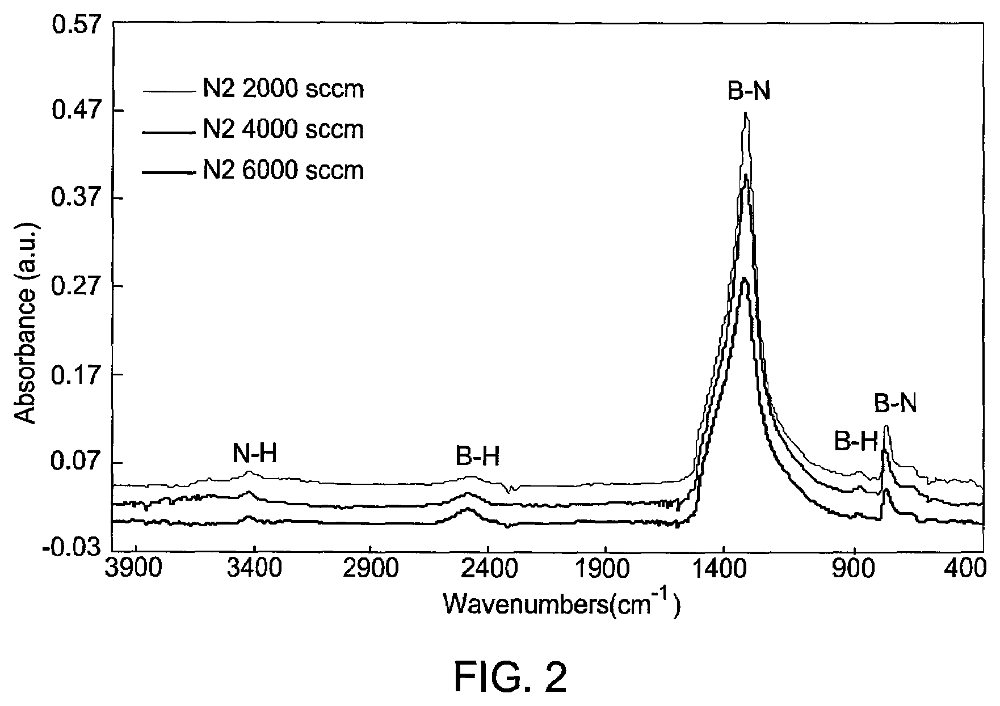
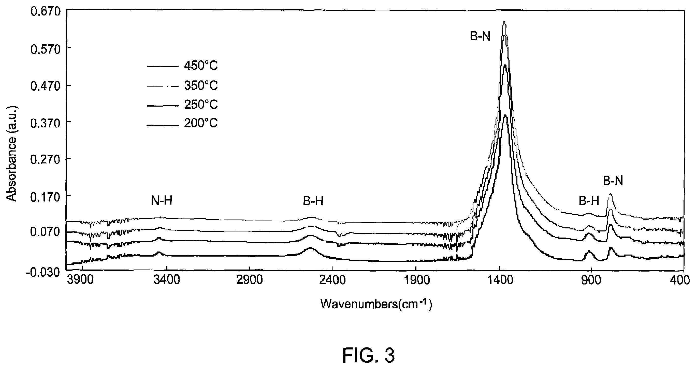

# 03-04 · SiBN / SiBCN 

> 근거 번호 `[S##]`는 `03-04_SiBN_SiBCN_자료수집.md`의 ID다. 논문은 초록 수준까지만 확인했다.
>
> 근거 표시 — **[논문]** 동료심사 논문에 보고된 값 · **[특허]** 특허의 주장·실시예 · **[리뷰]** 교과서 수준의 정설 · **[계산]** 가정을 명시한 교육용 계산 · **[현장]** 문헌으로 못 박지 못한 현장 통념. 자기 장비에서 확인이 필요하다.

---

## 0. 요약

SiBN과 SiBCN은 SiN에 붕소(와 탄소)를 넣어 **유전율을 낮춘 질화막**이다. SiN(k 약 7)이 쓰이던 자리 가운데 정전용량이 문제 되는 곳에 쓴다. 증착 방식은 두께와 자리로 갈린다. 수 nm의 **게이트 Spacer**는 ALD로, 수십 nm 이상의 Blanket 막(배선 덮개·Cu Barrier, Hardmask, DRAM Capacitor의 지지막·Stopper)은 **PECVD**로 만든다. 붕소를 넣으면 k가 내려가지만 HF, 산화, 수분에 약해진다. 그 약점을 탄소, 표면 처리, 덮개 막으로 메우는 것이 이 막질의 설계다.

| 항목 | 내용 |
|---|---|
| 화학식 | SiBN은 $\mathrm{Si}_x\mathrm{B}_y\mathrm{N}_z$:H, SiBCN은 $\mathrm{Si}_x\mathrm{B}_y\mathrm{C}_z\mathrm{N}_w$:H. 원소 비가 정해지지 않은 비정질 질화막이고, PECVD 막은 수소를 Si–H·N–H·B–H로 품는다. 예: Borazine PECVD SiBN Si₀.₀₉B₀.₃₉N₀.₅₁ [논문 S01]. 양 끝의 기준은 Si₃N₄와 BN이다 |
| 역할 | Low-k Spacer·Liner(ALD). PECVD 막은 배선 덮개·Cu Barrier [논문 S01, 특허 S17·S18], BN·SiBN Spacer·Hardmask [특허 S15], DRAM Capacitor 지지막·Stopper [특허 S16] |
| 증착 방식 | 수 nm Spacer는 ALD(열 또는 Plasma). 두꺼운 Blanket 막은 PECVD(원료 동시 공급, 또는 증착과 질화 Plasma의 반복) |
| 전구체 | Si: SiH₂Cl₂·SiH₄·Si₂H₆ / B: BCl₃·B₂H₆·Borazine / C: C₂H₄·CH₄ / N: NH₃·N₂. PECVD의 기본 조합은 SiH₄ + B₂H₆(N₂·Ar 희석) + NH₃ + N₂ |
| ALD 순서 예 | SiH₂Cl₂ → BCl₃ → C₂H₄ → NH₃ (각 단계 사이 Purge) [특허 S04] |
| PECVD 조건 예 | 13.56 MHz 100 W, 6 Torr, 전극 간격 480 mil. SiH₄ 60 · NH₃ 600 · N₂ 1,000 · B₂H₆ 100–1,000 sccm(Station 2개 합계). 온도 범위 300–500 °C [특허 S15] |
| 유전율 | PECVD SiBN 4.7, BN 4.1, SiBON 3.9 [논문 S01]. PECVD BN(증착–질화 반복) 4.7, PECVD SiBN 5.5 미만 [특허 S15]. ALD SiBN 약 4.4 [특허 S07]. 기준 SiN 약 7 |
| 적용 효과 | 14 nm FinFET에서 Ring Oscillator 지연 약 8 % 개선 [논문 S03] |
| 핵심 Trade-off | 낮은 k(B·O↑) ↔ HF·산화 내성(C·N↑) [특허 S05]. PECVD 막은 여기에 흡습에 따른 k 상승 [특허 S18]과 단차 피복 [특허 S19]이 더해진다 |

---

## 1. 용도와 필요성

SiBN과 SiBCN은 주로 게이트 Spacer에 쓴다. 이 절에서는 Spacer가 왜 정전용량을 만드는지, Spacer가 형성된 뒤 어떤 공정을 견뎌야 하는지, 다른 Low-k Spacer 막과 어떻게 다른지 살펴본다. 끝으로 PECVD로 만드는 두꺼운 SiBN이 쓰여 온 자리를 정리한다.

### 1.1 Spacer와 기생 정전용량

게이트 옆의 Spacer는 게이트와 소스/드레인 Contact 사이를 채우는 절연체다. 두 도체 사이에 낀 유전체이므로 그대로 기생 정전용량이 된다. 미세화로 게이트와 Contact 사이가 수 nm까지 좁아지면서 이 정전용량이 회로 지연의 큰 몫을 차지하게 됐다. Spacer를 SiN(k 약 7)에서 더 낮은 k의 막으로 바꾸는 이유다.

IBM은 저온 ALD SiBCN Spacer를 14 nm Replacement Metal Gate FinFET에 넣어 Ring Oscillator 지연을 약 8 % 줄였고, 신뢰성 요구도 만족했다고 보고했다 [논문 S03].

### 1.2 Spacer의 공정 환경

Spacer는 한번 형성되면 그 뒤에 이어지는 Front-end 공정의 거의 전부를 견뎌야 한다. 그래서 k만 낮으면 되는 배선 절연막과는 요구가 전혀 다르다. 아래 표는 Spacer가 겪는 공정과 그때 필요한 성질을 정리한 것이다.

| Spacer가 겪는 공정 | 요구되는 성질 |
|---|---|
| Spacer RIE (이방성 식각으로 측벽만 남김) | 식각 제어성. 과식각에서 Fin·기판 손상 없이 |
| 수많은 HF·SC1 세정, Pre-epi Clean | **HF Wet 내성** |
| PR Ash, 산화성 Plasma | **산화 내성.** 탄소가 빠지거나 표면이 산화막으로 바뀌지 않을 것 |
| S/D Epitaxy (600–700 °C대), Anneal (1,000 °C 이상 순간) | 열 안정성. 조성·k 유지, 붕소 외확산 없음 |
| Dummy Gate 제거, Contact 식각 | 다른 막 대비 식각 선택비 |
| 동작 중 전계 | 누설, 절연 파괴 |

이 표의 내용은 리뷰와 현장에서 통용되는 정리이다 [리뷰·현장]. **Low-k Spacer의 어려움은 낮은 k로 증착하는 것이 아니라, 이 모든 과정을 지난 뒤에도 k가 낮게 남아 있게 하는 것이다.** IBM 보고가 “Spacer RIE를 최적화해 Low-k 값을 유지했다”고 따로 적은 이유다 [논문 S03].

### 1.3 다른 Low-k Spacer와의 관계

Spacer의 k를 낮추는 방법은 붕소를 넣는 것만 있는 것이 아니다. 산소나 탄소를 넣는 막도 쓰이며, 각 막은 k를 낮추는 원소에 따라 강점과 약점이 다르다.

| 막 | k를 낮추는 원소 | 강점 | 약점 |
|---|---|---|---|
| SiN | — (기준) | HF·산화·열 내성이 모두 좋다. | k 약 7 |
| SiCN | C | HF 내성 | k 감소 폭이 작다(→ 03-12). |
| SiOCN · SiOC | O, C | k가 많이 내려간다. | HF에 약해진다. Ash에서 C 손실 |
| SiBN · SiBCN | B (+C) | O 없이 k를 낮춘다. | B–N의 가수분해, 붕소 외확산 |

### 1.4 PECVD SiBN의 쓰임

ALD가 Spacer를 맡기 전에도, 그리고 지금도 SiBN의 상당 부분은 PECVD로 만든다. 두께가 수십 nm 이상이고 Blanket이나 완만한 단차 위에 올리는 막이라면 증착이 빠른 PECVD가 맞는다. 공개 문헌에 나타난 PECVD SiBN의 쓰임은 시기에 따라 다음과 같이 옮겨 왔다.

| 시기 | 용도 | 원료와 방식 | 요점 | 근거 |
|---|---|---|---|---|
| 1980년대 후반 | 배선 덮개, 보호막 | 평행평판 PECVD, SiH₄ + B₂H₆ + NH₃ + Ar | SiN보다 낮은 k. 가스 네 가지의 혼합비 제어가 어렵다는 지적이 뒤따랐고, Si–B–N 화합물 원료로 300–450 °C에서 증착하는 방법이 제안됐다 | [특허 S17] |
| 1990 무렵 | 배선 덮개 | SiH₄ + B₂H₆ + NH₃ → 유기 Si·B 원료 | 배선 위에 두껍고 사이·측벽에 얇은 Overhang 형상(§6.6). 유기 원료로 바꿔 피복 개선 | [특허 S19] |
| 1997 | 배선 절연막, Cu Barrier | Borazine + Si₂H₆ + NH₃ (+ N₂O) | SiBN k 4.7, SiBON k 3.9 | [논문 S01] |
| 2000년대 | Cu Barrier·Cap | SiH₄ + B₂H₆ + NH₃ | 대기 수분으로 k가 시간에 따라 오른다. 산소·탄소가 든 덮개 막으로 k 4.5 미만 유지(§6.7) | [특허 S18] |
| 2007–2011 | Spacer, Stress Liner, Hardmask, Cu Barrier | B₂H₆ (+ SiH₄) + NH₃/N₂. 동시 공급 또는 증착–질화 반복 | BN k 4.7, 단차 피복 95 % 초과. SiBN k 5.5 미만 | [특허 S15] |
| 2019 이후 | DRAM Capacitor 지지막·Stopper | PECVD SiBN, 225–600 °C | B 10–50 at%에서 누설 1×10⁻⁹ A/cm² 미만(1.5 MV/cm)(§6.8) | [특허 S16] |

DRAM Capacitor의 지지막은 높고 가는 원통형 하부 전극들이 Mold 산화막을 걷어 낸 뒤에도 쓰러지지 않도록 옆에서 붙잡아 주는 질화막이고, Stopper는 그 아래의 식각 정지막이다(→ 10-04). 기존 SiBN은 열 예산과 누설 전류에서 불리했는데, 붕소를 많이 넣으면서도 누설을 낮춘 PECVD 막을 이 자리에 쓰겠다는 것이 최근 특허의 주장이다 [특허 S16].

> 이해 확인: 배선 절연막의 Low-k와 Spacer의 Low-k는 요구가 어떻게 다른가? Spacer가 거치는 공정을 들어 설명해 보자. 또 같은 SiBN이라도 Spacer는 ALD로, DRAM 지지막은 PECVD로 만드는 이유는 무엇인가?

---

## 2. 붕소 첨가와 유전율

붕소를 넣으면 유전율은 낮아지지만 막이 물과 산소에 약해진다. 이 절에서는 유전율이 무엇으로 정해지는지에서 출발해 B–N 결합이 k를 낮추는 이유를 설명하고, 그 대가와 이를 보완하는 탄소의 역할, 그리고 조성을 설계하는 방향을 살펴본다.

### 2.1 B–N 결합

먼저 유전율이 무엇으로 정해지는지 생각해 보자. 유전율은 단위 부피 안에 전기장에 의해 분극될 수 있는 것이 얼마나 있느냐로 정해진다. 결합 하나하나의 분극률이 작고, 단위 부피 안의 결합 수가 적을수록 유전율이 낮다. Si–N 결합은 분극률이 크고 Si₃N₄는 밀도가 높다. 붕소는 가벼운 원소이고, 질소와 만나면 흑연과 비슷한 평면형(h-BN형) 결합을 이룬다. 이 결합은 분극률과 밀도가 모두 낮다 [리뷰 S11].

1997년 PECVD 연구의 값이 이를 그대로 보여 준다 [논문 S01].

| 막 | 조성 | k |
|---|---|---|
| SiBN | Si₀.₀₉B₀.₃₉N₀.₅₁ | 4.7 |
| BN | — | 4.1 |
| SiBON | Si₀.₁₆B₀.₂₉O₀.₄₁N₀.₁₄ | 3.9 |
| (기준) SiN | — | 약 7 |

Si가 9 %뿐인 SiBN은 사실상 BN에 Si를 조금 넣은 막이다. k는 BN(4.1)과 SiN(7) 사이에서 조성에 따라 움직인다. ALD SiBN으로 약 4.4를 얻었다는 주장이 있다 [특허 S07]. 최근에는 비정질 BN에서 k 2 미만도 보고됐다 [논문 S11].

*LPCVD SiNₓ, 이 특허의 ALD SiBN(3원계), BN 막의 유전율. 각각 7, 4.4, 3.9이다. SiBN은 SiN과 BN 사이의 값을 가진다.*

*출처: US 6,962,876 (Samsung Electronics, 2005), FIG. 6. 미국 특허 도면. [Google Patents](https://patents.google.com/patent/US6962876B2/en)*

### 2.2 수분과 산소에 대한 취약성

B–N 결합은 물과 만나면 B–O로 바뀐다. 산화성 약액이나 O₂ Plasma에서도 붕소가 먼저 산화된다. 붕소 산화물과 붕산은 물에 녹는다 [리뷰 S12]. 그래서 붕소가 많을수록 다음이 나빠진다.

- DHF·BHF Wet Etch Rate 상승 [특허 S05]
- 대기 중 흡습, 시간에 따른 k 상승 [특허 S18]
- Ash 후 표면 변질

특허가 정리한 문장이 이 막질의 핵심이다. **“더 낮은 k가 필요하면 막 안의 산소나 붕소를 늘려야 하고, 그러면 Wet Etch Rate가 오른다”** [특허 S05].

*같은 세 막의 식각 속도(Å/min). FIG. 3은 RIE로, SiNₓ 252, SiBN 340, BN 165이다. FIG. 4는 고온 H₂SO₄와 SC-1 Wet 식각으로, SiNₓ는 0.106과 0.104로 거의 깎이지 않지만 SiBN은 10과 2.5, BN은 30과 6.56이다. 붕소가 많을수록 약액에 약해진다는 이 절의 설명을 그대로 보여 준다. 다만 HF가 아니라 H₂SO₄와 SC-1의 결과이다 [특허 S07].*

*출처: US 6,962,876 (Samsung Electronics, 2005), FIG. 3, 4. 미국 특허 도면. [Google Patents](https://patents.google.com/patent/US6962876B2/en)*

### 2.3 탄소 첨가의 효과

그렇다면 붕소의 약점을 어떻게 메울 수 있을까? SiBCN에 넣는 C가 그 역할을 하며, 두 가지 일을 한다 [리뷰 S12].

- Si–C 결합은 HF에 녹지 않는다. Wet 내성을 준다.
- C도 가벼운 원소라 k를 더 내리거나 적어도 올리지 않는다.

대신 탄소는 O₂ Plasma에 타 버린다. Ash에서 표면의 탄소가 빠지면 그 자리가 산화막처럼 변해 HF에 녹는다. **B는 물에, C는 산소에 약하다.** SiBCN 조성은 이 두 약점 사이에서 정해진다.

### 2.4 조성 설계의 방향

| 원소 ↑ | k | HF 내성 | 산화(Ash) 내성 | 열 안정성 | 비고 |
|---|---|---|---|---|---|
| B | ↓ | ↓ | ↓ | 외확산 위험 | k를 내리는 주 조절 변수 |
| C | ↓ 또는 유지 | ↑ | ↓ | — | Wet 내성의 주 조절 변수 |
| N | ↑ | ↑ | ↑ | ↑ | SiN 쪽으로 돌아간다. |
| O (의도 또는 오염) | ↓ | ↓ | — | — | SiBON은 k 3.9 [S01] |

이 표는 특허와 리뷰의 서술을 정리한 것이다 [특허 S05·리뷰]. 한 조성으로 모든 요구를 맞추기 어려워 **깊이 방향으로 조성을 나누는** 방법이 쓰인다(§6.3).

> 이해 확인: 붕소 함량을 늘려 k를 더 낮추면 어떤 성질이 나빠지는가? 이를 보완하려고 탄소를 넣으면 새로 어떤 약점이 생기는가?

---

## 3. 전구체와 반응

수 nm 두께의 Spacer를 3차원 구조에 고르게 입히려면 ALD를 써야 하고, 두꺼운 Blanket 막은 PECVD로 빠르게 쌓는다. 이 절에서는 SiBCN을 만드는 ALD Cycle의 각 단계에서 어떤 반응이 일어나는지 설명한 뒤, PECVD의 원료, 두 가지 증착 방식, Plasma와 기상에서 일어나는 반응을 차례로 살펴본다.

### 3.1 ALD Cycle

Spacer는 수 nm 두께를 3차원 구조에 균일하게 올려야 하므로 ALD를 쓴다. 특허에 나온 SiBCN Cycle은 다음과 같다 [특허 S04].

- ① SiH₂Cl₂(또는 SiH₄) → Purge: Si가 흡착하고 표면이 Si–Cl로 덮인다.
- ② BCl₃ → Purge: B가 흡착한다(B–Cl).
- ③ C₂H₄(또는 CH₄) → Purge: C를 넣는다.
- ④ NH₃ → Purge: Cl을 HCl로 떼어내며 Si–N, B–N 결합이 생기고, 표면이 N–H로 덮인다.

조성은 각 단계의 노출량과, 한 Super-cycle 안에서 단계를 몇 번씩 반복하느냐로 조절한다. 예컨대 ①④를 여러 번 돌리고 ②를 한 번 넣으면 붕소가 적은 막이 된다.

### 3.2 반응별 특성

| 단계 | 반응 | 주의 |
|---|---|---|
| Si–Cl + NH₃ | → Si–NH₂ + HCl | 열 ALD에서는 수백 °C가 필요하다. 저온에서는 Cl이 남는다. |
| BCl₃ + N–H 표면 | → B–N + HCl | BCl₃는 Lewis 산이라 N–H 표면과 잘 반응한다. 노출이 과하면 흡착이 포화되지 않고 계속 늘 수 있다. |
| C₂H₄ | 표면 반응성이 낮다. | 탄소 도입 효율이 온도에 민감하다. C 함량이 Wafer 내 온도 분포를 따른다. |
| NH₃ (또는 N₂/NH₃ Plasma) | 질화, Cl 제거 | Plasma를 쓰면 저온에서 가능하지만 측벽과 바닥의 막질이 달라진다. |

이 표는 리뷰 수준의 정리이다 [리뷰].

### 3.3 PECVD 원료

PECVD SiBN의 원료는 SiN PECVD(→ 03-11)의 SiH₄–NH₃–N₂ 조합에 붕소원을 더한 것이다. 붕소원과 희석 가스의 선택이 막의 조성과 공정 안정성을 좌우한다.

| 원료 | 화학식 | 공급하는 원소 | 특징 | 근거 |
|---|---|---|---|---|
| Silane | SiH₄ | Si | SiN PECVD와 같은 Si 원료 | [특허 S15] |
| Diborane | B₂H₆ | B | 붕소 둘을 수소 다리로 잇는 B–H–B 결합이 약해 쉽게 분해된다. 보관 중에도 서서히 분해되므로 N₂·Ar·H₂에 수 % 희석해 공급한다 | [리뷰] |
| Borazine | B₃N₃H₆ | B, N | B–N 육각 고리를 이미 갖고 있어 BN 계 막을 만들기 쉽다. 알킬 치환 Borazine도 쓴다 | [논문 S01, 특허 S15] |
| Ammonia | NH₃ | N | 주 질화원. 막에 N–H(Amine)를 남긴다 | [리뷰] |
| Nitrogen | N₂ | N, 희석 | 해리가 어려워 혼자서는 질화가 느리다. 희석과 Plasma 안정화를 겸한다 | [리뷰] |
| Ar | Ar | — | 원료와 함께 넣으면 k가 내려가고 파괴 전압이 오른다고 특허는 설명한다 | [특허 S15] |
| 유기 원료 | HMDS (CH₃)₃Si–NH–Si(CH₃)₃, TMB B(CH₃)₃, TEB B(C₂H₅)₃ 등 | Si, B | SiH₄·B₂H₆·NH₃의 기상 반응을 피하려는 대안. 막에 탄소가 들어온다 | [특허 S19] |

SiH₄–B₂H₆–NH₃ 계에서 NH₃ 유량을 고정하면 막 조성은 주로 SiH₄와 B₂H₆의 유량비로 정해진다고 보고됐다 [논문 S02]. 1997년 IBM 연구는 Borazine + Si₂H₆ + NH₃로 SiBN을, 여기에 N₂O를 더해 SiBON을 만들었다 [논문 S01].

### 3.4 동시 공급과 증착–질화 반복

PECVD SiBN을 쌓는 방식은 두 가지다 [특허 S15].

- **동시 공급.** SiH₄, B₂H₆, NH₃, N₂를 함께 넣고 Plasma를 켠다. 증착이 빠르다. 단차 피복과 Pattern Loading 요구가 크지 않은 Hardmask 같은 용도에 맞는다.
- **증착–질화 반복.** B₂H₆(필요하면 SiH₄·NH₃를 함께)로 붕소가 많은 얇은 막을 한 번에 약 20 Å 올리고, NH₃/N₂ Plasma로 질소를 넣는다. 이것을 원하는 두께까지 되풀이한다. 한 번에 두껍게 쌓을 때보다 단차 피복과 Pattern Loading이 좋아진다.

반복 방식은 ALD와 닮았지만 표면 포화를 이용하지 않는다. 한 번에 쌓이는 두께는 B₂H₆ 노출 시간과 조건이 정한다. 그래도 B₂H₆와 NH₃가 Chamber 안에 동시에 있지 않으니 둘 사이의 기상 반응(§3.5)을 피하고, 얇은 막을 매번 끝까지 질화할 수 있다. 질화 단계의 조건이 조성을 바꾼다는 것은 아래 FTIR에서 볼 수 있다. 후속 특허는 기존 PECVD SiBN이 단차 피복과 Conformality가 낮고 높은 온도가 필요하다고 지적하고, CVD로 SiB 층을 올린 뒤 질소 Plasma로 처리하는 Cycle을 제안했다 [특허 S08].

*B₂H₆로 붕소 막을 올린 뒤 질소 Plasma로 처리해 만든 BN 막의 FTIR 흡광 스펙트럼. 처리 중 N₂ 유량을 2,000, 4,000, 6,000 sccm으로 바꿨다. 약 1,370 cm⁻¹의 큰 봉우리와 약 800 cm⁻¹의 날카로운 봉우리가 B–N이고, 약 2,500 cm⁻¹와 900 cm⁻¹ 근처가 B–H, 약 3,400 cm⁻¹가 N–H다. 세 곡선은 보기 좋게 위아래로 띄워 그렸다.*

*출처: US 8,084,105 (Applied Materials, 2011), FIG. 2. 미국 특허 도면. [Google Patents](https://patents.google.com/patent/US8084105B2/en)*

특허는 이 그림으로 질화 처리 때의 N₂ 유량을 바꾸면 BN 막의 조성을 조절할 수 있다고 설명한다. 같은 특허에서 B₂H₆ 유량을 줄이면 질소가 많고 굴절률이 낮은 막이 됐다 [특허 S15]. PECVD 막에서는 붕소와 질소 말고도 **수소가 결합 상태로 남는다**는 점을 이 스펙트럼에서 읽어야 한다. B–H와 N–H는 열처리나 UV에서 빠져나가며 막을 수축시키고 응력을 바꾼다(§4.3).

### 3.5 Plasma와 기상의 반응

B₂H₆와 NH₃는 Plasma가 없어도 서로 반응한다. B₂H₆는 전자가 모자란 Lewis 산이고 NH₃는 전자쌍을 내주는 Lewis 염기라, 만나면 Amine–Borane 계 부가물과 그 중합체를 만든다 [리뷰]. 붕소 함량을 올리려고 B₂H₆ 분압을 높이면 이 기상 반응이 늘어 단차 피복이 나빠진다 [특허 S19]. 반응이 Showerhead 안이나 Wafer 위 공간에서 일어나면 가루가 생기고, 막은 배선 위에 두껍고 측벽에 얇은 형상이 된다(§6.6).

Plasma 안에서는 SiH₄, B₂H₆, NH₃가 모두 라디칼로 쪼개지고, 표면에 닿은 라디칼이 Si–N, B–N 결합을 만들며 막이 된다. 이때 수소가 다 빠지지 않아 Si–H, N–H, B–H로 남는다. 온도가 낮을수록, 원료가 많을수록 수소가 많이 남는다는 점은 SiN PECVD와 같다(→ 03-11) [리뷰]. 증착 뒤 UV Cure를 하면 수소가 빠지고 막이 치밀해지며 인장 응력이 2.0 GPa를 넘게 오른다 [특허 S15].

> 이해 확인: ALD Super-cycle에서 BCl₃ 단계를 넣는 횟수를 줄이면 막의 조성과 k는 어떻게 변할 것으로 예상되는가? PECVD에서 붕소를 늘리려고 B₂H₆ 유량을 올릴 때 조성 말고 무엇이 함께 변하는가?

---

## 4. Process Window와 공정 변수별 응답

이 절에서는 문헌에 나타난 증착 조건과, ALD와 PECVD 각각의 조절 변수가 막의 조성과 성질에 어떤 영향을 주는지 정리한다. 끝으로 특허 실시예의 유량 표기를 읽는 법을 계산으로 확인한다.

### 4.1 문헌 조건

| 방식 | 조건 | 결과 | 출처 |
|---|---|---|---|
| PECVD SiBN (Borazine 계) | 400 °C, 0.5 W/cm² | SiBN k 4.7, SiBON k 3.9. 4 : 1 Trench Conformality 70 % 초과 | [논문 S01] |
| PECVD SiBN 동시 공급 (Spacer 목적) | SiH₄ 60, NH₃ 600, N₂ 1,000, B₂H₆ 100–1,000 sccm. 13.56 MHz 100 W, 6 Torr, 480 mil. 필요하면 400 °C UV Cure 10분 | k 5.5 미만, 파괴 전계 6 MV/cm 초과 | [특허 S15] |
| PECVD BN 증착–질화 반복 | ① B₂H₆ 400 + N₂ 2,000 sccm, 6 Torr, 480 mil, 5초(약 20 Å) ② NH₃ 100 + N₂ 2,000 sccm, 13.56 MHz 300 W, 10초 | k 4.7, 굴절률 1.810, 밀도 2.4 g/cm³, 파괴 전계 5 MV/cm, 단차 피복 95 % 초과, Pattern Loading 5 % 미만 | [특허 S15] |
| PECVD BN 증착–질화 반복 (Stress Liner 목적) | B₂H₆ 25 또는 50 sccm, 400 °C, 6 Torr, 10초 → NH₃ 100 + N₂ 2,000 sccm, 100 W, 10초. 10회 반복 | 측벽/윗면 100 %·99 %, 바닥/윗면 98 %·100 %. 900 °C 30분 Anneal 뒤에도 안정 | [특허 S15] |
| PECVD 붕소 막 + 질화 (원료 혼합) | B₂H₆(N₂ 중 5 %) 400, SiH₄ 40, NH₃ 200, N₂ 4,000 sccm, 15초 → N₂ Plasma 600 W, NH₃ 100, N₂ 6,000 sccm, 15초 | 바닥/윗면 91 %, 측벽/윗면 91 %. Pattern Loading 윗면 0 %, 측벽 7 %, 바닥 5 % | [특허 S15] |
| PECVD BN 동시 공급 (Hardmask 목적) | B₂H₆(N₂ 중 5 %) 3,000 + NH₃ 150 sccm, 300 W, 6 Torr, 480 mil | Wet Etch Rate가 낮고 증착이 빠르며 k가 낮은 막. 동시 공급 막의 100 : 1 HF Wet Etch Rate는 열산화막의 0.03배, 열질화막의 0.3배였다 | [특허 S15] |
| PECVD B 첨가 SiN (Cu Barrier) | B₂H₆/Ar(5/95 %) 약 9,000, SiH₄ 약 50, NH₃ 약 500 sccm | 흡습으로 k가 오른다. O·C가 든 덮개 막을 얹어 k 4.5 미만 유지 | [특허 S18] |
| PECVD SiBN (DRAM Capacitor) | 225–600 °C | B 10–50 at%, 누설 1×10⁻⁹ A/cm² 미만(1.5 MV/cm) | [특허 S16] |
| ALD SiBCN | 저온 ALD (온도 미공개) | 14 nm FinFET Spacer | [논문 S03] |

[특허 S15]의 유량은 Station 두 개가 한 Chamber를 나누는 300 mm 장비 기준의 합계이고, Wafer 한 장에 가는 유량은 그 절반이다. 표에서 PECVD의 Conformality 70 %는 배선 절연막으로는 충분했지만 수 nm Spacer에는 모자란다. Spacer 용도가 ALD로 넘어간 이유다. PECVD도 증착–질화 반복으로 바꾸면 단차 피복이 95 %를 넘는다는 실시예가 있으나 [특허 S15], 시험한 구조의 치수가 공개되지 않아 수 nm Spacer에 그대로 옮길 수는 없다.

### 4.2 ALD 공정 변수

| 공정 변수 | 영향 | 주의점 |
|---|---|---|
| Super-cycle 비율 (BCl₃ 단계 빈도) | B 함량 → k, Wet 내성 | 가장 직접적인 조성 조절 변수 |
| 온도 ↑ | Cl 잔류 ↓, 밀도 ↑, Wet 내성 ↑. C 도입량 변화 | 열 예산 한계. 고온에서는 전구체가 스스로 분해해 ALD가 아니라 CVD가 된다(Conformality 저하). |
| NH₃ 노출 ↑ | N ↑, Cl ↓. k ↑ | 불충분하면 Cl 잔류 → 흡습, 부식 |
| C₂H₄ 노출 ↑ | C ↑. Wet 내성 ↑ | 포화가 느리다. Wafer 내·Batch 내 균일도 |
| Purge 시간 | 불충분하면 기상 반응(CVD 성분) → Particle, Conformality 저하 | NH₄Cl 생성(§7) |
| Plasma 사용 | 저온 치밀화 | 이온이 닿는 수평면과 닿지 않는 측벽의 막질 차이. Spacer는 측벽이 본체다. |

이 표의 값은 문헌과 현장에서 통용되는 범위이며, 자기 장비에서 확인해야 한다 [리뷰·현장].

### 4.3 PECVD 공정 변수

| 공정 변수 | 영향 | 주의점 |
|---|---|---|
| B₂H₆/SiH₄ 유량비 | B/Si 조성 → k, Wet 내성, 흡습 [논문 S02] | B₂H₆ 분압을 올리면 NH₃와의 기상 반응이 늘어 피복이 나빠진다 [특허 S19] |
| B₂H₆ 유량 (BN 막) | 줄이면 N ↑, 굴절률 ↓ [특허 S15] | 굴절률을 조성 Monitor로 쓸 수 있다 |
| 함께 넣는 원료 | B₂H₆ + SiH₄ 막의 굴절률이 가장 높고, B₂H₆ + NH₃ + SiH₄ 막의 단차 피복이 가장 좋았다. B₂H₆만 쓸 때보다 균일도가 좋다 [특허 S15] | 원료를 바꾸면 조성과 피복이 함께 움직인다 |
| 질화 Plasma의 HF 전력·NH₃·시간 | 늘리면 굴절률 ↓, 절연 특성 ↑ [특허 S15]. N₂ 유량으로 조성 조절 [특허 S15] | 이온 충격에 의한 하부막 손상 |
| LF RF (수백 kHz) | 이온 충격 → 치밀화, 응력이 압축 쪽으로 [리뷰, → 03-11] | 특허는 13.56 MHz 단독, 300–400 kHz 단독, 혼합 주파수를 모두 범위로 둔다 [특허 S15] |
| 온도 | 결합 수소와 조성이 바뀐다(아래 그림) [특허 S15]. 실시예 범위 300–500 °C | 열 예산. DRAM용은 225–600 °C [특허 S16] |
| Ar 첨가 | k ↓, 파괴 전압 ↑ [특허 S15] | — |
| NH₃ 비율 | N–H(Amine) ↑ | Resist Poisoning 우려(→ 03-12) [현장] |
| 후처리 (UV Cure) | 수소 제거, 치밀화, 인장 응력 2.0 GPa 초과 [특허 S15] | 응력이 커지면 Wafer Bow, 박리 |

*붕소 막을 200, 250, 350, 450 °C에서 올린 뒤 질화해 만든 BN 막의 FTIR. 봉우리 표시는 FIG. 2와 같다. 곡선은 위아래로 띄워 그렸고, 범례의 선 굵기는 온도가 낮을수록 굵다.*

*출처: US 8,084,105 (Applied Materials, 2011), FIG. 3. 미국 특허 도면. [Google Patents](https://patents.google.com/patent/US8084105B2/en)*

특허는 증착 온도로도 BN 막의 조성을 조절할 수 있다고만 적었다 [특허 S15]. 그래프에서 선 굵기로 곡선을 구분해 읽으면, 가장 굵은 200 °C 곡선에서 B–H 흡수(약 2,500, 900 cm⁻¹)가 가장 뚜렷하고 온도가 오를수록 약해진다. 낮은 온도에서 수소가 더 많이 남는다는 §3.5의 설명과 같은 방향이다. 다만 이 경향은 그래프에서 읽은 것이고 특허 본문이 수치로 밝힌 것은 아니다.

### 4.4 원료 유량 읽기 [계산]

특허 실시예의 “B₂H₆(N₂ 중 5 %) 400 sccm, SiH₄ 40 sccm”은 혼합 가스의 유량이다 [특허 S15]. 실제 B₂H₆는 $400 \times 0.05 = 20\ \mathrm{sccm}$이고, B₂H₆ 한 분자에 붕소가 둘이다. 그래서 기체 속 붕소 원자와 실리콘 원자의 공급비는 다음과 같다.

$$
\frac{\text{B 원자}}{\text{Si 원자}} = \frac{2 \times (400 \times 0.05)}{40} = 1.0
$$

Station 두 개가 한 Chamber를 나누면 Wafer 한 장에 가는 유량은 둘 다 절반이지만 비는 그대로 1.0이다. 막 속의 B/Si는 기체의 B/Si와 같지 않다. B₂H₆는 SiH₄보다 쉽게 분해되고 기상에서 NH₃와 먼저 반응하므로, 원료마다 막으로 들어가는 효율이 다르다 [리뷰]. Recipe를 옮길 때는 ① 희석 가스를 포함한 유량인지, ② Chamber 합계인지 Station당인지를 먼저 맞추고, ③ 막 조성은 XPS와 굴절률로 다시 확인한다 [현장].

> 이해 확인: PECVD SiBN의 Conformality가 배선 절연막에는 충분했지만 Spacer에는 부족했던 이유는 무엇인가? 같은 PECVD에서 증착–질화 반복이 피복을 개선하는 원리는 무엇인가?

---

## 5. Spacer 정전용량 계산 [계산]

Spacer의 k를 낮추면 정전용량이 얼마나 줄어드는지, 그리고 Spacer가 얇아지면 그 이득이 어떻게 변하는지 숫자로 확인해 보자.

게이트와 Contact를 서로 마주 보는 평행판 Capacitor로 단순화해 보자. 두 판 사이에 낀 Spacer가 유전체이다.

$$
\frac{C}{W} = \frac{\varepsilon_0\, k\, h}{t},\qquad \varepsilon_0 = 8.854\times10^{-12}\ \mathrm{F/m}
$$

여기서 $h$는 게이트 높이, $t$는 Spacer 두께, $W$는 게이트 폭이다.

**예.** $h = 50\ \mathrm{nm}, t = 8\ \mathrm{nm}$, 게이트 한쪽 면

| Spacer | k | C/W (fF/µm) | SiN 대비 |
|---|---|---|---|
| SiN | 7.0 | 0.387 | — |
| SiBCN | 5.0 | 0.277 | −29 % |
| SiBN (ALD) | 4.4 | 0.243 | −37 % |
| Air Gap | 1.0 | 0.055 | −86 % |

이 계산에서 두 가지를 읽을 수 있다.

1. 정전용량은 k에 정비례한다. k를 7에서 5로 내리면 Spacer 몫이 29 % 줄어든다. 전체 기생 정전용량에는 다른 성분도 있으므로 회로 지연 개선은 이보다 작다. 보고된 8 % [S03]는 그 결과다.
2. **식각이나 세정으로 Spacer가 1 nm만 얇아져도 이득이 크게 줄어든다.** $t = 8\ \mathrm{nm}$에서 7 nm가 되면 정전용량이 14 % 늘어난다. k 5 막이라면 0.277에서 0.316 fF/µm가 되어, SiN 대비 이득이 29 %에서 18 %로 줄어든다. Wet 내성이 k와 같은 무게의 사양인 이유다.

> 이해 확인: Spacer 두께 6 nm에서 세정으로 1 nm가 손실되면 정전용량은 몇 % 늘어나는가? 8 nm일 때와 비교해 보자.

---

## 6. 집적 이슈와 불량 모드

Low-k Spacer는 증착한 뒤 세정, Ash, 식각, 고온 공정을 모두 거쳐야 한다. 이 절에서는 이 과정에서 생기는 문제인 HF 손실, Ash와 산화 손상, 붕소 외확산, Cl 잔류, Pinch-off를 살펴보고, 표면 처리와 다층 구조로 대응하는 방법을 설명한다. 이어 PECVD 막에서 따로 문제가 되는 단차 피복, 흡습, 누설을 다룬다.

### 6.1 HF 내성

게이트 형성 이후 Wafer는 DHF·BHF 세정을 여러 번 거친다. SiN은 이 약액에 거의 녹지 않지만 Low-k Spacer는 녹는다 [특허 S05]. 손실은 두 가지 문제를 만든다. Spacer가 얇아져 정전용량과 누설이 늘고, 게이트와 Epi 사이 거리가 변해 소자 특성이 흔들린다.

### 6.2 Ash·산화 손상

O₂ Plasma와 산화성 약액은 표면의 C와 B를 빼앗고 그 자리를 Si–O로 바꾼다. 이 변질층은 k가 다르고 HF에 빨리 녹는다. **“산화 → HF” 순서가 반복되면 Spacer가 한 겹씩 벗겨진다** [리뷰 S12]. 증착 직후의 Blanket Wet Etch Rate만 보면 이 손실을 놓친다. Ash를 거친 뒤의 Etch Rate로 평가해야 한다.

### 6.3 표면 처리와 다층 구조

| 방법 | 내용 | 근거 |
|---|---|---|
| 표면 질화 | 표면 1–2 nm를 Plasma로 질화해 SiN에 가까운 껍질을 만든다. 본체의 낮은 k는 유지하고 Wet 내성만 얻는다. | [특허 S05] |
| 다층 Spacer | 가운데에 k가 낮은 층, 바깥쪽에 내성이 좋은 층. 탄소 분율이 다른 층을 번갈아 쌓는다. | [특허 S06] |
| 식각 조건 최적화 | Spacer RIE가 막을 변질시키지 않도록 Chemistry를 조정 | [논문 S03] |

Dry Etch 쪽에서는 SiBCN이 오히려 강한 경우도 있다. NF₃/H₂O 계 Dry Etch에서 SiBCN은 250초에 약 0.2 Å, 일반 SiN은 약 14.6 Å 깎였다는 실시예가 있다 [특허 S04]. **Wet에 약하고 특정 Dry에 강한** 이 비대칭을 집적에서 이용한다.

### 6.4 붕소 외확산

붕소는 Si의 p형 도펀트다. 후속 고온 공정에서 Spacer의 붕소가 채널이나 소스/드레인 Extension으로 확산하면 문턱 전압과 접합이 변한다. 얇은 SiN Liner를 먼저 깔거나 열 예산을 제한한다 [현장]. 붕소가 많은 막의 위나 아래에 붕소가 적은 BN·붕소 산화막 Liner를 두면 외확산과 누설이 줄어든다는 특허도 있다 [특허 S15].

### 6.5 Cl 잔류

Chloride 전구체를 쓰는 저온 ALD에서는 Cl이 막에 남는다. Cl은 흡습을 부르고, 금속 게이트·Contact를 부식시키며, 막의 Wet Etch Rate를 올린다. NH₃ 노출과 온도로 줄인다 [리뷰].

### 6.6 Conformality와 Pinch-off

Fin과 게이트 사이의 좁은 틈에서 Spacer가 위쪽부터 붙어 버리면(Pinch-off) 안쪽이 비거나 막질이 달라진다. Purge가 부족해 CVD 성분이 섞이면 생긴다 [현장].

ALD가 제대로 되면 막은 패턴의 윗면, 측벽, 바닥을 거의 같은 두께로 덮는다. 아래 사진이 그 예이다.

*ALD로 증착한 SiBN 막의 단면 SEM. 윗면, 측벽, 바닥의 두께가 거의 같다. 특허는 단차 피복이 약 95 %라고 적었다. 사진 속 숫자는 위치별 두께 측정값이다. 같은 특허의 SiBN은 k 약 4.4이다(§2.1).*

*출처: US 6,962,876 (Samsung Electronics, 2005), FIG. 5. 미국 특허 도면. [Google Patents](https://patents.google.com/patent/US6962876B2/en)*

PECVD 막은 사정이 다르다. SiH₄ + B₂H₆ + NH₃를 함께 넣어 배선을 덮으면 배선 위는 두껍고 배선 사이와 측벽은 얇은 **Overhang** 형상이 된다. 이 막을 층간 절연막으로 쓰면 위층 배선의 단선이나 단락으로 이어질 수 있다 [특허 S19]. 붕소를 늘리려고 B₂H₆ 분압을 올리면 기상 반응(§3.5)이 늘어 형상이 더 나빠진다. 대책은 세 가지가 문헌에 있다. 원료를 유기 Si·B 원료로 바꾸거나 [특허 S19], 증착–질화 반복으로 얇게 나눠 쌓거나 [특허 S15], CVD SiB 층과 질소 Plasma 처리를 반복하는 것이다 [특허 S08].

### 6.7 PECVD 막의 흡습과 k 변화

B를 넣은 SiN은 SiN보다 k가 낮지만 대기 수분에 불안정해, 시간이 지나며 k가 올라 Low-k Cu Barrier로 쓸 수 없게 된다는 기술이 있다 [특허 S18]. 같은 특허의 대책은 산소나 탄소가 든 막을 위에 덮어 수분을 막는 2층 구조였고, 이렇게 하면 대기에서도 k를 4.5 미만으로 유지한다고 적었다 [특허 S18]. 같은 시기 Barrier 특허 가운데에는 B 첨가 SiN이 Via Poisoning을 일으킬 우려를 들고 B를 넣은 SiC Barrier를 제안한 것도 있다 [특허 S20]. 배선 쪽에서 SiBN이 주류가 되지 못한 배경이다(§9).

그래서 PECVD SiBN은 **증착 직후 k만 보면 안 된다.** 증착 뒤 대기 노출 시간(Q-time)에 따른 k, 굴절률, FTIR의 B–O·O–H를 추적하고, 덮개 막을 진공을 깨지 않고(In-situ) 올리는지까지 사양에 넣는다 [현장].

### 6.8 열 예산과 누설

DRAM Capacitor의 지지막·Stopper로 SiBN을 쓸 때의 걸림돌은 열 예산과 누설 전류였다고 특허는 적는다 [특허 S16]. 그 특허는 B 10–50 at%(바람직하게는 20–40 at%)의 높은 붕소 농도에서도 1.5 MV/cm에서 1×10⁻⁹ A/cm² 미만의 누설을 얻는 PECVD 막을 내세우고, 청구항에서 N/Si 원자비를 약 1.05–1.5로 묶는다 [특허 S16]. 질소가 실리콘보다 충분히 많아야 한다는 조건은, Si 쪽으로 기운 질화막이 더 낮은 전압에서 파괴되는 SiN의 경향(→ 03-11 §2.1)과 같은 방향이다 [리뷰].

> 이해 확인: 증착 직후 Blanket 막의 HF Etch Rate는 SiN과 비슷했는데, 실제 공정 뒤 Spacer가 많이 얇아졌다. 어떤 순서의 공정을 의심해야 하는가? PECVD SiBN Cu Barrier의 k가 증착 직후에는 사양 안이었는데 일주일 뒤 벗어났다면 무엇을 의심해야 하는가?

---

## 7. 챔버 · 하드웨어 관리

SiBCN ALD는 Chloride 원료와 NH₃를, PECVD SiBN은 B₂H₆와 NH₃를 함께 쓰므로 부산물과 원료 관리가 중요하다. 아래 표는 Chamber와 하드웨어 관리의 주요 항목을 정리한 것이다.

| 항목 | 내용 | 근거 |
|---|---|---|
| NH₄Cl | Chloride + NH₃ 반응의 부산물. 약 340 °C 아래에서 고체로 석출한다. 배기 라인·밸브·Pump에 쌓인다. 배기계 가열과 Trap이 필수다. | [리뷰 S13] |
| BCl₃ | 수분과 만나면 붕산과 HCl이 된다. 배관의 미세 Leak가 고형물과 부식으로 이어진다. | [리뷰] |
| B₂H₆ 공급 | 독성·가연성 가스다. 보관 중 서서히 분해해 고차 Borane과 H₂가 생기므로 희석 가스에 섞어 쓴다. 용기를 쓰는 동안 실효 농도가 변하면 두께는 같아도 B 함량이 달라진다(→ 03-02). | [리뷰] |
| B₂H₆ + NH₃ 부가물 | Plasma 없이도 반응해 고체 부가물을 만든다. 두 가스를 Chamber 직전까지 따로 보내고, 혼합 지점과 Showerhead 온도를 관리한다. | [특허 S19·현장] |
| 누적 막 | BN 계 누적 막은 응력과 흡습으로 박리하기 쉽다. Batch Furnace에서는 Tube·Boat의 누적 두께를, PECVD에서는 Clean 주기를 관리한다. | [현장] |
| Clean | F 계(NF₃, ClF₃ 등)로 Si·B·N을 휘발시킨다. BF₃는 휘발성이다. | [리뷰] |
| Memory Effect | 붕소가 벽과 배관에 남아 다음 막에 혼입된다. 붕소 공정과 무붕소 공정의 Chamber 공유가 어렵다. Clean 뒤 Seasoning 막으로 첫 장 효과를 줄인다. | [현장] |
| Station 간 Matching | 두 Station이 원료를 나누는 PECVD에서는 한쪽의 유량·온도·간격 차이가 그대로 조성 차이가 된다(→ 07-02). | [현장] |
| Purge 설계 | 4원계 ALD는 Cycle이 길다. 생산성을 위해 Purge를 줄이면 기상 반응과 Particle이 늘어난다. | [현장] |

---

## 8. 계측과 해석

Spacer는 수 nm로 얇고 3차원 구조 위에 있어 측정이 어렵다. 또 증착 직후의 값이 아니라 공정을 거친 뒤의 값이 중요하다. PECVD Blanket 막은 측정은 쉽지만 시간에 따라 값이 변한다. 아래 표는 각 계측이 무엇을 알려 주고 어떤 함정이 있는지 정리한 것이다.

| 계측 | 얻는 것 | 읽는 법과 함정 |
|---|---|---|
| XPS (깊이 방향) | B·C·N·O·Cl 조성, 결합 상태 | B1s에서 B–N(약 190.5 eV)과 B–O(약 192–193 eV)를 구분한다 [리뷰 S14]. B–O가 늘면 산화·흡습의 신호다. |
| FTIR | 결합 구성 | B–N 약 1,370–1,400, Si–N 약 830–900, N–H 약 3,350, B–H 약 2,500 cm⁻¹ [리뷰 S14]. PECVD 막에서는 B–H·N–H가 조건에 따라 변한다(§3.4, §4.3 그림) [특허 S15]. 수 nm 막은 신호가 약해 두꺼운 Monitor 막으로 본다. |
| 굴절률 (Ellipsometry) | 조성의 빠른 지표 | PECVD BN은 B₂H₆를 줄이면 굴절률이 내려간다. 증착–질화 반복 BN 예: 1.810 [특허 S15]. 같은 Recipe에서 굴절률이 움직이면 B₂H₆ 농도와 유량부터 본다. |
| Hg Probe · MIS C–V | k | 두꺼운 Blanket 막의 k와 실제 Spacer(측벽, 수 nm, 공정 손상 후)의 k는 다르다. PECVD 막은 증착 직후와 대기 노출 뒤를 함께 잰다 [특허 S18]. |
| I–V (누설, 절연 파괴) | 절연 특성 | DRAM 지지막 사양 예: 1.5 MV/cm에서 1×10⁻⁹ A/cm² 미만 [특허 S16]. PECVD BN 예: 파괴 전계 5 MV/cm [특허 S15]. |
| 응력 (Wafer 곡률) | 막 응력 | UV Cure 뒤 인장 2.0 GPa를 넘을 수 있다 [특허 S15]. 두꺼운 PECVD 막은 Wafer Bow와 박리로 이어진다. |
| Wet Etch Rate (DHF) | Wet 내성 | **증착 직후와 Ash 후를 모두 측정한다**(§6.2). SiN 기준막과 같이 돌린다. |
| 단면 SEM·TEM | 단차 피복, Pattern Loading | 측벽/윗면, 바닥/윗면 비를 조밀 영역과 고립 영역에서 함께 잰다 [특허 S15]. |
| TEM + EELS/EDS | 측벽 두께, 조성 | 실제 구조에서의 Conformality와 측벽 조성 |
| SIMS | 붕소 Profile | 열처리 후 하부 Si로의 확산 |
| XRR | 밀도, 두께 | Wet 내성과 상관. PECVD BN 예: 2.4 g/cm³ [특허 S15] |
| 소자 측정 | 기생 정전용량, RO 지연 | 최종 판정 [S03] |

> 이해 확인: Spacer의 k를 증착 직후 Blanket 막으로만 평가하면 어떤 위험이 있는가? PECVD SiBN의 굴절률이 같은 Recipe에서 서서히 변할 때 먼저 확인할 것은 무엇인가?

---

## 9. 파생 막과 차세대 기술

Spacer의 유전율을 더 낮추려는 노력은 여러 방향으로 이어지고 있다. 그 방향들과 SiBCN의 위치, 그리고 PECVD SiBN의 새 자리를 살펴보자.

- **Air Gap Spacer.** k를 1까지 내리는 궁극의 방법. 희생막을 넣었다가 빼고 위를 막는다. §5의 계산처럼 효과가 크지만 기계적 강도와 공정 복잡도가 대가다. Low-k Spacer 막은 Air Gap의 벽과 덮개로도 쓰인다 [리뷰].
- **BN 자체.** 비정질 BN의 k 2 미만 보고 [논문 S11]는 붕소 질화물 계의 잠재력을 보여 주지만, §2.2의 가수분해 문제가 그대로 남는다.
- **SiOCN과의 경쟁.** 산소로 k를 내리는 SiOCN이 Logic Spacer의 주류로 쓰이는 세대가 있다 [현장]. SiBCN은 산소 없이 k를 내린다는 점에서 구별된다.
- **배선 쪽 응용의 역사.** SiBON이 Cu Barrier로 양호했다는 1997년 결과 [논문 S01]와 B 첨가 SiN Barrier [특허 S18]는 주류가 되지 못했다. 흡습에 따른 k 상승과 Via Poisoning 우려가 기록돼 있다(§6.7). 배선 쪽은 SiC 계(→ 03-03)와 SiCOH(→ 03-10)가 차지했다.
- **DRAM Capacitor 지지막.** PECVD SiBN의 새 자리다. 높은 붕소 농도와 낮은 누설, 열 예산을 함께 맞추는 것이 과제다 [특허 S16].

> 이해 확인: Air Gap Spacer가 k를 가장 크게 낮출 수 있는데도 모든 곳에 쓰이지 않는 이유는 무엇인가?

---

## 10. Troubleshooting

아래 표는 Low-k Spacer 공정과 PECVD SiBN 공정에서 흔히 나타나는 증상과 유력한 원인, 확인할 데이터, 조치 방향을 정리한 것이다. 표의 원인은 현장 경험에서 나온 출발점이므로 [현장], “확인할 데이터” 열로 가설을 좁힌 뒤에 조치해야 한다.

| 증상 | 유력 원인 | 확인할 데이터 | 조치 방향 |
|---|---|---|---|
| Spacer 두께가 세정 후 과도하게 감소 | B·O 과다, Cl 잔류, Ash 변질층 | XPS 조성, Ash 전후 Wet Etch Rate | Super-cycle 비율, NH₃ 노출·온도, 표면 질화 |
| k가 설계보다 높다 | N 과다, 붕소 부족, 표면 산화 | XPS, 소자 정전용량 | BCl₃ 단계 빈도 상향 |
| 시간이 지나며 k 상승 | 흡습(B–N 가수분해) | XPS B–O 증가, Q-time 상관 | Cap, Q-time 단축, B 저감 |
| 문턱 전압 이동 | 붕소 외확산 | SIMS | SiN Liner, 열 예산 |
| Conformality 불량, Pinch-off | Purge 부족으로 CVD 성분 혼입 | TEM 측벽/상면 두께 비 | Purge 연장, 노출량 조정 |
| Particle 증가 | NH₄Cl, 누적 막 박리 | 입자 성분, 배기 온도 | 배기 가열, Clean 주기 |
| Wafer 내 조성 불균일 | C₂H₄ 반응의 온도 의존성 | 조성 Map과 온도 Map | 온도 균일도, C₂H₄ 노출 포화 |
| 금속 부식 | Cl 잔류 | XPS·SIMS Cl | NH₃ 노출·온도 상향 |
| (PECVD) 배선 위 두껍고 측벽 얇음 | B₂H₆–NH₃ 기상 반응, 동시 공급 방식의 한계 | 단면 SEM 측벽/윗면 비, B₂H₆ 분압 | B₂H₆ 분압 ↓, 증착–질화 반복, 원료 조합 변경 [특허 S15·S19] |
| (PECVD) Showerhead 아래 가루, Particle | B₂H₆·NH₃ 부가물 | 입자 성분(B·N), 혼합 지점 온도 | 가스 분리 공급, Clean 주기 |
| (PECVD) 같은 Recipe인데 굴절률·B 함량 Drift | B₂H₆ 용기 농도 변화, MFC | 굴절률 추세와 용기 교체 시점, XPS | 용기 관리, 교체 뒤 확인 Wafer |
| (PECVD) 증착 뒤 k·굴절률이 시간에 따라 변함 | 흡습 | Q-time별 k, FTIR B–O·O–H | In-situ 덮개 막, Q-time 관리 [특허 S18] |
| (PECVD) 누설 전류 높음 | N/Si 부족(Si 과다), 수소 과다 | XPS N/Si, FTIR Si–H·B–H | NH₃ 비율 ↑, 질화 처리·UV Cure [특허 S15·S16] |
| (PECVD) UV Cure 뒤 Bow·박리 | 수소가 빠지며 인장 응력 증가 | Cure 전후 응력 | UV 조건, 두께 분할 [특허 S15] |
| (PECVD) 두 Station의 조성 차이 | Station별 유량·온도·간격 차이 | Station별 굴절률·두께 | Station Matching(→ 07-02) |

> 이해 확인: 배기 라인 압력이 점점 오르고 Pump 부하가 커졌다. SiBCN ALD 공정의 어떤 부산물을 의심해야 하는가? PECVD SiBN 공정이었다면 무엇을 의심하겠는가?

---

## 11. 자가 점검

이 장의 핵심 내용을 질문으로 확인해 보자.

**Q1. 붕소를 넣으면 k가 내려가는 이유는?**
B–N 결합은 Si–N보다 분극률이 낮고, 붕소가 가벼워 막의 밀도도 낮아진다. 단위 부피당 분극이 줄어든다.

**Q2. SiBCN에서 탄소의 역할은?**
Si–C 결합이 HF에 녹지 않아 Wet 내성을 준다. k는 올리지 않는다. 다만 O₂ Plasma에는 타 버린다.

**Q3. “산화 → HF” 반복이 Low-k Spacer에 특히 해로운 이유는?**
산화가 표면의 C와 B를 빼앗고 Si–O로 바꾼다. 그 변질층이 HF에 녹는다. 반복할 때마다 한 겹씩 벗겨진다.

**Q4. Spacer 두께 8 nm에서 k를 7에서 5로 내렸다. 정전용량은 얼마나 줄어드는가? 세정으로 1 nm가 손실되면?**
k에 비례하므로 29 % 감소한다. 두께가 7 nm가 되면 정전용량이 8/7배, 14 % 늘어난다. SiN 대비 이득이 29 %에서 18 %로 줄어든다.

**Q5. 저온 ALD에서 NH₃ 노출이 부족하면 생기는 문제는?**
Cl이 막에 남는다. 흡습, 금속 부식, Wet Etch Rate 상승으로 이어진다.

**Q6. 표면 1–2 nm만 질화하는 이유는?**
바깥 껍질만 SiN에 가깝게 만들어 Wet 내성을 얻고, 본체의 낮은 k는 유지하기 위해서다.

**Q7. Chloride 전구체와 NH₃를 쓰는 공정에서 배기계를 가열하는 이유는?**
부산물 NH₄Cl이 약 340 °C 아래에서 고체로 석출해 배기 라인과 Pump를 막기 때문이다.

**Q8. PECVD SiBN에서 붕소를 늘리려고 B₂H₆ 분압을 올렸더니 배선 측벽 피복이 나빠졌다. 왜인가?**
B₂H₆와 NH₃가 Plasma 없이도 기상에서 먼저 반응해, 표면에서 자라야 할 막 대신 기상에서 만들어진 물질이 위에서 쌓인다. 배선 위는 두껍고 측벽과 사이는 얇은 Overhang 형상이 된다.

**Q9. 실시예에 “B₂H₆(N₂ 중 5 %) 400 sccm, SiH₄ 40 sccm”이라고 적혀 있다. 기체 속 B/Si 원자비는?**
순 B₂H₆는 20 sccm이고 붕소 원자로는 40 sccm분이다. Si는 40 sccm이므로 1.0이다. Station 두 개가 나누면 Wafer당 유량은 각각 절반이지만 비는 같다. 막 속의 B/Si는 이와 다를 수 있으므로 XPS로 확인한다.

**Q10. PECVD 증착–질화 반복이 동시 공급보다 단차 피복이 좋은 이유는? 대가는?**
B₂H₆와 NH₃가 동시에 있지 않아 둘 사이의 기상 반응이 없고, 한 번에 약 20 Å의 얇은 막만 올려 매번 끝까지 질화한다. 대가는 느린 증착 속도다. 그래서 피복 요구가 작은 Hardmask는 동시 공급으로 만든다.

**Q11. PECVD B 첨가 SiN Cu Barrier가 배선의 주류가 되지 못한 이유로 문헌에 기록된 것은?**
대기 수분에 불안정해 시간이 지나며 k가 오르는 문제, 그리고 NH₃를 쓰는 막의 Via Poisoning 우려다. 덮개 막으로 k를 지키는 방법이 제안됐지만 배선 쪽은 SiC 계와 SiCOH가 차지했다.

---

## 12. 참고 문헌

- [S01] *J. Electrochem. Soc.* 144, 658 (1997) — Borazine PECVD SiBN·SiBON의 조성과 k
- [S02] *Diamond Relat. Mater.* (1996) — SiH₄–B₂H₆–NH₃ 계 SiNB 막, 조성과 SiH₄/B₂H₆ 비
- [S03] IBM, VLSI Technology 2020 — ALD SiBCN Spacer, RO 지연 8 % 개선
- [S04] US 10,672,773 — SiBCN ALD Cycle, Dry Etch 비교
- [S05] US 9,171,736 — k와 Wet 내성의 Trade-off, 표면 질화
- [S06] US 9,419,101 — 다층 Spacer
- [S07] US 6,962,876 — ALD SiBN k 약 4.4
- [S08] US 11,515,145 — 기존 PECVD SiBN의 피복 한계, CVD SiB + 질소 Plasma 반복
- [S15] US 8,084,105 — PECVD BN·SiBN의 조건, k, 단차 피복, UV Cure
- [S16] US 12,451,345 — DRAM Capacitor 지지막·Stopper용 저누설 PECVD SiBN
- [S17] US 4,990,365 — 초기 평행평판 PECVD SiBN과 Si–B–N 원료 PECVD
- [S18] US 6,967,405 · US 7,163,889 — B 첨가 SiN Cu Barrier의 흡습과 k 상승, 덮개 막
- [S19] EP 0 394 054 — SiH₄·B₂H₆·NH₃ 막의 Overhang과 기상 반응, 유기 원료
- [S20] US 7,239,017 · US 7,420,275 — B 첨가 SiC Barrier, B 첨가 SiN의 Via Poisoning 우려
