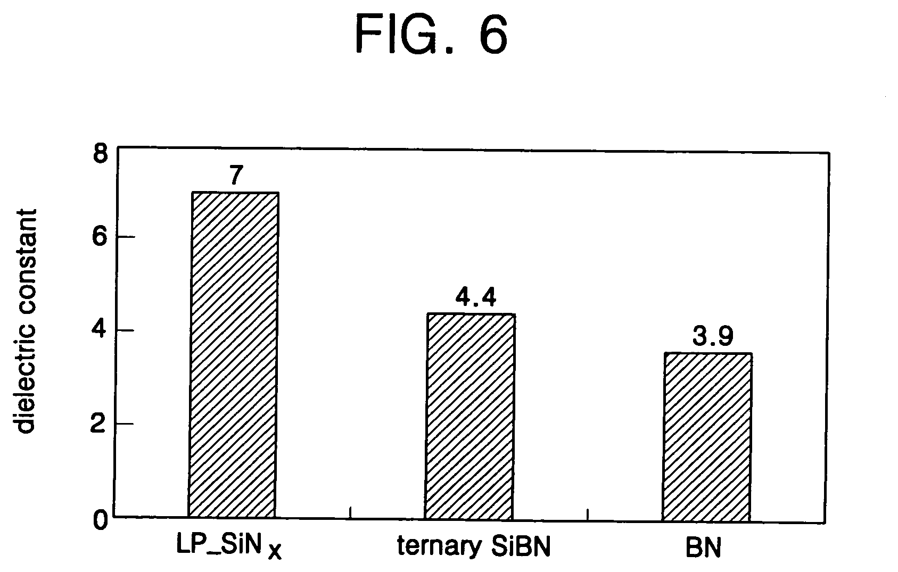
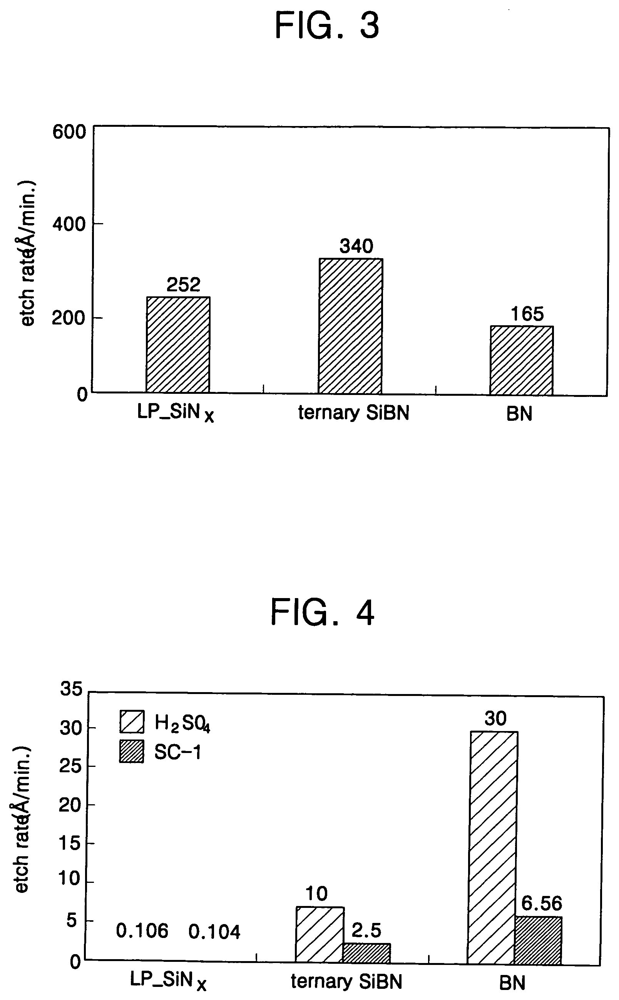
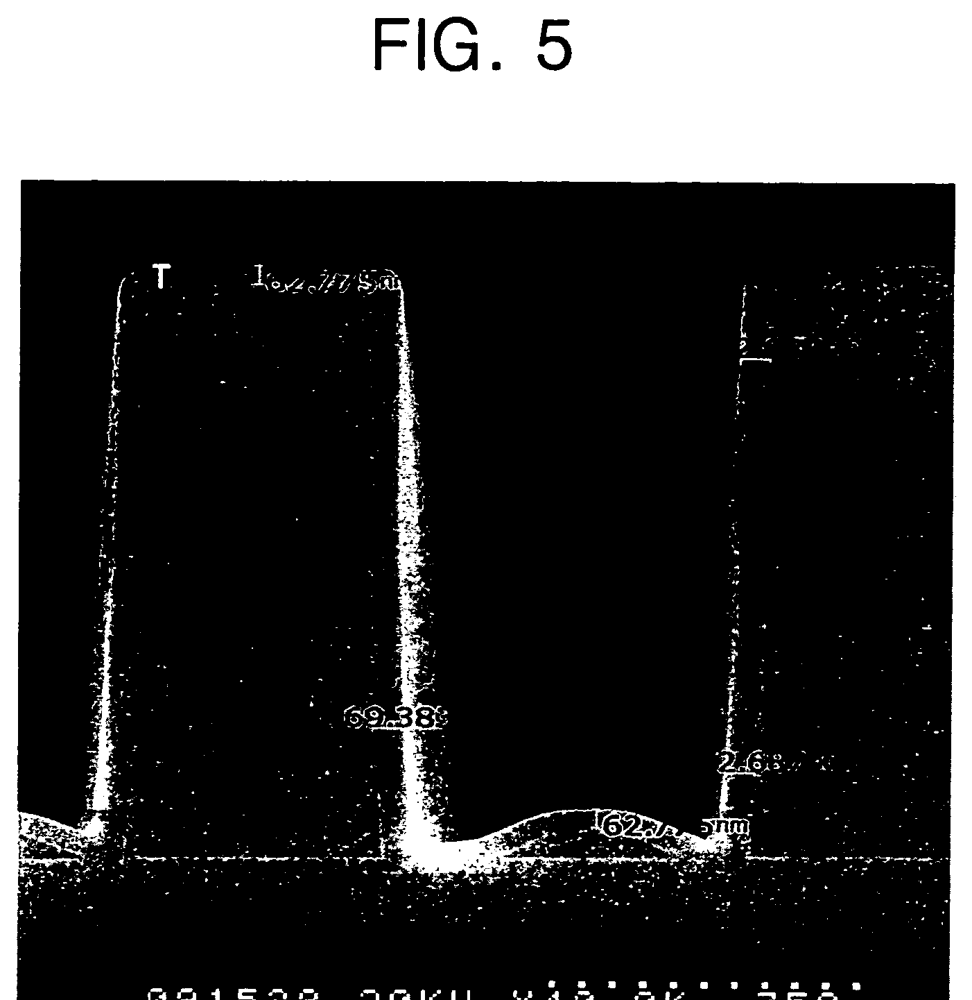

# 03-04 · SiBN / SiBCN 

> 근거 번호 `[S##]`는 `03-04_SiBN_SiBCN_자료수집.md`의 ID다. 논문은 초록 수준까지만 확인했다.
>
> 근거 표시 — **[논문]** 동료심사 논문에 보고된 값 · **[특허]** 특허의 주장·실시예 · **[리뷰]** 교과서 수준의 정설 · **[계산]** 가정을 명시한 교육용 계산 · **[현장]** 문헌으로 못 박지 못한 현장 통념. 자기 장비에서 확인이 필요하다.

---

## 0. 요약

이 장에서는 SiN에 붕소와 탄소를 넣어 유전율을 낮춘 SiBN과 SiBCN을 다룬다. 먼저 이 막의 성질을 정리한 뒤, 붕소가 왜 유전율을 낮추는지, 그리고 그 대가로 생기는 약점을 어떻게 메우는지를 차례로 설명한다.

SiBN과 SiBCN은 SiN에 붕소(와 탄소)를 넣어 **유전율을 낮춘 질화막**이다. SiN(k 약 7)이 쓰이던 자리 가운데 정전용량이 문제 되는 곳, 특히 **게이트 Spacer**에 쓴다. 붕소를 넣으면 k가 내려가지만 HF와 산화에 약해진다. 그 약점을 탄소와 표면 처리로 메우는 것이 이 막질의 설계다.

| 항목 | 내용 |
|---|---|
| 역할 | Low-k Spacer, Low-k Liner. 과거에는 배선 절연막·Cu Barrier로도 연구 [논문 S01] |
| 증착 방식 | Spacer용은 ALD(열 또는 Plasma). 과거 연구는 PECVD |
| 전구체 | Si: SiH₂Cl₂·SiH₄·Si₂H₆ / B: BCl₃·Borazine·B₂H₆ / C: C₂H₄·CH₄ / N: NH₃ |
| ALD 순서 예 | SiH₂Cl₂ → BCl₃ → C₂H₄ → NH₃ (각 단계 사이 Purge) [특허 S04] |
| 유전율 | PECVD SiBN 4.7, BN 4.1, SiBON 3.9 [논문 S01]. ALD SiBN 약 4.4 [특허 S07]. 기준 SiN 약 7 |
| 적용 효과 | 14 nm FinFET에서 Ring Oscillator 지연 약 8 % 개선 [논문 S03] |
| 핵심 Trade-off | 낮은 k(B·O↑) ↔ HF·산화 내성(C·N↑) [특허 S05] |

---

## 1. 용도와 필요성

SiBN과 SiBCN은 주로 게이트 Spacer에 쓴다. 이 절에서는 Spacer가 왜 정전용량을 만드는지, Spacer가 형성된 뒤 어떤 공정을 견뎌야 하는지, 그리고 다른 Low-k Spacer 막과 어떻게 다른지 살펴본다.

### 1.1 Spacer와 기생 정전용량

게이트 옆의 Spacer는 게이트와 소스/드레인 Contact 사이를 채우는 절연체다. 두 도체 사이에 낀 유전체이므로 그대로 기생 정전용량이 된다. 미세화로 게이트와 Contact 사이가 수 nm까지 좁아지면서 이 정전용량이 회로 지연의 큰 몫을 차지하게 됐다. Spacer를 SiN(k 약 7)에서 더 낮은 k의 막으로 바꾸는 이유다.

IBM은 저온 ALD SiBCN Spacer를 14 nm Replacement Metal Gate FinFET에 넣어 Ring Oscillator 지연을 약 8 % 줄였고, 신뢰성 요구도 만족했다고 보고했다 [논문 S03].

### 1.2 Spacer의 공정 환경

Spacer는 한번 형성되면 그 뒤에 이어지는 Front-end 공정의 거의 전부를 견뎌야 한다. 그래서 k만 낮으면 되는 배선 절연막과는 요구가 전혀 다르다. 아래 표는 Spacer가 겪는 공정과 그때 필요한 성질을 정리한 것이다.

| Spacer가 겪는 공정 | 요구되는 성질 |
|---|---|
| Spacer RIE (이방성 식각으로 측벽만 남김) | 식각 제어성. 과식각에서 Fin·기판 손상 없이 |
| 수많은 HF·SC1 세정, Pre-epi Clean | **HF Wet 내성** |
| PR Ash, 산화성 Plasma | **산화 내성.** 탄소가 빠지거나 표면이 산화막으로 바뀌지 않을 것 |
| S/D Epitaxy (600–700 °C대), Anneal (1,000 °C 이상 순간) | 열 안정성. 조성·k 유지, 붕소 외확산 없음 |
| Dummy Gate 제거, Contact 식각 | 다른 막 대비 식각 선택비 |
| 동작 중 전계 | 누설, 절연 파괴 |

이 표의 내용은 리뷰와 현장에서 통용되는 정리이다 [리뷰·현장]. **Low-k Spacer의 어려움은 낮은 k로 증착하는 것이 아니라, 이 모든 과정을 지난 뒤에도 k가 낮게 남아 있게 하는 것이다.** IBM 보고가 “Spacer RIE를 최적화해 Low-k 값을 유지했다”고 따로 적은 이유다 [논문 S03].

### 1.3 다른 Low-k Spacer와의 관계

Spacer의 k를 낮추는 방법은 붕소를 넣는 것만 있는 것이 아니다. 산소나 탄소를 넣는 막도 쓰이며, 각 막은 k를 낮추는 원소에 따라 강점과 약점이 다르다.

| 막 | k를 낮추는 원소 | 강점 | 약점 |
|---|---|---|---|
| SiN | — (기준) | HF·산화·열 내성이 모두 좋다. | k 약 7 |
| SiCN | C | HF 내성 | k 감소 폭이 작다(→ 03-12). |
| SiOCN · SiOC | O, C | k가 많이 내려간다. | HF에 약해진다. Ash에서 C 손실 |
| SiBN · SiBCN | B (+C) | O 없이 k를 낮춘다. | B–N의 가수분해, 붕소 외확산 |

> 이해 확인: 배선 절연막의 Low-k와 Spacer의 Low-k는 요구가 어떻게 다른가? Spacer가 거치는 공정을 들어 설명해 보자.

---

## 2. 붕소 첨가와 유전율

붕소를 넣으면 유전율은 낮아지지만 막이 물과 산소에 약해진다. 이 절에서는 유전율이 무엇으로 정해지는지에서 출발해 B–N 결합이 k를 낮추는 이유를 설명하고, 그 대가와 이를 보완하는 탄소의 역할, 그리고 조성을 설계하는 방향을 살펴본다.

### 2.1 B–N 결합

먼저 유전율이 무엇으로 정해지는지 생각해 보자. 유전율은 단위 부피 안에 전기장에 의해 분극될 수 있는 것이 얼마나 있느냐로 정해진다. 결합 하나하나의 분극률이 작고, 단위 부피 안의 결합 수가 적을수록 유전율이 낮다. Si–N 결합은 분극률이 크고 Si₃N₄는 밀도가 높다. 붕소는 가벼운 원소이고, 질소와 만나면 흑연과 비슷한 평면형(h-BN형) 결합을 이룬다. 이 결합은 분극률과 밀도가 모두 낮다 [리뷰 S11].

1997년 PECVD 연구의 값이 이를 그대로 보여 준다 [논문 S01].

| 막 | 조성 | k |
|---|---|---|
| SiBN | Si₀.₀₉B₀.₃₉N₀.₅₁ | 4.7 |
| BN | — | 4.1 |
| SiBON | Si₀.₁₆B₀.₂₉O₀.₄₁N₀.₁₄ | 3.9 |
| (기준) SiN | — | 약 7 |

Si가 9 %뿐인 SiBN은 사실상 BN에 Si를 조금 넣은 막이다. k는 BN(4.1)과 SiN(7) 사이에서 조성에 따라 움직인다. ALD SiBN으로 약 4.4를 얻었다는 주장이 있다 [특허 S07]. 최근에는 비정질 BN에서 k 2 미만도 보고됐다 [논문 S11, 미재확인].

*LPCVD SiNₓ, 이 특허의 ALD SiBN(3원계), BN 막의 유전율. 각각 7, 4.4, 3.9이다. SiBN은 SiN과 BN 사이의 값을 가진다.*

*출처: US 6,962,876 (Samsung Electronics, 2005), FIG. 6. 미국 특허 도면. [Google Patents](https://patents.google.com/patent/US6962876B2/en)*

### 2.2 수분과 산소에 대한 취약성

B–N 결합은 물과 만나면 B–O로 바뀐다. 산화성 약액이나 O₂ Plasma에서도 붕소가 먼저 산화된다. 붕소 산화물과 붕산은 물에 녹는다 [리뷰 S12]. 그래서 붕소가 많을수록 다음이 나빠진다.

- DHF·BHF Wet Etch Rate 상승 [특허 S05]
- 대기 중 흡습, 시간에 따른 k 상승
- Ash 후 표면 변질

특허가 정리한 문장이 이 막질의 핵심이다. **“더 낮은 k가 필요하면 막 안의 산소나 붕소를 늘려야 하고, 그러면 Wet Etch Rate가 오른다”** [특허 S05].

*같은 세 막의 식각 속도(Å/min). FIG. 3은 RIE로, SiNₓ 252, SiBN 340, BN 165이다. FIG. 4는 고온 H₂SO₄와 SC-1 Wet 식각으로, SiNₓ는 0.106과 0.104로 거의 깎이지 않지만 SiBN은 10과 2.5, BN은 30과 6.56이다. 붕소가 많을수록 약액에 약해진다는 이 절의 설명을 그대로 보여 준다. 다만 HF가 아니라 H₂SO₄와 SC-1의 결과이다 [특허 S07].*

*출처: US 6,962,876 (Samsung Electronics, 2005), FIG. 3, 4. 미국 특허 도면. [Google Patents](https://patents.google.com/patent/US6962876B2/en)*

### 2.3 탄소 첨가의 효과

그렇다면 붕소의 약점을 어떻게 메울 수 있을까? SiBCN에 넣는 C가 그 역할을 하며, 두 가지 일을 한다 [리뷰 S12].

- Si–C 결합은 HF에 녹지 않는다. Wet 내성을 준다.
- C도 가벼운 원소라 k를 더 내리거나 적어도 올리지 않는다.

대신 탄소는 O₂ Plasma에 타 버린다. Ash에서 표면의 탄소가 빠지면 그 자리가 산화막처럼 변해 HF에 녹는다. **B는 물에, C는 산소에 약하다.** SiBCN 조성은 이 두 약점 사이에서 정해진다.

### 2.4 조성 설계의 방향

| 원소 ↑ | k | HF 내성 | 산화(Ash) 내성 | 열 안정성 | 비고 |
|---|---|---|---|---|---|
| B | ↓ | ↓ | ↓ | 외확산 위험 | k를 내리는 주 조절 변수 |
| C | ↓ 또는 유지 | ↑ | ↓ | — | Wet 내성의 주 조절 변수 |
| N | ↑ | ↑ | ↑ | ↑ | SiN 쪽으로 돌아간다. |
| O (의도 또는 오염) | ↓ | ↓ | — | — | SiBON은 k 3.9 [S01] |

이 표는 특허와 리뷰의 서술을 정리한 것이다 [특허 S05·리뷰]. 한 조성으로 모든 요구를 맞추기 어려워 **깊이 방향으로 조성을 나누는** 방법이 쓰인다(§6.3).

> 이해 확인: 붕소 함량을 늘려 k를 더 낮추면 어떤 성질이 나빠지는가? 이를 보완하려고 탄소를 넣으면 새로 어떤 약점이 생기는가?

---

## 3. 전구체와 반응

수 nm 두께의 Spacer를 3차원 구조에 고르게 입히려면 ALD를 써야 한다. 이 절에서는 SiBCN을 만드는 ALD Cycle의 각 단계에서 어떤 반응이 일어나는지, 그리고 PECVD로 BN 계 막을 만들 때 쓰는 원료를 설명한다.

### 3.1 ALD Cycle

Spacer는 수 nm 두께를 3차원 구조에 균일하게 올려야 하므로 ALD를 쓴다. 특허에 나온 SiBCN Cycle은 다음과 같다 [특허 S04].

- ① SiH₂Cl₂(또는 SiH₄) → Purge: Si가 흡착하고 표면이 Si–Cl로 덮인다.
- ② BCl₃ → Purge: B가 흡착한다(B–Cl).
- ③ C₂H₄(또는 CH₄) → Purge: C를 넣는다.
- ④ NH₃ → Purge: Cl을 HCl로 떼어내며 Si–N, B–N 결합이 생기고, 표면이 N–H로 덮인다.

조성은 각 단계의 노출량과, 한 Super-cycle 안에서 단계를 몇 번씩 반복하느냐로 조절한다. 예컨대 ①④를 여러 번 돌리고 ②를 한 번 넣으면 붕소가 적은 막이 된다.

### 3.2 반응별 특성

| 단계 | 반응 | 주의 |
|---|---|---|
| Si–Cl + NH₃ | → Si–NH₂ + HCl | 열 ALD에서는 수백 °C가 필요하다. 저온에서는 Cl이 남는다. |
| BCl₃ + N–H 표면 | → B–N + HCl | BCl₃는 Lewis 산이라 N–H 표면과 잘 반응한다. 노출이 과하면 흡착이 포화되지 않고 계속 늘 수 있다. |
| C₂H₄ | 표면 반응성이 낮다. | 탄소 도입 효율이 온도에 민감하다. C 함량이 Wafer 내 온도 분포를 따른다. |
| NH₃ (또는 N₂/NH₃ Plasma) | 질화, Cl 제거 | Plasma를 쓰면 저온에서 가능하지만 측벽과 바닥의 막질이 달라진다. |

이 표는 리뷰 수준의 정리이다 [리뷰]. 한편 PECVD 쪽에서는 Borazine(B₃N₃H₆)이 B–N 고리를 이미 갖고 있어 BN 계 막을 만들기 쉽다. 1997년 연구는 Borazine + Si₂H₆ + NH₃로 SiBN을, 여기에 N₂O를 더해 SiBON을 만들었다 [논문 S01]. SiH₄와 B₂H₆를 NH₃와 함께 쓰면 두 전구체가 NH₃를 두고 경쟁한다는 보고도 있다 [논문 S02, 미재확인].

> 이해 확인: ALD Super-cycle에서 BCl₃ 단계를 넣는 횟수를 줄이면 막의 조성과 k는 어떻게 변할 것으로 예상되는가?

---

## 4. 공정 윈도우와 공정 변수별 응답

이 절에서는 문헌에 나타난 증착 조건과, ALD의 각 조절 변수가 막의 조성과 성질에 어떤 영향을 주는지 정리한다.

### 4.1 문헌 조건

| 방식 | 조건 | 결과 | 출처 |
|---|---|---|---|
| PECVD (Borazine 계) | 400 °C, 0.5 W/cm² | SiBN k 4.7, SiBON k 3.9. 4 : 1 Trench Conformality 70 % 초과 | [논문 S01] |
| ALD SiBCN | 저온 ALD (온도 미공개) | 14 nm FinFET Spacer | [논문 S03] |

PECVD의 Conformality 70 %는 배선 절연막으로는 충분했지만 수 nm Spacer에는 모자란다. Spacer 용도가 ALD로 넘어간 이유다.

### 4.2 ALD 공정 변수

| 공정 변수 | 영향 | 주의점 |
|---|---|---|
| Super-cycle 비율 (BCl₃ 단계 빈도) | B 함량 → k, Wet 내성 | 가장 직접적인 조성 조절 변수 |
| 온도 ↑ | Cl 잔류 ↓, 밀도 ↑, Wet 내성 ↑. C 도입량 변화 | 열 예산 한계. 고온에서는 전구체가 스스로 분해해 ALD가 아니라 CVD가 된다(Conformality 저하). |
| NH₃ 노출 ↑ | N ↑, Cl ↓. k ↑ | 불충분하면 Cl 잔류 → 흡습, 부식 |
| C₂H₄ 노출 ↑ | C ↑. Wet 내성 ↑ | 포화가 느리다. Wafer 내·Batch 내 균일도 |
| Purge 시간 | 불충분하면 기상 반응(CVD 성분) → Particle, Conformality 저하 | NH₄Cl 생성(§7) |
| Plasma 사용 | 저온 치밀화 | 이온이 닿는 수평면과 닿지 않는 측벽의 막질 차이. Spacer는 측벽이 본체다. |

이 표의 값은 문헌과 현장에서 통용되는 범위이며, 자기 장비에서 확인해야 한다 [리뷰·현장].

> 이해 확인: PECVD SiBN의 Conformality가 배선 절연막에는 충분했지만 Spacer에는 부족했던 이유는 무엇인가?

---

## 5. Spacer 정전용량 계산 [계산]

Spacer의 k를 낮추면 정전용량이 얼마나 줄어드는지, 그리고 Spacer가 얇아지면 그 이득이 어떻게 변하는지 숫자로 확인해 보자.

게이트와 Contact를 서로 마주 보는 평행판 Capacitor로 단순화해 보자. 두 판 사이에 낀 Spacer가 유전체이다.

$$
\frac{C}{W} = \frac{\varepsilon_0\, k\, h}{t},\qquad \varepsilon_0 = 8.854\times10^{-12}\ \mathrm{F/m}
$$

여기서 $h$는 게이트 높이, $t$는 Spacer 두께, $W$는 게이트 폭이다.

**예.** $h = 50\ \mathrm{nm}, t = 8\ \mathrm{nm}$, 게이트 한쪽 면

| Spacer | k | C/W (fF/µm) | SiN 대비 |
|---|---|---|---|
| SiN | 7.0 | 0.387 | — |
| SiBCN | 5.0 | 0.277 | −29 % |
| SiBN (ALD) | 4.4 | 0.243 | −37 % |
| Air Gap | 1.0 | 0.055 | −86 % |

이 계산에서 두 가지를 읽을 수 있다.

1. 정전용량은 k에 정비례한다. k를 7에서 5로 내리면 Spacer 몫이 29 % 줄어든다. 전체 기생 정전용량에는 다른 성분도 있으므로 회로 지연 개선은 이보다 작다. 보고된 8 % [S03]는 그 결과다.
2. **식각이나 세정으로 Spacer가 1 nm만 얇아져도 이득이 크게 줄어든다.** $t = 8\ \mathrm{nm}$에서 7 nm가 되면 정전용량이 14 % 늘어난다. k 5 막이라면 0.277에서 0.316 fF/µm가 되어, SiN 대비 이득이 29 %에서 18 %로 줄어든다. Wet 내성이 k와 같은 무게의 사양인 이유다.

> 이해 확인: Spacer 두께 6 nm에서 세정으로 1 nm가 손실되면 정전용량은 몇 % 늘어나는가? 8 nm일 때와 비교해 보자.

---

## 6. 집적 이슈와 불량 모드

Low-k Spacer는 증착한 뒤 세정, Ash, 식각, 고온 공정을 모두 거쳐야 한다. 이 절에서는 이 과정에서 생기는 문제인 HF 손실, Ash와 산화 손상, 붕소 외확산, Cl 잔류, Pinch-off를 살펴보고, 표면 처리와 다층 구조로 대응하는 방법을 설명한다.

### 6.1 HF 내성

게이트 형성 이후 Wafer는 DHF·BHF 세정을 여러 번 거친다. SiN은 이 약액에 거의 녹지 않지만 Low-k Spacer는 녹는다 [특허 S05]. 손실은 두 가지 문제를 만든다. Spacer가 얇아져 정전용량과 누설이 늘고, 게이트와 Epi 사이 거리가 변해 소자 특성이 흔들린다.

### 6.2 Ash·산화 손상

O₂ Plasma와 산화성 약액은 표면의 C와 B를 빼앗고 그 자리를 Si–O로 바꾼다. 이 변질층은 k가 다르고 HF에 빨리 녹는다. **“산화 → HF” 순서가 반복되면 Spacer가 한 겹씩 벗겨진다** [리뷰 S12]. 증착 직후의 Blanket Wet Etch Rate만 보면 이 손실을 놓친다. Ash를 거친 뒤의 Etch Rate로 평가해야 한다.

### 6.3 표면 처리와 다층 구조

| 방법 | 내용 | 근거 |
|---|---|---|
| 표면 질화 | 표면 1–2 nm를 Plasma로 질화해 SiN에 가까운 껍질을 만든다. 본체의 낮은 k는 유지하고 Wet 내성만 얻는다. | [특허 S05] |
| 다층 Spacer | 가운데에 k가 낮은 층, 바깥쪽에 내성이 좋은 층. 탄소 분율이 다른 층을 번갈아 쌓는다. | [특허 S06] |
| 식각 조건 최적화 | Spacer RIE가 막을 변질시키지 않도록 Chemistry를 조정 | [논문 S03] |

Dry Etch 쪽에서는 SiBCN이 오히려 강한 경우도 있다. NF₃/H₂O 계 Dry Etch에서 SiBCN은 250초에 약 0.2 Å, 일반 SiN은 약 14.6 Å 깎였다는 실시예가 있다 [특허 S04]. **Wet에 약하고 특정 Dry에 강한** 이 비대칭을 집적에서 이용한다.

### 6.4 붕소 외확산

붕소는 Si의 p형 도펀트다. 후속 고온 공정에서 Spacer의 붕소가 채널이나 소스/드레인 Extension으로 확산하면 문턱 전압과 접합이 변한다. 얇은 SiN Liner를 먼저 깔거나 열 예산을 제한한다 [현장].

### 6.5 Cl 잔류

Chloride 전구체를 쓰는 저온 ALD에서는 Cl이 막에 남는다. Cl은 흡습을 부르고, 금속 게이트·Contact를 부식시키며, 막의 Wet Etch Rate를 올린다. NH₃ 노출과 온도로 줄인다 [리뷰].

### 6.6 Conformality와 Pinch-off

Fin과 게이트 사이의 좁은 틈에서 Spacer가 위쪽부터 붙어 버리면(Pinch-off) 안쪽이 비거나 막질이 달라진다. Purge가 부족해 CVD 성분이 섞이면 생긴다 [현장].

ALD가 제대로 되면 막은 패턴의 윗면, 측벽, 바닥을 거의 같은 두께로 덮는다. 아래 사진이 그 예이다.

*ALD로 증착한 SiBN 막의 단면 SEM. 윗면, 측벽, 바닥의 두께가 거의 같다. 특허는 단차 피복이 약 95 %라고 적었다. 사진 속 숫자는 위치별 두께 측정값이다. 같은 특허의 SiBN은 k 약 4.4이다(§2.1).*

*출처: US 6,962,876 (Samsung Electronics, 2005), FIG. 5. 미국 특허 도면. [Google Patents](https://patents.google.com/patent/US6962876B2/en)*

> 이해 확인: 증착 직후 Blanket 막의 HF Etch Rate는 SiN과 비슷했는데, 실제 공정 뒤 Spacer가 많이 얇아졌다. 어떤 순서의 공정을 의심해야 하는가?

---

## 7. 챔버 · 하드웨어 관리

SiBCN ALD는 Chloride 원료와 NH₃를 함께 쓰므로 부산물 관리가 중요하다. 아래 표는 Chamber와 하드웨어 관리의 주요 항목을 정리한 것이다.

| 항목 | 내용 | 근거 |
|---|---|---|
| NH₄Cl | Chloride + NH₃ 반응의 부산물. 약 340 °C 아래에서 고체로 석출한다. 배기 라인·밸브·Pump에 쌓인다. 배기계 가열과 Trap이 필수다. | [리뷰 S13] |
| BCl₃ | 수분과 만나면 붕산과 HCl이 된다. 배관의 미세 Leak가 고형물과 부식으로 이어진다. | [리뷰] |
| 누적 막 | BN 계 누적 막은 응력과 흡습으로 박리하기 쉽다. Batch Furnace에서는 Tube·Boat의 누적 두께를 관리한다. | [현장] |
| Clean | F 계(NF₃, ClF₃ 등)로 Si·B·N을 휘발시킨다. BF₃는 휘발성이다. | [리뷰] |
| Memory Effect | 붕소가 벽과 배관에 남아 다음 막에 혼입된다. 붕소 공정과 무붕소 공정의 Chamber 공유가 어렵다. | [현장] |
| Purge 설계 | 4원계 ALD는 Cycle이 길다. 생산성을 위해 Purge를 줄이면 기상 반응과 Particle이 늘어난다. | [현장] |

---

## 8. 계측과 해석

Spacer는 수 nm로 얇고 3차원 구조 위에 있어 측정이 어렵다. 또 증착 직후의 값이 아니라 공정을 거친 뒤의 값이 중요하다. 아래 표는 각 계측이 무엇을 알려 주고 어떤 함정이 있는지 정리한 것이다.

| 계측 | 얻는 것 | 읽는 법과 함정 |
|---|---|---|
| XPS (깊이 방향) | B·C·N·O·Cl 조성, 결합 상태 | B1s에서 B–N(약 190.5 eV)과 B–O(약 192–193 eV)를 구분한다 [리뷰 S14]. B–O가 늘면 산화·흡습의 신호다. |
| FTIR | 결합 구성 | B–N 약 1,370–1,400, Si–N 약 830–900, N–H 약 3,350, B–H 약 2,500 cm⁻¹ [리뷰 S14]. 수 nm 막은 신호가 약해 두꺼운 Monitor 막으로 본다. |
| Hg Probe · MIS C–V | k | 두꺼운 Blanket 막의 k와 실제 Spacer(측벽, 수 nm, 공정 손상 후)의 k는 다르다. |
| Wet Etch Rate (DHF) | Wet 내성 | **증착 직후와 Ash 후를 모두 측정한다**(§6.2). SiN 기준막과 같이 돌린다. |
| TEM + EELS/EDS | 측벽 두께, 조성 | 실제 구조에서의 Conformality와 측벽 조성 |
| SIMS | 붕소 Profile | 열처리 후 하부 Si로의 확산 |
| XRR | 밀도, 두께 | Wet 내성과 상관 |
| 소자 측정 | 기생 정전용량, RO 지연 | 최종 판정 [S03] |

> 이해 확인: Spacer의 k를 증착 직후 Blanket 막으로만 평가하면 어떤 위험이 있는가?

---

## 9. 파생 막과 차세대 기술

Spacer의 유전율을 더 낮추려는 노력은 여러 방향으로 이어지고 있다. 그 방향들과 SiBCN의 위치를 살펴보자.

- **Air Gap Spacer.** k를 1까지 내리는 궁극의 방법. 희생막을 넣었다가 빼고 위를 막는다. §5의 계산처럼 효과가 크지만 기계적 강도와 공정 복잡도가 대가다. Low-k Spacer 막은 Air Gap의 벽과 덮개로도 쓰인다 [리뷰].
- **BN 자체.** 비정질 BN의 k 2 미만 보고 [논문 S11, 미재확인]는 붕소 질화물 계의 잠재력을 보여 주지만, §2.2의 가수분해 문제가 그대로 남는다.
- **SiOCN과의 경쟁.** 산소로 k를 내리는 SiOCN이 Logic Spacer의 주류로 쓰이는 세대가 있다 [현장]. SiBCN은 산소 없이 k를 내린다는 점에서 구별된다.
- **배선 쪽 응용의 역사.** SiBON이 Cu Barrier로 양호했다는 1997년 결과 [논문 S01]는 채택되지 않았다. 배선 쪽은 SiC 계(→ 03-03)와 SiCOH(→ 03-10)가 차지했다.

> 이해 확인: Air Gap Spacer가 k를 가장 크게 낮출 수 있는데도 모든 곳에 쓰이지 않는 이유는 무엇인가?

---

## 10. Troubleshooting

아래 표는 Low-k Spacer 공정에서 흔히 나타나는 증상과 유력한 원인, 확인할 데이터, 조치 방향을 정리한 것이다. 표의 원인은 현장 경험에서 나온 출발점이므로 [현장], “확인할 데이터” 열로 가설을 좁힌 뒤에 조치해야 한다.

| 증상 | 유력 원인 | 확인할 데이터 | 조치 방향 |
|---|---|---|---|
| Spacer 두께가 세정 후 과도하게 감소 | B·O 과다, Cl 잔류, Ash 변질층 | XPS 조성, Ash 전후 Wet Etch Rate | Super-cycle 비율, NH₃ 노출·온도, 표면 질화 |
| k가 설계보다 높다 | N 과다, 붕소 부족, 표면 산화 | XPS, 소자 정전용량 | BCl₃ 단계 빈도 상향 |
| 시간이 지나며 k 상승 | 흡습(B–N 가수분해) | XPS B–O 증가, Q-time 상관 | Cap, Q-time 단축, B 저감 |
| 문턱 전압 이동 | 붕소 외확산 | SIMS | SiN Liner, 열 예산 |
| Conformality 불량, Pinch-off | Purge 부족으로 CVD 성분 혼입 | TEM 측벽/상면 두께 비 | Purge 연장, 노출량 조정 |
| Particle 증가 | NH₄Cl, 누적 막 박리 | 입자 성분, 배기 온도 | 배기 가열, Clean 주기 |
| Wafer 내 조성 불균일 | C₂H₄ 반응의 온도 의존성 | 조성 Map과 온도 Map | 온도 균일도, C₂H₄ 노출 포화 |
| 금속 부식 | Cl 잔류 | XPS·SIMS Cl | NH₃ 노출·온도 상향 |

> 이해 확인: 배기 라인 압력이 점점 오르고 Pump 부하가 커졌다. SiBCN ALD 공정의 어떤 부산물을 의심해야 하는가?

---

## 11. 자가 점검

이 장의 핵심 내용을 질문으로 확인해 보자. 각 질문을 먼저 스스로 풀어 본 뒤 답을 펼쳐 비교한다.

**Q1. 붕소를 넣으면 k가 내려가는 이유는?**
B–N 결합은 Si–N보다 분극률이 낮고, 붕소가 가벼워 막의 밀도도 낮아진다. 단위 부피당 분극이 줄어든다.

**Q2. SiBCN에서 탄소의 역할은?**
Si–C 결합이 HF에 녹지 않아 Wet 내성을 준다. k는 올리지 않는다. 다만 O₂ Plasma에는 타 버린다.

**Q3. “산화 → HF” 반복이 Low-k Spacer에 특히 해로운 이유는?**
산화가 표면의 C와 B를 빼앗고 Si–O로 바꾼다. 그 변질층이 HF에 녹는다. 반복할 때마다 한 겹씩 벗겨진다.

**Q4. Spacer 두께 8 nm에서 k를 7에서 5로 내렸다. 정전용량은 얼마나 줄어드는가? 세정으로 1 nm가 손실되면?**
k에 비례하므로 29 % 감소한다. 두께가 7 nm가 되면 정전용량이 8/7배, 14 % 늘어난다. SiN 대비 이득이 29 %에서 18 %로 줄어든다.

**Q5. 저온 ALD에서 NH₃ 노출이 부족하면 생기는 문제는?**
Cl이 막에 남는다. 흡습, 금속 부식, Wet Etch Rate 상승으로 이어진다.

**Q6. 표면 1–2 nm만 질화하는 이유는?**
바깥 껍질만 SiN에 가깝게 만들어 Wet 내성을 얻고, 본체의 낮은 k는 유지하기 위해서다.

**Q7. Chloride 전구체와 NH₃를 쓰는 공정에서 배기계를 가열하는 이유는?**
부산물 NH₄Cl이 약 340 °C 아래에서 고체로 석출해 배기 라인과 Pump를 막기 때문이다.

---

## 12. 참고문헌

전체 서지, 링크, 확인 수준은 `03-04_SiBN_SiBCN_자료수집.md`에 있다.

- [S01] *J. Electrochem. Soc.* 144, 658 (1997) — Borazine PECVD SiBN·SiBON의 조성과 k
- [S03] IBM, VLSI Technology 2020 — ALD SiBCN Spacer, RO 지연 8 % 개선
- [S04] US 10,672,773 — SiBCN ALD Cycle, Dry Etch 비교
- [S05] US 9,171,736 — k와 Wet 내성의 Trade-off, 표면 질화
- [S06] US 9,419,101 — 다층 Spacer
- [S07] US 6,962,876 — ALD SiBN k 약 4.4
