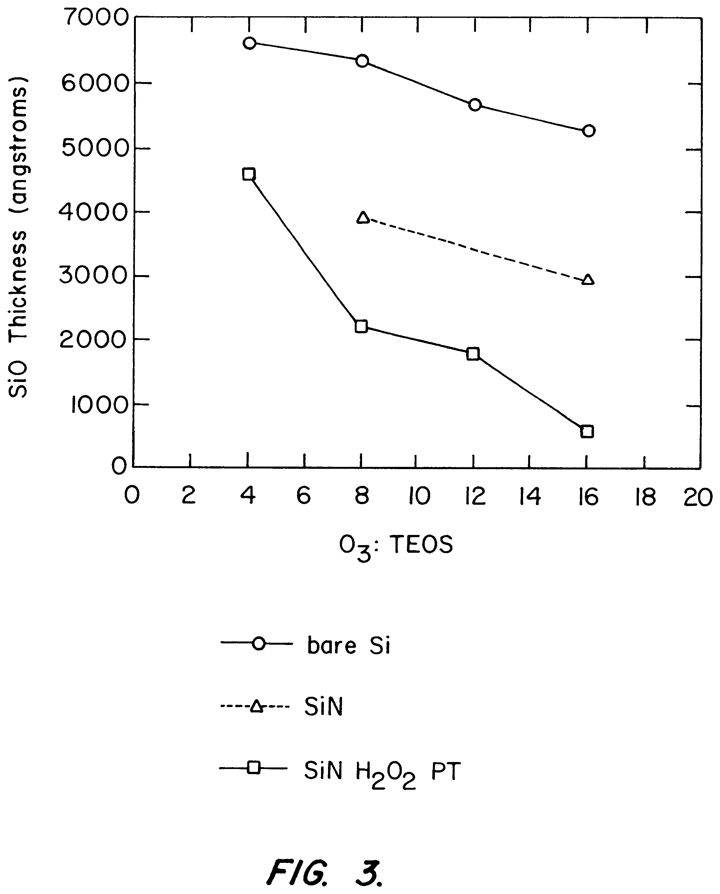
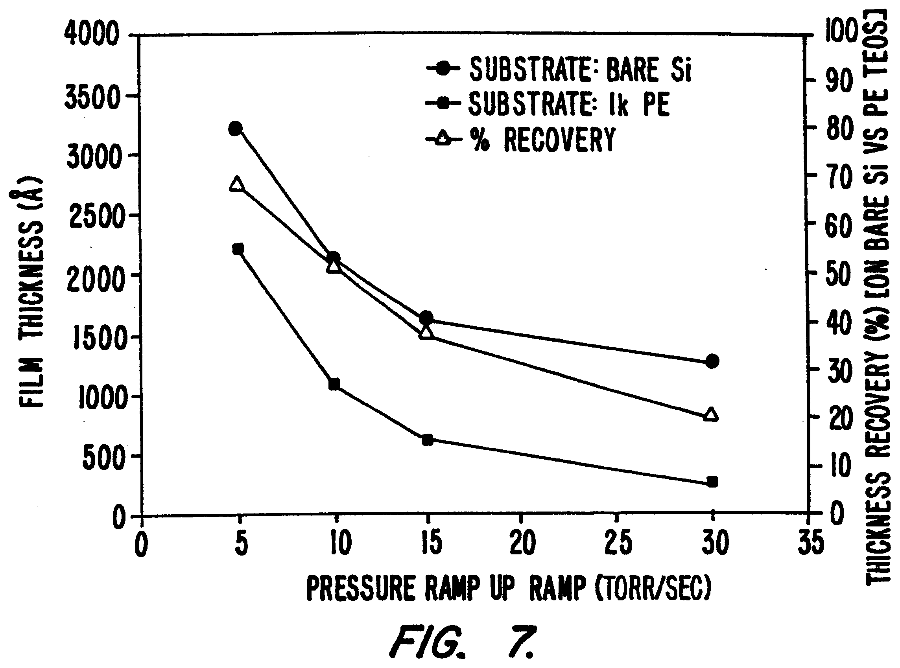
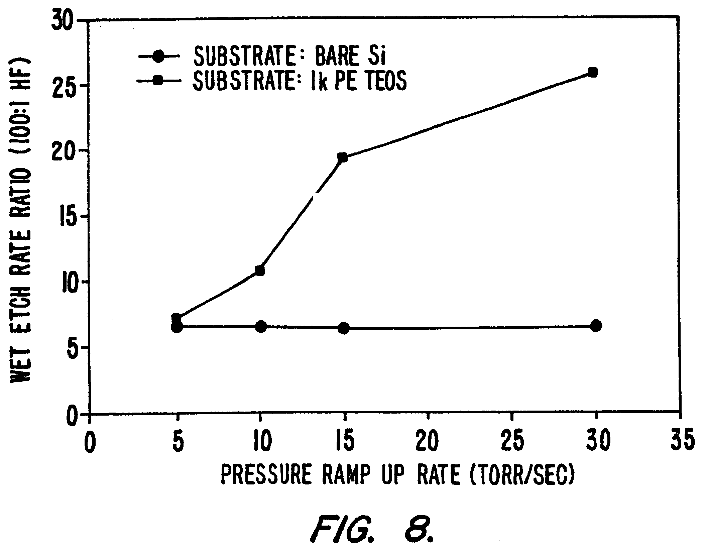
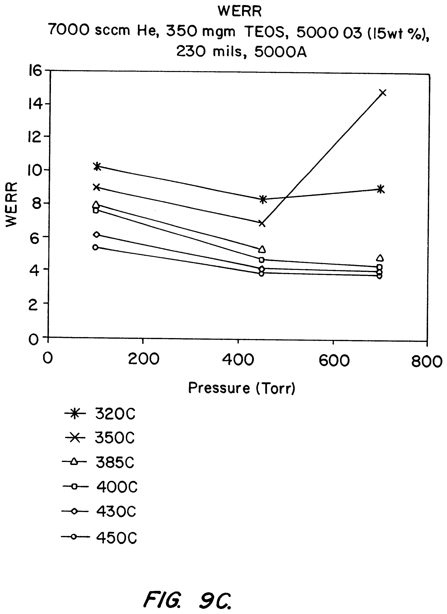
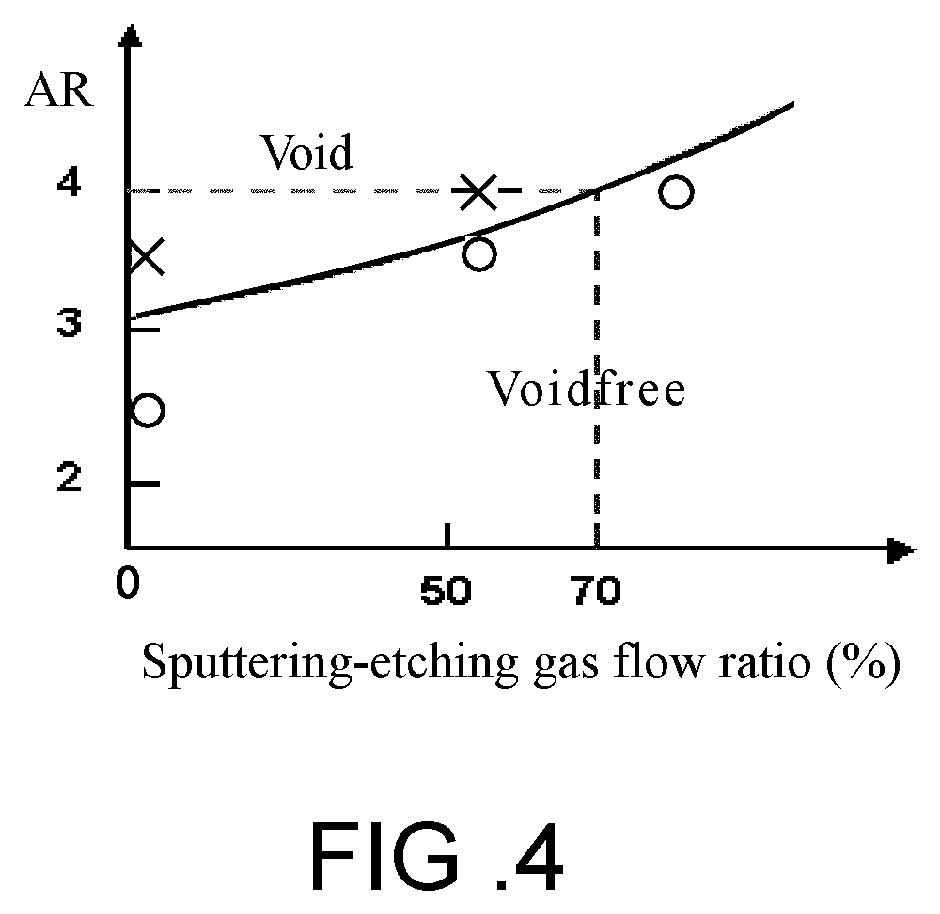
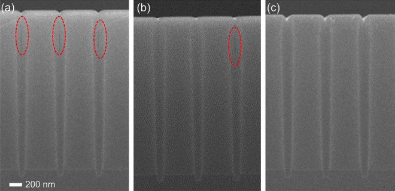
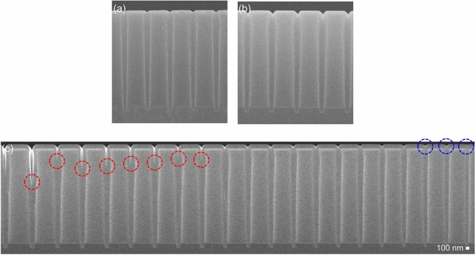

# 03-05 · USG — Undoped Silicate Glass 

> 근거 번호 `[S##]`는 `03-05_USG_자료수집.md`의 ID다. 논문 전문은 열람하지 못했다.
>
> 근거 표시 — **[논문]** 논문·학회에 보고된 값 · **[특허]** 특허의 주장·실시예 · **[리뷰]** 교과서 수준의 정설 · **[계산]** 가정을 명시한 교육용 계산 · **[현장]** 문헌으로 못 박지 못한 현장 통념. 자기 장비에서 확인이 필요하다.

---

## 0. 요약

USG는 도펀트를 넣지 않은 CVD SiO₂다. “USG”라는 한 이름 아래 **증착 방식이 전혀 다른 여러 막**이 묶여 있다. 화학식은 같아도 치밀도, 수분 함량, 응력, 단차 피복이 방식마다 크게 다르다. USG를 이해한다는 것은 방식별 차이와 그 이유를 아는 것이다.

| 방식 | 화학 | 온도 · 압력 | 단차 피복 | 막질 | 응력 | 주 용도 |
|---|---|---|---|---|---|---|
| PECVD SiH₄ | SiH₄ + N₂O | 300–400 °C · 수 Torr | 나쁨 | 중간. H·N 함유 | 압축 | Cap, Hardmask, Passivation |
| PECVD TEOS | TEOS + O₂ | 350–400 °C · 수 Torr | 중간 | 중간. Si–OH 함유 | 압축 | IMD, Cap, Liner, 적층막 |
| SACVD O₃-TEOS | TEOS + O₃ (Plasma 없음) | 400–500 °C · 수백 Torr | 매우 좋음(유동형) | 성김. Si–OH·수분 많음 | 인장 | Gap-fill (STI, PMD) |
| HDP-CVD | SiH₄ + O₂ + Ar/He | Plasma 가열 · 수 mTorr | Bottom-up | 치밀. 열산화막에 근접 | 압축 | Gap-fill (STI, IMD) |
| LPCVD TEOS | TEOS 열분해 | 약 700 °C · 1 Torr 이하 | 매우 좋음 | 좋음 | — | Spacer, Liner (Front-end) |

조건과 막질 등급은 통용 범위다 [리뷰·현장].

---

## 1. 용도와 필요성

USG는 반도체 공정의 거의 모든 단계에서 쓰인다. 이 절에서는 적용처마다 무엇이 요구되고, 그 요구에 따라 어떤 증착 방식을 고르는지 살펴본다.

| 적용 | 요구 | 주로 쓰는 방식 |
|---|---|---|
| STI Gap-fill | 좁고 깊은 Trench를 Void 없이. 이후 고온 Anneal 가능 | HDP → SACVD(O₃-TEOS) → Flowable |
| PMD (게이트 사이 채움) | Void 없이. 열 예산 제한 | HDP, SACVD, (도핑막은 → 03-06 BPSG) |
| IMD (Al 배선 사이) | 400 °C 이하. Gap-fill | HDP + PE-TEOS Cap |
| Cap · Hardmask · Liner | 두께 제어, 낮은 Defect | PECVD TEOS, PECVD SiH₄ |
| Spacer | Conformality | LPCVD TEOS, ALD |
| 3D NAND 적층막의 산화막 층 | 수십~수백 층. 층별 두께 균일도, 응력 정합 | PECVD TEOS |
| Passivation | 수분·이온 차단은 SiN이 맡고 산화막은 응력 완충 | PECVD |

이 표는 문헌으로 확정하지 못한 현장의 경험을 정리한 것이므로, 자기 장비에서 확인해야 한다 [현장]. 공통 원리는 하나다. **Gap을 채워야 하면 단차 피복이 좋은 방식을, 막질이 중요하면 치밀한 방식을 쓰고, 둘 다 필요하면 조합한다.** 예를 들어 HDP로 Gap을 채우고 그 위를 PE-TEOS로 덮어 CMP한다.

> 이해 확인: STI Gap-fill과 Cap 산화막은 각각 어떤 성질을 가장 중요하게 요구하며, 그에 따라 어떤 방식을 고르는가?

---

## 2. CVD SiO₂의 구조와 물성

USG는 모두 SiO₂이지만 증착 방식에 따라 막질이 크게 다르다. 이 절에서는 막질을 평가하는 기준인 열산화막에서 출발해, 무엇이 CVD 산화막을 성기게 만드는지, 그리고 방식별 대표 값은 어떤지 살펴본다.

### 2.1 기준 막으로서의 열산화막

| 물성 | 열산화막 |
|---|---|
| 굴절률 (633 nm) | 1.46 |
| 밀도 | 약 2.2 g/cm³ |
| 유전율 | 3.9 |
| 절연 파괴 전계 | 약 10 MV/cm |
| HF Wet Etch Rate | 기준 $(\mathrm{WERR} = 1)$ |

이 표의 값은 리뷰와 교과서 수준에서 정리된 것이다 [리뷰 S13]. CVD 산화막은 모두 이 기준에서 얼마나 떨어져 있느냐로 평가한다. 가장 흔한 지표가 **WERR(Wet Etch Rate Ratio)** 로, 같은 HF 용액에서 열산화막 대비 몇 배 빨리 녹는지를 본다.

### 2.2 CVD 산화막의 밀도 저하 요인

| 원인 | 어디서 오는가 | 결과 |
|---|---|---|
| Si–OH (Silanol) | TEOS의 분해 생성물, 불완전한 축합 | 네트워크가 끊긴다. k 상승, WERR 상승, 흡습 자리 |
| 흡수된 H₂O | 성긴 구조에 대기 수분이 들어온다. | k 상승, 응력이 압축 쪽으로 이동, 후속 공정에서 Outgassing |
| Si–H | SiH₄ 전구체 | 미세 공극, Hot Carrier 신뢰성 문제 |
| 결합각 뒤틀림 | 저온에서 이완되지 못한 네트워크 | WERR 상승, FTIR Si–O 피크 이동 |

SiH₄ 기반 PECVD 산화막은 전구체에서 온 수소가 미세 공극을 남겨 Etch Rate가 높다. Anneal하면 치밀화되지만 약 1,100 °C가 돼야 열산화막 수준에 가까워진다 [논문 S08]. 저온 CVD 산화막은 **본질적으로 덜 완성된 유리**다.

### 2.3 방식별 대표 값

| 방식 | WERR (열산화막 = 1) | 수분·Si–OH | 비고 |
|---|---|---|---|
| HDP | 1.1–1.5 | 적다 | 이온 충격으로 치밀 |
| PECVD TEOS | 1.5–2.5 | 중간 | 온도↑ → 감소 [S06] |
| PECVD SiH₄ | 2–4 | 수소 함유 | N 소량 혼입 |
| SACVD O₃-TEOS (증착 직후) | 3 이상 | 많다 | Anneal로 크게 개선 |

이 표의 값은 현장에서 통용되는 범위이다 [현장]. HF 농도와 Anneal 이력에 따라 달라진다. 같은 기준으로 측정한 공개 수치표는 확보하지 못했다.

> 이해 확인: PECVD TEOS 막의 WERR이 2.0으로 측정되었다. 이 값은 무엇을 뜻하며, 막을 더 치밀하게 하려면 어떤 방법을 쓸 수 있는가?

---

## 3. 전구체와 반응

USG 방식들의 차이는 결국 원료와 반응의 차이에서 나온다. 이 절에서는 TEOS와 SiH₄의 반응이 단차 피복에 어떤 차이를 만드는지, PECVD의 산화제 선택, SACVD의 유동형 증착과 하부막 의존성, 그리고 HDP에서 증착과 식각이 동시에 일어나는 원리를 차례로 설명한다.

### 3.1 TEOS의 단차 피복 특성

TEOS Si(OC₂H₅)₄는 끓는점 약 168 °C의 액체다 [리뷰 S12]. SiH₄와 달리 부피가 큰 Ethoxy기 4개가 Si를 감싸고 있어 표면에 닿아도 바로 붙지 않는다. 표면의 Si–OH 자리에 화학흡착하고 [리뷰 S10], 붙기 전까지 여러 번 튕기며 좁은 틈 안쪽까지 들어간다.

$$
\equiv\mathrm{Si–OC_2H_5} \rightarrow\ \equiv\mathrm{Si–OH} + \mathrm{C_2H_4} \qquad (\text{Ethoxy기 탈리, β-수소 제거})
\equiv\mathrm{Si–OH} + \mathrm{HO–Si}\equiv\ \rightarrow\ \equiv\mathrm{Si–O–Si}\equiv + \mathrm{H_2O} \qquad (\text{축합})
$$

성장은 “Si–OH 자리 → TEOS 흡착 → Ethoxy기 제거 → 새 Si–OH”의 반복이다. **Si–OH는 불순물이기 전에 성장 자리**다. 그래서 TEOS 계 산화막에서 Si–OH를 완전히 없앨 수 없고, 저온일수록 축합이 덜 끝나 많이 남는다.

반면 SiH₄는 Plasma에서 SiH₃·SiH₂ 같은 반응성 큰 라디칼이 되어 처음 닿는 곳에 붙는다. 입구에 먼저 쌓여 Overhang을 만든다. 일반적으로 TEOS 계가 SiH₄ 계보다 단차 피복이 좋다 [리뷰 S10]. 다만 SiH₄/N₂O도 RTCVD처럼 표면 반응 지배 조건에서는 90 % 넘는 Conformality가 보고된다 [논문 S09]. 단차 피복은 전구체만이 아니라 **기상 반응이냐 표면 반응이냐**가 정한다.

### 3.2 PECVD: O₂와 N₂O

PECVD에서는 Si 원료에 따라 짝을 이루는 산화제가 다르다. 왜 그런 조합을 쓰는지 이해하면 각 방식의 특징이 보인다.

| 조합 | 산화제를 고른 이유 | 특징 |
|---|---|---|
| TEOS + O₂ | O 라디칼이 Ethoxy기와 탄소를 태운다. | O₂가 모자라면 탄소·Si–OH가 남는다. |
| SiH₄ + N₂O | SiH₄는 O₂와 기상에서 자발 반응해 분말이 된다 [리뷰 S15]. N₂O는 Plasma로 깨져야 O를 내놓는다. | N₂O/SiH₄ 비가 낮으면 Si-rich(굴절률↑). 질소가 조금 들어간다. |

### 3.3 SACVD: O₃-TEOS

SACVD는 Plasma를 쓰지 않고, O₃가 열로 분해될 때 나오는 O 원자로 TEOS를 산화한다. 수백 Torr의 높은 압력에서 TEOS와 O가 기상에서 반응해 **중간체(Silanol 계 Oligomer)** 를 만들고, 이것이 표면에서 액체처럼 움직인 뒤 굳는다. 그래서 막이 틈으로 흘러드는 유동형 Profile을 보인다 [리뷰].

- O₃ 농도를 올리면 증착 속도는 어느 점에서 포화한다. 그러나 막질은 그 포화점을 훨씬 넘는 O₃에서 계속 좋아진다 [리뷰 S03]. 과잉 O₃가 잔류 Ethoxy기와 Si–OH를 정리하기 때문이다.
- 문헌에서 쓰는 O₃ : TEOS 몰비는 저 3.7, 중 5.2, 고 12.6 수준이다 [특허 S01].

### 3.4 SACVD의 하부막 의존성 (Surface Sensitivity)

O₃-TEOS의 가장 유명한 문제다. **어떤 막 위에 증착하느냐에 따라 증착 속도와 막질이 달라진다.**

| 하부막 | 증착 속도 (Bare Si 대비) |
|---|---|
| Bare Si | 기준 |
| 열산화막 | **−60 %** |
| PECVD TEOS 산화막 | −15 % |
| PECVD SiH₄ 산화막 | 감소 없음 |
| PECVD TEOS (N₂O) 산화막 | 감소 없음 |
| SiN | 약 100초 동안 거의 0, 이후 회복 |

이 표의 내용은 특허에 공개된 것이며, 독립된 검증을 거친 값은 아니다 [특허 S01, S02]. 고농도 O₃ 조건의 값이다. 속도만 변하는 것이 아니라 Wet Etch Rate, 표면 거칠기, 응력 Hysteresis가 함께 나빠진다 [특허 S01]. 메커니즘은 특허 스스로 미해명이라고 적고 있다 [S01].

이 결과가 실무에서 가지는 의미는 세 가지이다.

1. **막질이 좋은 고농도 O₃ 조건일수록 의존성이 심하다.** 막질과 하부막 무관성이 Trade-off다.
2. STI Trench 안에는 Si(벽), 열산화막 Liner, SiN(Pad Nitride)이 함께 드러나 있다. 표면마다 속도가 다르면 **Trench 안에서 불균일하게 자란다.**
3. 대응은 하부를 “좋은 표면”으로 통일하는 것이다. 감소가 없는 PECVD 산화막을 Liner로 깔거나, Plasma로 표면을 처리하거나, 저농도 O₃로 초기층을 깐 뒤 고농도로 넘어간다 [특허 S01, S02]. 반대로 이 차이를 이용해 Si Liner 위에만 자라게 하는 선택 증착 Gap-fill도 제안됐다 [특허 S02].

하부막 의존성의 크기를 보여 주는 특허 그래프 세 장이다 [특허 S01, S02].

*O₃ : TEOS 유량비와 352초 증착 두께. 위에서부터 Bare Si, SiN, H₂O₂로 전처리한 SiN 위의 값이다. 유량비를 올리는 동안 Bare Si 위는 약 6,600 → 5,250 Å, SiN 위는 약 3,900 → 2,900 Å, 전처리한 SiN 위는 약 4,600 → 550 Å로 변한다(그래프에서 읽은 값). 같은 Recipe, 같은 시간인데 표면에 따라 두께가 몇 배 다르고, O₃ 비가 높을수록 차이가 벌어진다. 이 특허는 그 차이를 일부러 키워 Si 위에만 자라게 하는 데 쓴다.*

*출처: US 6,541,401 (Applied Materials, 2003), FIG. 3. 미국 특허 도면. [Google Patents](https://patents.google.com/patent/US6541401B1/en)*

*증착 압력까지 올리는 Ramp 속도와 그 구간에서 쌓인 초기층(Ramp Layer)의 두께. 위 곡선이 Bare Si, 아래 곡선이 PE-TEOS 산화막 1 kÅ 위의 값이고, 삼각형은 두 두께의 비(회복률)다. 30 Torr/s에서 1,250 Å 대 250 Å(20 %)이던 것이 5 Torr/s에서 3,216 Å 대 2,202 Å(68 %)가 된다. 압력을 천천히 올려 초기층을 두껍게 깔수록 하부막 차이가 덮인다.*

*출처: US 6,319,324 (Applied Materials, 2001), FIG. 7. 미국 특허 도면. [Google Patents](https://patents.google.com/patent/US6319324B1/en)*

*같은 시편의 Wet Etch Rate 비(WERR, 100 : 1 HF, 상온 12분). Bare Si 위의 막은 Ramp 속도와 무관하게 6.4–6.5다. PE-TEOS 위의 막은 30 Torr/s에서 25.8, 15 Torr/s에서 19.2, 10 Torr/s에서 10.7, 5 Torr/s에서 7.1이다. 하부막 의존성은 두께만이 아니라 막질로 나타나고, 초기층을 천천히 깔수록 사라진다.*

*출처: US 6,319,324 (Applied Materials, 2001), FIG. 8. 미국 특허 도면. [Google Patents](https://patents.google.com/patent/US6319324B1/en)*

### 3.5 HDP-CVD의 증착과 Sputter 식각

HDP-CVD는 유도결합 Plasma(ICP)로 밀도가 매우 높은 Plasma를 만들고, Wafer에는 따로 RF Bias를 건다. 수 mTorr의 낮은 압력이라 이온이 충돌 없이 수직으로 날아온다.

$$
\text{증착}: \quad \mathrm{SiH_4} + \mathrm{O_2} \rightarrow \mathrm{SiO_2} \qquad (\text{모든 면에})
\text{Sputter}: \quad \mathrm{Ar^{+}},\ \mathrm{He^{+}},\ \mathrm{O_2^{+}} \rightarrow \text{표면 물질 제거} \qquad (\text{경사면에서 가장 빠르다. 약 45° 부근})
$$

Sputter Yield가 경사면에서 가장 크므로 Trench 입구 모서리의 막이 계속 깎여 **입구가 열린 채로 바닥부터 찬다.** 이것이 HDP의 Bottom-up Gap-fill이다 [특허 S11]. 이온 충격은 막을 치밀하게도 만든다. HDP 산화막이 400 °C 이하 공정 중 막질이 가장 좋은 이유다.

> 이해 확인: SACVD에서 고농도 O₃ 조건을 쓰면 막질은 좋아지지만 STI Trench 안에서 불균일하게 자랄 수 있다. 그 이유를 하부막 의존성으로 설명해 보자.

---

## 4. Process Window와 공정 변수별 응답

이 절에서는 각 방식에서 조절 변수를 바꿀 때 막의 성질이 어떻게 변하는지 정리한다. 방식마다 주된 조절 변수가 다르다는 점에 주목하자.

### 4.1 PECVD TEOS

먼저 PECVD TEOS에서 조절 변수 하나를 올릴 때의 경향을 보자.

| 조절 변수 ↑ | DR | 밀도 · WERR | Si–OH | 압축 응력 | 근거 |
|---|---|---|---|---|---|
| 온도 | ↓ 소폭 | 치밀, WERR ↓ | ↓ | — | [논문 S06] |
| TEOS 유량 | ↑ | 밀도 ↓ | ↑ | ↑ | [논문 S06] |
| O₂ 유량 | — | 밀도 ↑ | ↓ | ↓ | [논문 S06]의 역 |
| RF Power (HF) | ↑ | 치밀 | ↓ | ↑ | [리뷰·현장] |
| LF Power | — | 치밀 | ↓ | ↑↑ | [리뷰·현장] |
| 압력 | ↑ | 성김 | ↑ | ↓ | 고압에서 낮은 응력과 좋은 단차 피복 [특허 S07] |

TEOS가 많거나 O₂가 모자라면 Ethoxy기가 덜 타고 덜 축합된 채 묻힌다. 밀도는 내려가는데 압축 응력은 오른다 [논문 S06].

### 4.2 SACVD O₃-TEOS

SACVD는 Plasma가 없으므로 온도, 압력, O₃ 농도가 주된 조절 변수이다.

| 조절 변수 ↑ | DR | 막질 | 유동성 · Gap-fill | 하부막 의존성 |
|---|---|---|---|---|
| O₃ / TEOS 비 | 포화 [S03] | ↑ [S03] | ↑ | **↑ (악화)** [S01] |
| 온도 | 최대점 후 ↓ | ↑ | — | — |
| 압력 | ↑ | — | ↑ | — |
| TEOS 유량 | ↑ | ↓ | ↓ | ↓ |

이 표의 값은 문헌과 현장에서 통용되는 범위이며, 자기 장비에서 확인해야 한다 [리뷰·현장, 표시한 칸은 문헌]. 온도가 너무 높으면 O₃가 Wafer에 닿기 전에 분해돼 속도가 오히려 떨어진다. Showerhead(Lid) 온도가 O₃ 분해에 직접 영향을 주므로 SACVD에서는 **Lid 온도가 공정 변수**다 [현장].

온도와 압력이 막질(WERR)에 주는 영향은 다음 그래프가 보여 준다 [특허 S02].

*SACVD O₃-TEOS 막의 증착 직후 WERR. 조건은 He 7,000 sccm, TEOS 350 mgm, O₃ 5,000 sccm(15 wt%), 간격 230 mil, 두께 5,000 Å다. 온도가 높을수록 WERR이 낮다(450 °C에서 약 4–5, 320 °C에서 8–10). 385 °C 이상에서는 압력을 올릴수록 조금 더 내려간다. 350 °C 곡선은 700 Torr에서 약 15로 튄다(그래프에서 읽은 값).*

*출처: US 6,541,401 (Applied Materials, 2003), FIG. 9C. 미국 특허 도면. [Google Patents](https://patents.google.com/patent/US6541401B1/en)*

### 4.3 HDP-CVD

HDP-CVD에서는 증착과 Sputter의 균형을 정하는 조절 변수가 가장 중요하다.

| 공정 변수 | 영향 |
|---|---|
| Bias Power ↑ | Sputter ↑ → D/S ↓. Gap-fill ↑, 순 증착 속도 ↓. 과하면 Corner Clipping |
| Source Power ↑ | Plasma 밀도 ↑ → 증착과 이온 Flux 모두 ↑. Wafer 온도 ↑ |
| SiH₄ 유량 ↑ | 증착 ↑ → D/S ↑. Gap-fill 여유 ↓ |
| Sputter 가스 종류 | 넓은 Trench는 Ar(30–60 %). 좁아지면 He로 바꾸고 13 % 미만으로 줄여 재증착을 억제 [특허 S11] |
| H₂ 첨가 | 증착/식각 비를 조절해 Corner Clipping 저감 [특허 S11] |
| Backside He 압력 | Wafer 온도. 온도가 막질과 수소 함량을 정한다. |

> 이해 확인: SACVD에서 Wafer 온도를 너무 높이면 증착 속도가 오히려 떨어질 수 있다. 그 이유는 무엇이며, 왜 Lid 온도도 공정 변수가 되는가?

---

## 5. Gap-fill 계산 [계산]

Gap-fill은 USG의 가장 중요한 용도의 하나이다. 이 절에서는 Conformal 증착이 왜 Void나 Seam을 남기는지 기하학적으로 이해하고, HDP의 증착과 Sputter의 비로 Gap-fill 창을 계산해 본다.

### 5.1 Conformal 증착의 한계

완전히 Conformal한 막은 양쪽 벽에서 같은 속도로 자라 가운데서 만난다. 폭 w인 Trench는 벽 두께 w/2에서 닫힌다. 입구가 조금이라도 먼저 좁아지면(Overhang, 음의 경사) 안에 **Void**가 갇히고, 수직이어도 만나는 면에 **Seam**이 남는다. Conformal 증착으로 Seam 없이 채우려면 Trench가 위로 벌어진 모양이어야 한다.

### 5.2 HDP의 D/S 비

HDP에서는 증착과 Sputter가 동시에 일어나므로, 둘의 비로 Gap-fill 거동을 나타낸다. 이 비를 D/S라고 하며, Bias를 걸 때와 걸지 않을 때의 증착 속도를 비교해 구한다.

$$
\frac{D}{S} = \frac{\text{Bias 없이 잰 증착 속도}}{\text{Sputter 속도}}
\text{Sputter 속도} = (\text{Bias 없이 잰 증착 속도}) - (\text{Bias 걸고 잰 순 증착 속도})
\frac{E}{D} = \frac{1}{D/S}
$$

| Bias 없는 증착 | 순 증착 | Sputter | D/S | E/D | 해석 |
|---|---|---|---|---|---|
| 500 nm/min | 400 | 100 | 5.0 | 0.20 | 통상 하한 부근 [S11] |
| 500 | 350 | 150 | 3.3 | 0.30 | Gap-fill 유리. Clipping 주의 |
| 600 | 550 | 50 | 12 | 0.08 | 빠르지만 입구가 막히기 쉽다. |

특허들이 말하는 창은 다음과 같다 [특허 S11].

- E/D는 통상 0.2를 넘겨야 Trench 위의 두 경사면이 서로 떨어진 채 유지된다.
- 너무 올리면 Trench 상단 모서리의 기판이 깎이는 Corner Clipping이 생긴다. D/S 3 조건에서 Clipping이 난 사례가 있다.
- 좁은 Trench에서는 한쪽 벽에서 Sputter된 물질이 맞은편 벽에 다시 붙어(재증착) Overhang을 만든다. Sputter를 올려도 해결되지 않는 한계다.
- 종횡비 4 이상에서는 조건을 최적화해도 Void를 막기 어렵다.

그래서 **초기에는 D/S를 높게(10–20) 가져가 모서리를 보호하는 막을 먼저 깔고, 이후 D/S를 낮추는** 다단계 Recipe를 쓴다 [특허 S11]. HDP의 종횡비 한계가 STI Gap-fill이 SACVD(O₃-TEOS)와 Flowable CVD로 넘어간 이유다.

Sputter 가스를 바꿔 채울 수 있는 종횡비를 넓힌 예가 있다 [특허 S11]. 특허는 좁은 Trench에서 한쪽 벽에서 Sputter된 물질이 맞은편에 다시 붙어 Overhang과 Void를 만든다고 설명한다.

*HDP-CVD에서 He/H₂ 혼합 가스의 비율(가로축)과 Trench 종횡비 AR(세로축). ○는 Void 없이 채움, ×는 Void다. He/H₂를 넣지 않으면 AR 2.5는 채우고 3.5는 못 채운다. 52 %에서는 3.5를 채우고 4.0은 못 채우며, 70 %를 넘기면 4.0도 채운다. 90 nm 공정의 Trench에서 E/D 비를 0.07로 둔 조건이다.*

*출처: US 6,989,337 (United Microelectronics, 2006), FIG. 4. 미국 특허 도면. [Google Patents](https://patents.google.com/patent/US6989337B2/en)*

> 이해 확인: Bias 없이 600 nm/min, Bias를 걸면 450 nm/min으로 증착된다. D/S와 E/D를 구하고, 이 조건이 Gap-fill 창 안에 있는지 판단해 보자.

---

## 6. 집적 이슈와 불량 모드

USG를 실제 공정에 넣으면 Gap-fill 결함, 수분, 하부막 의존성, Plasma 손상, 응력, Particle 같은 문제가 생긴다. 이 절에서는 각 문제가 왜 생기고 어떻게 대응하는지 살펴본다.

### 6.1 Void와 Seam

Gap-fill 결함은 방식마다 생기는 모양과 드러나는 시점이 다르다.

| 방식 | 생기는 모양 | 드러나는 시점 |
|---|---|---|
| PECVD | 입구 Overhang → 열쇠구멍 모양 Void | CMP 후 Void가 열려 Slurry·금속이 들어간다. |
| SACVD · LPCVD | 중앙 Seam | Wet 공정에서 Seam을 따라 빨리 녹는다. |
| HDP | 재증착 Overhang → Void. 밀집 패턴에서 먼저 [S11] | 단면 SEM |

Seam과 Void는 단면을 묽은 HF에 짧게 담가 드러낸 뒤 SEM으로 본다 [현장].

실제 사진으로 확인해 보자. 아래는 입구 200 nm, 깊이 2.5 µm인 좁고 깊은 Trench를 SiO₂로 채운 단면이다 [논문 S17]. CVD가 아니라 50 °C PE-ALD(DIPAS + O₂ Plasma) 막이다. 그래도 Conformal 증착이 가운데에 Seam을 남기는 원리와 그것을 드러내는 방법은 §5.1에서 본 것과 같다.

*입구 200 nm, 깊이 2.5 µm Trench를 PE-ALD SiO₂로 채운 단면 SEM. (a) 억제 처리가 없으면 양쪽 벽에서 같은 속도로 자란 막이 위쪽에서 먼저 만나 Void(빨간 타원)가 남는다. (b) 매 Cycle 앞에 N₂ Plasma를 쬐면 줄어들지만 남는다. (c) NH₃ Plasma를 쬐면 Void가 없다. NH₃ Plasma는 표면의 성장 자리(Si–OH)를 막아 위쪽 성장을 늦춘다. Plasma가 깊은 곳까지 덜 닿으므로 아래쪽이 먼저 차오른다(Bottom-up).*

*출처: Choi 등, Sci. Rep. 12, 15756 (2022), Figure 4. CC BY 4.0. [PMC](https://pmc.ncbi.nlm.nih.gov/articles/PMC9492731/)*

*위 시편을 묽은 HF(200:1)에 60초 담근 뒤의 단면 SEM. (a) 억제 처리 없이 채운 막, (b) NH₃ Plasma 억제로 채운 막, (c) 깊이 3 µm, 입구 300 nm(왼쪽)에서 100 nm(오른쪽)까지의 Trench를 NH₃ 억제로 채운 결과다.*

*출처: Choi 등, Sci. Rep. 12, 15756 (2022), Figure 11. CC BY 4.0. [PMC](https://pmc.ncbi.nlm.nih.gov/articles/PMC9492731/)*

(a)에서는 HF가 Seam을 따라 스며들어 Trench 바닥까지 갈라진 선이 드러나고, (b)에는 Seam이 없다. (c)에서 넓은 Trench는 아직 다 차지 않았는데, 빈 곳의 끝(빨간 원)은 오른쪽으로 갈수록 위로 올라온다. 아래부터 차오르고 있다는 뜻이다. 가장 좁은 Trench는 완전히 찼다.

HF 처리 전의 사진만 보면 (a)와 (b)의 차이가 작아 보인다. Seam은 HF에 녹아 넓어진 뒤에야 잘 보인다. **Gap-fill을 평가할 때는 HF Decoration 뒤의 단면을 기준으로 삼는다.**

### 6.2 수분: 흡습, Outgassing, 신뢰성

성긴 산화막, 특히 증착 직후의 O₃-TEOS 막은 대기 중의 수분을 빨아들인다. 흡수된 수분은 다음과 같은 문제를 일으킨다.

- **k 상승과 응력 이동.** 인장이던 막이 수분을 먹으면 압축 쪽으로 움직인다. 시간에 따른 응력 변화가 흡습의 지표다.
- **Via Poisoning.** Via를 뚫은 뒤 금속을 채울 때 측벽에서 수분이 나와 Barrier·W 증착을 방해한다. Via 저항이 오른다.
- **신뢰성.** 수분과 수소가 게이트 산화막 쪽으로 이동하면 Hot Carrier 열화가 심해진다.

대응은 치밀한 막으로 덮는 것(PE-TEOS·SiN Cap), Anneal, Q-time 관리다 [리뷰·현장].

### 6.3 하부막 의존성에 의한 불균일

§3.4에서 본 대로 O₃-TEOS는 표면에 따라 다르게 자란다. 패턴 Wafer에서는 SiN 위, 산화막 위, Si 위의 두께와 막질이 달라지고, “나쁜 표면” 위의 막은 거칠고 성기다. Monitor Wafer(Bare Si)의 두께로는 이 문제가 보이지 않는다. **SACVD는 반드시 실제 하부막 조합에서 평가한다.**

### 6.4 Corner Clipping과 Plasma 손상

HDP의 Sputter가 과하면 Trench 상단 모서리의 Si나 Liner가 깎인다 [S11]. STI에서는 활성 영역 모서리가 손상돼 누설과 문턱 전압 이상으로 이어진다. HDP와 PECVD 모두 Plasma에서 온 전하가 배선에 모여 게이트 산화막을 손상시키는 Charging 문제도 있다 [리뷰].

### 6.5 응력과 Crack

인장 응력인 SACVD 막을 두껍게 쌓거나 Anneal로 수축시키면 Crack이 난다. 압축 막(PECVD·HDP)과 조합해 응력을 상쇄한다. 3D NAND의 수백 층 적층에서는 산화막과 질화막의 응력을 맞춰 Wafer Bow를 관리하는 것이 핵심이다 [현장].

### 6.6 Particle

산화막 공정의 Particle은 원료에 따라 원인이 다르다.

- SiH₄ + N₂O: 기상 핵생성 분말
- O₃-TEOS: 기상 반응으로 생긴 흰 분말이 Showerhead와 배기에 쌓인다.
- TEOS 액체 공급: 기화 불량에 의한 액적

> 이해 확인: 증착 직후 인장이던 SACVD 막의 응력이 하루 뒤 압축 쪽으로 이동했다. 무슨 일이 일어난 것이며, 후속 공정에서 어떤 문제가 생길 수 있는가?

---

## 7. 챔버 · 하드웨어 관리

USG 공정은 방식마다 원료 공급과 Chamber 관리의 주의점이 다르다. 아래 표는 그 주요 항목을 정리한 것이다.

| 항목 | 내용 |
|---|---|
| Clean | NF₃ Remote Plasma의 F 라디칼로 SiO₂를 SiF₄로 제거. 잔류 F는 Seasoning으로 덮는다. 고온의 Al·AlN 부품에서 AlFₓ가 생겨 Particle과 Drift 원인이 된다 [현장]. |
| TEOS 공급 | 액체 유량 제어 후 기화, 또는 Bubbler. 배관과 Showerhead를 응축 온도 이상으로 가열한다. 찬 곳이 있으면 응축해 유량이 흔들리고 액적 Defect가 된다 [현장]. |
| O₃ 발생기 | O₃ 농도가 발생기 상태(냉각수 온도, 첨가 N₂, 전극 열화)에 따라 Drift한다. 농도 Monitor가 필수다. O₃ 농도는 막질과 하부막 의존성을 모두 바꾼다 [현장]. |
| Lid 온도 (SACVD) | O₃가 Wafer에 닿기 전에 분해되는 양을 정한다. 증착 속도와 균일도에 직접 영향 [현장]. |
| HDP Dome · Nozzle | Dome 온도가 벽면 증착과 Particle을 좌우한다. Gas Nozzle 끝에 막이 자라 유량 분포가 변한다 [현장]. |
| HDP Wafer 온도 | Plasma가 Wafer를 가열하고 정전척의 Backside He가 식힌다. He Leak나 척 오염은 온도 이상 → 막질 이상으로 이어진다 [현장]. |
| 배기 | 분말이 쌓인다. TEOS 부산물과 O₃의 처리(O₃ 분해기) |

---

## 8. 계측과 해석

산화막의 막질은 두께와 굴절률만으로는 알 수 없다. 아래 표는 각 계측이 무엇을 알려 주고 어떤 함정이 있는지 정리한 것이다.

| 계측 | 얻는 것 | 읽는 법과 함정 |
|---|---|---|
| Ellipsometry | 두께, n | n > 1.47이면 Si-rich 또는 N 혼입. n < 1.45면 성긴 막 |
| FTIR | 결합, 수분 | Si–O–Si 신축 약 1,070–1,080 cm⁻¹. **피크가 낮은 파수로 가고 넓어지면 성기고 뒤틀린 네트워크.** Si–OH 약 3,650, 수분 약 3,400, Si–H 약 2,260 cm⁻¹ [리뷰 S14] |
| WERR | 치밀도 | 열산화막 Wafer를 같은 조에 넣어 비로 본다. |
| 응력과 Hysteresis | 흡습, 열 안정성 | 가열·냉각하며 응력을 잰다. 가열 중 수분이 빠지며 인장 쪽으로 가고 냉각 후 원래 값으로 돌아오지 않으면 그 차이가 수분·구조 변화의 양이다 [특허 S01]. |
| 수축률 | 치밀화 여지 | Anneal 전후 두께 변화 %. 성긴 막일수록 크다. |
| TDS | 방출 가스 | H₂O 방출 온도와 양. Via Poisoning 위험의 직접 지표 |
| 단면 SEM (HF 처리) | Void, Seam | §6.1 |
| C–V · I–V | k, 누설, 절연 파괴 | k > 4.2면 수분·Si–OH를 의심 |

**시간에 따라 변하는 계측값**(n, 응력, FTIR 수분)은 Q-time과 함께 기록해야 비교할 수 있다.

> 이해 확인: 같은 산화막의 n과 응력을 증착 직후와 하루 뒤에 측정했더니 값이 달랐다. 두 값을 비교하려면 무엇을 함께 기록해야 하는가?

---

## 9. 파생 막과 차세대 기술

Gap-fill할 구조의 종횡비가 커지면서 기존 방식으로는 채우기 어려운 경우가 늘었다. 이에 대응해 개발된 방식들은 다음과 같다.

| 방식 | 내용 |
|---|---|
| Flowable CVD | Si–N–H 계 유동성 막을 저온에서 증착해 틈을 액체처럼 채우고, O₃·수증기 Cure로 SiO₂로 바꾼다 [리뷰 S16]. Cure 중 수축과 막질이 과제다. |
| ALD SiO₂ | Aminosilane + O₂ Plasma 또는 O₃. Spacer, Liner, 다중 패터닝 |
| SACVD 개선형 | 하부막 의존성을 없애는 표면 처리와 다단 O₃ 농도 [특허 S01] |
| 선택 증착 | 하부막 의존성을 거꾸로 이용 [특허 S02] |
| 적층용 PECVD | 3D NAND의 산화막/질화막 교대 적층. 한 Chamber에서 수백 층을 연속 증착 |

> 이해 확인: HDP가 종횡비 4 이상의 Trench를 채우기 어려운 이유는 무엇이며, 이를 대신하는 방식은 어떤 원리로 채우는가?

---

## 10. Troubleshooting

아래 표는 USG 공정에서 흔히 나타나는 증상과 유력한 원인, 확인할 데이터, 조치 방향을 정리한 것이다. 표의 원인은 현장 경험에서 나온 출발점이므로 [현장], “확인할 데이터” 열로 가설을 좁힌 뒤에 조치해야 한다.

| 증상 | 유력 원인 | 확인할 데이터 | 조치 방향 |
|---|---|---|---|
| Gap에 Void | PECVD Overhang, HDP D/S 과대, 재증착 | 단면 SEM, D/S | 방식 변경, D/S 하향, He Sputter, 다단계 |
| STI 모서리 손상 | HDP Corner Clipping | 단면 TEM, Bias 이력 | 초기 고 D/S Step, H₂ 첨가, Liner 보강 |
| SACVD 두께가 패턴마다 다름 | 하부막 의존성 | 하부막별 두께, O₃ 농도 | PECVD Liner, 표면 처리, 초기 저농도 O₃ |
| SACVD 막이 거칠고 WERR 높음 | 나쁜 표면 위 성장, O₃ 부족 | AFM, FTIR, O₃ 농도 | 위와 같음. O₃ 발생기 점검 |
| Via 저항 상승 | 산화막 수분 Outgassing | TDS, Q-time | Cap, Anneal, Degas 강화 |
| 응력이 시간에 따라 이동 | 흡습 | 응력–시간, FTIR 수분 | 치밀화, Cap, Q-time |
| n 상승 | Si-rich (N₂O/SiH₄ 비 저하, O₂ 부족) | n, FTIR Si–H | 가스 비 복귀, MFC 점검 |
| 두께 Drift | TEOS 공급 불안정, O₃ 농도 Drift, Lid 온도 | 유량·농도·온도 이력 | 공급계 가열, 발생기 보정 |
| Clean 후 Particle | AlFₓ, Seasoning 부족 | 입자 성분 | Clean 조건, Seasoning |
| 두꺼운 막 Crack | 인장 응력 × 두께, Anneal 수축 | 응력, 수축률 | 압축 막과 조합, 두께 분할 |

> 이해 확인: Bare Si Monitor Wafer의 두께는 정상인데 제품 Wafer의 STI에서 Void가 늘었다. 어떤 원인을 먼저 확인해야 하는가?

---

## 11. 자가 점검

이 장의 핵심 내용을 질문으로 확인해 보자.

**Q1. TEOS 계가 SiH₄ 계보다 단차 피복이 좋은 이유는?**
TEOS는 부피 큰 Ethoxy기가 Si를 감싸 표면 반응 확률이 낮다. 여러 번 튕기며 깊은 곳까지 들어간다. SiH₄에서 나온 라디칼은 처음 닿는 곳에 붙는다.

**Q2. PECVD에서 SiH₄의 산화제로 O₂ 대신 N₂O를 쓰는 이유는?**
SiH₄와 O₂는 기상에서 자발적으로 반응해 분말이 된다. N₂O는 Plasma로 깨져야 O를 내놓으므로 반응이 Plasma 영역에 한정된다.

**Q3. O₃-TEOS에서 O₃ 농도를 올리면 좋아지는 것과 나빠지는 것은?**
막질이 좋아진다. 하부막 의존성은 심해진다. 열산화막 위에서 증착 속도가 60 % 줄어든다.

**Q4. HDP가 Trench를 바닥부터 채울 수 있는 이유는?**
증착과 Sputter가 동시에 일어나고, Sputter가 경사면에서 가장 빠르다. 입구 모서리의 막이 계속 깎여 입구가 열려 있는 동안 바닥이 찬다.

**Q5. Bias 없이 500 nm/min, Bias를 걸면 400 nm/min이다. D/S와 E/D는?**
Sputter 100 nm/min. $D/S = 5$, $E/D = 0.2$.

**Q6. Sputter를 더 올려도 좁은 Trench의 Void가 없어지지 않는 이유는?**
한쪽 벽에서 Sputter된 물질이 맞은편 벽에 재증착해 Overhang을 만든다. 폭이 좁을수록 심하다.

**Q7. 산화막 FTIR에서 Si–O–Si 피크가 낮은 파수로 이동하고 넓어졌다. 무슨 뜻인가?**
네트워크가 성기고 결합각이 뒤틀려 있다. 밀도가 낮고 WERR이 높을 것이다.

**Q8. SACVD를 Bare Si Monitor Wafer만으로 관리하면 놓치는 것은?**
하부막 의존성이다. 실제 Wafer의 SiN·열산화막 위에서 속도와 막질이 다르다.

---

## 12. 참고 문헌

- [S01] O₃-TEOS 하부막 의존성 특허군(US 6,319,324 등, Kwok 논문 인용) — 하부막별 증착 속도
- [S02] US 6,541,401 · US 7,176,105 — SiN 위 지연, 선택 증착
- [S03] Enigmatic Consulting, TEOS/Ozone Thermal CVD — O₃ 농도와 속도·막질
- [S06] PECVD TEOS 연구(NYCU) — 유량·온도와 응력·밀도·Si–OH
- [S08] Cornell CNF 2023–2024 — PECVD 산화막의 Anneal 치밀화
- [S11] HDP Gap-fill 특허군(US 6,989,337 · US 6,808,748 등) — E/D, Corner Clipping, 재증착
- [S17] Choi 등, *Sci. Rep.* 12, 15756 (2022) — 억제 처리로 아래부터 채우는 SiO₂ PE-ALD, 단면 SEM·TEM(그림 출처)
