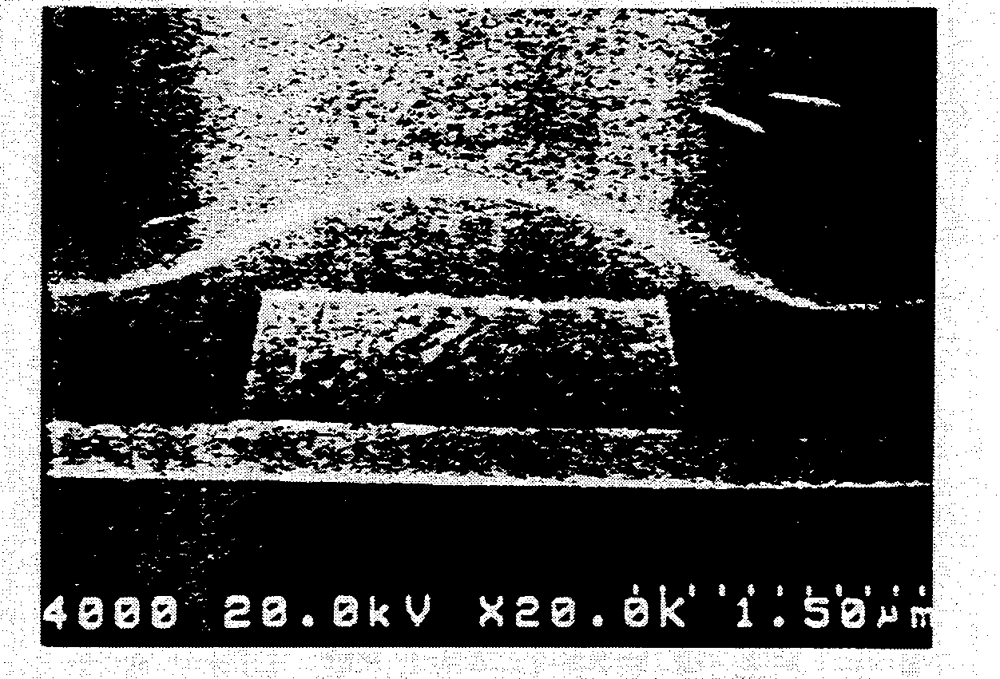
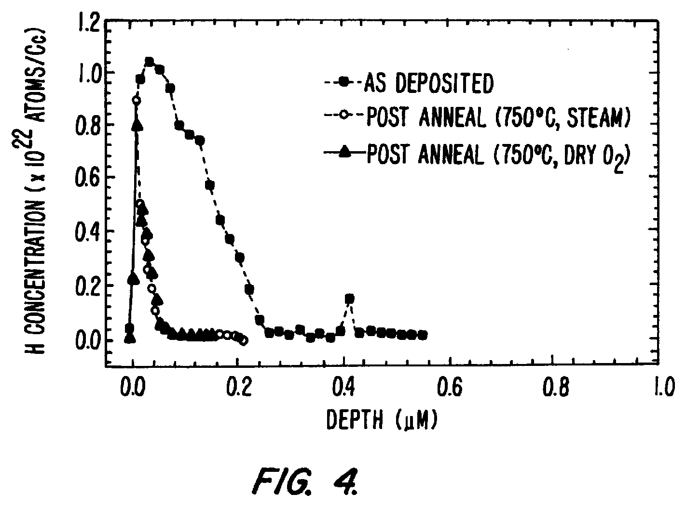
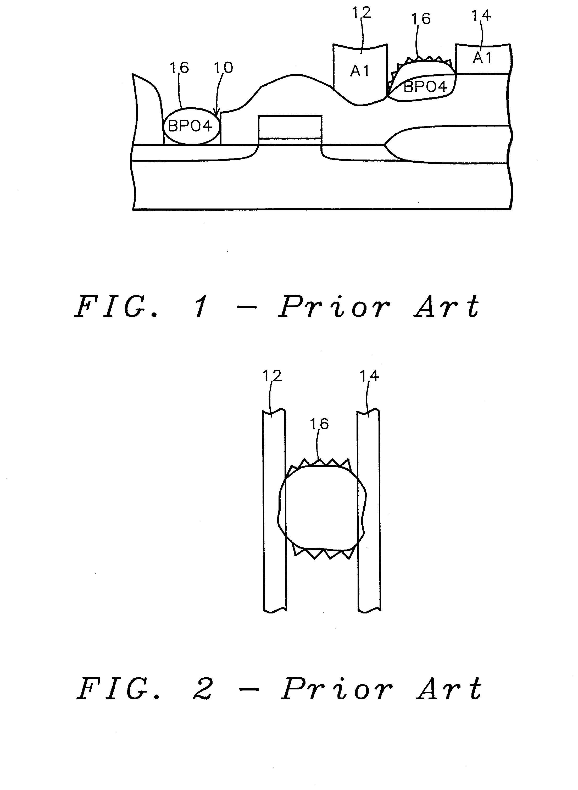
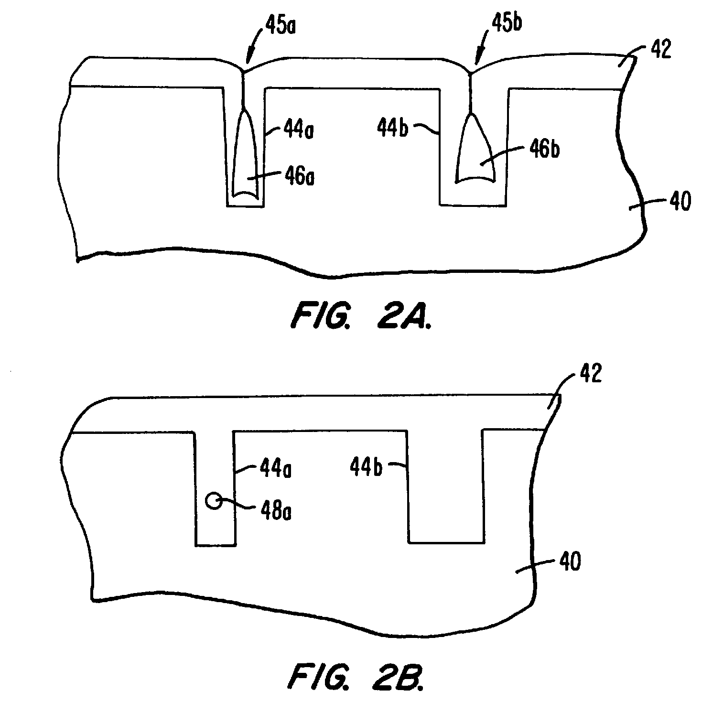

# 03-06 · BPSG — Borophosphosilicate Glass 

> 근거 번호 `[S##]`는 `03-06_BPSG_자료수집.md`의 ID다. 논문 전문은 열람하지 못했다.
>
> 근거 표시 — **[논문]** 논문·학회에 보고된 값 · **[특허]** 특허의 주장·실시예 · **[리뷰]** 교과서 수준의 정설 · **[계산]** 가정을 명시한 교육용 계산 · **[현장]** 문헌으로 못 박지 못한 현장 통념. 자기 장비에서 확인이 필요하다.

---

## 0. 요약

BPSG는 SiO₂에 붕소와 인을 함께 넣은 유리다. 도펀트가 유리의 점도를 낮춰 **800–900 °C에서 녹아 흐른다(Reflow).** 이 성질로 게이트 사이의 좁은 틈을 메우고 표면을 완만하게 만든다. 금속 배선 이전 층간 절연막(PMD)의 대표 재료다.

| 항목 | 내용 |
|---|---|
| 화학식 | SiO₂–B₂O₃–P₂O₅ 3성분 유리. 붕소와 인은 산화물(B₂O₃, P₂O₅) 형태로 SiO₂ 망에 들어간다. 조성은 산화물이 아니라 원소 B·P의 무게비(wt%)로 적는 것이 관행이다(아래 ‘조성’ 행) |
| 역할 | PMD Gap-fill과 평탄화, 이동성 이온 Gettering(P) |
| 조성 | B 2–6 wt%, P 2–9 wt%, 합계 11 wt% 미만 [특허 S02]. 통상 B 1–4, P 4–6 wt% [특허 S02] |
| Reflow | 800–900 °C [특허 S02]. 비교: PSG는 950–1,100 °C |
| 조성의 효과 | B 1 wt% ↑ → Flow 온도 약 40 °C ↓. P는 5 wt% 넘으면 효과 포화 [특허 S02] |
| 분위기의 효과 | Steam은 N₂보다 약 70 °C 낮춘다 [특허 S02] |
| 증착 방식 | SACVD(O₃ + TEOS + TEB + TEPO), PECVD, 과거 APCVD(SiH₄ + B₂H₆ + PH₃ + O₂) |
| 증착 조건 예 | 480 °C, 600 Torr, 2,000 Å/min [특허 S09]. He Carrier 공정 150–250 Torr [특허 S09] |
| 대표 결함 | BPO₄ 결정, 붕산 결정, 도펀트 외확산 |
| 핵심 Trade-off | 낮은 Flow 온도(도펀트↑) ↔ 안정성(흡습·결정·외확산) |

---

## 1. 용도와 필요성

BPSG는 트랜지스터와 첫 금속 배선 사이를 채우는 PMD로 쓰인다. 이 절에서는 PMD가 풀어야 하는 문제, 붕소와 인을 함께 넣는 이유, 그리고 평탄화의 주역이 CMP로 넘어간 뒤에도 BPSG가 남은 이유를 살펴본다.

### 1.1 PMD의 요구 조건

트랜지스터를 만든 직후의 표면을 떠올려 보자. 게이트가 솟아 있어 표면이 울퉁불퉁하다. 그 위에 Contact와 첫 금속 배선을 올리려면 게이트 사이의 틈을 Void 없이 메우고 표면을 완만하게 만들어야 한다. PMD에 요구되는 것은 다음과 같다.

| 요구 | BPSG가 주는 답 |
|---|---|
| 좁은 틈 Gap-fill | 증착 후 녹여 흘리면 Void와 Seam이 메워진다. |
| 평탄화 | Reflow로 단차가 완만해진다. |
| 이동성 이온 차단 | P가 Na⁺·K⁺를 붙잡는다(→ 03-07 PSG). |
| Contact 식각 | 도핑 산화막은 SiN 대비 식각 선택비가 커서 Self-aligned Contact에 유리하다. |
| 열 예산 | PSG(950–1,100 °C)보다 낮은 800–900 °C에서 흐른다 [특허 S02]. |

### 1.2 붕소와 인의 동시 첨가

인만 넣은 PSG는 950–1,100 °C가 돼야 흐른다 [특허 S02]. 접합이 얕아진 소자에서는 이 온도가 도펀트를 너무 많이 확산시킨다. 인을 더 넣어 온도를 낮추려 하면 유리가 수분을 심하게 빨아들인다. 붕소를 추가하면 인을 늘리지 않고도 Flow 온도가 내려간다. **붕소가 온도를 낮추고, 인이 Gettering과 안정성을 맡는다.**

### 1.3 Reflow 평탄화와 CMP 평탄화

그 뒤 평탄화의 주역은 CMP로 넘어갔다. Reflow로 얻는 완만한 표면으로는 미세 Litho의 초점 여유를 맞출 수 없기 때문이다. 그래도 BPSG는 Gap-fill 재료로 남았다. 증착 후 Reflow(또는 낮은 온도의 치밀화 Anneal)로 틈을 메우고 CMP로 평탄화하는 조합이다. 0.06 µm 폭 Trench를 2단계 SACVD BPSG로 Void 없이 채운 보고가 있다 [논문 S08]. DRAM에서는 Capacitor를 만드는 두꺼운 Mold 산화막의 일부로도 쓴다. 도핑 농도에 따라 Wet Etch Rate가 달라지는 성질을 Hole 형상 조절에 이용한다 [현장].

> 이해 확인: BPSG에서 붕소와 인은 각각 어떤 역할을 맡는가? 인만 늘려 Flow 온도를 낮추면 어떤 문제가 생기는가?

---

## 2. 유리의 점도와 도펀트

BPSG가 흐르는 이유는 도펀트가 SiO₂ 네트워크를 느슨하게 만들기 때문이다. 이 절에서는 유리의 네트워크 구조에서 출발해 붕소와 인이 각각 어떤 일을 하는지, 조성이 Flow 온도를 어떻게 바꾸는지, 그리고 도펀트를 무한정 넣을 수 없는 이유를 설명한다.

### 2.1 도펀트의 역할

순수 SiO₂는 SiO₄ 사면체가 꼭짓점을 공유하며 3차원으로 이어진 단단한 네트워크다. 흐르려면 Si–O 결합이 끊어지고 다시 이어져야 하는데 1,400 °C 이상이 필요하다. 도펀트는 이 네트워크를 느슨하게 만든다 [리뷰 S13].

| 도펀트 | 들어가는 형태 | 네트워크에 미치는 영향 |
|---|---|---|
| B (B₂O₃) | 평면 삼각형 BO₃ 단위. 결합이 3개뿐이다. | 3차원 연결을 줄인다. 점도를 크게 낮춘다. |
| P (P₂O₅) | PO₄ 사면체. 그중 하나는 P=O 이중결합으로 끝난다. | 연결이 하나 끊긴다. 점도를 낮추고, 끊긴 자리가 양이온을 붙잡는다. |

### 2.2 조성과 Flow 온도

BPSG가 몇 도에서 흐르는지는 도펀트의 양과 Reflow 분위기에 따라 정해진다. 아래 표는 그 관계를 정리한 것이다.

| 관계 | 내용 | 근거 |
|---|---|---|
| B의 효과 | 1 wt% 늘릴 때마다 필요한 Flow 온도가 약 40 °C 내려간다. | [특허 S02] |
| P의 효과 | 약 5 wt%까지는 내려가고, 그 이상은 더 내려가지 않는다. | [특허 S02] |
| 분위기 | Steam에서는 N₂보다 약 70 °C 낮은 온도에서 흐른다. | [특허 S02] |
| F 첨가 | Reflow 온도를 더 낮춘다(F-BPSG). | [특허 S02] |

Steam이 효과가 있는 이유는 H₂O가 Si–O–Si를 끊어 Si–OH 두 개로 만들기 때문이다. 일시적으로 네트워크가 더 느슨해진다 [리뷰].

### 2.3 조성의 상한

그렇다면 도펀트를 많이 넣을수록 좋을까? 도펀트를 많이 넣을수록 유리는 잘 흐르지만, 동시에 불안정해져 수분을 빨아들이거나 결정이 생긴다. 그래서 조성에는 상한이 있다.

| 한계 | 내용 | 근거 |
|---|---|---|
| 붕산 결정 | B 3–4 wt% 범위에서 표면에 붕산 결정이 생길 수 있다. | [논문 S01, 특허 S03의 인용] |
| 흡습·불안정 | B 5 wt%(다른 서술은 6 wt%) 초과 시 매우 흡습성이고 불안정하다. 증착 직후 바로 Flow해야 한다. | [특허 S02] |
| 표면 결정 | B₂O₃·P₂O₅가 각각 약 5 wt%를 넘으면 증착 후 붕산 또는 Boron Phosphate 결정이 자란다. | [특허 S06] |
| 합계 | B + P 11 wt% 미만 | [특허 S02] |

**출처마다 한계 값이 3–6 wt%로 엇갈린다.** wt%가 원소 기준인지 산화물 기준인지, 증착 방식과 대기 노출 조건이 무엇인지에 따라 달라지는 값이다. 숫자를 외우기보다 “붕소가 흡습과 결정의 주범이고, 그 문턱이 수 wt% 안에 있다”는 것을 기억하고 자기 공정의 한계를 실측으로 정한다.

> 이해 확인: Steam 분위기에서 Reflow하면 Flow 온도가 내려가는 이유를 유리 네트워크의 관점에서 설명해 보자.

---

## 3. 전구체와 반응

BPSG는 Si, B, P의 원료와 산화제를 함께 넣어 증착한다. 이 절에서는 원료의 계열과 성질, 대표적인 SACVD BPSG 공정, 그리고 인이 어떤 산화 상태로 들어가는지가 왜 중요한지 살펴본다.

### 3.1 전구체 계열

BPSG의 원료는 수소화물 계열과 유기 계열로 나뉜다. 계열에 따라 산화제와 공정 방식이 달라진다.

| 계열 | Si | B | P | 산화제 | 특징 |
|---|---|---|---|---|---|
| Hydride (APCVD·LPCVD) | SiH₄ | B₂H₆ | PH₃ | O₂ | 과거 주류. 단차 피복이 나쁘다. 독성·자연발화성 가스 |
| 유기 액체 (SACVD) | TEOS | TEB | TEPO | O₃ | 현재 주류. 유동형 Profile, 좋은 Gap-fill [논문 S08] |
| 유기 액체 (PECVD) | TEOS | TMB · TEB | TMP 계 | O₂ | 저온. Gap-fill은 SACVD보다 못하다. |

액체 전구체의 끓는점은 TEB 약 118 °C, TEPO 약 215 °C, TEOS 약 168 °C다 [리뷰 S12]. TEPO가 가장 덜 날아간다. 기화가 불완전하거나 배관이 차면 가장 먼저 응축한다.

### 3.2 SACVD BPSG

SACVD BPSG는 O₃-TEOS USG(→ 03-05)에 도펀트 원료를 추가한 공정이다. 액체 TEOS·TEB·TEPO를 각각 기화해 He Carrier에 실어 넣고, Chamber 직전에서 O₃와 섞는다. 제어 변수는 Chamber 압력, Heater 온도, TEOS와 도펀트 유량, O₃ 농도와 유량이다 [논문 S08].

- He를 Carrier로 쓰는 이유는 열전도와 확산이 좋아 균일도가 좋기 때문이다. 선호 압력은 150–250 Torr다 [특허 S09].
- 실시예: Susceptor 480 °C, 600 Torr에서 2,000 Å/min. 이때 TEB는 TEOS 유량의 약 4 mol%, TEPO는 약 16 mol%다 [특허 S09]. **막에 들어가는 비율과 공급 비율은 다르다.** 인의 편입 효율이 낮아 TEPO를 훨씬 많이 넣어야 한다.

### 3.3 인의 산화 상태

인은 P₂O₅(5가)로 들어가야 안정하다. 산소가 모자라면 P₂O₃(3가)가 섞인다. 3가 인은 휘발하기 쉽고 수분과 잘 반응한다 [리뷰 S14]. Hydride 계에서 O₂ : Hydride 비가 낮을 때, 유기 계에서 O₃가 부족할 때 생긴다. BPO₄ 결정의 인자로 O₂ : Hydride 비가 꼽히는 것도 이와 연결된다 [논문 S04].

> 이해 확인: 증착 시 산화제가 부족하면 인이 어떤 상태로 들어가며, 그것이 왜 문제가 되는가?

---

## 4. Process Window와 공정 변수별 응답

BPSG의 공정은 증착과 Reflow·Anneal의 두 단계로 이루어진다. 이 절에서는 각 단계의 조절 변수가 막의 조성, Gap-fill, 막질에 어떤 영향을 주는지 정리한다.

### 4.1 증착

먼저 증착 단계에서 조절 변수 하나를 올릴 때 막의 조성과 Gap-fill이 어떻게 변하는지 보자.

| 조절 변수 ↑ | 막의 B | 막의 P | DR | Gap-fill | 주의점 |
|---|---|---|---|---|---|
| TEB 유량 | ↑ | 소폭 변화 | ↑ 소폭 | ↑ | 붕소 한계(§2.3). B와 P의 편입이 서로 영향을 준다. |
| TEPO 유량 | 소폭 변화 | ↑ | — | — | 편입 효율이 낮다. 기화·응축 관리 |
| O₃ 농도 | — | 5가 비율 ↑ | 포화 | ↑ | 부족하면 탄소·P₂O₃ 잔류 |
| 온도 | ↓ (B 휘발) | — | 최대점 후 ↓ | — | 도펀트 편입이 온도에 민감하다. 온도 분포가 조성 분포가 된다. |
| 압력 | — | — | ↑ | ↑ | 기상 반응 분말 ↑ |

이 표의 경향은 리뷰와 현장에서 통용되는 것이다 [리뷰·현장]. 여기서 기억할 점은, BPSG에서는 **두께 균일도와 조성 균일도가 별개의 사양**이다. 두께가 균일해도 조성이 Wafer 내에서 다르면 Reflow 형상과 Wet Etch Rate가 위치마다 달라진다.

### 4.2 Reflow · Anneal

증착한 막을 흐르게 하고 치밀하게 만드는 Reflow와 Anneal 단계의 조절 변수는 다음과 같다.

| 공정 변수 | 영향 |
|---|---|
| 온도 ↑ | 점도 ↓ → 더 잘 흐른다. 접합 확산, 도펀트 외확산 ↑ |
| 시간 ↑ | 더 흐른다. 열 예산 ↑ |
| 분위기 Steam | 약 70 °C 낮은 온도에서 같은 흐름 [S02]. 하부 Si·게이트의 산화 위험 → SiN Liner 필요 |
| 냉각 속도 | 느리면 BPO₄ 결정이 자랄 시간이 생긴다 [S04]. |
| Wafer 간격 (Furnace) | 넓히면 방열이 빨라져 BPO₄가 줄어든다 [S04]. |
| 증착 → Reflow Q-time | 길면 흡습해 붕산 결정과 조성 변화가 생긴다. B가 높은 막은 즉시 Flow [S02] |

Reflow가 실제로 만드는 모양은 단면 SEM으로 확인한다. 아래는 배선 위에 BPSG를 올리고 Reflow한 뒤의 사진이다 [특허 S17].

*배선 위 BPSG를 Reflow한 뒤의 단면 SEM(×20,000, 눈금 1.5 µm). 가운데 사각형이 배선이고, 그 위를 덮은 BPSG가 흘러 모서리 없는 완만한 언덕 모양이 되었다. B와 P를 각각 4–15 wt% 넣은 BPSG를 증착하고 표면을 N₂O Plasma로 처리한 뒤 N₂ 분위기 800 °C에서 30분 Reflow했다. 증착 직후의 막은 배선 모양을 따라 각진 단차를 가진다. 이 각진 단차가 둥글게 바뀐 정도, 즉 경사각이 Flow를 재는 지표이다(§8). 1995년 특허의 스캔이라 흑백 점으로 거칠다.*

*출처: US 5,405,489 (Samsung Electronics, 1995), FIG. 3B. 미국 특허 도면. [Google Patents](https://patents.google.com/patent/US5405489A/en)*

같은 특허는 표면 처리 없이 B·P가 높은 BPSG를 H₂SO₄로 끓여 세정한 뒤 Flow하면 막에 심한 Crack이 생긴다고 보고했다 [특허 S17]. 막 표면의 불안정한 B₂O₃가 수분과 반응하기 때문이다. Plasma 처리는 이 B₂O₃를 B–O–Si 결합이나 얇은 SiOₓ로 바꿔 막을 안정하게 만든다(§2.3, §6.2).

Steam Reflow가 막에 수소를 남기지 않는다는 근거로 특허가 제시한 그래프다 [특허 S02].

*BPSG의 깊이 방향 수소 농도. 증착 직후(●)는 표면 가까이에서 약 1×10²² atoms/cm³이고 깊이 약 0.25 µm까지 수소가 분포한다. 750 °C Steam Anneal(○)과 750 °C 건식 O₂ Anneal(▲) 뒤의 분포는 서로 거의 같고 훨씬 낮다.*

*출처: US 6,177,344 (Applied Materials, 2001), FIG. 4. 미국 특허 도면. [Google Patents](https://patents.google.com/patent/US6177344B1/en)*

> 이해 확인: BPSG의 두께 균일도가 좋은데도 Wafer 위치마다 Reflow 형상이 다를 수 있는 이유는 무엇인가?

---

## 5. 조성 환산과 Flow 온도 계산 [계산]

BPSG의 조성은 여러 단위로 표시되어 혼란스럽기 쉽다. 이 절에서는 원소 wt%와 산화물 mol%를 서로 바꾸는 방법을 익히고, 조성과 분위기가 Flow 온도를 얼마나 바꾸는지 어림해 본다.

### 5.1 wt%와 mol%

BPSG 조성은 “원소 wt%”로 말하는 경우와 “산화물 mol%”로 말하는 경우가 섞여 있다. 환산을 모르면 문헌 값을 잘못 비교한다.

$$
\text{B wt%} \rightarrow \mathrm{B_2O_3}\ \text{wt%}: \quad \times 3.22 \qquad (\mathrm{B_2O_3}\ 69.62\ /\ 2\mathrm{B}\ 21.62)
\text{P wt%} \rightarrow \mathrm{P_2O_5}\ \text{wt%}: \quad \times 2.29 \qquad (\mathrm{P_2O_5}\ 141.94\ /\ 2\mathrm{P}\ 61.95)
\text{산화물 wt%} \div \text{분자량} \rightarrow \text{몰수} \rightarrow \text{mol%} \qquad (\mathrm{SiO_2}\ 60.08)
$$

| B wt% | P wt% | B₂O₃ wt% | P₂O₅ wt% | SiO₂ wt% | B₂O₃ mol% | P₂O₅ mol% | SiO₂ mol% |
|---|---|---|---|---|---|---|---|
| 3 | 5 | 9.7 | 11.5 | 78.9 | 9.1 | 5.3 | 85.7 |
| 4 | 5 | 12.9 | 11.5 | 75.7 | 12.1 | 5.3 | 82.6 |
| 5 | 5 | 16.1 | 11.5 | 72.4 | 15.2 | 5.3 | 79.4 |
| 2 | 6 | 6.4 | 13.7 | 79.8 | 6.1 | 6.4 | 87.5 |

“B 4 wt%”는 산화물로 치면 B₂O₃ 12.9 wt%, 12.1 mol%다. 원소 wt%로는 작아 보여도 **유리의 8분의 1이 붕소 산화물**이다. 수 wt%의 도펀트가 유리 성질을 크게 바꾸는 이유이고, §2.3의 “5 wt%”가 원소 기준인지 산화물 기준인지에 따라 3배 차이가 나는 이유다.

### 5.2 Flow 온도 추정

이번에는 특허에 나온 계수 [S02]를 써서 조성과 분위기가 Flow 온도를 얼마나 바꾸는지 어림해 보자. 이 계산은 절댓값을 구하는 것이 아니라 방향과 크기를 보는 데 쓴다.

| 조건 | Flow 온도 변화 | 예: 기준 900 °C에서 |
|---|---|---|
| 기준: B 3 wt%, P 5 wt%, N₂ | — | 900 °C |
| B 3 → 4.5 wt% | −60 °C | 840 °C |
| N₂ → Steam | −70 °C | 830 °C |
| 둘 다 | −130 °C | 770 °C |
| P 5 → 7 wt% | 거의 없음 | 약 900 °C |

열 예산을 줄이는 조절 변수는 붕소와 분위기다. 인을 올리는 것은 효과가 없고 흡습만 키운다.

> 이해 확인: B 3 wt%, P 4 wt%인 BPSG에서 B₂O₃의 wt%는 대략 얼마인가? 원소 wt%로만 보면 놓치기 쉬운 점은 무엇인가?

---

## 6. 집적 이슈와 불량 모드

BPSG는 도펀트 덕분에 잘 흐르지만, 같은 도펀트가 결정, 확산, 조성 불균일 같은 문제를 만든다. 이 절에서는 대표적인 불량인 BPO₄ 결정과 붕산 결정을 구별하고, 도펀트 외확산, 깊이 방향 조성, Wet Etch Rate, Gap-fill 불량을 차례로 살펴본다.

### 6.1 BPO₄ 결정

BPSG에서 가장 까다로운 불량은 결정이다. Anneal 중에 붕소와 인이 만나면 Boron Phosphate(BPO₄) 결정이 생길 수 있다. Motorola의 사례 연구가 원인과 대책을 정리했다 [논문 S04].

- **주 원인은 Anneal의 열 조건이다.** 결정 성장을 시작할 활성화 에너지가 공급되느냐의 문제다.
- 부 인자는 증착 시 O₂ : Hydride 비, 막의 P 농도, 증착 온도, Anneal 분위기다.
- **대책은 Furnace에서 Wafer 간격을 두 배로 넓혀 방열 속도를 올린 것이다.** 냉각 중 결정이 자라는 온도 구간을 빨리 지나가게 한 것이다. Furnace 온도를 낮추는 것이 대안이다.
- POCl₃/O₂ 분위기에서 Anneal하면 BPO₄가 쉽게 생긴다. Furnace가 인 확산 공정과 공유되거나 인이 남아 있으면 위험하다.

BPO₄가 치명적인 이유는 **Wet으로도 Dry로도 제거되지 않기 때문이다.** Contact 식각에서 결정이 마스크처럼 남아 Contact가 열리지 않거나, 표면 돌기가 금속 Bridge를 만든다 [특허 S05].

*BPO₄ 결정이 만드는 두 가지 불량(종래 기술 설명도). 위(FIG. 1)는 단면으로, 결정(16)이 Contact 자리에 남아 개구를 막고 금속 배선 12와 14 사이에 걸쳐 있다. 아래(FIG. 2)는 위에서 본 모습으로, 결정이 이웃한 두 배선을 잇는다.*

*출처: US 5,461,011 (United Microelectronics, 1995), FIG. 1, 2. 미국 특허 도면. [Google Patents](https://patents.google.com/patent/US5461011A/en)*

### 6.2 붕산 결정

증착 후 대기 중 수분이 표면의 B₂O₃와 반응해 붕산(H₃BO₃) 결정을 만든다. 붕소 농도가 높을수록, 대기 노출이 길수록, 습도가 높을수록 심하다 [S01 인용, S02]. 표면 결정은 Litho·RIE·CMP 모두에 문제를 일으킨다 [특허 S06].

대책은 붕소 농도 관리, 증착 → Anneal Q-time 단축, 얇은 USG Cap이다 [현장]. BPO₄(Anneal 중 생성, 제거 불가)와 붕산(대기 노출 중 생성, 물에 녹음)은 원인과 대책이 다르므로 구별해야 한다.

### 6.3 도펀트 외확산

BPSG는 인의 확산원이다. 인의 외확산은 붕소 농도가 높을수록 커진다 [특허 S02]. Reflow 중 도펀트가 하부 Si와 게이트로 들어가 접합과 문턱 전압을 바꾼다. 그래서 BPSG 아래에 **도핑하지 않은 Liner**(USG, SiN)를 먼저 깐다. SiN Liner는 Steam Reflow에서 하부 산화도 막는다 [리뷰].

### 6.4 깊이 방향 조성 불균일

증착 시작과 끝에서 도펀트 농도가 튀는 경우가 있다. 가스 안정화 중 도펀트와 TEOS의 도달 시점이 다르기 때문이다. 계면에 도펀트가 많은 층이 생기면 Contact Wet 세정에서 그 층만 빨리 녹아 Contact 바닥이 옆으로 파인다(Notch). 반대로 도펀트가 적은 층은 Reflow가 안 돼 Void가 남는다 [현장]. SIMS 깊이 분포로 확인한다.

### 6.5 Wet Etch Rate와 Contact 형상

도핑 농도가 Wet Etch Rate를 정한다. 조성이 Wafer 내에서 다르면 Contact 세정 후 CD가 위치마다 달라진다. Anneal 전후로도 크게 변한다(치밀화). **BPSG의 조성 균일도는 Contact CD 균일도로 돌아온다** [현장].

### 6.6 Gap-fill 불량

Reflow로도 Void가 남는 경우는 틈의 종횡비가 너무 크거나, 틈 안의 도펀트 농도가 낮거나(편입의 형상 의존성), 열 예산이 부족한 경우다. 증착 자체의 Gap-fill 성능(SACVD의 유동형 증착)과 Reflow를 합쳐서 본다. 2단계 SACVD로 0.06 µm 폭을 채운 것이 한 예다 [논문 S08].

*좁고 깊은 Trench 위의 BPSG(종래 기술 설명도). 위(FIG. 2A)는 Reflow 전으로, 증착 때 입구가 먼저 닫혀 Void(46a, 46b)가 남아 있다. 아래(FIG. 2B)는 종래 Reflow 후로, 넓은 쪽은 채워졌지만 좁고 종횡비가 큰 쪽에는 둥근 Void(48a)가 남았다. 특허는 Steam 분위기 Reflow로 같은 도펀트 농도에서 종횡비 6 : 1, 7 : 1 Trench의 이 Void를 없앴다고 적었다.*

*출처: US 6,177,344 (Applied Materials, 2001), FIG. 2A, 2B. 미국 특허 도면. [Google Patents](https://patents.google.com/patent/US6177344B1/en)*

> 이해 확인: Contact가 열리지 않는 불량에서 표면 결정이 발견되었다. 그 결정이 BPO₄인지 붕산인지 구별하는 방법과, 각각의 대책은 무엇인가?

---

## 7. 챔버 · 하드웨어 관리

BPSG는 세 가지 액체 원료를 기화해 정확한 비율로 공급해야 하므로, 원료 공급 장치와 배관의 관리가 막의 조성을 좌우한다. 아래 표는 Chamber와 하드웨어 관리의 주요 항목을 정리한 것이다.

| 항목 | 내용 |
|---|---|
| 액체 공급 | TEOS·TEB·TEPO 3계통. 끓는점이 다르므로 기화기와 배관 온도를 가장 덜 날아가는 TEPO 기준으로 잡는다. 응축은 조성 Drift와 액적 Defect로 이어진다 [현장]. |
| 기화기·분사 밸브 | 도펀트가 분해·중합해 막힌다. 유량이 서서히 줄어 조성이 Drift한다 [현장]. |
| O₃ | 농도 Drift가 인의 산화 상태와 막질을 바꾼다(→ 03-05 §7). |
| 분말 | 기상 반응으로 생긴 흰 분말이 Showerhead·배기에 쌓인다. B₂O₃·P₂O₅ 분말은 흡습해 산이 되어 배기 부품을 부식시킨다 [현장]. |
| Clean | NF₃ 계 F 라디칼. BF₃·PF₅·SiF₄ 모두 휘발성 [리뷰] |
| Memory Effect | 붕소와 인이 벽에 남는다. 같은 Chamber에서 USG를 증착하면 도펀트가 섞인다 [현장]. |
| Anneal Furnace | 인 오염 이력, Wafer 간격, 냉각 Profile이 BPO₄를 좌우한다 [논문 S04]. |

> 이해 확인: TEPO 배관의 온도가 낮아지면 막의 조성은 어떻게 변할 것으로 예상되는가? 끓는점을 근거로 설명해 보자.

---

## 8. 계측과 해석

BPSG에서는 두께뿐 아니라 B와 P의 조성, 그리고 결정 결함을 측정해야 한다. 아래 표는 각 계측이 무엇을 알려 주고 어떤 함정이 있는지 정리한 것이다.

| 계측 | 얻는 것 | 읽는 법과 함정 |
|---|---|---|
| FTIR | B, P 농도 (Inline) | B–O 약 1,370–1,400, P=O 약 1,320–1,330, Si–O 약 1,080 cm⁻¹ [리뷰 S15]. B–O와 P=O 피크가 겹친다. 분리 Fitting과 습식 분석 교정이 필요하다. 흡습하면 피크가 변하므로 증착 직후 측정한다. |
| XRF | B, P 농도 | 붕소는 가벼워 감도가 낮다. 인에 유리 |
| ICP-OES · 습식 분석 | 절대 농도 | FTIR·XRF의 교정 기준 |
| SIMS | 깊이 방향 분포 | 계면 Spike(§6.4), Liner를 통한 외확산 |
| Wet Etch Rate | 조성·치밀도의 종합 지표 | Anneal 전후 모두. 조성 Map의 대리 지표로 쓸 수 있다. |
| 단면 SEM | Gap-fill, Flow 각도 | Reflow 후 단차의 경사각이 Flow의 지표 |
| 표면 검사 (광학·SEM) | 결정 결함 | BPO₄와 붕산을 구별한다. 붕산은 물 세정으로 없어진다. |
| 응력 · 수축률 | 치밀화, 흡습 | 시간에 따른 변화를 Q-time과 함께 기록 |

> 이해 확인: BPSG 막의 B와 P 농도를 FTIR로 관리할 때 주의할 점은 무엇인가?

---

## 9. 파생 막과 차세대 기술

열 예산이 줄고 Gap-fill할 구조가 미세해지면서 BPSG는 여러 방향으로 변형되거나 다른 막으로 대체되었다.

- **F-BPSG.** 불소를 넣어 Reflow 온도를 더 낮춘다 [특허 S02]. 불소의 안정성 문제(→ 03-09 FSG)가 따라온다.
- **불균일 조성 적층.** 도펀트 농도가 다른 층을 쌓아 저온 Reflow와 안정성을 함께 얻는다 [특허 S02].
- **HDP-PSG로의 대체.** 열 예산이 더 줄면서 Reflow가 필요 없는 HDP 계 Gap-fill(→ 03-07)과 Flowable CVD가 PMD를 가져갔다 [현장].
- **Mold 산화막.** DRAM Capacitor의 높은 Mold에서 도핑 농도가 다른 층을 쌓아 Wet Etch 형상을 조절한다 [현장].

> 이해 확인: BPSG가 PMD에서 HDP-PSG나 Flowable CVD로 대체된 가장 큰 이유는 무엇인가?

---

## 10. Troubleshooting

아래 표는 BPSG 공정에서 흔히 나타나는 증상과 유력한 원인, 확인할 데이터, 조치 방향을 정리한 것이다. 표의 원인은 현장 경험에서 나온 출발점이므로 [현장], “확인할 데이터” 열로 가설을 좁힌 뒤에 조치해야 한다.

| 증상 | 유력 원인 | 확인할 데이터 | 조치 방향 |
|---|---|---|---|
| Anneal 후 표면 결정, Contact 미개구 | BPO₄ | 결정이 물·식각에 안 없어짐. Furnace 이력 | Wafer 간격 확대, 온도·냉각 Profile, P 농도, Furnace 인 오염 점검 |
| 증착 후 방치 시 표면 결정·Haze | 붕산 | 물 세정으로 제거됨. Q-time·습도 상관 | Q-time 단축, B 농도 하향, Cap |
| Reflow 부족, Void 잔류 | B 농도 저하, 온도·시간 부족 | FTIR B, Flow 각도 | 조성 복귀, 분위기(Steam), 열 예산 |
| 조성 Drift | 기화기·분사 밸브 막힘, 배관 응축 | 유량 이력, FTIR 추이 | 공급계 점검·가열 |
| Contact 바닥 Notch | 계면 도펀트 Spike | SIMS | 가스 안정화 순서 조정 |
| Contact CD 불균일 | 조성 불균일 | FTIR·Wet Etch Rate Map | 온도 분포, 가스 분포 |
| 접합 누설·문턱 전압 이동 | 도펀트 외확산 | SIMS | Liner 보강, B 농도·열 예산 |
| 배기 부식·막힘 | 흡습한 도펀트 분말 | 분말 성분 | 배기 가열, PM 주기 |

> 이해 확인: 증착 직후에는 정상이던 BPSG Wafer에서 다음 날 표면 결정이 늘었다. 어떤 조건을 먼저 확인해야 하는가?

---

## 11. 자가 점검

이 장의 핵심 내용을 질문으로 확인해 보자.

**Q1. PSG 대신 BPSG를 쓰는 이유는?**
PSG는 950–1,100 °C가 돼야 흐른다. 붕소를 넣으면 인을 늘리지 않고도 800–900 °C로 내려간다. 인을 더 넣는 방법은 5 wt% 위에서 효과가 없고 흡습만 키운다.

**Q2. B 3 wt% 막을 4.5 wt%로 바꾸고 Steam에서 Reflow하면 Flow 온도는 대략 얼마나 내려가는가?**
붕소로 약 60 °C, Steam으로 약 70 °C. 합쳐 약 130 °C다.

**Q3. “B 4 wt%”를 산화물 mol%로 환산하면? (P 5 wt%)**
B₂O₃ 12.9 wt%, 약 12.1 mol%다.

**Q4. BPO₄와 붕산 결정의 차이를 원인과 대책으로 설명하라.**
BPO₄는 Anneal 중 열 조건 때문에 생기고 식각으로 제거되지 않는다. 방열을 빠르게 하거나 온도를 낮춘다. 붕산은 증착 후 대기 수분으로 생기고 물에 녹는다. Q-time을 줄이고 붕소 농도를 관리한다.

**Q5. BPSG 아래에 도핑하지 않은 Liner를 까는 이유는?**
Reflow 중 붕소와 인이 하부 Si와 게이트로 확산하는 것을 막는다. SiN Liner는 Steam에 의한 하부 산화도 막는다.

**Q6. TEPO 공급량이 TEB보다 훨씬 많은 이유는?**
인의 편입 효율이 낮기 때문이다. 공급 비율과 막 안의 비율은 다르다.

**Q7. 두께 균일도가 좋은데 Contact CD가 Wafer 내에서 흩어진다. 무엇을 의심하는가?**
조성 불균일이다. 도펀트 농도가 Wet Etch Rate를 정하므로 세정 후 CD가 위치마다 달라진다.

---

## 12. 참고 문헌

- [S01] Kern & Schnable, *RCA Review* 43, 423 (1982) — BPSG 기준 문헌(원문 미열람)
- [S02] BPSG Reflow 특허군(US 6,177,344 등) — 조성 범위, Flow 온도 계수, Steam 효과
- [S04] Motorola, MRS Proc. — BPO₄ 제거 사례 연구
- [S05] US 5,461,011 — BPO₄의 제거 불가성
- [S08] SACVD BPSG 논문 — TEB/TEPO/He, 0.06 µm Gap-fill
- [S09] BPSG 증착 특허군(US 6,599,574 등) — 온도·압력·유량 실시예
- [S17] US 5,405,489 (Samsung) — Plasma 표면 처리 뒤 BPSG Reflow 단면 SEM(그림 출처), H₂SO₄ 세정 Crack
