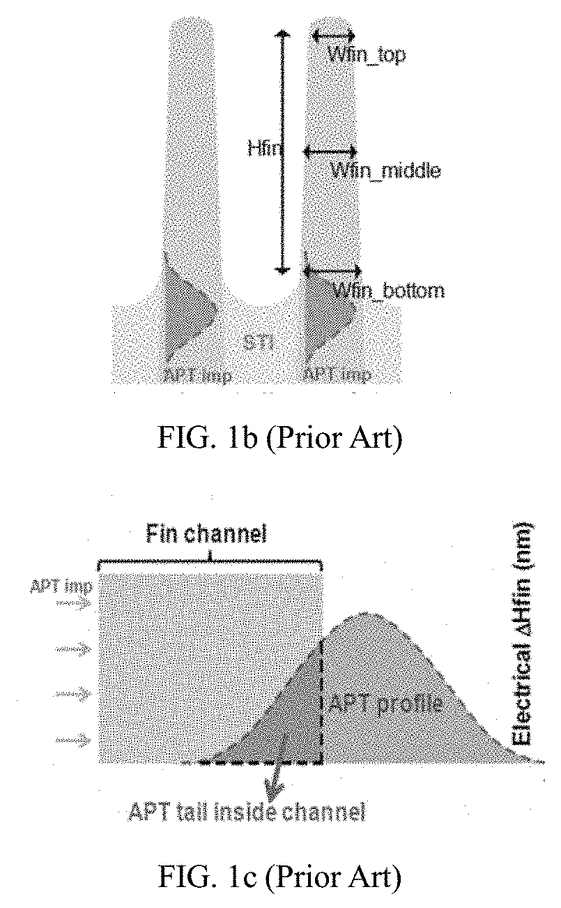

# 03-07 · PSG / BSG 

> 근거 번호 `[S##]`는 `03-07_PSG_BSG_자료수집.md`의 ID다. 논문 전문은 열람하지 못했다.
>
> 근거 표시 — **[논문]** 논문·학회에 보고된 값 · **[특허]** 특허의 주장·실시예 · **[리뷰]** 교과서 수준의 정설 · **[계산]** 가정을 명시한 교육용 계산 · **[현장]** 문헌으로 못 박지 못한 현장 통념. 자기 장비에서 확인이 필요하다.

---

## 0. 요약

PSG는 인을, BSG는 붕소를 넣은 SiO₂다. 둘을 합친 것이 BPSG(→ 03-06)다. 한 가지 도펀트만 넣은 이 두 막은 Reflow 유리로서보다 **도펀트 그 자체의 기능** 때문에 쓴다. PSG는 이동성 이온을 붙잡고, BSG는 붕소를 Si에 공급한다.

| 항목 | PSG | BSG |
|---|---|---|
| 도펀트 | P (P₂O₅로 존재) | B (B₂O₃로 존재) |
| 주 기능 | Na⁺·K⁺ Gettering, Passivation, PMD Gap-fill, n형 확산원 | p형 고체 확산원, 희생막 |
| Reflow | 950–1,100 °C [특허 S03] | BPSG의 구성 성분으로 Flow 온도를 낮춘다(→ 03-06). |
| 농도 예 | P 약 3–5 % (한 공정의 최적값) [특허 S02] | 확산원용: B 1×10²⁰ – 5×10²¹ cm⁻³, 두께 2–5 nm [특허 S06] |
| 증착 | SACVD(TEOS + TEPO + O₃), PECVD, HDP(SiH₄ + PH₃ + O₂), ALD | CVD, PEALD(B₂O₃ / SiO₂ Cycle 교대) [특허 S07] |
| 약점 | 인이 많으면 흡습해 인산이 된다. | 흡습해 붕산이 된다. PSG보다 불안정 |

---

## 1. 용도와 필요성

PSG와 BSG는 쓰임이 서로 다르다. 이 절에서는 각 막이 어디에 쓰이는지 정리하고, 특히 3차원 소자에서 이온 주입 대신 도핑 유리로 도펀트를 넣는 이유를 살펴본다.

### 1.1 PSG

PSG는 인이 이온을 붙잡고 유리를 무르게 만드는 성질 덕분에 여러 곳에 쓰인다.

| 용도 | 내용 |
|---|---|
| 이동성 이온 Gettering | 공정 중 들어온 Na⁺·K⁺가 게이트 산화막에 닿으면 문턱 전압이 움직인다. P-doped 유리가 이 이온들의 Sink가 된다 [리뷰 S01]. |
| Passivation | 최상층 보호막. SiN 단독 또는 PSG/SiN 적층 [리뷰 S01]. PSG가 이온을 붙잡고 응력을 완충하며, SiN이 수분을 막는다. |
| PMD Gap-fill | HDP-PSG. Reflow 없이 Plasma의 증착/Sputter로 채운다. 인은 Gettering을 위해 넣는다 [리뷰 S14, 현장]. |
| n형 확산원 | POCl₃ 확산에서 Si 표면에 생기는 PSG가 인의 공급원이다 [논문 S04]. FinFET Sub-fin 도핑에도 쓴다 [논문 S05]. |
| 희생막 · Mold | USG보다 HF에 빨리 녹는 성질을 이용한다 [리뷰 S15, 현장]. |

### 1.2 BSG

BSG는 주로 붕소를 Si에 공급하는 원천으로 쓰인다.

| 용도 | 내용 |
|---|---|
| p형 고체 확산원 | 3차원 구조(Fin, Trench 벽)에 얇게 덮고 Anneal로 붕소를 밀어 넣는다. 14 nm 노드의 Sub-fin 도핑에 적용이 보고됐다 [논문 S05]. |
| BPSG의 구성 성분 | → 03-06 |
| 희생막 · Hardmask | 다른 산화막 대비 Wet Etch 선택비가 크다 [현장]. |

### 1.3 유리 확산원 도핑과 이온 주입의 비교

FinFET을 예로 들어 보자. Fin의 아래쪽(Sub-fin)에는 소스와 드레인 사이의 누설을 막는 Punch-through Stopper 도핑이 필요하다. 이온 주입으로 넣으려면 이온이 Fin을 뚫고 지나가야 한다. 그 과정에서 **채널에 원치 않는 불순물이 남고 Si 격자가 손상된다.** 도핑 유리를 Fin 아래쪽 측벽에만 남기고 Anneal하면 채널을 건드리지 않고 Sub-fin에만 고농도를 만들 수 있다 [논문 S05]. 수직 벽에는 이온 주입이 닿지 않는다는 기하학적 이유도 있다. 3차원 구조에서 **Conformal하게 증착한 막이 Conformal한 도핑이 된다.**

*이온 주입으로 Punch-through Stopper(APT)를 넣을 때의 문제(종래 기술 설명도). 위(FIG. 1b)는 Fin 단면으로, Fin 바닥 양쪽 STI 높이에 APT 주입 분포가 있다. 아래(FIG. 1c)는 그 분포를 Fin 높이 방향으로 펼친 것으로, 분포의 위쪽 꼬리가 채널 안으로 걸쳐 들어온다(APT tail inside channel). 도핑 유리로 측벽에서 확산시키는 방법은 이 꼬리를 없애려는 것이다.*

*출처: US 11,302,583 (Shanghai Huali IC, 2022), FIG. 1b, 1c. 미국 특허 도면. [Google Patents](https://patents.google.com/patent/US11302583B2/en)*

> 이해 확인: 수직으로 선 Fin의 측벽에 도펀트를 넣을 때, 이온 주입보다 Conformal한 도핑 유리가 유리한 이유는 무엇인가?

---

## 2. 재료

PSG와 BSG의 성질은 인과 붕소가 유리 속에서 어떤 형태로 들어가느냐에 따라 정해진다. 이 절에서는 PSG가 이온을 붙잡는 원리, 인 농도의 장단점, BSG가 불안정한 이유를 설명하고, 네 가지 산화막을 비교한다.

### 2.1 PSG의 이동 이온 포집

PSG가 이온을 붙잡는 원리는 인이 유리 속에 들어가는 방식에서 나온다. 인은 SiO₂ 네트워크에 PO₄ 사면체로 들어간다. 5가인 인은 산소 4개 중 하나와 P=O 이중결합을 이루고, 주변에 음전하를 띤 비가교 산소 자리가 생긴다. 이 자리가 Na⁺ 같은 양이온을 붙잡는다 [리뷰 S11].

- 붙잡힌 이온은 전계가 걸려도 잘 빠져나오지 못한다 [리뷰 S01].
- 청정도만으로는 부족하다. 현대 IC의 BPSG 층에도 공정에서 들어온 Na가 상당량 들어 있다 [리뷰 S01]. **Gettering 층은 오염을 없애는 것이 아니라 해롭지 않은 곳에 가둬 두는 것**이다.

### 2.2 인 농도의 영향

인을 많이 넣으면 좋아지는 성질과 나빠지는 성질이 함께 생긴다.

| 인 ↑ | 좋아지는 것 | 나빠지는 것 |
|---|---|---|
| | Gettering 용량 | 흡습. P₂O₅ + H₂O → 인산 |
| | Flow 온도 ↓ (약 5 wt%까지, → 03-06) | 인산이 Al 배선을 부식 [리뷰 S12] |
| | HF Etch Rate ↑ (희생막에는 장점) | 외확산, n형 자동 도핑 |
| | 응력 완화 | 대기 중 표면 변질 |

한 공정 특허는 PSG의 최적 인 농도를 약 3–5 %로 잡았다 [특허 S02]. 범용 기준은 아니다. 용도마다 최적이 다르다. Passivation에서는 부식 때문에 낮게, 희생막에서는 Etch Rate를 위해 높게 간다.

### 2.3 BSG의 불안정성

B₂O₃는 P₂O₅보다도 물과 잘 반응한다. BSG는 대기에 두면 표면에 붕산 결정이 생기고 붕소가 빠져나간다 [리뷰 S13]. 확산원으로 쓰는 수 nm BSG는 대기 노출만으로 Dose가 달라질 수 있다. 그래서 **증착 직후 같은 장비에서 Cap을 덮는 것**이 기본이다 [특허 S06].

### 2.4 USG · PSG · BSG · BPSG 비교

지금까지 배운 네 가지 산화막을 나란히 놓고 비교해 보자. 어떤 도펀트를 넣느냐에 따라 Flow, Gettering, 흡습, HF Etch Rate가 어떻게 달라지는지 한눈에 볼 수 있다.

| 막 | Flow | Gettering | 흡습 | HF Etch Rate | 주 용도 |
|---|---|---|---|---|---|
| USG | 안 흐른다 | 없음 | 방식에 따라 | 기준 | 범용(→ 03-05) |
| PSG | 950–1,100 °C | 있음 | P↑ 시 큼 | 빠르다 | Gettering, Passivation, 희생막 |
| BSG | — | 없음 | 큼 | 빠르다 | 확산원, 희생막 |
| BPSG | 800–900 °C | 있음 | B↑ 시 큼 | 빠르다 | PMD Reflow(→ 03-06) |

> 이해 확인: PSG의 Gettering 층은 Na 오염을 없애는가, 아니면 다른 방식으로 소자를 보호하는가?

---

## 3. 전구체와 반응

PSG와 BSG는 CVD와 ALD 등 여러 방식으로 만든다. 확산원으로 쓰는 얇은 막은 조성을 정밀하게 맞추어야 하므로 방식의 선택이 중요하다. 아래 표는 방식별 원료와 특징을 정리한 것이다.

| 방식 | 전구체 | 특징 |
|---|---|---|
| SACVD PSG | TEOS + TEPO + O₃ | 유동형 Gap-fill. 인 편입 효율이 낮다(→ 03-06 §3). |
| PECVD PSG | SiH₄ + PH₃ + N₂O, 또는 TEOS + 유기 인 + O₂ | 저온. Passivation |
| HDP PSG | SiH₄ + PH₃ + O₂ + Ar/He | 증착/Sputter 동시 진행으로 Gap-fill(→ 03-05 §3.5). Reflow 불필요 [리뷰 S14] |
| POCl₃ 확산 | POCl₃ + O₂, 800–900 °C | Si 표면에서 PSG가 자라며 인을 공급 [논문 S04] |
| PEALD BSG | B 전구체(TEB · TMB)와 Si 전구체를 번갈아 흘리고 Cycle마다 O₂ Plasma로 산화 | B₂O₃ 층과 SiO₂ 층을 원자층 단위로 교대 적층 [특허 S07] |

### 3.1 인의 산화 상태

인은 5가(P₂O₅)로 들어가야 안정하다. 산화제가 부족하면 3가(P₂O₃)가 섞이고, 이것이 휘발과 흡습의 원인이 된다(→ 03-06 §3.3). PH₃를 쓰는 공정에서는 산화제 비가, O₃-TEOS 계에서는 O₃ 농도가 이를 정한다.

### 3.2 PEALD BSG의 조성 제어

- B₂O₃ Cycle: B 전구체 → Purge → O₂ Plasma → Purge를 $m$번 반복한다.
- SiO₂ Cycle: Si 전구체 → Purge → O₂ Plasma → Purge를 $n$번 반복한다.

붕소 농도는 **m : n 비**로 정한다 [특허 S07]. 유량 비로 조성을 맞추는 CVD와 달리 Cycle 수라는 정수로 조성이 정해지므로 재현성이 좋다. 수 nm 두께에서 Dose를 맞춰야 하는 확산원에 맞는 방식이다. B₂O₃ Cycle을 연속으로 여러 번 돌리면 붕소가 뭉친 층이 생기므로 잘게 섞는다.

> 이해 확인: PEALD BSG에서 B₂O₃ Cycle을 연속으로 여러 번 돌리지 않고 SiO₂ Cycle 사이에 잘게 섞는 이유는 무엇인가?

---

## 4. Process Window와 공정 변수별 응답

PSG와 BSG는 용도에 따라 공정의 관심사가 다르다. Gap-fill과 Passivation에 쓰는 PSG에서는 인 농도와 막질이, 확산원에서는 두께와 조성의 정밀도가 중요하다. 이 절에서는 두 경우의 조절 변수를 정리한다.

### 4.1 PSG (Gap-fill · Passivation)

먼저 Gap-fill과 Passivation에 쓰는 PSG에서 조절 변수를 올릴 때의 경향을 보자.

| 조절 변수 ↑ | 막의 P | 영향 |
|---|---|---|
| P 전구체 유량 | ↑ | Gettering ↑, 흡습 ↑, HF Etch Rate ↑ |
| 산화제 비 | 5가 비율 ↑ | 안정성 ↑ |
| 온도 | 편입 효율 변화 | 치밀화. 온도 분포가 조성 분포가 된다. |
| HDP Bias | — | Gap-fill ↑. Sputter가 인을 선택적으로 빼낼 수 있어 조성이 변한다 [현장]. |

### 4.2 BSG · PSG (확산원)

확산원으로 쓰는 막에서는 두께, 조성, Cap, Anneal 조건이 Si에 들어가는 Dose를 정한다.

| 변수 | 범위·방법 | 근거 |
|---|---|---|
| 두께 | 1–10 nm, 통상 2–5 nm | [특허 S06, S07] |
| 붕소 농도 | 1×10²⁰ – 5×10²¹ cm⁻³ | [특허 S06] |
| 조성 제어 | B₂O₃ : SiO₂ Cycle 비 | [특허 S07] |
| Cap | SiN 등. 도펀트 유출 방지, 확산 방향 제어 | [특허 S06, S08] |
| Drive-in Anneal | 온도·시간이 접합 깊이와 Dose를 정한다. | [논문 S05] |

> 이해 확인: Passivation용 PSG와 희생막용 PSG는 인 농도를 각각 어느 방향으로 정하는가? 그 이유는 무엇인가?

---

## 5. 계산 [계산]

이 절에서는 세 가지 계산을 해 본다. PSG의 조성을 단위 사이에서 환산하고, 확산원 BSG 속에 들어 있는 붕소의 양을 구하며, Anneal 동안 붕소가 Si 속으로 얼마나 확산하는지 어림한다.

### 5.1 PSG 조성 환산

$$
\text{P wt%} \rightarrow \mathrm{P_2O_5}\ \text{wt%}: \quad \times 2.29
$$

| P wt% | P₂O₅ wt% | P₂O₅ mol% |
|---|---|---|
| 4 | 9.2 | 4.1 |
| 6 | 13.7 | 6.3 |
| 8 | 18.3 | 8.7 |

문헌의 “인 농도”가 원소 wt%인지 P₂O₅ wt%인지 mol%인지에 따라 숫자가 두 배 이상 다르다. 단위를 확인하고 비교한다.

### 5.2 확산원의 붕소 총량

$$
\text{면적당 붕소} = \text{농도} \times \text{두께}
$$

| BSG 두께 | 붕소 농도 | 면적당 붕소 |
|---|---|---|
| 3 nm | 2×10²¹ cm⁻³ | 6×10¹⁴ cm⁻² |
| 5 nm | 1×10²¹ cm⁻³ | 5×10¹⁴ cm⁻² |
| 2 nm | 5×10²¹ cm⁻³ | 1×10¹⁵ cm⁻² |

수 nm 유리에 든 붕소가 10¹⁴–10¹⁵ cm⁻² 수준이다. 이 가운데 일부만 Si로 들어가도 Punch-through Stopper에 필요한 Dose 규모가 된다. 뒤집어 보면 **두께 1 nm, 농도 수십 %의 오차가 곧 Dose 오차**다. 확산원 BSG는 수 nm 막의 두께와 조성을 % 단위로 맞춰야 한다.

### 5.3 확산 길이

$$
\text{확산 길이} \approx 2\sqrt{D t}
$$

붕소의 Si 내 확산 계수를 1,000 °C에서 약 1.5×10⁻¹⁴ cm²/s로 놓으면(대략적인 값), 10초에 약 8 nm, 60초에 약 19 nm다. Fin 폭이 10 nm 안팎이므로 **수 초 ~ 수십 초의 Anneal로 Fin 전체에 닿는다.** Drive-in의 열 예산이 접합 위치를 nm 단위로 정한다. 유리에서 공급이 충분하면 표면 농도는 고용 한계로 고정되고 분포는 상보 오차 함수를 따른다 [리뷰 S10].

> 이해 확인: 두께 4 nm, 붕소 농도 1×10²¹ cm⁻³인 BSG에 든 면적당 붕소의 양은 얼마인가? 두께가 1 nm 줄면 몇 % 변하는가?

---

## 6. 집적 이슈와 불량 모드

PSG와 BSG는 도펀트 때문에 흡습, 부식, 외확산, Dose 변동 같은 문제가 생긴다. 이 절에서는 Passivation·Gap-fill용 PSG의 문제와 확산원의 문제를 나누어 살펴본다.

### 6.1 PSG의 흡습과 부식

인이 많은 PSG는 수분을 흡수해 인산을 만든다. 인산이 Al 배선을 부식시킨다 [리뷰 S12]. 대책은 인 농도 제한, SiN으로 덮기, 증착 후 Q-time 관리다. Passivation을 PSG 단독이 아니라 PSG/SiN 적층으로 하는 이유다 [리뷰 S01].

### 6.2 PSG의 외확산과 자동 도핑

고온 공정에서 인이 하부로 확산하거나, 기상으로 나와 다른 Wafer·다른 영역에 붙는다. Liner로 막고, Furnace의 인 이력을 관리한다(→ 03-06 §6.1의 BPO₄도 인 분위기에서 쉽게 생긴다).

### 6.3 확산원의 비의도적 도핑

확산원은 도펀트를 원하는 곳에만 넣어야 한다. 그러나 도펀트가 바깥으로 날아가거나 측벽 밖으로 번지면 원치 않는 곳이 도핑된다.

| 문제 | 내용 | 대책 |
|---|---|---|
| 채널 도핑 | Fin 위쪽에 유리가 남으면 채널까지 도핑된다. | Fin 위쪽·상면의 유리를 제거하고 Sub-fin 측벽에만 남긴다 [특허 S06]. |
| STI로의 유출 | 도펀트가 STI 산화막으로 들어간다. BSG가 공정 중 손상될 수 있다. | SiN Cap으로 방향을 제한 [특허 S08] |
| 대기로의 유출 | Anneal 중 도펀트가 바깥으로 날아간다. | Cap [특허 S06] |
| n/p 교차 오염 | nFET 영역의 BSG, pFET 영역의 PSG | 영역별 제거와 Barrier 층 |
| 유리 잔류 | Drive-in 후 유리가 남으면 이후 공정에서 계속 도펀트를 낸다. | Drive-in 후 제거 [특허 S06]. 하부 Si·산화막 대비 선택비 |

### 6.4 확산원의 Dose 변동

§5.2에서 본 대로 두께와 조성이 곧 Dose다. 변동 요인은 ALD Cycle당 성장량의 Drift, 3차원 구조의 위아래 두께 차이, 대기 노출 중 붕소 손실(§2.3), Cap 증착 전 대기 시간이다 [현장].

### 6.5 Wet Etch Rate 차이의 이용과 부작용

도핑 산화막은 USG보다 HF에 빨리 녹는다 [리뷰 S15]. 희생막으로는 장점이지만, 도핑막과 USG가 함께 드러난 구조를 세정하면 도핑막만 파여 단차와 Undercut이 생긴다. 조성이 Wafer 내에서 다르면 Etch 양이 달라진다.

> 이해 확인: 도핑막과 USG가 함께 드러난 구조를 HF로 세정했더니 단차가 생겼다. 그 이유는 무엇인가?

---

## 7. 챔버 · 하드웨어 관리

도펀트 원료는 Chamber와 Furnace에 흔적을 남겨 다른 Wafer를 오염시킬 수 있다. 아래 표는 Chamber와 하드웨어 관리의 주요 항목을 정리한 것이다.

| 항목 | 내용 |
|---|---|
| Memory Effect | 인과 붕소가 벽·배관에 남아 다음 막에 섞인다. USG와 Chamber를 공유하면 USG에 도펀트가 들어간다. 확산원 공정에서는 Dose 오차가 된다 [현장]. |
| PH₃ · B₂H₆ | 고독성. B₂H₆는 용기 안에서 분해해 농도가 변한다(→ 03-02 §7). |
| TEPO | 끓는점이 높아 응축하기 쉽다. 공급계 가열(→ 03-06 §7) |
| 분말 | P₂O₅·B₂O₃ 분말이 흡습해 산이 되어 배기계를 부식시킨다 [현장]. |
| Clean | NF₃ 계. PF₅·BF₃·SiF₄ 모두 휘발성 [리뷰] |
| Furnace 이력 | 인 공정을 돈 Furnace는 인을 낸다. 붕소 함유 막의 Anneal과 공유하면 BPO₄ 위험(→ 03-06 §6.1) |

---

## 8. 계측과 해석

PSG와 BSG에서는 도펀트의 농도와, 확산원이라면 실제로 Si에 들어간 도펀트의 양을 측정해야 한다. 아래 표는 각 계측이 무엇을 알려 주고 어떤 함정이 있는지 정리한 것이다.

| 계측 | 얻는 것 | 읽는 법과 함정 |
|---|---|---|
| FTIR | P=O 약 1,320–1,330, B–O 약 1,370–1,400 cm⁻¹ | 두꺼운 막의 Inline 조성. 수 nm 확산원에는 감도가 모자란다. |
| XRF | P 농도 | 붕소는 감도가 낮다. |
| XPS · SIMS | 얇은 막의 조성, 깊이 분포 | 확산원의 주 계측. Drive-in 후 Si 내 분포(SIMS) |
| Ellipsometry | 두께 | 수 nm에서 두께와 n이 물린다. 조성이 바뀌면 n이 바뀐다. |
| Wet Etch Rate | 조성의 대리 지표 | 도펀트가 많을수록 빠르다. |
| 면저항 (4-point Probe) | Drive-in 후 활성 Dose | Blanket Monitor Wafer에서 확산원 공정 전체를 한 번에 본다. |
| 소자 측정 | 누설, 문턱 전압 | 최종 판정 |
| 표면 검사 | 결정, Haze | 흡습의 조기 신호 |

확산원 공정의 가장 실용적인 Monitor는 **Blanket Wafer에 증착 → Cap → Anneal → 유리 제거 후 면저항**을 재는 것이다. 두께·조성·Anneal의 변동이 모두 한 숫자에 모인다 [현장].

> 이해 확인: 확산원 공정을 양산에서 관리할 때, 두께와 조성을 따로 재는 것보다 면저항을 재는 것이 실용적인 이유는 무엇인가?

---

## 9. 파생 막과 차세대 기술

도핑 유리의 쓰임은 소자 구조가 바뀌면서 함께 변해 왔다. 앞으로의 방향을 살펴보자.

- **ALD 도펀트 직접 증착.** 유리 대신 붕소 자체를 ALD로 올린다(BCl₃ 등) [특허 S09]. 산화막이 없어 제거가 간단하지만 Dose 제어가 더 어렵다.
- **GAA·3차원 구조의 Conformal 도핑.** 이온 주입이 닿지 않는 면이 늘어날수록 고체 확산원의 쓸모가 커진다.
- **PMD의 저열 예산화.** Reflow PSG → BPSG → HDP-PSG → Flowable CVD 순으로 필요 온도가 내려왔다 [현장].

> 이해 확인: GAA처럼 이온 주입이 닿지 않는 면이 많은 구조에서 고체 확산원의 쓸모가 커지는 이유는 무엇인가?

---

## 10. Troubleshooting

아래 표는 PSG와 BSG 공정에서 흔히 나타나는 증상과 유력한 원인, 확인할 데이터, 조치 방향을 정리한 것이다. 표의 원인은 현장 경험에서 나온 출발점이므로 [현장], “확인할 데이터” 열로 가설을 좁힌 뒤에 조치해야 한다.

| 증상 | 유력 원인 | 확인할 데이터 | 조치 방향 |
|---|---|---|---|
| Al 배선 부식 | PSG 인 농도 과다, 흡습 | P 농도, 고온다습 시험 | 인 하향, SiN Cap |
| 문턱 전압 불안정 (이동성 이온) | Gettering 부족, 오염원 증가 | BTS C–V, P 농도 | P 농도·막 두께, 오염원 추적 |
| 확산원 Dose 변동 | 두께·조성 Drift, 대기 노출, Cap 지연 | 면저항 Monitor, XPS, Q-time | Cycle 비·성장량 점검, In-situ Cap |
| 채널 도핑 이상 | Fin 위쪽 유리 잔류 | TEM, SIMS, 문턱 전압 | Recess 식각 조건 |
| Sub-fin 누설 | Dose 부족, Drive-in 부족 | 면저항, 누설 | 농도·Anneal 상향 |
| USG에서 도펀트 검출 | Memory Effect | SIMS | Chamber 전용화, Clean·Seasoning |
| 세정 후 Undercut | 도핑막과 USG의 Etch Rate 차 | 단면 SEM | 세정 약액·시간, 조성 |
| 표면 Haze·결정 | 흡습 (붕산·인산) | Q-time 상관 | Cap, Q-time |

> 이해 확인: 같은 Recipe인데 확산원 공정 뒤 면저항이 Lot마다 흔들린다. 증착 뒤 Cap까지의 어떤 조건을 먼저 확인해야 하는가?

---

## 11. 자가 점검

이 장의 핵심 내용을 질문으로 확인해 보자.

**Q1. PSG가 Na⁺를 붙잡는 원리는?**
인이 네트워크에 들어가며 음전하를 띤 비가교 산소 자리를 만든다. 이 자리가 양이온을 붙잡고, 전계가 걸려도 잘 놓지 않는다.

**Q2. Passivation에서 PSG의 인 농도를 올리지 못하는 이유는?**
흡습해 인산을 만들고 Al 배선을 부식시킨다.

**Q3. Fin 아래쪽 도핑에 이온 주입 대신 BSG·PSG를 쓰는 이유 두 가지는?**
이온 주입은 Fin을 지나가며 채널에 불순물과 격자 손상을 남긴다. 그리고 수직 벽에는 이온이 닿지 않는다. Conformal 유리는 측벽에 균일하게 도펀트를 공급한다.

**Q4. 두께 3 nm, 붕소 2×10²¹ cm⁻³인 BSG에 든 붕소는 면적당 얼마인가?**
6×10¹⁴ cm⁻².

**Q5. PEALD BSG에서 붕소 농도를 무엇으로 조절하는가?**
B₂O₃ Cycle과 SiO₂ Cycle의 비로 조절한다.

**Q6. 확산원 BSG 위에 Cap을 덮는 이유는?**
Anneal 중 붕소가 바깥으로 날아가는 것을 막고 Si 쪽으로 확산하게 한다. 대기 노출 중 붕소 손실과 흡습도 막는다.

**Q7. 문헌에서 “인 8 %”라고 했다. 무엇을 먼저 확인해야 하는가?**
단위다. 원소 wt% 8이면 P₂O₅로 18 wt%, 8.7 mol%다. P₂O₅ wt% 8이면 원소로 3.5 wt%다.

---

## 12. 참고 문헌

- [S01] Enigmatic Consulting, Gettering and Transport of Mobile Ions — P-doped 유리의 Gettering
- [S02] US 5,897,364 등 — PSG Gettering 층, P 3–5 %
- [S05] AVS 2016, TF-ThP16 — 14 nm Sub-fin 고체 확산원 도핑
- [S06] US 11,302,583 — BSG 두께·농도, 측벽 한정, Cap
- [S07] US 9,583,489 — PEALD BSG, Cycle 비 조성 제어
- [S08] US 9,698,018 — SiN Cap 자기정렬 도핑
