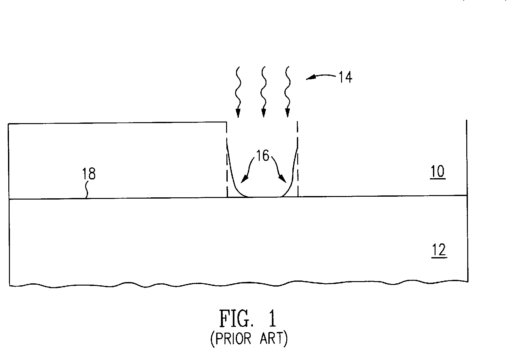
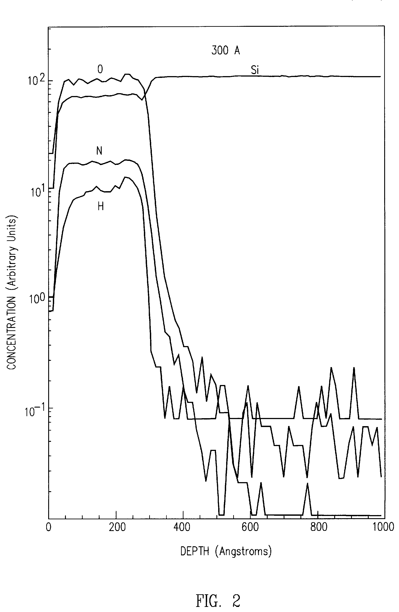
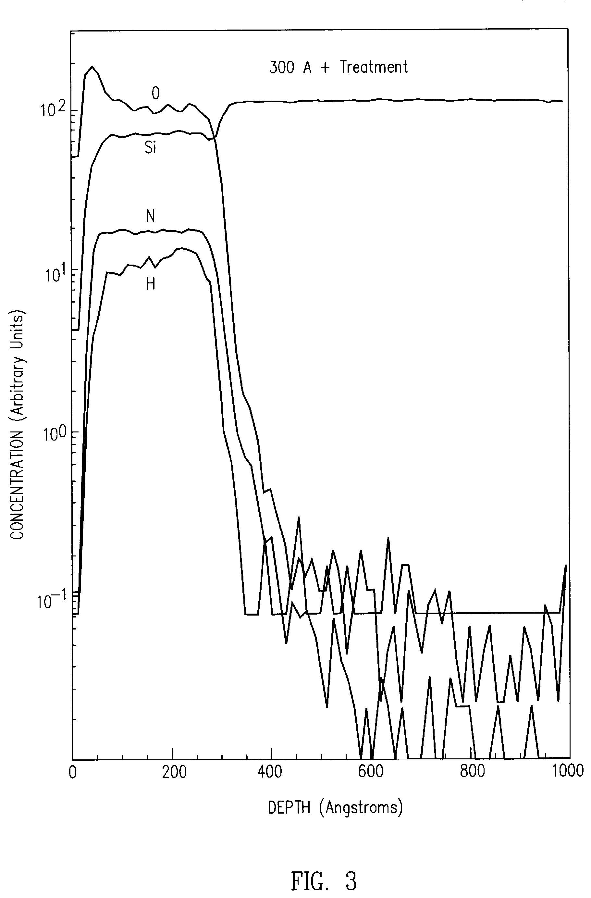
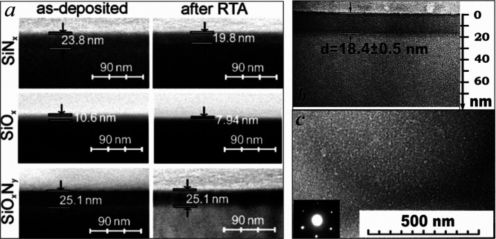

# 03-08 · SiON — Silicon Oxynitride 

> 근거 번호 `[S##]`는 `03-08_SiON_자료수집.md`의 ID다. 논문 전문은 열람하지 못했다.
>
> 근거 표시 — **[논문]** 논문·학회에 보고된 값 · **[특허]** 특허의 주장·실시예 · **[리뷰]** 교과서 수준의 정설 · **[계산]** 가정을 명시한 교육용 계산 · **[현장]** 문헌으로 못 박지 못한 현장 통념. 자기 장비에서 확인이 필요하다.

---

## 0. 요약

SiON은 산화막과 질화막 사이의 조성을 갖는 막이다. 가스 비 하나로 **굴절률을 1.46에서 2.0까지 연속으로 바꿀 수 있다** [논문 S01]. 이 조절 가능성이 SiON을 쓰는 주된 이유다. 반도체에서 가장 중요한 용도는 노광 반사를 줄이는 **DARC(Dielectric Anti-Reflective Coating)** 이고, ACL 위에서는 식각 중간 마스크를 겸한다(→ 03-01 §1.2).

| 항목 | 내용 |
|---|---|
| 조성식 | SiOₓNᵧ(PECVD 막은 :H). x와 y가 SiO₂(x = 2, y = 0)와 Si₃N₄(x = 0, y = 4/3) 사이를 연속으로 오가고, 굴절률이 이 조성을 따라 움직인다 |
| 역할 | DARC, ACL 위 Hardmask, Etch Stop, Passivation, 광 도파로 |
| 증착 방식 | PECVD, 300–400 °C |
| 전구체 | SiH₄ + N₂O (+ NH₃ · N₂ · He) |
| 굴절률 (633 nm) | 1.46 (SiO₂ 쪽) ~ 2.0 (SiN 쪽) [논문 S01] |
| 주 조절 변수 | N₂O 유량 ↓ → 굴절률 ↑, 증착 속도 ↓ [논문 S01] |
| DARC 광학 상수 예 | $n = 1.9, k = 0.3$ @248 nm [특허 S11] |
| 구조 | 단일상 균질 SiOₓNᵧ. Si–O와 Si–N이 섞인 하나의 네트워크 [논문 S03] |
| 대표 문제 | Resist Footing(표면 Amine) [특허 S12], 수소, ACL 계면 손상 |

**증착 반응식.** 첫 줄은 N₂O만 쓸 때의 식이다. 막을 SiOₓNᵧ로 놓고 원소 수를 맞췄다 [계산]. N₂O가 O와 함께 N도 조금 내놓아 y가 0이 아니다. 둘째 줄처럼 NH₃를 더하면 N이 늘어 굴절률이 오른다. 아래 두 줄은 조성의 양 끝이다.

$$
\mathrm{SiH_4} + x\,\mathrm{N_2O} \rightarrow \mathrm{SiO}_x\mathrm{N}_y + \left(x - \tfrac{y}{2}\right)\mathrm{N_2} + 2\,\mathrm{H_2} \qquad (\text{PECVD, 막의 H는 뺐다})
\mathrm{SiH_4} + \mathrm{N_2O} + \mathrm{NH_3} \rightarrow \mathrm{SiO}_x\mathrm{N}_y\text{:H} + \mathrm{N_2} + \mathrm{H_2} \qquad (\text{PECVD, 개략식})
\mathrm{SiH_4} + 2\,\mathrm{N_2O} \rightarrow \mathrm{SiO_2} + 2\,\mathrm{N_2} + 2\,\mathrm{H_2} \qquad (\text{굴절률 1.46 쪽 끝})
3\,\mathrm{SiH_4} + 4\,\mathrm{NH_3} \rightarrow \mathrm{Si_3N_4} + 12\,\mathrm{H_2} \qquad (\text{굴절률 2.0 쪽 끝})
$$

---

## 1. 용도와 필요성

SiON은 굴절률과 흡수를 조절할 수 있다는 성질 덕분에 여러 곳에 쓰인다. 그 가운데 가장 중요한 것이 노광 반사를 줄이는 DARC이다. 아래 표에서 용도를 정리한 뒤, DARC가 왜 필요한지 자세히 살펴보자.

| 용도 | SiON을 쓰는 이유 |
|---|---|
| DARC | 노광 파장에서 n과 k를 가스 비로 맞출 수 있다. 무기막이라 Resist와 식각 선택비가 크다. |
| ACL 위 Hardmask | O₂ Plasma에 깎이지 않아 ACL Open의 마스크가 된다. DARC를 겸해 층 수를 줄인다. |
| Etch Stop · Liner | 산화막과 질화막 사이의 식각 선택비를 조성으로 조절 |
| Passivation | SiN보다 응력과 수소가 적고 산화막보다 수분을 잘 막는다. $n \approx 1.82$ 조성의 예 [특허 S08] |
| 광 도파로 | Core와 Clad의 굴절률 차를 정밀하게 설계. n 1.4663–1.5496 범위의 예 [논문 S07] |
| 태양전지 반사 방지·Passivation | SiNₓ보다 계면 준위와 고정 전하가 낮다 [논문 S05] |

### 1.1 DARC의 필요성

노광할 때 Resist를 통과한 빛은 아래 막에서 반사되어 다시 Resist로 돌아온다. 이 반사광이 들어오는 빛과 간섭하면 두 가지 문제가 생긴다 [리뷰].

- **정상파(Standing Wave).** Resist 두께 방향으로 빛의 세기가 물결친다. 측벽이 울퉁불퉁해진다.
- **Swing과 Notching.** Resist 두께나 하부 단차가 조금만 달라도 선폭이 변한다. 단차 모서리에서 반사된 빛이 엉뚱한 곳을 노광한다.

Resist와 Si 사이의 반사율은 DUV에서 50–60 %에 이른다 [계산, §5]. 그 사이에 광학 상수를 맞춘 막을 넣어 반사를 상쇄시키는 것이 ARC다. Spin-on 유기 BARC와 CVD 무기 DARC가 있고, DARC는 두께 균일도가 좋고 단차를 따라 Conformal하게 덮이며 Hardmask를 겸할 수 있다.

> 이해 확인: Resist 아래에서 반사된 빛이 패턴에 어떤 문제를 일으키는가? 정상파와 Notching을 구별해 설명해 보자.

---

## 2. 재료의 구조와 물성

SiON의 물성이 조성에 따라 연속으로 변하는 것은 그 구조 때문이다. 이 절에서는 SiON이 어떤 네트워크를 이루는지, 굴절률이 조성을 어떻게 나타내는지, 그리고 막 속의 수소가 어떤 문제를 일으키는지 설명한다.

### 2.1 Si–O–N 네트워크

SiON은 SiO₂ 덩어리와 Si₃N₄ 덩어리가 섞인 것이 아니다. Si 원자 하나가 O와 N을 함께 이웃으로 갖는 하나의 네트워크다. 증거는 FTIR이다. 산화막에서 질화막까지 모든 조성에서 Si–O/Si–N 신축 대역이 **두 개가 아니라 하나**로 나타나고, 그 위치가 조성에 따라 연속으로 움직인다 [논문 S03].

이 때문에 물성도 조성에 따라 연속으로 변한다.

| 물성 | SiO₂ 쪽 | SiN 쪽 | 비고 |
|---|---|---|---|
| 굴절률 (633 nm) | 1.46 | 2.0 | [논문 S01] |
| 유전율 | 약 3.9 | 약 7 | [리뷰] |
| HF Etch Rate | 빠르다 | 느리다 | 조성으로 선택비 조절 |
| 수분 차단 | 약하다 | 강하다 | |
| 수소 | 적다 | 많다 | [논문 S04, S05] |
| 응력 | 압축 | 조건에 따라 인장~압축 | → 03-11 |

### 2.2 굴절률과 조성

SiON의 굴절률은 조성을 읽는 눈금으로 쓸 수 있다. N/(N+O) 분율에 대해 굴절률이 거의 선형으로 변한다고 보면 다음과 같이 어림할 수 있다 [계산].

| N/(N+O) | n (633 nm) 어림 |
|---|---|
| 0 | 1.46 |
| 0.25 | 1.59 |
| 0.5 | 1.73 |
| 0.75 | 1.86 |
| 1.0 | 2.00 |

실제로는 여기에 **Si 과잉**이 겹친다. Si–Si, Si–H 결합이 늘면 굴절률이 이 직선 위로 올라가고, DUV 영역의 흡수(k)가 생긴다 [리뷰 S17]. DARC는 바로 이 Si-rich 성분으로 k를 만든다. 굴절률이 같아도 “질소가 많아서 높은 것”과 “Si가 많아서 높은 것”은 다른 막이다. 633 nm의 n만으로는 구별되지 않고, DUV의 k나 FTIR Si–H로 구별한다.

### 2.3 수소

PECVD SiON에는 N–H와 Si–H로 수소가 들어간다. N–H 결합과 결합하지 않은 수소 때문에 Si 농도가 이론값보다 크게 낮아지며, 질화막에 가까운 조성일수록 두드러진다 [논문 S04]. 산소 쪽 조성은 수소가 훨씬 적다 [논문 S05].

수소가 문제 되는 지점은 세 가지다.

- **Amine.** N–H에서 유래한 표면 Amine이 Resist Footing을 일으킨다(§6.1).
- **열 불안정.** 후속 열처리에서 수소가 빠지며 응력과 두께가 변한다.
- **공극.** PECVD SiON은 공극률이 높아 열처리 전후로 물성 경향이 뒤바뀔 수 있다 [논문 S02].

> 이해 확인: 633 nm에서 굴절률이 같은 두 SiON 막이 DUV에서 다른 반사 특성을 보인다. 그 이유는 무엇이며, 어떤 측정으로 구별할 수 있는가?

---

## 3. 전구체와 반응

SiON의 조성은 Si 원료, 산소 원료, 질소 원료의 균형으로 정해진다. 이 절에서는 가스 구성과 그 역할을 정리하고, 왜 산소가 질소보다 먼저 막에 들어가는지, 그리고 DARC의 광학 상수와 두께를 어떻게 맞추는지 살펴본다.

### 3.1 가스 구성

PECVD SiON에는 보통 다음과 같은 가스를 쓰며, 각 가스는 막에 원소를 공급하거나 Plasma를 조절하는 역할을 한다.

| 가스 | 역할 |
|---|---|
| SiH₄ | Si 공급 |
| N₂O | 산소 공급. Plasma에서 N₂ + O로 깨진다. 질소도 소량 공급 |
| NH₃ | 질소 공급. N–H 결합이 늘어난다. |
| N₂ | 희석과 질소 공급(깨기 어려워 편입 효율은 낮다) |
| He | 희석. N₂ 대신 쓰면 막 표면의 N–H 혼입이 줄어든다 [리뷰 S10]. |

산소원으로 O₂가 아니라 N₂O를 쓰는 이유는 안전과 반응 제어다. SiH₄와 O₂는 기상에서 자발 반응하고, PECVD 압력 범위에서는 폭발 위험이 있다 [특허 S13].

### 3.2 산소와 질소의 편입 경쟁

SiON의 조성을 조절할 때 꼭 알아야 할 성질이 있다. Si는 N보다 O와 훨씬 강하게 결합한다는 것이다. Plasma 안에 O가 있으면 Si는 O와 먼저 결합한다. 그래서 **N₂O 유량을 조금만 바꿔도 조성이 크게 움직인다.** N₂O가 줄면 굴절률이 오르고 증착 속도가 내려간다 [논문 S01]. 증착 속도가 내려가는 것은 산소가 가져오던 부피(Si–O–Si)가 줄기 때문이다.

이것이 실무에서 뜻하는 바는 분명하다. **N₂O MFC의 작은 오차가 굴절률 오차가 된다.** SiON에서 가장 정밀해야 하는 것은 SiH₄가 아니라 N₂O와 SiH₄의 비다.

### 3.3 DARC 광학 상수의 조절 변수

DARC Recipe는 광학 상수와 두께라는 두 가지를 독립적으로 맞춘다 [리뷰 S10].

| 맞추는 것 | 공정 변수 |
|---|---|
| n, k | SiH₄/N₂O 비 |
| 두께 | 증착 시간 |

DARC는 20–40 nm로 얇다(§5). 증착 시간이 수 초이므로 Plasma 점화와 가스 안정화 구간이 막의 상당 부분을 차지한다. **얇은 막의 반복성은 과도 구간 제어에 달려 있다** [현장].

> 이해 확인: SiON의 굴절률을 정밀하게 관리하려 할 때, SiH₄ 유량과 N₂O 유량 가운데 어느 쪽의 오차가 더 중요한가? 그 이유는 무엇인가?

---

## 4. Process Window와 공정 변수별 응답

SiON에서는 조절 변수 하나를 바꾸면 굴절률, 흡수, 증착 속도, 수소가 함께 움직인다. 아래 표는 그 경향을 정리한 것이다.

| 조절 변수 ↑ | n (633 nm) | k (DUV) | DR | 수소 | 메커니즘 | 근거 |
|---|---|---|---|---|---|---|
| N₂O / SiH₄ 비 | ↓ | ↓ | ↑ | ↓ | 산소 편입 증가. Si-rich 성분 감소 | [논문 S01] |
| SiH₄ 유량 | ↑ | ↑ | ↑ | ↑ (Si–H) | Si-rich | [리뷰 S17] |
| NH₃ 유량 | ↑ | — | — | ↑ (N–H) | 질소 편입 | [리뷰] |
| He 희석 (N₂ 대신) | — | — | ↓ | N–H ↓ | 표면 N–H 감소 | [리뷰 S10] |
| RF Power | ↓ 소폭 | ↓ | ↑ | ↓ | N₂O 해리 증가 → 산소 공급 증가 | [현장] |
| 온도 | ↑ 소폭 | — | ↓ 소폭 | ↓ | 치밀화, 수소 탈리 | [현장] |
| 압력 | — | — | ↑ | ↑ | 체류시간 증가 | [현장] |

RF Power 행이 SiON 특유의 함정이다. Power를 올리면 N₂O가 더 많이 깨져 **같은 가스 비에서도 산소가 더 들어간다.** 가스 비를 고정해도 Power, 압력, 전극 상태가 변하면 조성이 움직인다. 조성은 유량 비가 아니라 **Plasma 안의 O 라디칼과 Si 라디칼의 비**가 정한다.

> 이해 확인: 가스 비를 그대로 두었는데 Chamber를 Clean한 뒤 굴절률이 바뀌었다. 표의 어떤 메커니즘으로 설명할 수 있는가?

---

## 5. DARC 설계 계산 [계산]

DARC의 두께와 광학 상수는 반사를 줄이는 조건에서 정해진다. 이 절에서는 반사가 얼마나 큰지 계산하고, 반사를 상쇄하는 조건에서 DARC의 두께를 구해 본다.

### 5.1 반사율 계산

먼저 Resist와 Si 사이에서 빛이 얼마나 반사되는지 계산해 보자. 빛이 수직으로 들어올 때 두 매질 경계의 반사율은 다음과 같다.

$$
R = \left|\frac{\tilde{n}_1 - \tilde{n}_2}{\tilde{n}_1 + \tilde{n}_2}\right|^2,\qquad \tilde{n} = n - i k
$$

Resist($n \approx 1.7$)와 Si(248 nm에서 $n \approx 1.57$, $k \approx 3.57$ / 193 nm에서 n ≈ 0.88, k ≈ 2.78) 사이의 반사율은 248 nm에서 약 54 %, 193 nm에서 약 58 %다. 광학 상수는 1차 문헌으로 확인하지 않은 대표값 [리뷰 S16]이므로 크기만 본다. **들어간 빛의 절반 이상이 되돌아온다.**

### 5.2 상쇄 조건

ARC의 윗면(Resist/ARC)에서 반사된 빛과 아랫면(ARC/하부막)에서 반사돼 올라온 빛이 **크기가 같고 위상이 반대**면 서로 지운다 [리뷰 S15].

| 조건 | 무엇으로 맞추는가 |
|---|---|
| 위상: 왕복 광로차가 반파장 | 두께. 대략 λ/(4n) |
| 진폭: 두 반사광의 세기가 같음 | n과 k. 흡수가 아랫면 반사광을 적당히 줄여 준다. |

$$
\text{1/4 파장 두께} = \frac{\lambda}{4n}
$$

| 파장 | n | k | 1/4 파장 두께 | 30 nm 1회 통과 투과율 |
|---|---|---|---|---|
| 248 nm | 1.9 | 0.3 | 32.6 nm | 63 % |
| 193 nm | 1.9 | 0.3 | 25.4 nm | 56 % |
| 193 nm | 1.8 | 0.5 | 26.8 nm | 38 % |

$n = 1.9, k = 0.3$ @248 nm은 특허에 나온 SiON DARC의 예다 [특허 S11]. 이 계산에서 세 가지를 읽을 수 있다.

1. **DARC 두께는 수십 nm이고, 오차 허용이 nm 단위다.** 두께가 1/4 파장에서 벗어나면 위상이 틀어져 반사가 다시 커진다.
2. **n, k, 두께가 한 묶음이다.** n이 변하면 최적 두께가 변한다. 셋 중 하나만 관리해서는 반사율이 보장되지 않는다.
3. **하부막이 바뀌면 최적값이 바뀐다.** DARC 아래가 ACL이냐 Poly-Si냐 산화막이냐에 따라 아랫면 반사가 다르다. 층마다 DARC Recipe가 따로 있는 이유다.

실제 설계는 다층 박막 계산(전달 행렬)으로 Resist/DARC/하부막 전체의 반사율을 두께와 n, k의 함수로 그려 최소점을 찾는다. 위 식은 그 출발점이다.

> 이해 확인: $n = 1.8$인 DARC를 193 nm 노광에 쓴다면 1/4 파장 두께는 대략 얼마인가? 하부막이 바뀌면 이 값을 그대로 써도 되는가?

---

## 6. 집적 이슈와 불량 모드

SiON을 실제 공정에 넣으면 Resist, 아래 막, 열 이력, 식각과 만나며 여러 문제가 생긴다. 이 절에서는 Resist Footing, ACL 위에서의 문제, 광학 상수 Drift, 수소와 열 이력, 제거와 선택비를 차례로 살펴본다.

### 6.1 Resist Footing

Footing이 왜 생기는지 이해하려면 Resist가 현상되는 원리를 알아야 한다. DUV용 화학증폭형 Resist는 노광으로 생긴 산이 촉매가 되어 현상된다. SiON 표면의 **Amine(염기)이 이 산을 중화**하면 계면 근처의 Resist가 현상되지 않고 발 모양으로 남는다 [특허 S12]. 선폭이 바닥에서 넓어지고 식각 후 CD가 틀어진다.

| 대책 | 내용 | 근거 |
|---|---|---|
| SiO₂ Cap | DARC 위에 얇은 산화막을 덮어 Amine과 Resist를 분리 | [특허 S12] |
| N₂O Plasma 처리 | 증착 직후 같은 Chamber에서 N₂O Plasma를 약 1–20초. 표면 수 nm를 SiO₂로 바꾼다. | [특허 S12] |
| He 희석 | N₂ 대신 He를 써 표면 N–H를 줄인다. | [리뷰 S10] |
| N-free ARC | 질소가 없는 ARC로 대체 | [특허 S14] |

N₂O Plasma 처리가 널리 쓰이는 이유는 추가 장비 없이 In-situ로 되기 때문이다 [특허 S12]. 다만 표면이 SiO₂로 바뀌면 **표면층의 n, k가 달라져** §5의 반사 조건이 조금 움직인다. 처리 시간이 곧 광학 사양에 영향을 준다.

Footing의 모양과 N₂O Plasma 처리의 효과를 보여 주는 특허 도면이다 [특허 S12].

*Resist Footing(종래 기술 설명도). Resist(10)가 SiON ARL(18) 위에 있고 DUV(14)로 노광한다. 이상적인 현상 형상은 점선의 수직 벽이지만, 계면의 Amine이 산을 중화해 바닥에 발 모양(16)이 남는다.*

*출처: US 6,051,282 (Novellus Systems, 2000), FIG. 1. 미국 특허 도면. [Google Patents](https://patents.google.com/patent/US6051282A/en)*

*처리하지 않은 SiON ARL(약 300 Å)의 SIMS 깊이 분포. H, N, Si, O의 농도다. 표면에서 산소가 따로 높지 않다.*

*출처: US 6,051,282 (Novellus Systems, 2000), FIG. 2. 미국 특허 도면. [Google Patents](https://patents.google.com/patent/US6051282A/en)*

*N₂O Plasma로 처리한 SiON ARL의 SIMS 깊이 분포. 처리 전과의 주된 차이는 표면에 나타난 산소 피크다. 특허는 이를 SiO₂ 층으로 해석한다. 이 얇은 산화층이 Amine과 Resist를 분리한다.*

*출처: US 6,051,282 (Novellus Systems, 2000), FIG. 3. 미국 특허 도면. [Google Patents](https://patents.google.com/patent/US6051282A/en)*

### 6.2 ACL 위 SiON의 문제

ACL 위에 SiON을 올릴 때는 문제가 반대 방향에서 온다.

- **ACL 표면 손상.** SiON 증착은 N₂O Plasma로 시작한다. 산화성 Plasma가 ACL 표면을 태운다. 계면이 거칠어지고 접착이 약해진다. 초기 Step에서 산화성 Plasma 노출을 줄이는 순서가 필요하다 [현장].
- **온도 순서.** SiON 증착 온도가 ACL 증착 온도보다 높으면 ACL에서 가스가 나와 Blister가 생긴다(→ 03-01 §6.3).
- **Pinhole.** SiON이 얇아 Pinhole이 있으면 ACL Open의 O₂ Plasma가 그 구멍으로 ACL을 파먹는다. 수십 nm 막의 연속성이 Defect 사양이다 [현장].

### 6.3 광학 상수 Drift

DARC는 n, k, 두께가 모두 사양이다. 변동 원인은 N₂O/SiH₄ 비의 미세 변화(§3.2), RF·압력·전극 상태에 따른 N₂O 해리 변화(§4), Chamber 벽 상태(Clean 후 첫 Wafer), 그리고 대기 노출에 의한 표면 산화다. Litho에서는 **Swing Curve 이동이나 CD 변동**으로 나타난다. CD가 흔들릴 때 DARC가 원인 후보에 들어가야 한다 [현장].

### 6.4 수소와 열 이력

후속 열처리에서 수소가 빠지며 n과 응력이 변한다. PECVD SiON은 공극이 많아 열처리 전후로 경향이 뒤바뀌기도 한다 [논문 S02]. 증착 직후 값과 열처리 후 값을 구별해 관리한다.

열처리에 대한 반응이 조성에 따라 얼마나 다른지 단면 사진으로 비교한 실험이 있다 [논문 S19].

*ICP-CVD로 증착한 SiNₓ, SiOₓ, SiOₓNᵧ 막을 Ar 분위기 1,100 °C에서 3분 RTA한 실험. (a) 단면 SEM, (b) RTA 뒤 SiNₓ의 단면 TEM(두께 18.4 ± 0.5 nm), (c) 같은 막을 위에서 본 암시야 TEM과 전자 회절 무늬(왼쪽 아래). 이 실험의 SiNₓ와 SiOₓ는 Si가 과잉인 조성이었고, SiOₓNᵧ에는 과잉 Si가 없었다.*

*출처: Parkhomenko 등, ACS Omega 8(33), 30768 (2023), Figure 1. CC BY 4.0. [PMC](https://pmc.ncbi.nlm.nih.gov/articles/PMC10448691/)*

(a)에서 SiNₓ는 23.8 → 19.8 nm, SiOₓ는 10.6 → 7.94 nm로 얇아졌고, SiOₓNᵧ는 25.1 nm 그대로이다. (c)의 밝은 점들은 막 안에 생긴 Si와 Si₃N₄ 나노 결정이다.

저자들은 SiNₓ와 SiOₓ가 얇아진 원인을 치밀화와 원자 재배열, 나노 결정 형성으로 보았다. SiOₓNᵧ는 세 막 가운데 열처리에 가장 덜 변했다. 다만 1,100 °C는 DARC가 겪는 후속 열처리보다 훨씬 높은 온도이다. 이 결과는 경향을 보여 주는 예로만 읽는다.

### 6.5 제거와 선택비

DARC는 패턴 전사 후 제거하거나 남긴다. SiON은 F 기반 Plasma에 깎이고, 조성에 따라 산화막·질화막 대비 선택비가 달라진다. Si-rich DARC는 식각 속도가 느려 잔류물이 남기 쉽다 [현장].

> 이해 확인: Resist Footing을 막으려고 N₂O Plasma 처리 시간을 늘렸더니 Litho의 CD가 변했다. 그 이유는 무엇인가?

---

## 7. 챔버 · 하드웨어 관리

SiON의 조성과 광학 상수는 가스 비와 Plasma 상태에 민감하므로 Chamber와 가스 공급의 관리가 중요하다. 아래 표는 그 주요 항목을 정리한 것이다.

| 항목 | 내용 |
|---|---|
| MFC 정밀도 | N₂O와 SiH₄의 비가 조성을 정한다(§3.2). MFC 교체·교정 후 n, k 재확인 [현장] |
| 과도 구간 | 얇은 DARC는 증착 수 초. 가스 안정화 → RF 점화 순서와 시간이 두께·조성 반복성을 정한다 [현장]. |
| Clean과 Seasoning | NF₃ Clean 후 벽 상태가 달라 첫 Wafer의 n, k가 벗어난다. Seasoning 필수 [현장] |
| 분말 | SiH₄ + N₂O는 기상 핵생성 분말을 만든다. 압력·Power가 높을수록 심하다 [리뷰]. |
| In-situ 표면 처리 | N₂O Plasma 처리 Step의 시간과 Power가 표면층 두께를 정한다. Footing과 광학 상수 모두에 영향 [현장] |
| 안전 | SiH₄는 자연발화성. N₂O는 산화제. O₂를 쓰지 않는 이유 [특허 S13] |

---

## 8. 계측과 해석

SiON은 두께와 함께 굴절률, 흡수, 조성을 함께 관리해야 한다. 아래 표는 각 계측이 무엇을 알려 주고 어떤 함정이 있는지 정리한 것이다.

| 계측 | 얻는 것 | 읽는 법과 함정 |
|---|---|---|
| Spectroscopic Ellipsometry | 두께, n, k | **DARC는 노광 파장(248·193 nm)에서의 n, k를 봐야 한다.** 633 nm 값만으로는 Si-rich와 N-rich를 구별하지 못한다. |
| 반사율 측정 | 실제 반사 | Resist 없이 측정한 값과 Resist 아래에서의 값은 다르다. 모델로 환산한다. |
| FTIR | 결합 구성, 수소 | Si–O 약 1,070과 Si–N 약 850 cm⁻¹ 사이에 **하나의 대역**이 조성에 따라 이동한다 [논문 S03]. N–H 약 3,350, Si–H 약 2,150–2,250 cm⁻¹ [리뷰 S18]. 얇은 DARC는 신호가 약해 두꺼운 Monitor 막으로 본다. |
| ERDA · SIMS | 수소 절대량 | FTIR N–H 면적과 대조 [논문 S04] |
| XPS · AES | O/N 조성 | AES는 수소를 못 본다. 수소 보정 필요 [특허 S08] |
| Wet Etch Rate | 조성·치밀도 지표 | |
| 응력 | | 열처리 전후 |
| Litho 결과 | Swing Curve, CD, Footing | DARC의 최종 판정 |

> 이해 확인: DARC의 두께는 정상인데 Litho CD가 흔들린다. 계측 표에서 어떤 항목을 먼저 확인해야 하는가?

---

## 9. 파생 막과 차세대 기술

Litho 기술과 소자 구조가 바뀌면서 SiON의 쓰임도 함께 변하고 있다.

- **N-free DARC.** Footing과 Low-k Poisoning을 피하려고 질소 없는 막(SiOC 계, Si-rich 산화막)으로 만든다 [특허 S14].
- **Graded DARC.** 두께 방향으로 n, k를 바꿔 넓은 조건에서 반사를 줄인다. 증착 중 가스 비를 Ramp한다 [리뷰].
- **EUV.** 13.5 nm에서는 반사 간섭 문제가 사라져 ARC의 광학 기능이 필요 없다. Resist 하부막은 접착과 패턴 전사 기능으로 남는다 [리뷰].
- **광 집적.** 도파로용 SiON은 굴절률 정밀도와 수소(N–H의 1.5 µm 대역 흡수) 저감이 과제다. N₂O/(N₂+NH₃) 비와 Anneal로 제어한다 [논문 S07].

> 이해 확인: EUV 노광에서는 DARC의 광학 기능이 필요 없어지는 이유는 무엇인가? 그래도 Resist 아래 막이 필요한 이유는 무엇인가?

---

## 10. Troubleshooting

아래 표는 SiON 공정에서 흔히 나타나는 증상과 유력한 원인, 확인할 데이터, 조치 방향을 정리한 것이다. 표의 원인은 현장 경험에서 나온 출발점이므로 [현장], “확인할 데이터” 열로 가설을 좁힌 뒤에 조치해야 한다.

| 증상 | 유력 원인 | 확인할 데이터 | 조치 방향 |
|---|---|---|---|
| Resist Footing | 표면 Amine, 표면 처리 부족 | 단면 SEM, 표면 처리 시간 | N₂O Plasma 처리, Cap, He 희석 |
| CD 변동, Swing Curve 이동 | DARC n·k·두께 Drift | 노광 파장 n, k, 두께 추이 | 가스 비·MFC·Seasoning 점검 |
| n은 정상인데 반사가 큼 | Si-rich/N-rich 균형 변화(k 변화) | DUV k, FTIR Si–H | SiH₄/N₂O 비, RF Power |
| Clean 후 첫 Wafer 이탈 | Seasoning 부족 | 순번별 n, k | Seasoning 조건 |
| 두께 반복성 불량 | 과도 구간 불안정 | 점화 지연, 반사 전력 | 안정화 Step |
| ACL Open 후 ACL에 구멍 | SiON Pinhole, Particle | Defect Map, 단면 | 두께 여유, Particle 저감 |
| SiON/ACL 계면 박리·Blister | ACL 표면 산화 손상, 온도 순서 | 초기 Step 조건, 온도 | 초기 산화성 Plasma 축소, 온도 순서 |
| 열처리 후 n·응력 변화 | 수소 탈리, 공극 | 열처리 전후 FTIR | 증착 온도 상향, 조성 |
| In-film Particle | 기상 핵생성 | 압력·Power 이력 | 압력·Power 하향, 종료 순서 |

> 이해 확인: ACL 위에 SiON을 올린 뒤 Blister가 생겼다. 어떤 두 가지 원인을 먼저 의심해야 하는가?

---

## 11. 자가 점검

이 장의 핵심 내용을 질문으로 확인해 보자.

**Q1. SiON의 굴절률을 올리는 방법 두 가지와 그 차이는?**
질소를 늘리는 것과 Si를 과잉으로 만드는 것이다. 633 nm의 n은 둘 다 오르지만, DUV 흡수(k)는 Si 과잉에서 생긴다.

**Q2. N₂O 유량을 줄이면 굴절률과 증착 속도는 어떻게 되는가?**
굴절률은 오르고 증착 속도는 내려간다. N₂O가 막의 주 산소원이기 때문이다.

**Q3. 가스 비를 고정했는데 RF Power를 올리자 굴절률이 내려갔다. 왜인가?**
N₂O가 더 많이 해리돼 같은 가스 비에서도 산소가 더 들어갔다. 조성은 유량 비가 아니라 Plasma 안의 라디칼 비가 정한다.

**Q4. $n = 1.9$인 DARC의 248 nm 1/4 파장 두께는?**
$248 / (4 \times 1.9) \approx 32.6\ \mathrm{nm}$.

**Q5. Resist Footing의 원인과 In-situ 대책은?**
SiON 표면의 Amine이 노광으로 생긴 산을 중화한다. 증착 직후 N₂O Plasma로 표면을 얇은 SiO₂로 바꾼다.

**Q6. SiON FTIR에서 Si–O와 Si–N 피크가 따로 보이지 않고 하나로 나타난다. 무슨 뜻인가?**
SiO₂와 Si₃N₄가 따로 섞인 것이 아니라 Si가 O와 N을 함께 이웃으로 갖는 단일 네트워크라는 뜻이다.

**Q7. 같은 DARC Recipe를 다른 하부막 위에 쓰면 안 되는 이유는?**
아랫면 반사의 크기와 위상이 하부막의 광학 상수에 따라 달라진다. 상쇄 조건이 바뀐다.

---

## 12. 참고 문헌

- [S01] PECVD SiON 일반 연구 — N₂O 유량과 굴절률·증착 속도
- [S02] Dupuis 등, *Thin Solid Films* 519, 1325 (2010) — 광학·구조, 공극
- [S03] Mártil 등, *Thin Solid Films* 343, 437 (1999) — 단일상 SiOₓNᵧ
- [S04] UCM ECR-PECVD — 수소와 조성
- [S10] GlobalSino — DARC의 n, k·두께 조절 변수, He 희석
- [S11] US 8,088,563 등 — SiON DARC n 1.9, k 0.3 @248 nm
- [S12] Footing 대책 특허군(US 6,051,282 등) — Amine, N₂O Plasma, Cap
- [S19] Parkhomenko 등, *ACS Omega* 8, 30768 (2023) — ICP-CVD SiNₓ·SiOₓ·SiOₓNᵧ의 RTA 전후 단면 SEM·TEM(그림 출처)
