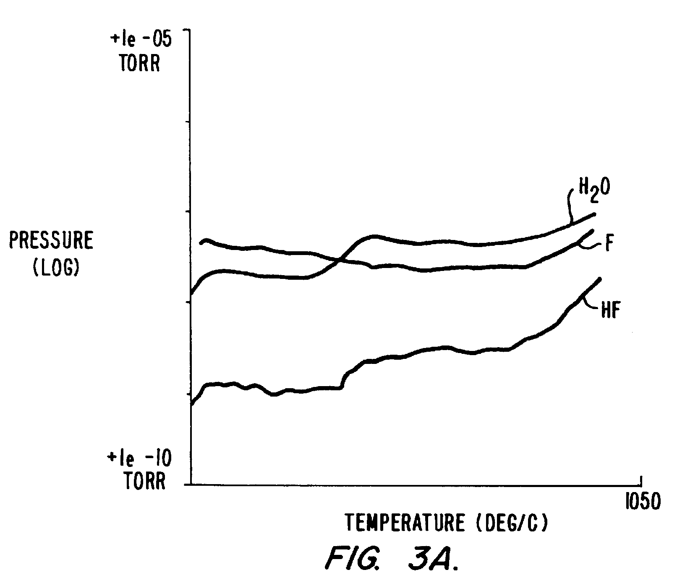
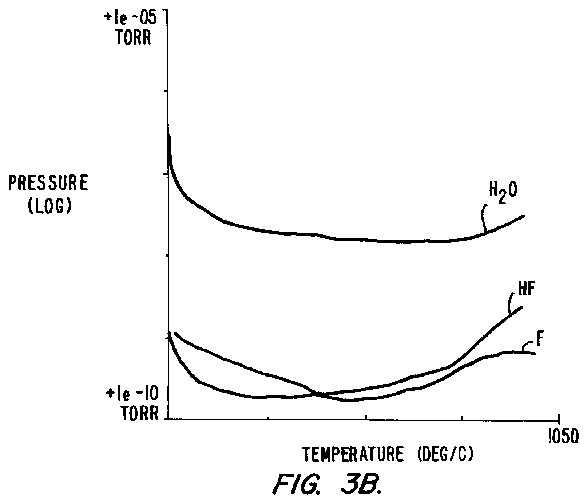
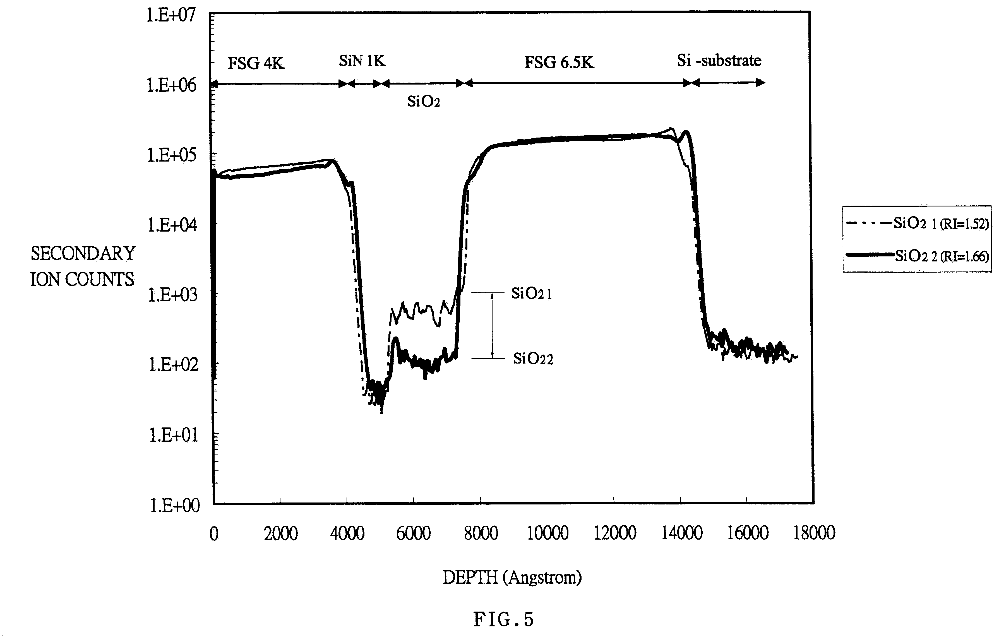

# 03-09 · FSG — Fluorinated Silicate Glass 

> 근거 번호 `[S##]`는 `03-09_FSG_자료수집.md`의 ID다. 논문 전문은 열람하지 못했다.
>
> 근거 표시 — **[논문]** 논문·학회에 보고된 값 · **[특허]** 특허의 주장·실시예 · **[리뷰]** 교과서 수준의 정설 · **[계산]** 가정을 명시한 교육용 계산 · **[현장]** 문헌으로 못 박지 못한 현장 통념. 자기 장비에서 확인이 필요하다.

---

## 0. 한 장 요약

이 장에서는 SiO₂에 불소를 넣어 유전율을 낮춘 FSG를 다룬다. FSG는 최초로 양산에 쓰인 Low-k 배선 절연막이지만, 불소가 막에서 빠져나오려는 성질 때문에 많은 문제를 겪었다. 먼저 이 막의 성질을 정리한 뒤, 불소가 하는 일과 그 대가, 그리고 불소를 막 안에 붙잡아 두는 방법을 차례로 설명한다.

FSG는 SiO₂에 불소를 넣어 유전율을 낮춘 막이다. 산화막 공정을 거의 그대로 쓰면서 k를 약 4에서 3.5 근처로 내릴 수 있어, 최초로 양산에 쓰인 Low-k 배선 절연막이 됐다 [보고 S05]. 대가는 불소의 불안정성이다. **FSG 공정 기술의 거의 전부가 “불소를 막 안에 붙잡아 두는 방법”** 이다.

| 항목 | 내용 |
|---|---|
| 역할 | 배선 층간 절연막(IMD). k 저감과 Gap-fill |
| 유전율 | USG 약 3.9 → FSG 약 3.5 [보고 S05]. 안정한 최저 약 3.2–3.5 [특허 S02] |
| 불소 농도 | 수 at%. 예: 3.5 at%에서 k 3.6 [논문 S01, 서지만 확인]. 실제로 쓰는 FSG의 k는 3.6–3.8 [리뷰 S14] |
| 안정 한계 | 출처마다 다르다. 4 at% [S01], 7–8 at% [특허 S02], 15 at% [논문 S03]. 농도가 높으면 F 결합이 불안정해 Ta 계열 Barrier를 공격할 수 있다 [리뷰 S14] |
| 증착 방식 | HDP-CVD(SiH₄ + SiF₄ + O₂), PECVD(TEOS + 불소원) |
| 대표 문제 | 흡습 → HF 생성 → 금속 부식·박리. 불소의 확산 |
| 표준 대책 | Si-rich Oxide Cap·Liner, In-situ Cap, Plasma 표면 처리 |
| 세대 | Al 배선 말기 ~ 초기 Cu 배선. 90 nm부터 SiCOH로 교체 [보고 S05] |

---

## 1. 어디에, 왜 쓰는가

FSG가 왜 필요했는지는 배선의 신호 지연에서 출발하면 이해하기 쉽다. 이 절에서는 유전율이 배선 지연에 미치는 영향, 여러 Low-k 재료 가운데 불소가 먼저 채택된 이유, 그리고 FSG가 주력에서 물러난 이유를 살펴본다.

### 1.1 배선 지연과 유전율

배선을 따라 신호가 전달되는 데 걸리는 시간, 즉 신호 지연은 저항 R과 정전용량 C의 곱에 비례한다. 배선이 가늘어지고 간격이 좁아지면 R과 C가 모두 커진다. C는 배선 사이 절연막의 유전율 k에 비례하므로, k를 낮추면 지연·전력·누화가 함께 줄어든다.

### 1.2 왜 불소부터였는가

k를 낮추는 재료는 여럿 있었지만 FSG가 먼저 채택된 이유는 **기존 산화막 공정과 가장 가까웠기 때문**이다.

| 항목 | FSG | 유기·탄소 도핑 Low-k |
|---|---|---|
| 증착 장비 | 기존 HDP·PECVD에 불소원만 추가 | 새 전구체, 새 Cure 공정 |
| 식각·CMP | 산화막과 거의 같다. | 새 조건 개발 필요 |
| 기계적 강도 | 산화막 수준 | 크게 떨어진다. |
| 열 안정성 | 좋다. | 제한적 |
| k | 약 3.5 | 3.0 이하 |

HDP-FSG는 Al 배선 사이의 Gap-fill도 겸했다. HDP의 증착/Sputter Gap-fill(→ 03-05 §3.5)에 불소의 식각 작용이 더해져 Gap-fill 능력이 오히려 좋아진다 [리뷰 S12].

### 1.3 물러난 이유

FSG가 물러난 가장 큰 이유는 k를 3.5 아래로 안정하게 낮출 수 없었기 때문이다. 불소를 더 넣으면 불안정해진다(§2.3). 90 nm 노드부터 탄소를 넣은 SiCOH(k 3.0 이하, → 03-10)가 자리를 넘겨받았다 [보고 S05].

> 이해 확인: 배선 사이 절연막의 k를 낮추면 신호 지연 외에 어떤 이득이 함께 생기는가? FSG가 여러 Low-k 후보 가운데 먼저 채택된 이유는 무엇인가?

---

## 2. 재료: 불소가 하는 일과 그 대가

불소는 유전율을 낮추지만, 동시에 물과 반응해 막에서 빠져나오려 한다. 이 절에서는 불소가 k를 낮추는 원리, 불소 농도와 k의 관계, 그리고 불소가 떨어져 나오면서 생기는 문제와 그 한계를 설명한다.

### 2.1 k가 내려가는 이유

불소가 유전율을 낮추는 데에는 세 가지 효과가 함께 작용한다.

| 효과 | 내용 |
|---|---|
| 전자 분극 감소 | F는 전기음성도가 가장 큰 원소다. 전자를 강하게 붙들어 전계에 덜 끌려간다. Si–F 결합의 분극률이 Si–O보다 낮다. |
| Si–OH 대체 | F가 Si–OH 자리를 차지한다. 분극이 큰 OH와 거기 붙는 수분이 줄어든다. |
| 밀도 감소 | F는 결합이 하나뿐인 종결기다. 네트워크가 끊겨 막이 덜 조밀해진다. |

이 표의 내용은 리뷰 수준에서 정리된 설명이다 [리뷰 S10].

### 2.2 불소 농도와 k

그렇다면 불소를 얼마나 넣으면 k가 얼마나 내려갈까? 보고된 값은 다음과 같다.

| 불소 농도 | k | 출처 |
|---|---|---|
| 0 (USG) | 약 3.9 | [특허 S02] |
| 3.5 at% | 3.6 | [논문 S01, 서지만 확인] |
| 양산 FSG | 약 3.5 | [보고 S05] |
| 안정한 최저 | 약 3.2–3.5 | [특허 S02] |
| 2–14 at% 범위의 최저 | 약 3.0 | [논문 S03] |

불소 1 at%당 k가 대략 0.1씩 내려가는 규모다 [계산, 위 표에서].

### 2.3 대가: 불소는 떨어져 나온다

그러나 불소에는 큰 약점이 있다. Si–F 결합은 물과 만나면 끊어진다 [리뷰 S11].

$$
\equiv\mathrm{Si–F} + \mathrm{H_2O} \rightarrow\ \equiv\mathrm{Si–OH} + \mathrm{HF}
$$

이 한 줄이 FSG의 모든 문제를 낳는다.

- **k가 다시 올라간다.** F가 OH로 바뀌고, OH에 수분이 붙는다. 흡수된 물은 분극이 커서 k를 크게 올린다 [논문 S03].
- **HF가 생긴다.** HF가 Al·Cu·W 배선과 Ti 계 Barrier를 공격하고 접착을 떨어뜨린다 [특허 S02, S09].
- **불소가 돌아다닌다.** 느슨하게 결합한 F는 후속 열 공정(약 450 °C까지)에서 방출되거나 이웃 막으로 확산한다 [특허 S02].

불소가 많을수록 한 Si에 F가 둘 붙은 자리(Si–F₂)가 늘어난다. 이 자리가 특히 불안정하다 [리뷰 S11]. 안정 한계에 대한 보고는 다음과 같이 갈린다.

| 보고 | 한계 |
|---|---|
| [논문 S01, 서지만 확인] | 4 at% 초과에서 불안정 |
| [특허 S02] | 7–8 at% 초과에서 흡습·Outgassing에 취약 |
| [논문 S03] | 15 at% 초과에서 물을 많이 흡수 |

차이는 증착 방식에서 온다. 이온 충격이 강한 HDP 막은 네트워크가 치밀해 같은 불소 농도에서도 더 안정하다 [논문 S03]. **“몇 at%까지 안전한가”는 재료 상수가 아니라 막의 치밀도에 달린 값**이다.

불소가 실제로 몇 °C에서 빠져나오는지는 TDS(승온 탈착 분석)로 본다. SiF₄ + TEOS + O₂ Plasma CVD FSG를 두 조건으로 증착해 비교한 특허 자료다 [특허 S02].

*NF₃ 없이 증착한 FSG의 TDS. 가로축은 온도, 세로축은 H₂O·F·HF의 분압(log)이다. 특허는 약 400–450 °C에서 H₂O와 HF 방출이 시작된다고 읽는다. 배선 공정 온도(약 450 °C) 안에서 불소가 움직인다는 뜻이다.*

*출처: US 5,827,785 (Applied Materials, 1998), FIG. 3A. 미국 특허 도면. [Google Patents](https://patents.google.com/patent/US5827785A/en)*

*공정 가스에 NF₃ 50 sccm을 더해 증착한 FSG의 TDS. 특허는 적어도 약 600 °C까지 HF와 H₂O 방출이 사실상 없다고 읽는다. 두 번째 불소원(NF₃)을 조금 넣는 것만으로 막의 안정성이 달라진다.*

*출처: US 5,827,785 (Applied Materials, 1998), FIG. 3B. 미국 특허 도면. [Google Patents](https://patents.google.com/patent/US5827785A/en)*

> 이해 확인: FSG 막의 k가 증착 직후 3.6이었는데 일주일 뒤 3.9가 되었다. 어떤 반응이 일어났으며, 그 결과로 어떤 문제가 더 생길 수 있는가?

---

## 3. 전구체와 반응

FSG는 산화막 공정에 불소 원료를 더해 만든다. 이 절에서는 대표 원료인 SiF₄의 특징, HDP 방식이 유리한 이유, 그리고 불소가 증착과 식각을 동시에 한다는 점을 살펴본다.

| 방식 | 가스 | 특징 |
|---|---|---|
| HDP-CVD | SiH₄ + SiF₄ + O₂ + Ar(또는 He) | Gap-fill 겸용. 이온 충격으로 치밀하고 안정. FSG의 주력 방식 |
| PECVD | TEOS + O₂ + 불소원(C₂F₆, SiF₄, FTES 등) | 치밀도가 낮아 안정성이 떨어진다. 탄소·수소 잔류 |

이 표의 내용은 리뷰 수준에서 정리된 것이다 [리뷰 S12].

### 3.1 SiF₄

SiF₄는 분자 하나에 F가 넷이고 모두 Si에 직접 결합해 있다. 단위 유량당 불소 공급이 많고, 탄소를 들여오지 않는다 [특허 S02]. HDP 실시예로 SiF₄ 약 53–63 sccm에 N₂를 넣고 Ar Sputter를 쓰지 않은 조건이 있다 [특허 S02].

### 3.2 HDP가 유리한 이유

HDP에서는 높은 에너지의 이온이 Si–O 네트워크를 다지고, 전구체에서 온 탄소와 수소를 제거한다 [논문 S03]. 느슨하게 붙은 불소도 증착 중에 떨어져 나간다. **약하게 결합한 불소를 증착 단계에서 미리 걸러 내는 것**이다. 남은 불소는 치밀한 네트워크 안에 갇혀 물이 접근하기 어렵다.

### 3.3 불소는 증착과 식각을 동시에 한다

Plasma 안의 F 라디칼은 SiO₂를 식각한다. FSG 증착은 증착과 불소 식각의 경쟁이다. 불소원을 늘리면 막의 불소 농도가 오르는 동시에 순 증착 속도가 내려간다. HDP에서는 이 식각이 Trench 입구를 여는 데 도움이 돼 Gap-fill이 좋아진다 [리뷰 S12]. 같은 불소가 Chamber 벽과 하부 금속도 공격한다는 점이 뒷면이다(§6.3).

> 이해 확인: 같은 불소 농도라도 HDP로 만든 FSG가 더 안정한 이유는 무엇인가?

---

## 4. 공정 윈도우와 손잡이별 응답

FSG에서는 손잡이를 바꿀 때 k와 안정성이 어떻게 움직이는지가 가장 중요하다. 아래 표는 그 경향을 정리한 것이다.

| 손잡이 ↑ | 막의 F | k | 안정성 | DR | 메커니즘 |
|---|---|---|---|---|---|
| SiF₄ / SiH₄ 비 | ↑ | ↓ | ↓ | ↓ | 불소 편입과 불소 식각 증가 |
| O₂ 유량 | ↓ 소폭 | ↑ 소폭 | ↑ | — | 산화가 충분하면 Si–F₂가 줄어든다. |
| Bias Power (HDP) | ↓ | ↑ 소폭 | ↑ | ↓ | 약한 F 제거, 치밀화. 하부 금속으로의 F 주입 위험(§6.3) |
| Source Power (HDP) | — | — | ↑ | ↑ | Plasma 밀도, Wafer 온도 상승 |
| Wafer 온도 | ↓ | ↑ 소폭 | ↑ | — | 약한 F 탈리. 고온 증착 막이 안정하다. |
| 증착 후 Plasma 처리 | 표면 F ↓ | — | ↑ | — | 표면 불소 제거와 질화(§6.2) |

이 표의 경향은 리뷰와 현장에서 통용되는 것이다 [리뷰·현장]. 표의 모든 행에서 **k와 안정성이 반대로 움직인다.** 불소를 많이 남길수록 k는 낮고 불안정하다. FSG Recipe는 “목표 k를 만족하는 최소 불소를 가장 치밀한 네트워크에 넣는” 방향으로 잡는다.

> 이해 확인: 불소원 유량을 늘려 k를 낮추려 한다. 이때 안정성과 증착 속도는 어떻게 변할 것으로 예상되는가?

---

## 5. 유전율 이득 계산 [계산]

FSG로 바꾸면 정전용량이 실제로 얼마나 줄어드는지 숫자로 확인해 보자. 이 절에서는 k 감소에 따른 이득을 계산하고, 불소를 막기 위해 덧붙이는 보호층이 그 이득을 얼마나 깎는지도 함께 계산한다.

정전용량은 k에 비례한다. 그러므로 배선 저항이 같다면 RC 지연이 줄어드는 비율은 k가 줄어드는 비율과 같다.

| 교체 | k 변화 | 정전용량 감소 |
|---|---|---|
| USG → FSG | 4.1 → 3.6 | 12 % |
| USG → 불소 상한 FSG | 4.1 → 3.0 | 27 % (안정성 문제로 비현실적) |
| FSG → 치밀 SiCOH | 3.6 → 2.7 | 25 % |

FSG의 이득은 약 12 %다. 크지 않다. 게다가 불소 차단을 위해 넣는 Cap과 Liner(Si-rich Oxide, k가 4 이상)가 유효 유전율을 다시 올린다 [특허 S02]. 03-03 §5의 식으로 보면:

$$
\text{수평}\ k_{\mathrm{eff}} = \frac{\sum k_i t_i}{\sum t_i}
$$

FSG 500 nm($k$ 3.6) 위에 SRO Cap 100 nm($k$ 4.3)를 올리면 다음과 같다.

$$
k_{\mathrm{eff}} = \frac{3.6\times500 + 4.3\times100}{600} = 3.72
$$

Cap이 두꺼우면 12 %의 이득 중 상당 부분이 사라진다. **보호층은 얇아야 하고, 얇아도 막을 수 있을 만큼 FSG 자체가 안정해야 한다.**

> 이해 확인: FSG 500 nm(k 3.6) 위에 SRO Cap을 50 nm로 줄이면 수평 유효 유전율은 얼마가 되는가? 100 nm일 때와 비교해 보자.

---

## 6. 집적 이슈와 불량 모드

FSG의 불량은 대부분 불소가 막에서 빠져나와 다른 곳으로 가는 데서 생긴다. 이 절에서는 흡습과 k Drift, 표면 처리와 Cap, 불소 확산과 금속 박리, 증착 초기의 금속 손상, CMP와 후속 공정의 문제를 차례로 살펴본다.

### 6.1 흡습과 k Drift

FSG를 증착한 뒤 대기에 두면 표면부터 Si–F가 Si–OH로 바뀐다. k가 오르고, 이후 열 공정에서 H₂O와 HF가 나온다. 대책의 핵심은 **대기에 노출하지 않는 것**이다. 진공을 깨지 않고 같은 Chamber에서 Cap을 올리면 흡습과 오염을 원천적으로 피할 수 있다 [특허 S09].

### 6.2 표면 처리와 Cap

불소가 빠져나오지 못하게 하려면 FSG의 표면을 처리하거나 보호막으로 덮는다. 쓰이는 방법은 다음과 같다.

| 방법 | 내용 | 근거 |
|---|---|---|
| Si-rich Oxide(SRO) Cap | SRO가 일반 PE-Oxide보다 고온에서 F 확산을 더 잘 막는다. 예: 200 nm | [논문 S08, 특허 S09] |
| In-situ Cap | 진공을 깨지 않고 Cap 증착 | [특허 S09] |
| High-RI Liner | 굴절률 1.5–1.8의 Si-rich SiO₂를 FSG와 금속 사이에 | [특허 S09] |
| N₂ Plasma 처리 | 20분 이상 처리로 내습성 안정화 | [논문 S04] |
| NH₃ Plasma 처리 | 얇은 질소 함유 표면층 형성 | [특허 S02] |

SRO가 불소를 잘 막는 이유로 Si Dangling Bond가 F를 붙잡는다는 설명이 제시돼 있다. 측정된 결과가 아니라 가설이다 [특허 S09]. 굴절률이 높다는 것이 Si-rich라는 뜻이므로, **Cap·Liner의 굴절률이 불소 차단 능력의 관리 지표**가 된다.

Liner의 굴절률과 불소 차단 능력의 관계는 다음 SIMS가 보여 준다 [특허 S09].

*FSG 4 kÅ / SiN 1 kÅ / SiO₂ Liner / FSG 6.5 kÅ / Si 적층의 불소 SIMS. FSG 안의 불소 신호는 약 10⁵ counts다. Liner 구간(깊이 약 5,000–7,500 Å)의 신호는 굴절률 1.52인 SiO₂에서 약 10³, 굴절률 1.66인 Si-rich SiO₂에서 약 10²다. 굴절률이 높은 Liner일수록 불소가 덜 들어온다.*

*출처: US 6,335,274 (Macronix, 2002), FIG. 5. 미국 특허 도면. [Google Patents](https://patents.google.com/patent/US6335274B1/en)*

### 6.3 불소 확산과 금속 박리

불소는 표면으로만 나가지 않는다. 고온에서 **F는 탈착하기보다 이웃한 USG 막 속으로 확산해 들어간다** [논문 S06]. 확산 길이는 수천 Å을 넘을 수 있다 [특허 S09]. USG Cap을 덮어도 불소가 그 Cap을 지나 금속에 닿는다.

| 사례 | 내용 | 근거 |
|---|---|---|
| TiSi₂ 박리 | FSG에서 확산해 온 F가 TiSi₂와 반응해 박리 | [논문 S06] |
| Ti/TiN/W 박리 | 활성 F가 USG 표면으로 확산한 뒤 위에 올린 Ti/TiN/W와 반응 | [논문 S07] |
| 금속 부식 | 느슨한 F가 HF를 만들어 Cu·Al·W 부식 | [특허 S09] |

Ti는 불소와 매우 잘 반응한다. Via 바닥과 측벽의 Ti/TiN이 불소를 만나면 계면이 약해져 W Plug나 배선이 들뜬다.

주의할 결과가 하나 있다. 안정화를 위해 하는 **N₂ Plasma 처리의 Bias가 높고 시간이 길수록 활성 불소가 오히려 더 많이 표면 쪽으로 확산해 박리가 심해졌다** [논문 S07]. 이온 충격이 Si–F를 끊어 자유로운 불소를 만든 것이다. 같은 연구의 해법은 Plasma N₂ 처리 조건을 조절하고, 초기 증착 온도를 낮춘(추가 냉각 Step) Ex-situ USG Cap을 쓰는 것이었다 [논문 S07]. **불소를 붙잡으려는 처리가 불소를 풀어 줄 수도 있다.**

### 6.4 증착 초기의 금속 손상

HDP-FSG를 Al 배선 위에 직접 증착하면 Plasma의 F와 이온이 금속을 먼저 공격한다. 불소가 없는 Liner를 먼저 깔고, RF Bias를 완만하게 올린다 [특허 S09].

### 6.5 CMP와 후속 공정

CMP는 물을 쓴다. 연마로 새로 드러난 FSG 표면이 물과 닿아 흡습한다. CMP 후 열처리(Degas)와 Cap이 필요하다 [현장]. Via 식각으로 드러난 FSG 측벽도 같은 문제가 있다. 측벽에서 나온 수분과 불소가 Barrier 증착을 방해해 Via 저항을 올린다.

> 이해 확인: 불소를 붙잡으려고 N₂ Plasma 처리를 강하게 했더니 금속 박리가 오히려 늘었다. 그 이유는 무엇인가?

---

## 7. 챔버 · 하드웨어 관리

FSG 공정은 불소를 쓰므로 Chamber 부품의 부식과 Chamber 벽에 남은 불소의 영향을 관리해야 한다. 아래 표는 그 주요 항목을 정리한 것이다.

| 항목 | 내용 |
|---|---|
| Chamber 부품 부식 | 증착 중에도 F 라디칼이 벽과 Dome을 공격한다. Al 부품에 AlFₓ가 쌓여 Particle이 된다 [현장]. |
| Seasoning | Clean 후 벽에 남은 F가 다음 Wafer의 불소 농도를 올린다. 벽을 덮는 Seasoning 막의 조성이 첫 Wafer의 k를 정한다 [현장]. |
| Wafer 온도 (HDP) | 정전척 Backside He로 제어. 온도가 낮으면 불소가 더 많이, 더 불안정하게 들어간다 [현장]. |
| 불소 농도 균일도 | Gas Nozzle 배치와 Plasma 분포가 정한다. 두께 균일도와 별개로 관리한다. |
| In-situ Cap 순서 | FSG 증착 → SiF₄ 차단 → Chamber 안 잔류 F 배기 → Cap. 잔류 F가 남으면 Cap에 불소가 섞인다 [현장]. |
| 배기 | SiF₄, HF. 부식성. 제해 설비 필요 |

---

## 8. 계측과 해석

FSG는 증착 직후보다 시간이 지난 뒤의 상태가 중요하므로, 불소 농도와 그 안정성을 함께 측정해야 한다. 아래 표는 각 계측이 무엇을 알려 주고 어떤 함정이 있는지 정리한 것이다.

| 계측 | 얻는 것 | 읽는 법과 함정 |
|---|---|---|
| FTIR | 불소 농도 (Inline) | Si–F 약 930–940 cm⁻¹와 Si–O 약 1,080 cm⁻¹의 피크 높이·면적 비 [리뷰 S13]. 절대 at%는 RBS·XPS 등으로 교정한다. **Si–OH(약 3,650)와 H₂O(약 3,400 cm⁻¹)가 보이면 이미 가수분해가 진행된 것**이다. |
| 굴절률 | 불소 농도의 빠른 지표 | 불소가 늘면 내려간다(1.46 → 1.42–1.44) [리뷰 S13]. |
| k (Hg Probe, MIS) | 유전율 | 증착 직후와 대기 노출 후를 모두 잰다. |
| 안정성 시험 | 흡습 내성 | 고온다습 노출 또는 끓는 물 처리 전후의 FTIR·k·응력 변화 [현장] |
| TDS | 방출 가스 | HF·H₂O·SiF₄의 방출 온도와 양. 후속 열 공정에서의 위험을 직접 본다. |
| SIMS | 불소 깊이 분포 | Cap·Liner·금속 쪽으로의 확산(§6.3) |
| 응력과 시간 변화 | 흡습 | |
| Cap의 굴절률 | Si-rich 정도 | 차단 능력의 지표(§6.2) |

FSG의 품질은 증착 직후 값이 아니라 **시간과 열·습도를 거친 뒤의 값**으로 판정한다.

> 이해 확인: FSG의 품질을 증착 직후의 값으로만 판정하면 어떤 불량을 놓칠 수 있는가?

---

## 9. 파생과 교훈

FSG는 주력에서 물러났지만 그 과정에서 얻은 교훈은 이후 Low-k에 그대로 이어졌다.

| FSG에서 배운 것 | 이후 Low-k에서의 대응 |
|---|---|
| k를 낮추는 원소가 막을 불안정하게 만든다. | SiCOH의 Si–CH₃도 Plasma에 떨어져 나가 흡습을 부른다(→ 03-10). |
| 증착 직후가 아니라 집적 후의 k가 진짜다. | 유효 유전율, 손상층 개념 |
| 보호층이 이득을 깎는다. | Cap·Etch Stop의 k 저감(→ 03-03) |
| 불소는 금속과 반응한다. | W 공정의 불소 문제(→ 03-16), 불소 없는 전구체로의 이동 |

불소 도핑은 다른 곳에도 남아 있다. BPSG에 불소를 넣어 Reflow 온도를 낮추거나(→ 03-06 §9), HDP Gap-fill에서 불소의 식각 작용을 이용하는 것이 그 예다.

> 이해 확인: FSG에서 얻은 교훈 가운데 이후 SiCOH 같은 Low-k 막의 개발에 이어진 것은 무엇인가?

---

## 10. Troubleshooting

아래 표는 FSG 공정에서 흔히 나타나는 증상과 유력한 원인, 확인할 데이터, 조치 방향을 정리한 것이다. 표의 원인은 현장 경험에서 나온 출발점이므로 [현장], “확인할 데이터” 열로 가설을 좁힌 뒤에 조치해야 한다.

| 증상 | 유력 원인 | 확인할 데이터 | 조치 방향 |
|---|---|---|---|
| k가 시간이 지나며 상승 | 흡습 (Si–F 가수분해) | FTIR Si–OH·H₂O, Q-time 상관 | In-situ Cap, 불소 하향, 치밀화 |
| Via 저항 상승 | FSG 측벽의 수분·불소 방출 | TDS, Degas 조건 | Degas 강화, Liner |
| 금속·Plug 박리 | 불소 확산 → Ti 계 반응 | SIMS 불소 분포, 박리 계면 분석 | SRO Cap·Liner, Plasma 처리 조건 완화, 열 예산 |
| 금속 부식 | HF 생성 | 부식 위치와 FSG 노출면의 관계 | 흡습 차단, Cap |
| 불소 농도 Wafer 간 변동 | Seasoning, 벽 잔류 F, Wafer 온도 | 순번별 FTIR, 척 He 압력 | Seasoning 조건, 척 점검 |
| Clean 후 Particle | AlFₓ | 입자 성분 | Clean 조건, 부품 교체 |
| Cap에 불소 검출 | In-situ 전환 시 잔류 F | SIMS | 배기·Purge Step 추가 |
| 증착 초기 금속 손상 | F와 Bias에 의한 공격 | 단면, 금속 표면 | 불소 없는 Liner, Bias Ramp 완화 |

> 이해 확인: Via 저항이 FSG 층에서만 높게 나온다. FSG 측벽에서 어떤 일이 일어났을 가능성이 있으며, 무엇으로 확인할 수 있는가?

---

## 11. 자가 점검

이 장의 핵심 내용을 질문으로 확인해 보자. 각 질문을 먼저 스스로 풀어 본 뒤 답을 펼쳐 비교한다.

**Q1. 불소가 k를 낮추는 이유 세 가지는?**
Si–F 결합의 전자 분극률이 낮다. 분극이 큰 Si–OH를 대체한다. 종결기로서 네트워크를 끊어 밀도를 낮춘다.

**Q2. FSG가 흡습하면 일어나는 반응과 그 결과는?**
Si–F + H₂O → Si–OH + HF. k가 오르고, HF가 금속을 부식시키며 접착이 떨어진다.

**Q3. 불소의 안정 한계가 출처마다 다른 이유는?**
막의 치밀도가 다르기 때문이다. 이온 충격이 강한 HDP 막은 같은 불소 농도에서도 더 안정하다.

**Q4. USG Cap을 덮었는데도 금속이 박리됐다. 왜인가?**
고온에서 불소는 탈착하기보다 USG 속으로 확산한다. Cap을 지나 Ti 계 금속에 닿아 반응한다. SRO가 일반 산화막보다 잘 막는다.

**Q5. N₂ Plasma 처리를 강하게 했더니 박리가 심해졌다. 가능한 설명은?**
높은 Bias의 이온 충격이 Si–F를 끊어 활성 불소를 만들었고, 이것이 표면 쪽으로 확산했다.

**Q6. USG(k 4.1)를 FSG(k 3.6)로 바꾸면 정전용량은 얼마나 줄어드는가?**
약 12 %.

**Q7. Cap·Liner의 굴절률을 관리하는 이유는?**
굴절률이 높을수록 Si-rich이고, Si-rich 산화막이 불소 확산을 더 잘 막기 때문이다.

---

## 12. 참고문헌

전체 서지, 링크, 확인 수준은 `03-09_FSG_자료수집.md`에 있다.

- [S01] G. Passemard, P. Fugier, P. Noel, F. Pires, O. Demolliens, "Study of fluorine stability in fluoro-silicate glass and effects on dielectric properties", *Microelectron. Eng.* 33, 335 (1997). [DOI](https://doi.org/10.1016/S0167-9317(96)00062-7) — F 3.5 at%, k 3.6 (이전 판에서 인용. 서지는 Crossref로 확인했으나 초록을 열람하지 못해 수치는 미확인)
- [S14] V. McGahay, "Porous Dielectrics in Microelectronic Wiring Applications", *Materials* 3, 536 (2010). CC BY. [PMC5525179](https://pmc.ncbi.nlm.nih.gov/articles/PMC5525179/) — FSG k 3.6–3.8, 낮은 농도의 F는 Silanol을 없애고 높은 농도에서는 Si–O–Si를 대체, 높은 농도에서 불안정·Ta Barrier 공격
- [S02] FSG 안정화 특허군(US 5,827,785 등) — k 한계, 불소 농도와 흡습, SiF₄
- [S03] *Trans. MRS-J* 29, 685 — 불소 범위와 k, HDP 치밀화
- [S05] IBM RC24405 — FSG k 3.5, SiCOH로의 전환
- [S06] MRS Proc. — F의 USG 내 확산, TiSi₂ 박리
- [S07] HDP-FSG 연구(NYCU) — N₂ 처리 Bias와 Ti/TiN/W 박리
- [S08] SRO Cap 연구(NYCU) — SRO의 불소 차단
- [S09] Cap·Liner 특허군(US 6,335,274 등) — In-situ Cap, High-RI Liner
