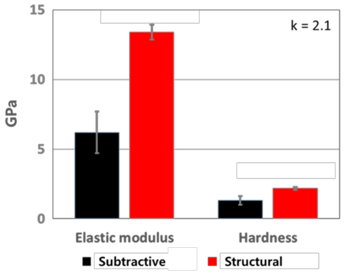
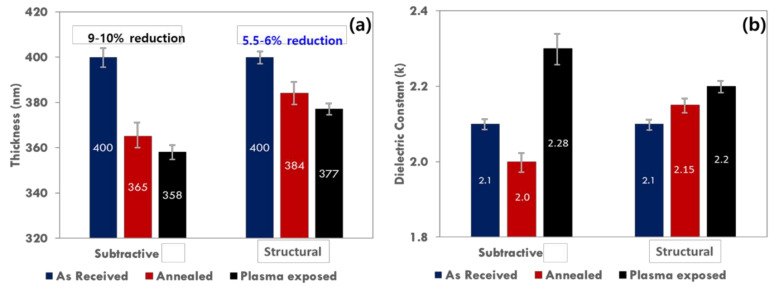

# 03-10 · SiOC / SiCOH 

> 근거 번호 `[S##]`는 `03-10_SiOC_SiCOH_자료수집.md`의 ID다. 대부분 초록·요약 수준까지만 확인했다.
>
> 근거 표시 — **[논문]** 논문·학회에 보고된 값 · **[특허]** 특허의 주장·실시예(타 연구 인용 포함) · **[리뷰]** 리뷰·교과서 수준의 정설 · **[계산]** 가정을 명시한 교육용 계산 · **[현장]** 문헌으로 못 박지 못한 현장 통념. 자기 장비에서 확인이 필요하다.

---

## 0. 요약

SiCOH(SiOC, SiOC:H, CDO, OSG로도 부른다)는 SiO₂ 네트워크의 일부 산소를 메틸기(–CH₃)로 바꾼 막이다. 메틸기가 네트워크를 끊어 막을 성기게 하고 분극을 줄여 k를 3.0 아래로 낮춘다. 여기에 기공을 넣으면 2.0 근처까지 내려간다. 90 nm 노드부터 Cu 배선의 표준 층간 절연막이다 [논문 S03]. **k를 낮추는 바로 그 구조가 막을 약하게 하고 Plasma에 취약하게 만든다**는 것이 이 막질의 핵심 설계 문제다.

| 항목 | 내용 |
|---|---|
| 화학식 | SiCₓOᵧ:H(SiCOH, SiOC:H). SiO₂ 망의 일부 O 자리에 메틸기(–CH₃)가 붙은 구조다. 모든 Si에 메틸기가 하나씩 붙은 극한이 CH₃SiO₁.₅(Methylsilsesquioxane, MSQ) 조성이다. 다공성 pSiCOH는 같은 골격에 기공이 더해진 것이다 |
| 역할 | Cu 배선 층간 절연막 (Low-k, Ultralow-k) |
| 유전율 | 치밀 SiCOH 약 2.7–3.0. 다공성 pSiCOH 1.8–2.95 [특허 S08]. 양산 적용 예 k 2.4(45 nm) [리뷰 S01] |
| 증착 방식 | PECVD, 400 °C 이하. 다공성은 증착 후 UV Cure |
| 골격 전구체 | DEMS, OMCTS, TMCTS, 3MS + O₂ 등 |
| Porogen | 고리형 불포화 탄화수소. ATRP(α-Terpinene), Norbornene 계 [논문 S02, 특허 S11] |
| Modulus | k 2.9에서 6.7–16.5 GPa(전구체에 따라) [특허 S04]. k 2.4에서 3.2 GPa [특허 S04] ~ 8.4 GPa [논문 S05]. k 2.1에서 6–13 GPa [논문 S06] |
| 대표 문제 | Plasma 손상(탄소 고갈 → k 상승) [특허 S08], 낮은 기계적 강도, 흡습 |
| 핵심 Trade-off | 낮은 k(기공·메틸기↑) ↔ Modulus ↔ Plasma 내성 |

---

## 1. 용도와 필요성

SiCOH가 왜 쓰이게 되었는지는 Low-k 재료가 발전해 온 과정에서 볼 수 있다. 이 절에서는 Low-k의 계보를 정리하고, SiCOH가 Dual Damascene 배선 공정 안에서 어떤 일을 겪는지 살펴본다. 이 과정을 알아야 증착 직후의 k가 왜 출발점일 뿐인지 이해할 수 있다.

### 1.1 Low-k 재료의 발전

| 세대 | 막 | k | 비고 |
|---|---|---|---|
| ~ 180 nm | USG | 약 4.0 | → 03-05 |
| 180–130 nm | FSG | 약 3.5 | → 03-09 [논문 S03] |
| 90 nm ~ | 치밀 SiCOH | 약 2.7–3.0 | 2004년까지 업계 전반 채택 [논문 S03] |
| 45 nm ~ | 다공성 pSiCOH | 약 2.4 | [리뷰 S01] |
| 이후 | 더 높은 기공률 | 2.0–2.2 | 집적 난이도 때문에 진행이 느리다. |

앞 장에서 본 것처럼 FSG는 k를 3.5 아래로 안정하게 낮추지 못했다. 탄소(메틸기)를 넣는 SiCOH가 그 벽을 넘었다. 이후 20년 가까이 k는 2.4–2.7 부근에서 크게 내려가지 못했다. 재료를 못 만들어서가 아니라 **집적을 견디지 못해서**다. 이 Chapter의 뒤쪽 절반이 그 이유다.

### 1.2 Dual Damascene 공정에서의 손상

SiCOH는 증착된 뒤 배선이 완성될 때까지 다음 공정을 모두 거친다.

| 공정 | SiCOH에 가해지는 것 |
|---|---|
| Hardmask·Cap 증착 | 산화성·환원성 Plasma, 열 |
| Via·Trench 식각 | Fluorocarbon Plasma, 이온 충격 |
| Resist Ash | O₂ 또는 환원성 Plasma. **가장 큰 손상원** |
| Wet 세정 | 약액 침투(기공으로) |
| Barrier·Seed 증착 | 금속 전구체의 기공 침투 |
| Cu 도금, CMP | 기계적 하중, Slurry 침투 |
| Cap 전처리 | NH₃·H₂ Plasma(→ 03-03 §6.1) |
| Packaging | 열응력, Chip–Package Interaction |

증착 직후의 k는 출발점일 뿐이다. 이 과정을 다 거친 뒤 배선 사이에 남은 막의 k, 즉 **유효 유전율**이 실제 성능이다.

> 이해 확인: 증착 직후 k가 2.5인 SiCOH가 배선 공정을 모두 거친 뒤 유효 유전율이 2.9가 되었다. 어떤 공정들이 k를 올렸을 수 있는가?

---

## 2. 재료의 구조와 물성

SiCOH의 낮은 유전율은 메틸기와 기공이라는 두 가지 구조에서 나온다. 이 절에서는 메틸기가 하는 일, 기공으로 k를 더 낮추는 방법, 그 대가로 Modulus가 낮아지는 Trade-off, 그리고 같은 기공률이라도 기공의 크기가 왜 중요한지 설명한다.

### 2.1 메틸기의 역할

SiO₂에서 Si는 산소 4개와 결합해 3차원으로 이어진다. 반면 SiCOH에서는 Si의 결합 하나(또는 둘)가 –CH₃로 끝난다. 이 작은 변화가 다음과 같은 네 가지 효과를 낸다.

| 효과 | 내용 |
|---|---|
| 네트워크 단절 | 메틸기는 다음 Si로 이어지지 않는다. 연결이 줄어 구조가 느슨해진다. |
| 자유 부피 | 메틸기는 부피가 크다. 주위에 빈 공간이 생긴다. 치밀 SiCOH에도 나노 크기의 자유 부피가 있다. |
| 낮은 분극 | Si–C, C–H 결합은 Si–O보다 분극이 작다. |
| 소수성 | 표면이 메틸기로 덮여 물이 붙지 않는다. **Low-k가 유지되는 조건**이다. |

이 표의 값은 리뷰와 교과서 수준에서 정리된 것이다 [리뷰]. 네 번째가 핵심이다. SiCOH의 낮은 k는 메틸기가 물을 밀어내고 있기 때문에 유지된다. 메틸기가 떨어지면 그 자리에 Si–OH가 생기고, OH가 물을 끌어들인다(§6.1).

### 2.2 기공에 의한 유전율 감소

기공이 없는 치밀 SiCOH의 한계는 k 2.7 부근이다. 그보다 더 낮추려면 어떻게 해야 할까? 유전율이 1인 빈 공간, 즉 기공을 막 속에 넣는다. 다공성 SiCOH의 k는 약 1.8–2.95 범위이고, k가 낮을수록 기공률이 높다 [특허 S08]. k 2.0 미만도 만들어졌다 [리뷰 S01].

### 2.3 k와 Modulus의 Trade-off

경도와 Modulus는 k가 내려갈수록 함께 내려간다 [논문 S03]. 문헌 값을 모으면 다음과 같다.

| 막 | k | Young’s Modulus (GPa) | 출처 |
|---|---|---|---|
| (참고) SiO₂ | 약 4 | 약 70 | [리뷰] |
| DEMS, Porogen 없음 | 2.90 | 16.5 | [특허 S04 인용] |
| Trimethylsilane | 2.85 | 8.76 | [특허 S04 인용] |
| DMDMOS | 2.88 | 6.68 | [특허 S04 인용] |
| Allyltrimethylsilane 계 | 약 2.4 | 8.4 | [논문 S05] |
| DEMS / ATRP 다공성 | 2.41 | 3.2 | [특허 S04 인용] |
| Porogen 내장형 전구체 | — | 2.94–3.78 | [특허 S04] |
| 기존 방식 다공성 | 2.1 | 6 | [논문 S06] |
| 분자 크기 균일 기공 | 2.1 | 13 | [논문 S06] |

이 표에서 두 가지를 읽을 수 있다.

1. **k가 거의 같아도 Modulus는 2–3배 차이 난다.** k 2.9 근처에서 6.7 GPa와 16.5 GPa, k 2.1에서 6 GPa와 13 GPa. 차이를 만드는 것은 전구체 구조와 기공의 크기·분포다. Trade-off는 고정된 곡선이 아니라 **재료 설계로 옮길 수 있는 곡선**이다.
2. SiO₂(약 70 GPa)와 비교하면 가장 좋은 Low-k도 한 자릿수 작다. 배선 구조 전체가 훨씬 무른 재료 위에 서 있게 된다. CMP와 Packaging에서 문제가 된다(§6.4).

표의 마지막 두 줄은 다음 실측에서 왔다 [논문 S06].

*k가 2.1로 같은 두 다공성 SiCOH의 Modulus와 경도(Nanoindentation). Porogen을 태워 기공을 만든 막(Subtractive)은 Modulus 약 6.2 GPa, 경도 약 1.3 GPa다. Porogen 없이 전구체 구조로 분자 크기 기공을 만든 막(Structural)은 약 13.4 GPa, 2.2 GPa다. 두 막 모두 두께 400 nm, 기공률 약 30 %다.*

*출처: Sa 등, Materials 14(9), 2284 (2021), Figure 1. CC BY 4.0. [PMC](https://pmc.ncbi.nlm.nih.gov/articles/PMC8125368/)*

### 2.4 기공 크기의 영향

같은 기공률이라도 기공이 작고 균일하면 유리하다. 그 이유는 기계적인 면과 화학적인 면에서 모두 찾을 수 있다.

- 기계적으로: 큰 기공은 응력이 집중되는 결함이다. 분자 크기의 균일한 기공을 가진 막이 같은 k에서 Modulus가 두 배였고, 400 °C에서 4시간 압입했을 때 변형이 약 89 % 작았다 [논문 S06].
- 화학적으로: 큰 기공이 서로 이어지면 Plasma 라디칼, 약액, 금속 전구체가 막 깊숙이 들어온다. k 2.6 미만의 큰 기공 막이 k 2.6 초과의 미세 기공 막보다 Plasma 손상을 훨씬 크게 받는다 [특허 S08].

> 이해 확인: k가 같은 두 다공성 SiCOH 가운데 하나는 Modulus가 두 배 높다. 이 차이를 만들 수 있는 구조적 원인은 무엇인가?

---

## 3. 전구체와 반응

SiCOH의 구조는 원료의 분자 구조와 증착 뒤의 Cure로 만들어진다. 이 절에서는 골격 원료를 설계하는 원리, 기공을 만드는 Porogen 방식, 그리고 Porogen을 없애고 골격을 강화하는 Cure를 설명한다.

### 3.1 골격 전구체

SiCOH의 골격은 Si–O 결합과 Si–CH₃ 결합을 이미 가진 유기실란 원료로 만든다. 대표적인 원료는 다음과 같다.

| 전구체 | 구조 | 특징 |
|---|---|---|
| 3MS + O₂ | (CH₃)₃SiH + 산화제 | 초기 방식. 산화제가 메틸기를 태워 조성 제어가 어렵다. |
| DEMS | CH₃–SiH(OC₂H₅)₂ | Si–O 결합을 전구체가 이미 갖고 있다. 별도 산화제가 거의 필요 없어 메틸기를 보존한다. k 2.9에서 16.5 GPa [특허 S04 인용] |
| OMCTS | [(CH₃)₂SiO]₄ 고리 | Si–O 고리와 메틸기를 함께 갖는다. |
| TMCTS | [CH₃(H)SiO]₄ 고리 | Porogen 없이 k 2.8 [논문 S02]. Si–H가 반응 자리가 된다. |

이 표의 값은 리뷰와 교과서 수준에서 정리된 것이다 [리뷰]. 설계 원리는 하나다. **전구체가 필요한 결합(Si–O 골격과 Si–CH₃)을 이미 갖고 있게 하고, Plasma는 그것을 이어 붙이는 데만 쓴다.** Plasma가 강하면 Si–CH₃가 끊어져 k가 오른다.

### 3.2 Porogen 방식

다공성 막은 두 단계로 만든다 [리뷰 S01].

- ① 증착: 골격 전구체와 Porogen(유기물)을 함께 넣어 이중상(Dual-phase) 막을 만든다. Porogen이 나중에 기공이 될 자리를 차지한다.
- ② Cure: Porogen을 제거해 기공을 만든다. 동시에 골격을 가교해 강화한다.

Porogen은 고리형 불포화 탄화수소다. α-Terpinene(ATRP)이 대표적이고 Norbornene 계도 쓴다 [논문 S02, 특허 S11].

Porogen 방식에는 본질적인 창의 문제가 있다 [논문 S02].

- RF Power는 골격 전구체를 과도하게 깨지 않을 만큼 **낮아야** 한다.
- 동시에 Porogen을 쪼개 막에 넣을 만큼은 **높아야** 한다.
- 두 조건이 겹치는 영역이 좁고, 쓸 수 있는 골격–Porogen 조합이 제한된다.
- TMCTS 계에서는 Porogen 편입 효율이 매우 낮았고 Porogen 종류에 따라 달랐다.

Porogen을 따로 넣지 않고 전구체 분자 안에 유기 가지를 달아 두는 방식(VTEOS 등)도 시도됐지만 Modulus가 2.94–3.78 GPa로 낮았다 [특허 S04].

### 3.3 Cure

증착한 막에서 Porogen을 없애고 골격을 단단하게 만드는 단계를 Cure라고 한다. Cure에는 다음과 같은 방식이 있다.

| 방식 | 내용 | 근거 |
|---|---|---|
| 열 Anneal | 400 °C 초과에서 수 시간. 생산성이 낮다. TMCTS 계에서 400 °C Anneal로 k 1.95 | [특허 S11, 논문 S02] |
| UV Cure | UV가 Porogen을 직접 분해하거나, 산소 존재하에 O₃·O 라디칼을 만들어 산화 제거. 분 단위. **골격 가교로 기계적 강도도 높인다.** | [특허 S11] |
| 전자빔 | 가교 효과가 크지만 소자 손상 우려 | [리뷰 S01] |

UV Cure가 표준이 된 이유는 Porogen 제거와 강화를 한 번에 하기 때문이다. UV 광자가 Si–CH₃ 일부와 Si–OH를 끊어 Si–O–Si 가교를 늘린다. 그 과정에서 막이 수축한다. **UV를 과하게 쬐면 메틸기를 너무 많이 잃어 k가 다시 오른다.** Cure에는 최적점이 있다 [리뷰].

> 이해 확인: UV Cure Dose를 늘리면 처음에는 k가 내려가다가 다시 오른다. 그 이유를 Porogen 제거와 메틸기 손실로 설명해 보자.

---

## 4. Process Window와 공정 변수별 응답

SiCOH의 막질은 증착 조건과 UV Cure 조건이 함께 정한다. 이 절에서는 두 단계의 조절 변수가 메틸기, 기공, k, Modulus를 어떻게 바꾸는지 정리한다.

### 4.1 증착

| 조절 변수 ↑ | 메틸기 보존 | Porogen 편입 | k (Cure 후) | Modulus | 메커니즘 |
|---|---|---|---|---|---|
| RF Power | ↓ | ↑ 후 ↓ | 복합 | ↑ | 골격 분해 증가. Porogen도 과분해되면 편입 감소 [S02] |
| 온도 | ↓ 소폭 | ↓ | ↑ | ↑ | Porogen이 표면에서 탈착. 골격 가교 증가 |
| Porogen / 골격 비 | — | ↑ | ↓ | ↓ | 기공률 증가 |
| 압력 | ↑ | ↑ | ↓ | ↓ | 분자당 에너지 감소(→ 03-01 §4.3) |
| 산화제 (O₂ 등) | ↓ | ↓ | ↑ | ↑ | 메틸기와 Porogen을 태운다. |

이 표의 값은 문헌과 현장에서 통용되는 범위이며, 자기 장비에서 확인해야 한다 [리뷰·현장, 표시한 칸은 문헌].

### 4.2 UV Cure

| 조절 변수 ↑ | Porogen 제거 | 가교 | k | Modulus | 수축 |
|---|---|---|---|---|---|
| UV Dose (시간 · 세기) | ↑ 후 완료 | ↑ | ↓ 후 ↑ | ↑ | ↑ |
| 온도 | ↑ | ↑ | — | ↑ | ↑ |
| 단파장 비율 | ↑ | ↑↑ | 과하면 ↑ | ↑ | ↑ |

이 표의 값은 문헌과 현장에서 통용되는 범위이며, 자기 장비에서 확인해야 한다 [리뷰·현장]. k는 Porogen이 빠지는 동안 내려가다가, 그 뒤로는 메틸기 손실과 치밀화로 다시 오른다. Modulus는 계속 오른다. **Cure Dose가 k–Modulus 곡선 위의 위치를 정한다.**

> 이해 확인: Modulus를 높이려고 Cure 시간을 늘렸더니 k가 Spec을 넘었다. k를 지키면서 Modulus를 높이려면 어떤 다른 방향을 생각할 수 있는가?

---

## 5. 기공률, k, Modulus 계산 [계산]

이 절에서는 두 가지 계산을 해 본다. 먼저 기공률이 k와 Modulus를 얼마나 바꾸는지 계산하고, 다음으로 식각에서 생긴 측벽 손상층이 배선 사이의 유효 유전율을 얼마나 올리는지 계산한다. 두 번째 계산은 업계가 왜 k를 더 낮추지 못했는지를 보여 준다.

### 5.1 기공률과 k

기공률이 k를 얼마나 바꾸는지 계산하기 위해, 유전율 1인 기공이 골격 속에 균일하게 섞여 있다고 보는 유효 매질 근사를 쓴다 [리뷰 S13].

$$
\frac{k - 1}{k + 2} = (1 - P)\,\frac{k_s - 1}{k_s + 2}
$$

여기서 $P$는 기공률, $k_s$는 골격의 유전율이다.

골격 $k_{s} = 2.9$일 때:

| 기공률 P | k | Modulus 비 $E/E_{0} (n = 2)$ | $(n = 3)$ |
|---|---|---|---|
| 0 % | 2.90 | 1.00 | 1.00 |
| 10 % | 2.61 | 0.81 | 0.73 |
| 15 % | 2.47 | 0.72 | 0.61 |
| 20 % | 2.35 | 0.64 | 0.51 |
| 25 % | 2.23 | 0.56 | 0.42 |
| 30 % | 2.12 | 0.49 | 0.34 |
| 40 % | 1.91 | 0.36 | 0.22 |

Modulus 비는 다공체의 경험식 $E/E_{0} = (1 - P)$ⁿ, $n \approx 2$–3을 쓴 어림이다. 이 계산에서 세 가지를 읽을 수 있다.

1. **k 2.4를 얻으려면 기공률 약 20 %가 필요하다.** k 2.1은 약 30 %다.
2. **k는 기공률에 대해 완만하게 내려가는데 Modulus는 가파르게 내려간다.** k를 2.9에서 2.1로 28 % 낮추는 동안 Modulus는 절반에서 3분의 1이 된다.
3. 기공률 30 % 이상에서는 기공이 서로 이어지기 시작한다. 이때부터 손상과 침투 문제가 급격히 커진다(§6).

### 5.2 손상층이 유효 유전율에 미치는 영향

이번에는 식각과 Ash에서 Trench 측벽이 깊이 d만큼 손상되어 k가 올랐다고 하자. 배선 사이 공간 s에서 손상층 둘과 본체가 전계 방향으로 직렬이다.

$$
k_{\mathrm{eff}} = \frac{s}{\dfrac{s - 2d}{k_{\mathrm{bulk}}} + \dfrac{2d}{k_{\mathrm{dmg}}}}
$$

$k_{\mathrm{bulk}} = 2.4, k_{\mathrm{dmg}} = 4.0$일 때:

| 배선 간격 s | 손상 깊이 d | $k_{\mathrm{eff}}$ |
|---|---|---|
| 40 nm | 3 nm | 2.55 |
| 40 nm | 5 nm | 2.67 |
| 20 nm | 3 nm | 2.73 |
| 20 nm | 5 nm | 3.00 |

간격 20 nm에서 측벽이 5 nm씩 손상되면 k 2.4 막의 유효값이 3.0이 된다. **치밀 SiCOH를 손상 없이 쓴 것보다 나쁘다.** 미세화가 진행될수록 같은 손상 깊이가 차지하는 비율이 커진다. 더 낮은 k의 막을 도입해도 유효 유전율이 내려가지 않는 이유이고, 업계가 k를 더 내리지 못한 이유다. 여기에 Cap·Etch Stop의 기여(→ 03-03 §5)가 더해진다.

> 이해 확인: k 2.4 막을 간격 30 nm 배선에 썼는데 측벽이 각각 3 nm씩 손상되어 k 4.0이 되었다. 유효 k는 대략 얼마인가?

---

## 6. 집적 이슈와 불량 모드

SiCOH는 k를 낮추는 구조 때문에 Plasma, 수분, 금속 전구체, 기계적 힘에 약하다. 이 절에서는 Plasma 손상, 흡습, 금속 침투와 Pore Sealing, 기계적 불량, 수축과 응력, TDDB를 차례로 살펴본다.

### 6.1 Plasma 손상

SiCOH의 가장 큰 약점은 Plasma 손상이다. 식각과 Ash의 Plasma가 SiCOH 표면의 탄소를 빼앗고, 그 자리에 다음과 같은 반응이 이어진다 [특허 S08].

$$
\equiv\mathrm{Si–CH_3} \xrightarrow{\text{Plasma}}\ \equiv\mathrm{Si\cdot}\ (\text{Dangling Bond}) \rightarrow\ \equiv\mathrm{Si–OH}
\equiv\mathrm{Si–OH} + \mathrm{H_2O} \rightarrow \text{수소결합으로 물 흡착}
$$

- 소수성이던 막이 친수성으로 바뀐다. 물은 분극이 매우 커서 소량만 흡착해도 유효 k가 크게 오른다 [특허 S08].
- 표면만이 아니라 일부 공정에서는 내부까지 손상된다 [특허 S08]. 기공이 이어져 있으면 라디칼이 기공을 타고 들어간다. 손상의 전파를 반응–확산 과정으로 기술한 모델이 있다 [논문 S10].
- 손상은 기공률이 가장 높은 막에서 가장 크다. 모든 Plasma 처리에서 k 상승과 절연 파괴 전압 저하가 관측됐다 [논문 S09].

| 대응 | 내용 | 근거 |
|---|---|---|
| Ash를 피한다 | TiN 같은 Metal Hardmask로 패턴을 전사해 Resist Ash 때 SiCOH가 드러나지 않게 한다. | [리뷰 S17] |
| Ash Chemistry | O₂ 대신 환원성·저손상 조건 | [리뷰 S17] |
| 증착 직후 He Plasma | In-situ He Plasma 처리가 이후 Plasma 노출에 대한 저항을 높인다. | [논문 S09] |
| 복구(Repair) | 손상된 Si–OH에 Silylation 처리로 메틸기를 다시 붙인다. | [특허 S08] |
| 수분 관리 | 집적 중 흡습을 제한 | [논문 S09] |

CVD 쪽에서 할 수 있는 것은 **손상에 강한 막을 만드는 것**이다. 작은 기공, 높은 탄소 함량, 끊기기 어려운 형태의 탄소(Si–CH₂–Si 가교처럼 골격 안에 든 탄소)가 방향이다 [리뷰].

같은 k의 두 막이 열과 Plasma를 거치며 어떻게 달라지는지 비교한 실측이다 [논문 S06].

*두께(왼쪽)와 k(오른쪽)의 변화. 증착 상태 → 400 °C 1시간 Anneal → O₂/Ar Plasma(50 W, 20분) 순서다. Porogen 방식 막은 두께가 400 → 365 → 358 nm로 줄고 k가 2.1 → 2.0 → 2.28로 움직였다. 분자 크기 기공 막은 400 → 384 → 377 nm, k 2.1 → 2.15 → 2.2였다(그래프에서 읽은 값). 누적 수축이 약 10 % 대 약 6 %다. 기공이 작고 균일한 막이 수축과 Plasma 손상에 더 강하다.*

*출처: Sa 등, Materials 14(9), 2284 (2021), Figure 3. CC BY 4.0. [PMC](https://pmc.ncbi.nlm.nih.gov/articles/PMC8125368/)*

손상을 주는 Plasma는 식각만이 아니다. 고종횡비 식각에 쓴 ACL Hardmask를 걷어 내는 Strip도 SiCOH를 O₂ Plasma에 노출한다 [논문 S18]. 단면 SEM으로는 Strip 뒤의 막이 멀쩡해 보인다. 그러나 손상은 두께가 아니라 결합 구조에서 먼저 나타난다.

*(a) SiOC(H)(422 nm) 위에 ACL(575 nm)을 올린 증착 직후의 단면. (b)–(d) O₂/Ar Plasma로 ACL을 끝점 너머까지 Strip한 뒤의 단면. RF Power는 각각 200, 250, 300 W이다.*

*출처: Park 등, Materials 14(5), 1144 (2021), Figure 3. CC BY 4.0. [PMC](https://pmc.ncbi.nlm.nih.gov/articles/PMC7957736/)*

세 조건 모두 SiOC(H)가 남아 있고 SEM으로는 차이가 거의 보이지 않는다. 그러나 FTIR로 보면 Si–O 결합의 Cage·Network·Ring 비율이 바뀌어 있었고 XPS도 이를 뒷받침했다. Plasma 손상은 SEM이 아니라 FTIR(Si–CH₃, Si–O 구조)과 k 측정으로 확인해야 한다(§8).

### 6.2 흡습

손상이 없어도 기공이 열려 있으면 대기 수분, 세정 약액, CMP Slurry가 들어온다. Q-time 관리와 Degas(가열 탈수)가 공정마다 필요하다. 접촉각이 소수성의 간단한 지표다 [논문 S09].

### 6.3 금속 침투와 Pore Sealing

Barrier를 ALD·CVD로 증착하면 전구체 분자가 열린 기공으로 들어가 Low-k 안에 금속이 박힌다. 누설과 신뢰성 불량으로 이어진다. Barrier 증착 전에 측벽의 기공 입구를 막는 Pore Sealing이 필요하다 [리뷰 S17]. 기공이 작을수록 막기 쉽다.

### 6.4 기계적 불량

Modulus가 낮은 SiCOH는 CMP, Packaging, 열 Cycle에서 기계적인 힘을 견디지 못해 다음과 같은 불량을 일으킨다.

| 불량 | 원인 |
|---|---|
| CMP 중 박리·Scratch | 낮은 Modulus와 접착 강도. 연마 전단력을 못 견딘다. |
| 균열 | 낮은 파괴 인성. 인장 응력이 누적된 다층 구조에서 발생. 수분이 균열 성장을 돕는다. |
| Chip–Package Interaction | Packaging의 열팽창 차이에서 온 응력이 Low-k 층을 찢는다. |
| 고온 변형 | 다공성 막이 후속 열 공정에서 하중 아래 서서히 변형 [논문 S06] |

이 표의 값은 리뷰와 교과서 수준에서 정리된 것이다 [리뷰]. 접착은 막 내부만이 아니라 **계면**에서 정해진다. SiCOH와 Cap(SiCN 등) 사이, SiCOH와 Hardmask 사이의 접착이 가장 약한 고리인 경우가 많다. 증착 초기층의 조성을 바꿔 접착층을 만드는 것이 CVD 쪽의 대응이다 [현장].

### 6.5 수축과 응력

UV Cure에서 막이 수축한다. 수축이 크면 인장 응력이 쌓이고 균열 위험이 커진다. 패턴 위에서는 수축이 형상을 바꾼다 [현장].

### 6.6 TDDB

Low-k는 절연 파괴 전계가 낮고, 손상과 흡습이 누설 경로를 만든다. 배선 간격이 좁아질수록 전계가 커진다. 파괴는 대개 CMP 표면과 Cap 사이의 계면을 따라 일어난다(→ 03-03 §6.5).

> 이해 확인: 식각 뒤 SiCOH 측벽의 접촉각이 크게 줄었다. 무슨 일이 일어났으며, k에 어떤 영향을 주는가?

---

## 7. 챔버 · 하드웨어 관리

SiCOH 공정은 증착 Chamber와 UV Cure Chamber를 함께 관리해야 한다. 특히 Cure에서 빠져나온 Porogen이 장비에 쌓여 공정을 변하게 한다. 아래 표는 그 주요 항목을 정리한 것이다.

| 항목 | 내용 |
|---|---|
| 액체 전구체 공급 | 골격 전구체와 Porogen 두 계통. 끓는점이 다르다(DEMS 약 95 °C, ATRP 약 174 °C) [리뷰 S16]. 덜 날아가는 쪽 기준으로 배관을 가열한다. 응축은 조성 Drift가 된다. |
| Porogen의 중합 | 불포화 탄화수소라 기화기와 배관에서 스스로 중합해 막힌다. 유량이 서서히 줄어 k가 Drift한다 [현장]. |
| PECVD Clean | 탄소가 많은 누적 막. NF₃에 O₂를 더해 제거한다 [현장]. |
| UV Cure Chamber | 빠져나온 Porogen이 UV 창과 Chamber 벽에 쌓인다. **창이 흐려지면 UV 세기가 떨어져 Cure가 부족해진다** [특허 S12]. 창 세정 주기와 UV 세기 Monitor가 필수다. |
| UV Lamp | Lamp 열화로 세기와 파장 분포가 변한다. Cure Dose를 시간이 아니라 실측 세기로 관리한다 [현장]. |
| 다중 Station Cure | Station마다 조건을 달리해 순차 Cure [특허 S11]. Station 간 정합 |
| 증착 → Cure Q-time | 증착 직후의 이중상 막은 불안정하다. 대기 중에서 Porogen이 변질·흡습한다 [현장]. |

---

## 8. 계측과 해석

SiCOH는 k, Modulus, 기공, 손상 정도를 함께 측정해야 하며, 일부는 측정 자체가 막을 바꿀 수 있다. 아래 표는 각 계측이 무엇을 알려 주고 어떤 함정이 있는지 정리한 것이다.

| 계측 | 얻는 것 | 읽는 법과 함정 |
|---|---|---|
| FTIR | 결합 구성 | Si–CH₃ 약 1,275 cm⁻¹와 Si–O–Si(약 1,040 Network, 약 1,140 Cage)의 **비가 탄소 함량의 Inline 지표**. C–H 약 2,970, Si–H 약 2,200 cm⁻¹ [리뷰 S14]. Cure 전후 C–H 대역 감소로 Porogen 제거를 확인한다. 손상 후에는 Si–CH₃ 감소와 Si–OH·H₂O(3,200–3,700 cm⁻¹) 증가 |
| Ellipsometry | 두께, n | n이 밀도·기공률의 빠른 지표. Cure 전후 두께 차가 수축률 |
| Ellipsometric Porosimetry | 기공률, 기공 크기 분포 | 용매 증기를 흡착시키며 n 변화를 잰다 [리뷰 S15]. 열린 기공만 보인다. |
| Hg Probe · MIS | k | **측정 전 가열로 수분을 뺀 값과 대기 노출 후 값을 구별한다.** 차이가 흡습량이다. |
| Nanoindentation | Modulus, 경도 | 얇고 무른 막은 기판 영향이 크다. 압입 깊이와 막 두께를 함께 기록한다. 측정법이 다른 문헌 값은 직접 비교하기 어렵다. |
| 4-point Bend | 접착 에너지, 파괴 위치 | 계면에서 깨졌는지 막 안에서 깨졌는지를 같이 본다. |
| 접촉각 | 소수성 | 손상·흡습의 빠른 지표 [논문 S09] |
| XPS · TOF-SIMS 깊이 분석 | 탄소 고갈 깊이 | 손상층 두께의 직접 측정 |
| 패턴 측정 | 유효 k, 누설, TDDB | 최종 판정 |

> 이해 확인: Ellipsometric Porosimetry로 잰 기공률이 실제보다 작게 나올 수 있는 경우는 언제인가?

---

## 9. 파생 막과 차세대 기술

k를 더 낮추기 어려워지면서 연구의 방향은 재료 자체보다 집적 뒤에도 성능을 지키는 쪽으로 옮겨 갔다. 아래 표는 그 방향들을 정리한 것이다.

| 방향 | 내용 | 근거 |
|---|---|---|
| 기공 구조 제어 | 분자 크기의 균일한 기공으로 같은 k에서 Modulus를 두 배로 | [논문 S06] |
| 탄소를 골격에 | Si–CH₂–Si, Si–C₂H₄–Si 같은 가교 탄소. 메틸기보다 끊기 어렵고 네트워크 연결을 유지한다. | [특허 S04, → 03-03 §2.2] |
| 이중상 고강도 막 | SiCOH/CₓHᵧ 이중상으로 k 약 2.4에서 8.4 GPa | [논문 S05] |
| 비다공성 초저k | 중성빔 CVD로 기공 없이 Modulus 10 GPa 초과 | [논문 S06의 리뷰 부분] |
| Air Gap | 배선 사이를 비운다. $k = 1$. 기계적 지지와 공정 복잡도가 대가 | [리뷰] |
| 손상 없는 집적 | Metal Hardmask, 기공을 일시적으로 채워 보호한 뒤 식각, 복구 처리 | [리뷰 S17, 특허 S08] |

재료의 k를 더 낮추는 것보다 **지금의 k를 집적 후에도 지키는 것**이 주 과제가 됐다.

> 이해 확인: 재료의 k를 더 낮추는 것보다 집적 뒤 k를 지키는 것이 주 과제가 된 이유는 무엇인가?

---

## 10. Troubleshooting

아래 표는 SiCOH 공정에서 흔히 나타나는 증상과 유력한 원인, 확인할 데이터, 조치 방향을 정리한 것이다. 표의 원인은 현장 경험에서 나온 출발점이므로 [현장], “확인할 데이터” 열로 가설을 좁힌 뒤에 조치해야 한다.

| 증상 | 유력 원인 | 확인할 데이터 | 조치 방향 |
|---|---|---|---|
| Blanket k Drift (상승) | Porogen 유량 감소(배관 중합), RF·온도 변화 | FTIR C–H(Cure 전), 유량 이력 | 공급계 점검, 조건 복귀 |
| Cure 후 k 높음, Modulus 낮음 | Cure 부족 (UV 창 오염, Lamp 열화) | UV 세기, FTIR 잔류 C–H | 창 세정, Lamp 교체, Dose 보정 |
| Cure 후 k 높음, Modulus 높음 | Cure 과다 (메틸기 손실) | FTIR Si–CH₃/Si–O, 수축률 | Dose 하향 |
| 패턴 유효 k 높음 | Plasma 손상, 흡습 | 손상층 깊이(XPS·SIMS), 접촉각 | Ash 조건, Hardmask 방식, 복구 처리 |
| 대기 방치 후 k 상승 | 흡습 | 가열 전후 k 차이 | Q-time, Degas |
| CMP 박리 | 계면 접착 부족, Modulus 부족 | 4-point Bend, 파괴 위치 | 접착층(초기층) 조성, Cure |
| 균열 | 수축에 의한 인장 응력, 다층 누적 | 응력, 수축률 | Cure 조건, 층 구성 |
| 선간 누설·TDDB 불량 | 금속 침투, 손상, 흡습 | 기공 크기, Pore Sealing 여부 | 기공 구조, Sealing |
| Wafer 내 k 불균일 | UV 세기 분포, 증착 온도 분포 | Cure 후 n·수축률 Map | UV 균일도, 히터 |

> 이해 확인: UV Cure 뒤의 k와 Modulus가 Wafer마다 서서히 나빠진다. Cure Chamber의 어느 부분을 먼저 점검해야 하는가?

---

## 11. 자가 점검

이 장의 핵심 내용을 질문으로 확인해 보자.

**Q1. 메틸기가 k를 낮추는 방법 세 가지와, Low-k를 “유지”하는 역할 한 가지는?**
네트워크를 끊어 느슨하게 하고, 큰 부피로 자유 공간을 만들고, 분극이 작은 결합을 들여온다. 그리고 표면을 소수성으로 만들어 물이 붙지 못하게 한다.

**Q2. Plasma 손상으로 k가 오르는 경로를 순서대로 설명하라.**
Si–CH₃가 끊어져 Dangling Bond가 생기고 Si–OH가 된다. 막이 친수성으로 바뀌어 물이 흡착한다. 물의 큰 분극이 k를 올린다.

**Q3. Porogen 방식에서 RF Power의 창이 좁은 이유는?**
골격 전구체를 과도하게 깨지 않으려면 낮아야 하고, Porogen을 쪼개 막에 넣으려면 높아야 한다. 두 조건이 겹치는 영역이 좁다.

**Q4. UV Cure Dose를 계속 올리면 k와 Modulus는 어떻게 되는가?**
k는 Porogen이 빠지는 동안 내려가다가 메틸기 손실과 치밀화로 다시 오른다. Modulus는 계속 오른다.

**Q5. 골격 k 2.9인 막에서 k 2.35를 얻으려면 기공률이 대략 얼마여야 하는가? 이때 Modulus는?**
약 20 %. Modulus는 원래의 약 50–65 % 수준이다.

**Q6. k 2.4 막을 간격 20 nm 배선에 썼는데 측벽이 5 nm씩 손상됐다(k 4.0). 유효 k는?**
$20 / (10/2.4 + 10/4.0) = 3.0$.

**Q7. k가 같은 두 막의 Modulus가 두 배 차이 날 수 있는 이유는?**
기공의 크기·분포와 골격의 결합 구조가 다르기 때문이다. 작고 균일한 기공, 골격에 든 탄소 가교가 강도를 높인다.

**Q8. UV Cure Chamber의 창을 주기적으로 세정해야 하는 이유는?**
빠져나온 Porogen이 창에 쌓여 UV 세기를 떨어뜨린다. Cure가 부족해져 k가 높고 Modulus가 낮은 막이 된다.

---

## 12. 참고 문헌

- [S01] Grill, *Annu. Rev. Mater. Res.* 39 (2009) — 다공성 pSiCOH 리뷰
- [S02] IBM, TMCTS 계 pSiCOH — Porogen 편입, RF 창, k 1.95
- [S03] IBM Research Reports — k–Modulus 경향, SiCOH 채택 시기
- [S04] US 8,298,965 등 — 전구체별 k–Modulus(인용 값)
- [S05] *J. Mater. Chem. C* (2013) — 이중상 막, k 2.4·8.4 GPa
- [S06] Sa 등, *Materials* 14, 2284 (2021) — k 2.1에서 13 GPa 대 6 GPa
- [S08] US 7,223,704 등 — 탄소 고갈, Silanol, 복구
- [S09] MRS Proc. — Plasma 손상과 He Plasma 처리
- [S11] UV Cure 특허군(US 7,208,389 등) — Porogen 제거 경로
- [S18] Park 등, *Materials* 14, 1144 (2021) — ACL Strip 뒤 SiOC(H)의 단면 SEM(그림 출처)과 결합 구조 변화
