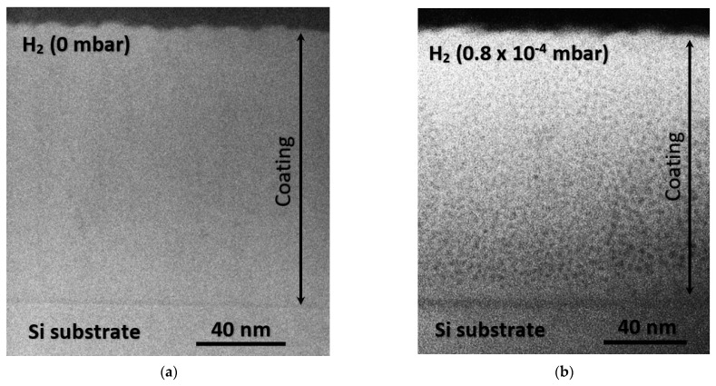
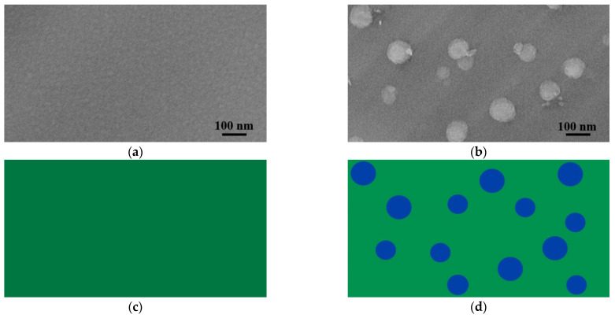

# 03-11 · SiN — Silicon Nitride 

> 근거 번호 `[S##]`는 `03-11_SiN_자료수집.md`의 ID다. 논문 전문은 열람하지 못했다.
>
> 근거 표시 — **[논문]** 논문·학회에 보고된 값 · **[특허]** 특허의 주장·실시예 · **[리뷰]** 교과서 수준의 정설 · **[계산]** 가정을 명시한 교육용 계산 · **[현장]** 문헌으로 못 박지 못한 현장 통념. 자기 장비에서 확인이 필요하다.

---

## 0. 요약

이 장에서는 산화막 다음으로 많이 쓰는 절연막인 SiN을 다룬다. USG와 마찬가지로 SiN이라는 이름 아래에는 증착 방식이 전혀 다른 막들이 묶여 있다. 먼저 방식별 차이와 기준 물성을 정리한 뒤, 그 차이가 어디에서 오는지를 차례로 설명한다.

SiN은 반도체에서 산화막 다음으로 많이 쓰는 절연막이다. 치밀하고, 수분과 이온을 막고, 산화막과 식각 선택비가 크며, 응력을 GPa 단위로 조절할 수 있다. USG와 마찬가지로 **“SiN”이라는 이름 아래 증착 방식이 전혀 다른 막**이 묶여 있다. 고온 LPCVD 막과 저온 PECVD 막은 수소 함량과 응력이 완전히 다르다.

| 방식 | 화학 | 온도 | 조성 | 수소 | 응력 | 주 용도 |
|---|---|---|---|---|---|---|
| LPCVD | SiH₂Cl₂ + NH₃ | 700–800 °C | 화학양론 Si₃N₄에 가깝다. | 수 at% | 인장. 최대 약 1.1 GPa [S12] | Pad Nitride, Spacer, Charge Trap, Etch Stop (Front-end) |
| PECVD | SiH₄ + NH₃ + N₂ | 300–550 °C | SiNₓ:H. Si/N 가변 | 15–30 at% | −1.4 ~ +1.5 GPa 조절 [S08] | Passivation, Etch Stop, Hardmask, 응력 Liner, 3D NAND 희생막 |
| ALD | Chlorosilane·Aminosilane + NH₃/N₂ Plasma | 300–550 °C | 조건에 따라 | 중간 | — | Spacer, Liner |

| 기준 물성 (화학양론 Si₃N₄) | 값 |
|---|---|
| N/Si | 1.33 |
| 밀도 | 약 3.1 g/cm³ |
| 굴절률 (633 nm) | 약 2.0 |
| 유전율 | 약 7 |

이 표의 값은 리뷰와 교과서 수준에서 정리된 것이다 [리뷰 S19].

---

## 1. 용도와 필요성

SiN은 치밀함, 차단 능력, 식각 선택비, 응력 조절이라는 여러 성질 덕분에 매우 다양한 곳에 쓰인다. 아래 표는 용도마다 SiN의 어떤 성질을 이용하는지 정리한 것이다.

| 용도 | SiN의 어떤 성질을 쓰는가 |
|---|---|
| Etch Stop | 산화막 식각(F 계)에서 SiN이 느리게 깎인다. 반대로 인산은 SiN만 녹인다. |
| Spacer | 치밀함, HF 내성, Conformal 증착 |
| Hardmask · CMP Stop | 단단하고 산화막 CMP에서 느리게 깎인다(STI의 Pad Nitride). |
| 산화 방지 마스크 | 산소와 수분이 통과하지 못한다. |
| Passivation | 수분과 Na⁺를 막는다. |
| Cu Cap | Cu 확산 Barrier. k가 높아 SiCN으로 넘어갔다(→ 03-03, 03-12). |
| Charge Trap 층 | 막 안의 Trap에 전하를 저장한다(3D NAND의 저장층). |
| 응력 Liner | 막의 응력으로 트랜지스터 채널을 변형시켜 이동도를 높인다. |
| 3D NAND 희생막 | 산화막/질화막 교대 적층 후 질화막만 인산으로 빼내고 그 자리에 금속을 채운다. |

이 표에서 보듯이 용도마다 요구가 다르다. Charge Trap 층은 Trap 밀도가, 응력 Liner는 응력이, 희생막은 인산 Etch Rate와 층별 균일도가 사양이다. **“좋은 SiN”은 하나가 아니다.**

> 이해 확인: Charge Trap 층, 응력 Liner, 3D NAND 희생막은 SiN에 각각 어떤 성질을 가장 중요하게 요구하는가?

---

## 2. 조성, 수소 함량, 물성

SiN의 성질은 Si와 N의 비율, 그리고 막 속에 들어간 수소의 양으로 대부분 설명된다. 이 절에서는 조성과 수소가 물성을 어떻게 바꾸는지 살펴보고, 수소 함량을 어림하는 방법을 익힌 뒤, LPCVD와 PECVD 막을 비교한다.

### 2.1 Si/N 비

먼저 조성부터 보자. 화학양론 조성은 Si₃N₄($\mathrm{N/Si} = 1.33$, $\mathrm{Si/N} = 0.75$)이다. 여기서 Si 쪽으로 벗어나면 Si–Si 결합이 생긴다.

| Si-rich로 갈수록 | 변화 | 근거 |
|---|---|---|
| 굴절률 | 오른다(2.0 → 2.1 이상) | [보고 S12, S13] |
| 응력 (LPCVD) | 인장이 줄어든다. | [보고 S13] |
| 절연 파괴 | 더 낮은 전압에서 파괴 | [보고 S13] |
| 광 흡수 | 단파장에서 늘어난다. | [리뷰] |
| HF Etch Rate | 내려간다. | [리뷰] |

굴절률이 조성의 가장 빠른 지표다. LPCVD에서 DCS : NH₃ 비를 1 : 6에서 6 : 1까지 바꾸면 Si/N이 0.84에서 1.04까지, 굴절률이 1.99에서 2.14까지 움직였다 [보고 S12].

### 2.2 수소

PECVD SiN은 SiNₓ:H다. SiH₄와 NH₃에서 온 수소가 Si–H와 N–H로 15–30 at% 들어 있다 [리뷰 S19]. 수소는 막의 거의 모든 성질에 관여한다.

| 수소가 많으면 | 이유 |
|---|---|
| 밀도가 낮다 (2.4–2.8 g/cm³) | 수소는 네트워크를 끊는 종결기다. |
| HF·인산 Etch Rate가 높다 | 성긴 네트워크 |
| 열에 불안정하다 | 증착 온도 이상에서 수소가 빠지며 수축하고 응력이 인장 쪽으로 간다 [포럼 S10]. |
| Trap이 줄어든다 | 수소가 Dangling Bond를 메운다. Passivation에는 유리, Charge Trap에는 불리 |
| 신뢰성에 영향 | 수소가 게이트 산화막으로 이동해 Hot Electron 열화에 관여한다 [웹 S09]. |

여기서 주의할 점이 있다. **수소가 전부 결합해 있는 것은 아니다.** ERDA로 잰 총 수소가 FTIR로 잰 결합 수소보다 크게 많다. 결합하지 않은 수소(H₂ 분자 등)가 막 안에 있다 [논문 S05]. FTIR만으로는 수소를 과소평가한다.

수소가 막을 성기게 만든다는 것을 직접 보여 주는 전자현미경 사진이 있다 [리뷰 S24]. PECVD가 아니라 RF Sputtering으로 만든 막이지만 수소의 역할은 같다.

*RF Sputtering a-SiNₓ의 HAADF-STEM 단면. (a) 수소 없이 증착한 막은 치밀하다. (b) H₂를 넣어 증착한 a-SiNₓ:H는 나노미터 크기의 기공이 고르게 퍼져 있다. 같은 계열 시편에서 H₂ 분압을 0에서 7.9×10⁻⁴ mbar로 올리면 굴절률(550 nm)이 1.96에서 1.89로 내려갔다.*

*출처: Hegedüs 등, Materials 14(19), 5658 (2021), Figure 3. CC BY 4.0. [PMC](https://pmc.ncbi.nlm.nih.gov/articles/PMC8510430/)*

### 2.3 수소 함량 추정 [계산]

FTIR로 잰 결합 밀도가 수소 몇 at%에 해당하는지 어림해 보자. 밀도 2.6 g/cm³인 SiN의 Si + N 원자 밀도는 약 7.8×10²² cm⁻³이다. FTIR로 구한 Si–H와 N–H 결합 밀도의 합이 $N_{\mathrm{H}}$라면:

| $N_{\mathrm{H}}$ (cm⁻³) | 수소 at% |
|---|---|
| 1.0×10²² | 11 % |
| 2.0×10²² | 20 % |
| 3.0×10²² | 28 % |

10²² cm⁻³ 단위의 결합 밀도가 10–30 at%에 해당한다. 막 원자 4–5개 중 하나가 수소인 재료다.

### 2.4 LPCVD와 PECVD의 차이

지금까지 본 조성과 수소의 차이를 바탕으로 LPCVD SiN과 PECVD SiN을 비교해 보자.

| 항목 | LPCVD | PECVD |
|---|---|---|
| 수소 | 수 at% | 15–30 at% |
| 밀도 | 3.0 근처 | 2.4–2.8 |
| HF Etch Rate | 매우 낮다 | 수 배 ~ 수십 배 |
| 응력 | 인장 약 1 GPa | 조절 가능 |
| Conformality | 매우 좋다 | 나쁘다 ~ 중간 |
| 열 예산 | 700–800 °C | 400 °C 안팎 |

이 표의 값은 문헌과 현장에서 통용되는 범위이며, 자기 장비에서 확인해야 한다 [리뷰·현장]. 금속 배선이 있으면 LPCVD를 쓸 수 없다. Front-end의 SiN이 LPCVD에서 ALD로 넘어간 것도 열 예산과 두께 제어 때문이다.

> 이해 확인: PECVD SiN의 굴절률이 1.95에서 2.05로 올랐다. 조성과 수소의 관점에서 어떤 변화를 의심할 수 있는가?

---

## 3. 전구체와 반응

LPCVD와 PECVD는 같은 SiN을 만들지만 반응의 방식이 다르다. 이 절에서는 두 방식의 반응을 설명하고, PECVD SiN이 응력을 넓게 조절할 수 있게 해 주는 이중 주파수 구성을 살펴본다.

### 3.1 LPCVD

$$
3\,\mathrm{SiH_2Cl_2} + 4\,\mathrm{NH_3} \rightarrow \mathrm{Si_3N_4} + 6\,\mathrm{HCl} + 6\,\mathrm{H_2} \qquad (700\text{–}800\ \mathrm{°C},\ \text{수백 mTorr})
\mathrm{HCl} + \mathrm{NH_3} \rightarrow \mathrm{NH_4Cl}\ (\text{고체, 약 340 °C 아래}) \qquad (\text{배기 쪽에서 석출})
$$

위 반응식은 리뷰 수준의 정리이다 [리뷰 S20]. LPCVD SiN은 표면 반응 지배 영역에서 증착되므로 Conformality가 좋고 Batch Furnace에서 수십~백여 장을 한 번에 처리한다. 가스가 Wafer 열을 따라 흐르며 소모되므로 Tube 앞뒤의 두께·조성 차이를 온도 구배로 보상한다. NH₃를 과잉으로 넣는 것이 기본이고, DCS 비를 올리면 Si-rich 저응력 막이 된다(§4.1).

### 3.2 PECVD

PECVD SiN은 SiH₄와 NH₃를 주 원료로 쓰며, 각 가스의 역할은 다음과 같다.

| 가스 | 역할 |
|---|---|
| SiH₄ | Si 공급. Si–H의 원천 |
| NH₃ | N 공급. 쉽게 해리된다. N–H의 원천 |
| N₂ | N 공급과 희석. 결합이 강해 해리가 어렵다. NH₃ 없이 N₂만 쓰면 수소가 적은 막이 되지만 증착이 느리다. |

Plasma에서 SiH₄와 NH₃가 깨져 SiHₓ와 NHₓ 라디칼이 되고, 표면에서 Aminosilane 형태의 중간체를 거쳐 Si–N 네트워크가 된다. 표면의 수소는 열과 이온 충격으로 떨어져 나간다. **수소를 얼마나 떼어내느냐를 온도와 이온 에너지가 정한다.**

### 3.3 이중 주파수

PECVD SiN의 표준 구성은 두 주파수를 섞는 것이다 [특허 S06].

| 주파수 | 하는 일 |
|---|---|
| 고주파 13.56 MHz | 전구체 해리. Plasma 밀도와 증착 속도 |
| 저주파 약 400 kHz | 이온 충격. 성장 중인 막의 응력 제어 |

저주파에서는 이온이 RF 주기를 따라갈 수 있어 Sheath 전압만큼 가속된다. 저주파는 이온 에너지를 바꾸지만 Plasma 화학에는 영향이 작다 [웹 S09]. 그래서 **증착 속도·조성과 응력을 거의 독립적으로** 조절할 수 있다. 이것이 PECVD SiN이 응력 공학의 재료가 된 이유다.

> 이해 확인: 이중 주파수 PECVD에서 저주파 전력만 바꾸면 증착 속도는 거의 그대로인데 응력이 크게 변하는 이유는 무엇인가?

---

## 4. 공정 윈도우와 공정 변수별 응답

이 절에서는 LPCVD와 PECVD 각각에서 조절 변수가 막의 조성, 굴절률, 응력을 어떻게 바꾸는지 정리하고, PECVD SiN의 응력이 어디에서 오는지 두 가지 원천으로 설명한다.

### 4.1 LPCVD

LPCVD에서는 DCS와 NH₃의 비, 그리고 온도가 주된 조절 변수이다.

| 조절 변수 ↑ | Si/N | 굴절률 | 인장 응력 | 비고 |
|---|---|---|---|---|
| DCS / NH₃ 비 | ↑ | ↑ | ↓ | 저응력 Si-rich 막. 절연 파괴 전압은 낮아진다 [S13]. |
| 온도 | — | — | ↓ | 증착 속도 ↑ [S13] |
| 압력 | — | — | — | 증착 속도 ↑, 균일도·거칠기 변화 |

문헌 범위: DCS : NH₃ 1 : 6 ~ 6 : 1, 776–838 °C에서 응력 168–1,127 MPa, 굴절률 1.99–2.14 [보고 S12]. 저응력과 낮은 표면 거칠기를 함께 얻기는 어렵고, 절충 조건으로 770 °C, 150 mTorr, DCS : $\mathrm{NH_{3}} = 3$ : 1이 제시됐다 [학위 논문 S14].

### 4.2 PECVD

PECVD에서는 조절 변수가 훨씬 많고, 특히 응력을 넓은 범위에서 조절할 수 있다.

| 조절 변수 ↑ | 응력 | 수소 | 밀도 | 굴절률 | 메커니즘 |
|---|---|---|---|---|---|
| 저주파 Power | 압축 쪽 | ↓ | ↑ | — | 이온 충격으로 치밀화 [S06, S09] |
| 저주파 끔 | 인장 | ↑ | ↓ | — | [S07] |
| SiH₄ / NH₃ 비 | 압축 쪽 [S10] | Si–H ↑, N–H ↓ | — | ↑ | Si-rich |
| NH₃ / N₂ 비 | — | N–H ↑ | ↓ | ↓ | N-rich |
| 온도 | 인장 쪽 | ↓ | ↑ | ↑ 소폭 | 수소 탈리, 치밀화 |
| 압력 | 인장 쪽 | ↑ | ↓ | — | 이온 에너지 감소 |
| H₂ · He 희석 | 조건에 따라 | 변화 | ↑ | — | 표면 수소 추출 |

이 표의 값은 문헌과 현장에서 통용되는 범위이며, 자기 장비에서 확인해야 한다 [특허·리뷰·현장]. 이중 주파수, 375–525 °C, 2–15 Torr에서 응력을 약 −1.4 GPa(압축)에서 +1.5 GPa(인장)까지 조절한 예가 있다 [특허 S08]. 응력은 가스 조성, 증착 속도, 온도, 이온 충격 모두에 의존한다 [특허 S07].

### 4.3 응력의 발생 원인

PECVD SiN의 응력이 왜 이렇게 넓게 변하는지 이해하려면 응력이 어디에서 오는지 알아야 한다. 응력에는 방향이 반대인 두 원천이 있다.

| 원천 | 방향 | 무엇이 키우는가 |
|---|---|---|
| 이온 충격 | 압축 | 저주파 Power, 낮은 압력. 원자가 빽빽이 박힌다. |
| 수소 방출에 의한 수축 | 인장 | 온도, 증착 후 UV·열 처리. 수소가 빠진 자리에서 Si–N이 새로 이어지며 막이 줄어들려 한다. |

이 표의 값은 리뷰와 교과서 수준에서 정리된 것이다 [리뷰]. 저주파를 끄면 인장이 되는 것은 압축 원천이 사라지기 때문이고, 고온이나 후처리에서 인장이 커지는 것은 수축 원천이 커지기 때문이다. **PECVD SiN의 응력은 이 둘의 차이**다.

> 이해 확인: PECVD SiN을 증착 직후에는 압축이었는데 고온 Anneal 뒤 인장으로 바뀌었다. 두 응력 원천으로 설명해 보자.

---

## 5. 계산 [계산]

3D NAND에서 SiN은 수백 층으로 쌓였다가 인산으로 녹여 내는 희생막으로 쓰인다. 이 절에서는 인산 식각의 선택비가 산화막 손실을 얼마나 정하는지, 그리고 층별 응력이 Wafer Bow를 얼마나 만드는지 계산해 본다.

### 5.1 인산 식각의 선택비와 산화막 손실

3D NAND에서는 Slit을 통해 인산을 넣어 질화막 층을 옆으로 녹여 낸다. 질화막을 옆으로 L만큼 빼내는 동안, 먼저 드러난 Slit 근처의 산화막 표면은 그 시간 내내 인산에 노출된다.

$$
\text{산화막 손실(한 면)} \approx \frac{L}{\text{선택비}}
$$

| 옆으로 빼낼 거리 L | 선택비 40 | 100 | 300 | 1,000 |
|---|---|---|---|---|
| 200 nm | 5.0 nm | 2.0 nm | 0.7 nm | 0.2 nm |
| 300 nm | 7.5 nm | 3.0 nm | 1.0 nm | 0.3 nm |
| 500 nm | 12.5 nm | 5.0 nm | 1.7 nm | 0.5 nm |

신선한 인산의 선택비는 약 40 : 1이다 [특허 S15]. 300 nm를 빼내면 산화막이 위아래로 7.5 nm씩, 합쳐 15 nm 줄어든다. 산화막 층이 25 nm 안팎이라면 **Slit 근처에서 절반 넘게 사라진다.** 3D NAND가 수백 대 1 이상의 선택비를 요구하고, 실리카를 미리 녹인 인산과 첨가제를 쓰는 이유다 [특허 S15]. 선택비를 너무 올리면 반대 문제가 생긴다(§6.1).

CVD 쪽의 의미: **질화막의 인산 Etch Rate가 빠르고 층마다 같아야 한다.** 느린 층이 있으면 전체 식각 시간이 그 층에 맞춰져 다른 층의 산화막 손실이 커진다.

### 5.2 적층 응력과 Wafer Bow

산화막(압축)과 질화막(인장)을 번갈아 쌓으면 응력 × 두께가 층마다 더해진다.

$$
\text{막의 합력} = \sum \sigma_i t_i
\text{300 mm Wafer Bow}\,[\mathrm{µm}] \approx 0.623 \times \text{합력}\,[\mathrm{N/m}]
$$

환산 계수는 03-02 §5에서 구한 것이다.

| 적층 | 산화막 | 질화막 | 합력 | Bow |
|---|---|---|---|---|
| 100쌍 | 25 nm, −200 MPa | 25 nm, +200 MPa | 0 N/m | 0 µm |
| 100쌍 | 25 nm, −200 MPa | 25 nm, +300 MPa | 250 N/m | 약 156 µm |
| 200쌍 | 25 nm, −200 MPa | 25 nm, +250 MPa | 250 N/m | 약 156 µm |

질화막 응력이 100 MPa만 어긋나도 100쌍에서 Bow가 150 µm를 넘는다. 층수가 두 배면 허용 오차가 절반이 된다. **적층 수가 늘수록 층 하나의 응력 사양이 조여진다** [특허 S17].

> 이해 확인: 인산 선택비를 100 : 1로 올리면 옆으로 500 nm를 빼내는 동안 산화막 손실은 한 면에 얼마인가? 40 : 1일 때와 비교해 보자.

---

## 6. 집적 이슈와 불량 모드

SiN의 불량은 용도마다 다르다. 이 절에서는 3D NAND의 인산 식각과 Wafer Bow, PECVD SiN의 수소 이동, 응력에 의한 불량, Conformality, Particle을 차례로 살펴본다.

### 6.1 3D NAND의 인산 식각과 산화막 재석출

질화막이 인산에 녹으면 용액 안에 실리카가 늘어난다. 실리카는 산화막 식각을 억제해 선택비를 올려 준다. 그러나 지나치면 **녹아 있던 실리카가 산화막 표면에 다시 석출**한다 [특허 S15, 논문 S16].

- Slit 입구 근처에 산화물이 쌓여 틈을 막는다(Pinch-off). 막히면 안쪽 질화막이 남는다.
- 산화막 식각 억제제를 넣으면 재석출이 비정상적으로 커질 수 있다 [논문 S16].
- 층수가 많을수록 부산물이 Slit 밖으로 빠져나가기 어려워 재석출이 심해진다 [논문 S16].

즉 선택비가 낮으면 산화막이 깎이고, 높으면 산화막이 자란다. 그 사이의 좁은 창을 맞춘다. 인산은 약 85 %, 140–180 °C에서 쓰며 물이 증발해 농도가 계속 변한다 [특허 S15].

### 6.2 3D NAND의 Wafer Bow와 구조 붕괴

§5.2대로 층별 응력의 작은 불일치가 큰 Bow가 된다. Bow는 Litho Overlay, 척 흡착, 반송에 문제를 일으킨다 [특허 S17]. 질화막을 빼낸 뒤에는 산화막 층만 남아 허공에 떠 있는 구조가 되므로, 잔류 응력이 층을 휘게 하거나 무너뜨린다(Tier Collapse) [기사 S18].

대책은 층별 응력 정합, Wafer Backside에 보상막 증착, N₂ Anneal(650–850 °C)이다 [특허 S17].

### 6.3 수소의 이동

PECVD SiN의 수소는 후속 열 공정에서 빠져나와 주변으로 간다.

| 결과 | 내용 |
|---|---|
| 응력·두께 변화 | 수소가 빠지며 수축, 인장 쪽 이동 [포럼 S10] |
| Blister · Peeling | 치밀한 막 아래에서 방출 가스가 갇힌다. |
| 소자 영향 | 게이트 산화막 계면으로 간 수소가 Hot Electron 열화, 문턱 전압 불안정에 관여 [웹 S09] |
| 유익한 경우 | 계면의 Dangling Bond를 메워 준다(Passivation). |

수소 총량과 결합 형태(Si–H인지 N–H인지)를 함께 관리한다. Si–H가 N–H보다 약해 먼저 끊어진다 [리뷰].

*RF Sputtering a-SiNₓ:H 표면의 SEM. (a) Anneal 전, (b) 약 65 °C Anneal 후로 지름 약 100 nm의 Blister가 생겼다. (c), (d)는 모식도다. Sputtering 막의 예이므로 온도 값을 PECVD 막에 그대로 옮기지는 않는다. 막 안의 수소가 모여 막을 들어 올린다는 원리만 가져온다.*

*출처: Hegedüs 등, Materials 14(19), 5658 (2021), Figure 4. CC BY 4.0. [PMC](https://pmc.ncbi.nlm.nih.gov/articles/PMC8510430/)*

### 6.4 응력에 의한 불량

- LPCVD SiN의 약 1 GPa 인장은 두께가 수백 nm를 넘으면 Crack을 낸다. 그래서 Pad Nitride 아래에 완충 산화막을 깐다.
- 고응력 Liner는 패턴 모서리에서 박리하거나 하부 구조를 변형시킨다.
- Passivation SiN의 응력은 Al 배선의 Stress Migration(Void)에 관여한다 [리뷰].

### 6.5 Conformality

PECVD SiN은 단차 피복이 나빠 측벽이 얇고 막질도 나쁘다. 이온이 닿는 수평면은 치밀하고, 닿지 않는 측벽은 성기다. 측벽의 Wet Etch Rate가 수평면의 몇 배가 된다. Spacer와 Liner가 LPCVD·ALD로 가는 이유다. Plasma를 쓰는 ALD에도 같은 문제가 남는다 [리뷰 S22].

### 6.6 Particle

- PECVD: SiH₄ + NH₃ 기상 반응 분말. 누적 막이 두꺼워지면 응력으로 박리
- LPCVD: NH₄Cl 석출물, Tube·Boat 누적 막의 박리(인장 응력이 커서 일정 두께에서 갈라진다)

> 이해 확인: 3D NAND의 Slit 입구 근처에 산화물이 쌓여 안쪽 질화막이 남았다. 인산 식각의 어떤 조건을 의심해야 하는가?

---

## 7. 챔버 · 하드웨어 관리

LPCVD와 PECVD는 장비와 부산물이 달라 관리 항목도 다르다. 아래 표는 Chamber와 하드웨어 관리의 주요 항목을 정리한 것이다.

| 항목 | 내용 |
|---|---|
| PECVD Clean | NF₃ 계 F 라디칼. 고응력 막은 누적 두께 한계가 낮다. Clean 주기를 누적 응력 기준으로 잡는다 [현장]. |
| Seasoning | Clean 후 벽의 F가 첫 Wafer의 굴절률과 응력을 바꾼다 [현장]. |
| 전극·Showerhead 상태 | 이온 에너지가 응력을 정하므로 전극 표면 상태, 간격, 접지 경로의 변화가 응력 Drift로 나타난다 [현장]. |
| RF 정합 | 두 주파수의 전력 전달이 각각 안정해야 한다. 저주파 반사가 응력 변동이 된다. |
| LPCVD NH₄Cl | 배기 라인·밸브·Pump에 고체로 쌓인다. 배기 가열과 Trap [리뷰 S20] |
| LPCVD 누적 막 | Tube와 Boat의 누적 두께 관리. 일정 두께에서 Wet 세정 또는 In-situ Clean |
| 적층 증착 (3D NAND) | 한 Chamber에서 산화막과 질화막을 수백 번 교대한다. **가스 전환의 과도 구간이 층 계면이 된다.** 층별 두께·응력·Etch Rate의 재현성, 누적 열에 의한 아래층 변화, 누적 Particle이 과제다 [현장]. |

---

## 8. 계측과 해석

SiN에서는 수소의 양과 결합 형태가 많은 성질을 좌우하므로 수소를 정량하는 방법이 특히 중요하다. 이 절에서는 FTIR로 수소를 정량하는 방법과 그 한계를 먼저 설명하고, 여러 계측을 조합해 읽는 방법을 정리한다.

### 8.1 FTIR 수소 정량

SiN의 수소는 FTIR로 Inline 관리한다. Lanford와 Rand가 핵반응 분석으로 잰 수소량과 FTIR 흡수를 대응시켜 Si–H와 N–H의 흡수 단면적을 정한 것이 기준이다 [논문 S01, 응용 노트 S02].

| 결합 | 파수 | 널리 쓰이는 흡수 단면적 |
|---|---|---|
| N–H 신축 | 약 3,350 cm⁻¹ | 5.3×10⁻¹⁸ cm² |
| Si–H 신축 | 약 2,170 cm⁻¹ | 7.4×10⁻¹⁸ cm² |
| Si–N 신축 | 약 830–870 cm⁻¹ | — |

단면적 값은 [논문 S03]에 인용된 것으로, 원 출처 귀속은 확인이 필요하다. 이 방법에는 알려진 한계가 세 가지 있다.

1. **교정 상수가 조성에 따라 달라진다.** N-rich 막에서 두 결합의 흡수 강도 비가 8.5로, Lanford의 약 2와 크게 달랐다는 재측정이 있다 [논문 S04].
2. **결합하지 않은 수소는 보이지 않는다.** ERDA 값이 FTIR 값보다 크게 많다 [논문 S05].
3. Anneal 중 FTIR 결합 수소와 ERD 총 수소가 다르게 움직인다 [논문 S05].

그래서 FTIR 수소 값은 **같은 공정 안에서의 상대 관리 지표**로 쓰고, 절대값이 필요하면 ERD·RBS로 교정한다.

### 8.2 계측법

| 계측 | 얻는 것 | 읽는 법과 함정 |
|---|---|---|
| Ellipsometry | 두께, 굴절률 | 굴절률 = 조성의 빠른 지표. 2.0에서 위로 가면 Si-rich |
| FTIR | Si–H, N–H, Si–N | Si–H/N–H 비가 Si-rich·N-rich를 가른다. Si–N 피크 위치·폭은 네트워크 치밀도 |
| Wafer Bow | 응력 | 증착 직후, 열처리 후, 시간 경과 후 |
| Wet Etch Rate | 치밀도 | HF와 인산 모두. 3D NAND 희생막은 인산 Etch Rate가 사양이다. |
| XRR · RBS | 밀도, Si/N | |
| ERD · HFS | 총 수소 | FTIR 교정 |
| TDS | 수소 방출 온도 | 열 안정성 |
| C–V · I–V | Trap, 누설, 절연 파괴 | Charge Trap 층, Si-rich 막 |
| 단면 TEM | 측벽 두께·막질 | Conformality. 측벽 Wet Etch 후 관찰 |

### 8.3 계측 결과의 종합 해석

한 가지 계측만으로는 원인을 가리기 어렵다. 여러 계측이 함께 어떻게 변했는지 보면 해석이 좁혀진다.

| 관측 | 유력한 해석 |
|---|---|
| 굴절률 ↑, Si–H ↑, N–H ↓ | Si-rich로 이동 (SiH₄/NH₃ 비 상승) |
| 응력이 압축 쪽, 밀도 ↑, 수소 ↓ | 이온 충격 증가 (저주파, 압력 저하) |
| 응력이 인장 쪽, 수소 ↑, Etch Rate ↑ | 이온 충격 감소 또는 온도 저하 |
| 열처리 후 응력이 인장 쪽, 두께 ↓ | 수소 방출과 수축 |
| 굴절률 정상, 응력만 Drift | 전극·RF 상태 변화 |

이 표의 값은 문헌과 현장에서 통용되는 범위이며, 자기 장비에서 확인해야 한다 [리뷰·현장].

> 이해 확인: 같은 공정에서 FTIR로 구한 수소 함량은 그대로인데 ERDA 값만 늘었다. 무엇이 변했을 가능성이 있는가?

---

## 9. 파생 막과 차세대 기술

SiN은 새로운 소자 구조와 함께 계속 새로운 요구를 받고 있다. 아래 표는 그 방향을 정리한 것이다.

| 방향 | 내용 |
|---|---|
| 응력 Liner | 트랜지스터 위에 고응력 SiN을 덮어 채널을 변형시킨다. 인장 막은 n형, 압축 막은 p형 이동도를 올린다. 인장은 저주파를 끄고 증착 후 UV로 수소를 빼 키운다. 압축은 강한 이온 충격으로 키운다 [특허 S07, 리뷰 S21]. |
| ALD SiN | 수 nm Spacer·Liner. Chlorosilane 또는 Aminosilane + NH₃/N₂ Plasma. 저온에서의 막질과 측벽 균질성이 과제 [리뷰 S22] |
| Low-k 대체 | Spacer는 SiBCN·SiOCN(→ 03-04), Cu Cap은 SiCN(→ 03-12)으로. SiN의 k 7이 부담인 곳부터 바뀐다. |
| 3D NAND 적층 | 층수 증가에 따라 층별 응력·두께·Etch Rate 사양이 계속 조여진다. |
| 수소 저감 PECVD | NH₃ 없이 N₂로, 또는 고밀도 Plasma로 수소를 줄인다. |

---

## 10. Troubleshooting

아래 표는 SiN 공정에서 흔히 나타나는 증상과 유력한 원인, 확인할 데이터, 조치 방향을 정리한 것이다. 표의 원인은 현장 경험에서 나온 출발점이므로 [현장], “확인할 데이터” 열로 가설을 좁힌 뒤에 조치해야 한다.

| 증상 | 유력 원인 | 확인할 데이터 | 조치 방향 |
|---|---|---|---|
| 응력 Drift (굴절률 정상) | 저주파 전력 전달, 전극 상태, 압력 | RF 반사·Vpp 이력, Clean 후 경과 | RF 점검, 부품 교체, Seasoning |
| 굴절률 상승 | Si-rich (SiH₄ MFC, NH₃ 부족) | FTIR Si–H/N–H | 가스 비 복귀 |
| 열처리 후 Blister·Peeling | 수소 방출 | TDS, FTIR 수소 | 증착 온도 상향, 수소 저감, 열 Ramp 완화 |
| 두꺼운 막 Crack | 인장 응력 × 두께 | 응력 | 저응력 조성, 두께 분할, 완충층 |
| 측벽 SiN이 세정에서 소실 | 측벽 막질 불량 (PECVD) | 단면 TEM, 측벽 Etch Rate | LPCVD·ALD로 변경 |
| 3D NAND: 인산 후 질화막 잔류 | 층별 Etch Rate 차이, Slit Pinch-off | 층별 잔류 위치, 인산 실리카 농도 | 층 균일도, 인산 관리 |
| 3D NAND: 산화막 층 두께 이상 | 선택비 부족(얇아짐) 또는 재석출(두꺼워짐) | 단면, 인산 이력 | 인산 조성·교체 주기 |
| Wafer Bow 과다 | 층별 응력 불일치 | 층별 응력 Monitor, 누적 Bow | 응력 정합, Backside 보상 |
| LPCVD Particle | 누적 막 박리, NH₄Cl | 누적 두께, 배기 온도 | 세정 주기, 배기 가열 |
| 소자 Hot Carrier 열화 | 수소 과다 | 수소량, Si–H 비율 | 수소 저감 조건 |

> 이해 확인: LPCVD SiN Furnace에서 배기 압력이 서서히 오르고 Particle이 늘었다. 어떤 부산물과 어떤 부위를 먼저 점검해야 하는가?

---

## 11. 자가 점검

이 장의 핵심 내용을 질문으로 확인해 보자. 각 질문을 먼저 스스로 풀어 본 뒤 답을 펼쳐 비교한다.

**Q1. LPCVD SiN과 PECVD SiN의 가장 큰 차이 두 가지는?**
수소 함량(수 at% 대 15–30 at%)과 응력(약 1 GPa 인장 고정 대 압축~인장 조절 가능)이다.

**Q2. 이중 주파수 PECVD에서 두 주파수의 역할은?**
13.56 MHz는 전구체 해리로 증착 속도와 조성을 정한다. 약 400 kHz는 이온 충격으로 응력과 밀도를 정한다.

**Q3. 저주파를 끄면 응력이 인장이 되는 이유는?**
압축을 만드는 이온 충격이 사라지고, 수소 방출에 의한 수축 성분만 남기 때문이다.

**Q4. FTIR로 구한 수소 함량이 ERDA 값보다 작게 나왔다. 왜인가?**
FTIR은 Si–H와 N–H로 결합한 수소만 본다. 결합하지 않은 수소는 보이지 않는다.

**Q5. 인산 선택비 40 : 1로 질화막을 옆으로 300 nm 빼내면 Slit 근처 산화막은 얼마나 줄어드는가?**
한 면에 7.5 nm, 위아래 합쳐 15 nm.

**Q6. 인산의 선택비를 무한정 올릴 수 없는 이유는?**
실리카가 포화하면 산화막 표면에 재석출해 Slit을 막는다.

**Q7. 100쌍 적층에서 질화막 응력이 설계보다 100 MPa 높다. Bow는 대략 얼마인가? (층 두께 25 nm)**
$100 \times 25\ \mathrm{nm} \times 100\ \mathrm{MPa} = 250\ \mathrm{N/m}$. 약 156 µm.

**Q8. PECVD SiN으로 Spacer를 만들면 생기는 문제는?**
측벽이 얇고, 이온이 닿지 않아 측벽 막질이 성기다. 세정에서 측벽이 먼저 녹는다.

---

## 12. 참고문헌

전체 서지, 링크, 확인 수준은 `03-11_SiN_자료수집.md`에 있다.

- [S01] Lanford & Rand, *J. Appl. Phys.* 49, 2473 (1978) — FTIR 수소 정량의 기준(원문 미열람)
- [S04, S05] UCM 그룹 — 교정 상수의 조성 의존성, 비결합 수소
- [S06] US 5,508,067 — 이중 주파수의 역할
- [S08] US 2005/0170104 — 응력 −1.4 ~ +1.5 GPa
- [S12] EPFL 학생 프로젝트 (2015) — LPCVD 조건과 Si/N·응력·굴절률
- [S13] Cornell CNF 2023–2024 — Si-rich 막의 응력·굴절률·절연 파괴
- [S15] 고선택비 SiN 식각액 특허군 — 인산 조건, 선택비, 재석출
- [S16] SISPAD 2023 — 산화막 재성장
- [S17] Wafer Bow 특허군 — 적층 응력과 보상
- [S24] Hegedüs 등, *Materials* 14, 5658 (2021) — a-SiNₓ:H 리뷰. 수소에 의한 기공과 Blister 사진(그림 출처)
