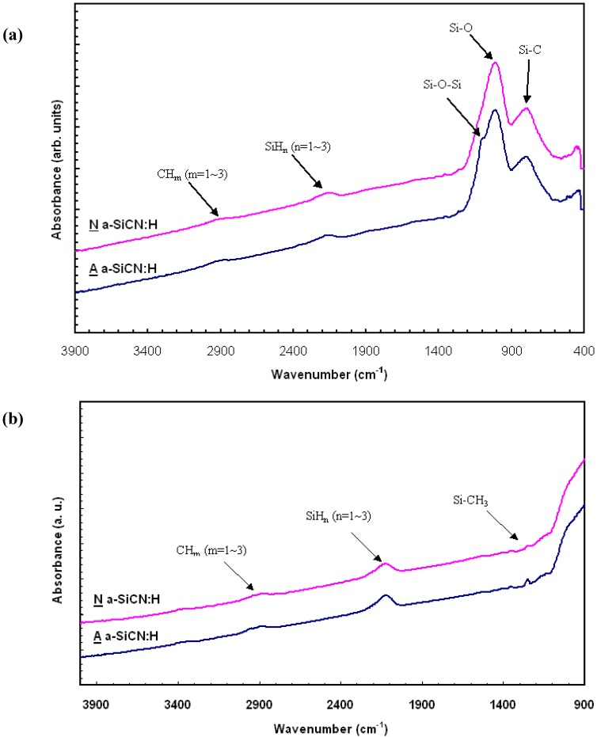

# 03-12 · SiCN — Silicon Carbon Nitride 

> 근거 번호 `[S##]`는 `03-12_SiCN_자료수집.md`의 ID다. 논문 전문은 열람하지 못했다.
>
> 근거 표시 — **[논문]** 논문·학회에 보고된 값 · **[특허]** 특허의 주장·실시예 · **[리뷰]** 교과서·기사 수준의 정설 · **[계산]** 가정을 명시한 교육용 계산 · **[현장]** 문헌으로 못 박지 못한 현장 통념. 자기 장비에서 확인이 필요하다.

---

## 0. 요약

SiCN은 SiC:H(→ 03-03)에 질소를 넣은 막, 또는 SiN(→ 03-11)에 탄소를 넣은 막이다. SiN보다 유전율이 낮고 SiC보다 치밀하다. 두 가지 자리에서 표준이다. 하나는 **Cu 배선 바로 위의 Cap**, 다른 하나는 Wafer끼리 붙이는 **Hybrid Bonding의 접합 유전체**다. 뒤쪽은 SiCN의 새 용도이고, 요구 성질이 Cap과 전혀 다르다.

| 항목 | 내용 |
|---|---|
| 역할 | Cu Cap·확산 Barrier·Etch Stop / Hybrid Bonding 유전체 |
| 증착 방식 | PECVD, 400 °C 이하. 접합용은 초저온 공정도 [논문 S10] |
| 전구체 | 3MS · 4MS + NH₃ (+ He) |
| 유전율 | 약 5.0. 비교: SiN 7.0 [현장 S01] |
| 도입 | 90 nm 노드 무렵 SiN을 대체 [현장 S01] |
| Cap에서의 강점 | SiC보다 Cu Barrier와 접착이 좋다. 3MS 기반이 4MS 기반보다 Barrier가 좋다 [논문 S05] |
| 접합에서의 강점 | Anneal 후 Void가 없다. Dangling Bond가 많고 Outgassing이 적다 [논문 S08, S09] |
| 약점 | N이 많으면 TDDB 악화 [논문 S06]. Amine에 의한 Resist Poisoning |

---

## 1. 용도와 필요성

SiCN은 두 가지 자리에서 쓰인다. 이 절에서는 Cu Cap에서 SiCN이 맡는 역할을 정리하고, Hybrid Bonding이 무엇이며 왜 접합 유전체로 SiCN을 쓰는지 살펴본 뒤, 두 용도의 요구를 비교한다.

### 1.1 Cu Cap

Cu 배선의 윗면을 덮는 유전체 Cap의 역할과 요구는 03-03 §1에서 다루었다. 여기서는 요점만 다시 정리한다.

- SiN은 Barrier로는 좋지만 k가 7.0이다. 유효 유전율을 낮추려고 k 약 5.0의 SiCN으로 바꿨다 [현장 S01].
- N이 없는 SiC:H는 k가 더 낮지만 Barrier와 Cu 접착이 약하다.
- 그래서 **Cu 바로 위에는 SiCN, 그 위에는 SiC·SiCO**를 올린 이중층이 흔하다 [논문 S05].

SiCN은 “Cu와 직접 닿는 층”을 맡는다. 이 층의 사양은 k가 아니라 **접착과 Barrier**다.

### 1.2 Hybrid Bonding 유전체

3차원 적층에서는 두 Wafer의 표면을 맞대어 붙이면서 Cu Pad끼리도 전기적으로 연결한다. 표면은 유전체 바탕에 Cu Pad가 박힌 형태이고, 유전체–유전체와 Cu–Cu가 동시에 붙는다. 그래서 Hybrid라 부른다.

- ① 유전체 증착 → Cu Pad Damascene → CMP: 유전체는 평탄하게, Cu는 수 nm 오목하게 만든다.
- ② 표면 활성화(Plasma) → 세정
- ③ 정렬 후 상온 접촉: 중앙에서 시작한 Bonding Wave가 퍼진다.
- ④ Anneal: 유전체 결합이 강해지고, Cu가 팽창해 맞닿으며 Cu–Cu 결합이 생긴다.

위 공정 흐름은 imec의 설명을 정리한 것이다 [현장 S07]. 접합 유전체로는 원래 SiO₂를 썼다. Pitch가 미세해지면서 SiCN이 표준이 됐다. imec은 SiCN을 접합 유전체로 높은 접합 에너지와 제어된 Cu Bulge-out을 보고했고, Wafer-to-wafer 접합을 400 nm Pitch까지 밀었다 [논문 S12, 현장 S07].

### 1.3 용도별 요구 특성 비교

같은 SiCN이지만 Cu Cap과 Hybrid Bonding은 요구가 전혀 다르다. 두 용도를 나란히 비교해 보자.

| 항목 | Cu Cap | Hybrid Bonding |
|---|---|---|
| 두께 | 수 nm ~ 수십 nm | 수백 nm ~ µm (CMP 여유 포함) |
| 핵심 사양 | Cu 접착, Barrier, Etch 선택비, k | 접합 에너지, Void 없음, CMP 후 평탄도 |
| 표면 | 증착 그대로 | CMP와 Plasma 활성화를 거친다. |
| 수소·Outgassing | 신뢰성 | **Void의 직접 원인** |
| Cu 확산 | 막아야 한다 | 막아야 한다(정렬 오차로 Cu가 상대편 유전체와 닿는다). |

같은 “SiCN”이라도 Recipe가 다르다. 접합용은 CMP가 잘 되고 Outgassing이 적어야 하며, Cu 정렬 오차 때문에 Barrier 성질도 필요하다. SiO₂ 대신 SiCN을 쓰는 이유 중 하나가 이 Barrier 성질이다.

> 이해 확인: Cu Cap용 SiCN과 Hybrid Bonding용 SiCN에서 가장 중요한 사양은 각각 무엇인가?

---

## 2. 재료의 구조와 물성

SiCN의 성질은 탄소와 질소의 비율, 그리고 표면의 상태로 정해진다. 이 절에서는 조성에 따라 물성이 어떻게 변하는지 설명하고, SiCN이 SiO₂보다 접합에 유리한 이유와 접합 강도가 언제 나타나는지 살펴본다.

### 2.1 SiC와 SiN의 중간 조성

SiCN은 Si–C와 Si–N 결합이 섞인 비정질 네트워크다. 수소가 Si–H, N–H, C–H로 들어 있고, 유기실란 전구체에서 온 메틸기(Si–CH₃)가 일부 남는다.

| N ↑ (NH₃ ↑) | 방향 | 근거 |
|---|---|---|
| 밀도 | ↑ | [리뷰] |
| Cu Barrier · 기밀성 | ↑ | [리뷰] |
| 누설 | ↓ | [논문 S06] |
| k | ↑ (5 안팎 → SiN의 7 쪽으로) | [현장 S01] |
| TDDB | N이 많으면 악화 | [논문 S06] |
| Amine 문제 | ↑ | → 03-03 §6.3 |

질소는 막을 치밀하게 하지만 너무 넣으면 절연 신뢰성이 나빠지고 k가 오른다. 중간 조성이 절충점이다 [논문 S06].

Cap용 SiCN의 FTIR 예다. 같은 SiCN이라도 전구체에 따라 남는 결합이 다르다 [논문 S05].

*PECVD a-SiCN:H의 FTIR. (a) 3MS 기반, (b) 4MS 기반이고 둘 다 350 °C 증착이다. 3MS 막은 Si–CH₃ 피크가 조금 더 강하고, 4MS 막에는 없는 790 cm⁻¹의 Si–C 신축 피크가 작게 보인다. k는 3MS 막 4.81, 4MS 막 5.68이었다.*

*출처: Chen 등, Materials 5(3), 377 (2012), Figure 2. CC BY 3.0. [PMC](https://pmc.ncbi.nlm.nih.gov/articles/PMC5448926/)*

### 2.2 SiCN의 접합 특성

먼저 산화막끼리 직접 붙이는 친수성 접합이 어떻게 일어나는지 보자. 그 기본 화학은 다음과 같다 [리뷰 S19].

$$
\equiv\mathrm{Si–OH} + \mathrm{HO–Si}\equiv\ \rightarrow\ \equiv\mathrm{Si–O–Si}\equiv + \mathrm{H_2O}
$$

표면의 Si–OH끼리 수소결합으로 붙어 있다가 가열하면 공유결합이 된다. 이때 **물이 나온다.** 물과 거기서 생긴 수소가 계면에 갇히면 Void가 된다. SiO₂ 쌍은 350 °C Anneal 후 Void가 생겼다 [논문 S08].

SiCN에서는 다르게 진행된다.

| 관측 | 내용 | 근거 |
|---|---|---|
| Void 없음 | PECVD SiCN은 Post-bond Anneal 후에도 계면에 Void가 없다. | [논문 S08] |
| Dangling Bond | N₂ Plasma 활성화가 표면에 Dangling Bond를 만든다(전자 스핀 공명으로 측정). SiCN이 SiO₂보다 Dangling Bond가 많다. | [논문 S08, S09] |
| Outgassing | SiCN이 SiO₂보다 Outgassing이 적다(열 탈착 분광의 수분 탈착과 일치). | [논문 S09] |
| 원자 수준 빈 공간 | SiCN이 더 많다. | [논문 S09] |

정리하면 SiCN은 **(1) 수분을 덜 머금고 덜 내놓으며, (2) Dangling Bond가 많아 직접 결합을 만들기 쉽고, (3) 원자 수준 빈 공간이 부산물을 받아들인다**고 해석된다. 많은 Dangling Bond가 Void를 억제한다는 것이 저자들의 결론이다 [논문 S09]. 접합 품질을 정하는 것은 막의 조성보다 **활성화 후 표면 상태**다.

### 2.3 접합 강도의 발현

SiCN/SiCN 계면의 접착 에너지는 Post-bond Anneal 약 200 °C에서 급격히 오르고 250 °C에서 최대가 된다 [논문 S11]. SiO₂ 접합보다 낮은 온도에서 강도가 나온다. 열 예산이 제한된 소자(메모리, 이미지 센서) 적층에 유리하다.

> 이해 확인: SiO₂끼리 접합한 Wafer에서 Anneal 뒤 Void가 생기는 이유를 화학 반응식으로 설명하고, SiCN에서는 왜 이 문제가 줄어드는지 말해 보자.

---

## 3. 전구체와 반응

SiCN은 유기실란 원료에 NH₃를 더해 PECVD로 만든다. 아래 표는 대표 원료와 그 특징을 정리한 것이다.

| 전구체 | 특징 |
|---|---|
| 3MS (CH₃)₃SiH + NH₃ | Si–H가 먼저 끊어져 네트워크 형성이 쉽다. 4MS 기반보다 Cu Barrier가 좋다 [논문 S05]. |
| 4MS (CH₃)₄Si + NH₃ | Si–H가 없다. 메틸기가 더 남는다. |
| He | 희석, Plasma 안정화 |

반응의 틀은 SiC:H와 같다(→ 03-03 §3). 차이는 NH₃다. Plasma에서 NH₃가 NHₓ 라디칼이 되어 Si와 결합하고, 메틸기를 CH₄로 떼어내 Si–N으로 바꾼다. **NH₃/유기실란 비가 탄소와 질소의 비를 정한다.**

Cu 위에 증착할 때는 증착 전 NH₃(또는 H₂) Plasma로 Cu 산화물을 환원한다. SiCN 증착 자체가 NH₃ Plasma이므로 전처리와 증착이 자연스럽게 이어진다. N-free SiC 대신 SiCN을 Cu 바로 위에 쓰는 실용적 이유다.

> 이해 확인: Cu 위에 SiC 대신 SiCN을 바로 올리는 실용적인 이유를 전처리와 연결해 설명해 보자.

---

## 4. Process Window와 공정 변수별 응답

SiCN은 용도에 따라 공정을 보는 기준이 다르다. 이 절에서는 Cap용과 접합용으로 나누어 조절 변수가 막에 주는 영향을 정리한다.

### 4.1 Cap용

Cap용 SiCN에서는 NH₃와 유기실란의 비, 온도, RF가 주된 조절 변수이다.

| 조절 변수 ↑ | N | C (Si–CH₃) | 밀도 · Barrier | k | 누설 | 주의 |
|---|---|---|---|---|---|---|
| NH₃ / 유기실란 비 | ↑ | ↓ | ↑ | ↑ | ↓ | 과하면 TDDB 악화 [S06] |
| RF Power | ↑ | ↓ | ↑ | ↑ | 복합 | 하부 Low-k 손상 |
| 온도 | — | ↓ | ↑ | ↑ 소폭 | ↓ | Cu Hillock(→ 03-03 §6.2) |
| 압력 | — | ↑ | ↓ | ↓ | — | |
| 전처리 시간 | — | — | 접착 ↑ | — | — | 과하면 Low-k 손상, Amine 증가 |

이 표의 값은 문헌과 현장에서 통용되는 범위이며, 자기 장비에서 확인해야 한다 [리뷰·현장].

### 4.2 접합용

접합용 SiCN에서는 막 자체의 성질보다 CMP와 접합에 미치는 영향을 기준으로 조절 변수를 본다.

| 공정 변수 | 영향 | 근거 |
|---|---|---|
| 전구체 유량 비 | 막 조성과 Si Dangling Bond 밀도를 바꾼다. 접합 품질에 직접 영향 | [논문 S10] |
| 증착 온도 | 낮출수록 열 예산에 유리. 수소가 늘어 Outgassing 위험 | [논문 S10] |
| 증착 후 Anneal | CMP 전 Outgassing을 미리 뺀다. | [현장] |
| 막 두께 | CMP 제거량과 잔막을 합쳐 설계 | [현장] |

접합용에서 CVD 엔지니어가 맞춰야 하는 것은 접합 그 자체가 아니라 **CMP와 접합이 잘 되게 하는 막**이다. 구체적으로는 두께 균일도(CMP 후 평탄도), Particle과 돌기(접합 Void의 직접 원인), 낮은 수소·수분(Outgassing), 조성의 깊이 방향 균일성(CMP로 드러나는 면의 조성이 접합면이 된다)이다.

> 이해 확인: 접합용 SiCN에서 두께 균일도와 깊이 방향 조성 균일성이 중요한 이유는 무엇인가?

---

## 5. 계산 [계산]

이 절에서는 Hybrid Bonding과 관련된 두 가지 계산을 해 본다. 먼저 Anneal에서 Cu Pad가 얼마나 팽창하는지 계산해 CMP 후 Cu 오목의 허용 폭을 구하고, 다음으로 접합 에너지를 재는 Maszara 시험의 식과 그 측정 오차를 살펴본다.

### 5.1 Cu Pad의 Dishing과 열팽창

Hybrid Bonding에서 Cu Pad끼리 어떻게 맞닿는지 계산해 보자. CMP 후 Cu Pad는 유전체 면보다 수 nm 낮다. Anneal에서 Cu가 유전체보다 많이 팽창해 이 틈을 메운다.

$$
\Delta h \approx h\, \alpha_{\mathrm{Cu}}\, \Delta T \qquad (\text{자유 팽창}),\qquad \alpha_{\mathrm{Cu}} \approx 16.5\ \mathrm{ppm/K}
$$

옆이 구속되면 팽창이 위로 몰려 최대 약 3배가 된다.

| Cu 높이 h | ΔT | 자유 팽창 | 구속 시 최대 |
|---|---|---|---|
| 500 nm | 200 K | 1.7 nm | 5.0 nm |
| 500 nm | 300 K | 2.5 nm | 7.4 nm |
| 1,000 nm | 300 K | 5.0 nm | 14.9 nm |

양쪽 Wafer의 오목 깊이 합이 이 팽창량보다 작아야 Cu끼리 닿는다. 허용되는 오목은 **수 nm**다. 반대로 Cu가 유전체보다 튀어나와 있으면 그 주변의 유전체가 붙지 못한다. Pitch가 줄어 Cu가 작아지면 팽창량도 줄어 허용 폭이 더 좁아진다.

CMP의 Cu 오목과 유전체 침식은 **유전체 막의 연마 속도와 균일도**에 달려 있다. 접합용 SiCN의 막질이 CMP 결과를 통해 접합 수율을 정한다.

### 5.2 접합 에너지 측정 (Maszara 시험)

접합이 얼마나 강한지는 어떻게 잴까? 가장 널리 쓰이는 방법은 접합한 Wafer 사이에 칼날을 넣고, 벌어진 균열의 길이로 접합 에너지를 구하는 것이다 [리뷰 S17, 평가법은 S11].

$$
\gamma = \frac{3 E\, t_w^3\, t_b^2}{32 L^4}
$$

여기서 $E$는 Wafer의 탄성 계수, $t_w$는 Wafer 두께, $t_b$는 칼날 두께, $L$은 균열 길이이다.

$E = 130\ \mathrm{GPa}, t_{w} = 775\ \mathrm{µm}, t_{b} = 100\ \mathrm{µm}$일 때:

| 균열 길이 L | 접합 에너지 γ |
|---|---|
| 20 mm | 0.35 J/m² |
| 15 mm | 1.12 J/m² |
| 12 mm | 2.74 J/m² |
| 10 mm | 5.67 J/m² |

접합이 강할수록 균열이 짧다. **γ가 L의 네제곱에 반비례**하므로 균열 길이를 10 % 잘못 읽으면 에너지가 약 30–50 % 틀린다(길게 읽으면 32 % 작게, 짧게 읽으면 52 % 크게). 강한 접합(L이 짧은 영역)일수록 측정 오차가 커진다. 문헌의 접합 에너지 값을 비교할 때 측정법과 조건을 같이 봐야 하는 이유다. 4-point Bend와 Nanoindentation이 보완 수단으로 쓰인다 [논문 S11].

> 이해 확인: Cu 높이가 300 nm로 줄었다면 ΔT 300 K에서 자유 팽창은 얼마인가? 이것은 CMP의 Cu 오목 허용 폭에 어떤 의미가 있는가?

---

## 6. 집적 이슈와 불량 모드

SiCN의 불량도 용도에 따라 다르다. 이 절에서는 Cap에서의 Cu 접착과 Electromigration을 먼저 보고, 접합에서의 Void, 표면 활성화, Wafer 변형을 차례로 살펴본다.

### 6.1 Cap의 Cu 접착과 Electromigration

Electromigration은 전류가 흐르면서 Cu 원자가 밀려 이동하는 현상이다. Cu 배선에서 원자가 가장 빨리 이동하는 길은 Cu 내부가 아니라 **Cu와 Cap의 계면**이다. 유전체 Barrier(SiN, SiC, SiCN)와 Cu의 결합은 Cu–금속 결합보다 약하다. 접착이 약하면 Void와 Hillock이 생겨 EM 신뢰성이 나빠진다 [특허 S02, S03].

| 원인 | 대책 | 부작용 |
|---|---|---|
| 표면 Cu 산화물 | NH₃·H₂ Plasma 전세정 | 주변 Low-k 손상 [S03] |
| 유전체–Cu 결합 자체가 약함 | Silane 처리로 계면에 Cu–Si–N 층 형성 [S03] | 배선 저항 상승 |
| | 금속 계면층(Cu 위 금속 단층을 질화) [S02] | 공정 추가 |
| | 금속 Cap(CoWP 등)이나 Mn 합금 [S01] | 유전체 위 선택성 문제 [S01] |

Cap 공정의 나머지 문제(Cu Hillock, Resist Poisoning, Etch Stop, TDDB, 기밀성)는 SiC:H와 같다(→ 03-03 §6). SiCN은 N을 포함하므로 **Resist Poisoning은 SiC보다 불리**하다.

### 6.2 접합 Void

Void의 원인은 크게 셋이다 [리뷰·현장].

| 원인 | 크기 · 모양 | 어디서 오는가 |
|---|---|---|
| Particle | 입자보다 훨씬 큰 원형 미접합. 수 µm 입자가 mm 크기 Void를 만든다. | 증착 In-film Particle, CMP 잔류물, 반송 |
| 표면 돌기 · 거칠기 | 국부 미접합 | 증착 막의 Hillock·Nodule, CMP 불량 |
| Outgassing | Anneal 후 나타나는 기포 | 막 안의 수소·수분, 접합 반응의 부산물 |

앞의 둘은 접합 직후에, 셋째는 Anneal 후에 나타난다. **시점으로 원인을 가른다.** SiO₂ 대신 SiCN을 쓰는 것이 셋째에 대한 대책이다 [논문 S08]. 첫째와 둘째는 재료를 바꿔도 해결되지 않고 증착과 CMP의 청정도·평탄도에 달려 있다.

### 6.3 접합 표면 활성화

접합 전 Plasma로 표면을 활성화하고 DI Water로 세정하는 것이 통상의 순서다 [논문 S14]. 활성화의 효과와 주의점은 다음과 같다.

- N₂ Plasma가 표면에 Dangling Bond를 만든다 [논문 S08].
- O₂ Plasma와 KOH 처리는 표면 Si–OH를 늘려 접합 계면을 개선한다 [논문 S10].
- Plasma는 드러난 Cu도 건드린다. Cu 산화, Sputter된 Cu의 유전체 재증착이 생길 수 있다.
- DI 세정은 표면에 OH와 물을 공급하지만 Cu를 산화·오염시킬 수 있다. 생략을 검토하는 이유다 [논문 S14].
- 활성화된 표면은 시간이 지나면 식는다. 활성화에서 접합까지의 Q-time이 사양이다 [현장].

### 6.4 접합 시 Wafer 변형

접합할 두 Wafer의 Bow와 국부 변형이 다르면 정렬 오차가 된다. 접합 유전체와 그 아래 막들의 응력이 Wafer 모양을 정한다. **접합용 막은 응력 사양이 Overlay 사양과 연결된다** [현장].

> 이해 확인: 접합 직후에 보인 Void와 Anneal 뒤에 새로 생긴 Void는 원인이 어떻게 다른가?

---

## 7. 챔버 · 하드웨어 관리

SiCN 공정은 Cap용이든 접합용이든 Particle과 막의 균일도가 중요하다. 아래 표는 Chamber와 하드웨어 관리의 주요 항목을 정리한 것이다.

| 항목 | 내용 |
|---|---|
| Clean | NF₃ 계. 탄소 잔류물 때문에 O₂를 더한다(→ 03-03 §7). |
| 전처리 Plasma와의 간섭 | 같은 Chamber에서 NH₃ 전처리와 증착을 한다. 벽 상태가 Wafer마다 변한다 [현장]. |
| NH₃와 F | Clean의 잔류 F와 NH₃가 만나 NH₄F 계 고형물을 만든다. Clean 후 충분한 Purge와 Seasoning [현장] |
| 얇은 Cap의 과도 구간 | 수 nm 막은 증착 수 초. 점화·안정화가 두께와 계면을 정한다. |
| 접합용 막의 Particle | **In-film Particle 하나가 Die 여러 개 크기의 Void가 된다.** Cap보다 훨씬 엄격한 Particle 사양. 종료 순서, Clean 주기, Showerhead 상태 관리 [현장] |
| 접합용 막의 두께 균일도 | CMP 후 잔막 균일도와 Cu 오목 균일도로 이어진다. |
| Cu 오염 격리 | BEOL 전용 장비 |

---

## 8. 계측과 해석

SiCN은 Cap용과 접합용에서 측정해야 할 항목이 다르다. 아래 표는 각 계측이 무엇을 알려 주고 어디에 쓰이는지 정리한 것이다.

| 계측 | 얻는 것 | 용도 |
|---|---|---|
| Ellipsometry | 두께, n | 공통. n이 조성(N/C)의 빠른 지표 |
| FTIR | Si–C 약 780–800, Si–N 약 850–950, Si–CH₃ 약 1,250, Si–H 약 2,100, N–H 약 3,350 cm⁻¹ [리뷰 S18] | 공통. Si–C와 Si–N 대역이 겹쳐 넓은 하나로 보인다. 그 중심 이동이 N/C 비의 지표 |
| XPS | C·N·O 조성, 결합 | 공통. 접합용은 활성화 전후 표면 |
| k, 누설, BTS, TDDB | 전기 특성, Cu Barrier | Cap(→ 03-03 §8) |
| 4-point Bend | Cu/Cap 접착 에너지 | Cap |
| TDS | 수분·수소 방출 | **접합용의 핵심.** Outgassing이 Void를 예고한다 [논문 S09]. |
| AFM | 표면 거칠기 | 접합용. CMP 후 sub-nm 수준이 요구된다 [현장]. |
| Particle 검사 | 입자, 돌기 | 접합용 |
| 음향 현미경 (SAM) | 접합 Void | 접합 직후와 Anneal 후를 모두 본다 [논문 S08]. |
| Maszara · 4-point Bend · Nanoindentation | 접합 에너지 | [논문 S11], §5.2 |
| 전자 스핀 공명 | Dangling Bond 밀도 | 연구용 [논문 S08] |
| 응력 · Wafer 형상 | Bow, 국부 변형 | 접합 정렬 |

> 이해 확인: 접합 에너지를 Maszara 시험으로만 평가할 때의 한계는 무엇이며, 어떤 방법으로 보완하는가?

---

## 9. 파생 막과 차세대 기술

Hybrid Bonding의 Pitch가 줄어들고 접합 온도가 낮아지면서 접합 유전체에 대한 연구가 계속되고 있다. 아래 표는 그 방향을 정리한 것이다.

| 방향 | 내용 | 근거 |
|---|---|---|
| 초저온 접합용 SiCN | 증착 온도를 낮추면서 Dangling Bond를 유지. 표면 처리(O₂ Plasma, KOH)로 보완 | [논문 S10] |
| 미세 Pitch 접합 | 400 nm Pitch Wafer-to-wafer. Cu 오목 제어와 정렬이 한계 | [현장 S07] |
| Die-to-wafer 접합 | 개별 Die를 붙인다. Particle과 표면 관리가 더 어렵다. | [리뷰] |
| 금속 Cap · 계면층 | Cu/유전체 접착의 근본 한계를 금속 계면으로 해결 | [특허 S02, 현장 S01] |
| 화학적 Grafting | 유전체 증착 전 Cu 표면에 분자층을 붙여 접착 개선 | [논문 S04] |
| Front-end의 SiCN | 탄소가 주는 HF 내성으로 Spacer·Etch Stop에 사용. k를 더 낮추려면 SiBCN·SiOCN으로(→ 03-04) | [리뷰] |

---

## 10. Troubleshooting

아래 표는 SiCN 공정에서 흔히 나타나는 증상과 유력한 원인, 확인할 데이터, 조치 방향을 정리한 것이다. 표의 원인은 현장 경험에서 나온 출발점이므로 [현장], “확인할 데이터” 열로 가설을 좁힌 뒤에 조치해야 한다.

| 증상 | 유력 원인 | 확인할 데이터 | 조치 방향 |
|---|---|---|---|
| EM 수명 저하 | Cu/Cap 접착 불량 | 4-point Bend, 전처리 조건, CMP→Cap Q-time | 전처리, Q-time, 계면층 |
| 선간 TDDB 불량 | N 과다, 전처리 손상 | 조성, Comb TDDB | NH₃ 비 하향, 전처리 완화 |
| Via Litho 패턴 닫힘 | Amine (Resist Poisoning) | N 함유 층 위치, Via 밀도 의존성 | 상부를 N-free 층으로 |
| 접합 직후 Void | Particle, 돌기 | SAM, 접합 전 Particle·AFM | 증착 Particle 저감, CMP·세정 |
| Anneal 후 Void | Outgassing | TDS, 증착 온도·수소량 | 증착 후 Anneal, 조성, 저수소 조건 |
| 접합 에너지 낮음 | 활성화 부족, Q-time 초과, 표면 오염 | 활성화 조건, 대기 시간 | 활성화·Q-time 관리 |
| Cu–Cu 미접촉 | Cu 오목 과다 | AFM Cu 단차 | CMP 조건, 막 연마 속도 균일도 |
| Cu 주변 유전체 미접합 | Cu 돌출, 유전체 침식 | AFM | CMP 조건 |
| 접합 정렬 오차 | Wafer 변형 불일치 | Wafer 형상, 막 응력 | 응력 정합 |

> 이해 확인: 접합 Void가 Wafer 가장자리에 몰려 있다. SiCN 증착과 CMP의 어떤 조건을 먼저 확인해야 하는가?

---

## 11. 자가 점검

이 장의 핵심 내용을 질문으로 확인해 보자.

**Q1. Cu Cap을 SiN에서 SiCN으로 바꾼 이유는?**
k가 7.0에서 약 5.0으로 낮아 유효 유전율이 내려간다. 90 nm 노드 무렵 전환됐다.

**Q2. Cu 바로 위에는 SiCN, 그 위에는 SiC·SiCO를 올리는 이유는?**
SiCN은 Cu 접착과 Barrier가 좋고 NH₃ 전처리와 이어진다. 그 위는 k가 낮고 N이 없어 Resist Poisoning이 적은 막으로 덮는다.

**Q3. SiO₂ 접합에서 Anneal 후 Void가 생기는 화학적 이유는?**
Si–OH끼리 축합하며 물이 나온다. 물과 수소가 계면에 갇힌다.

**Q4. SiCN이 접합 유전체로 SiO₂보다 유리한 이유 세 가지는?**
Outgassing이 적다. 활성화 후 Dangling Bond가 많아 직접 결합을 만든다. Cu 확산 Barrier 성질이 있어 정렬 오차로 Cu가 닿아도 견딘다. 낮은 Anneal 온도(약 250 °C)에서 강도가 나온다는 점도 있다.

**Q5. 접합 직후에는 없던 Void가 Anneal 후 나타났다. 무엇을 의심하는가?**
Outgassing이다. 막 안의 수소·수분을 TDS로 확인한다. Particle과 돌기는 접합 직후부터 보인다.

**Q6. Cu 높이 500 nm, Anneal ΔT 300 K일 때 Cu의 자유 팽창은? 이것이 뜻하는 바는?**
약 2.5 nm. 구속을 고려해도 수 nm다. CMP 후 Cu 오목이 수 nm 안에 들어야 한다.

**Q7. Maszara 시험에서 균열 길이를 10 % 길게 읽으면 접합 에너지는 어떻게 되는가?**
L⁴에 반비례하므로 약 32 % 작게 나온다$(1/1.1⁴ \approx 0.68)$.

**Q8. 접합용 SiCN에서 Cap용보다 훨씬 엄격한 사양 두 가지는?**
Particle·돌기와 Outgassing(수소·수분)이다.

---

## 12. 참고 문헌

- [S01] Semiconductor Engineering — SiN k 7.0, SiCN k 약 5.0, 90 nm 전환
- [S02, S03] Cu/Cap 계면 특허 — 접착과 EM
- [S05] *Materials* 5, 377 (2012) — 3MS·4MS 기반 SiCN Barrier
- [S06] IITC 2001 — N 함량과 TDDB
- [S07] imec — Wafer-to-wafer Hybrid Bonding 공정 흐름
- [S08] SiO₂·SiCN 접합 비교 — Void, Dangling Bond
- [S09] IEEE 논문 — SiCN의 Outgassing·Dangling Bond
- [S10] *IEEE Trans. CPMT* (2025) — 초저온 SiCN과 표면 처리
- [S11] imec·ECTC 자료 — Anneal 온도와 접착 에너지, 평가법
