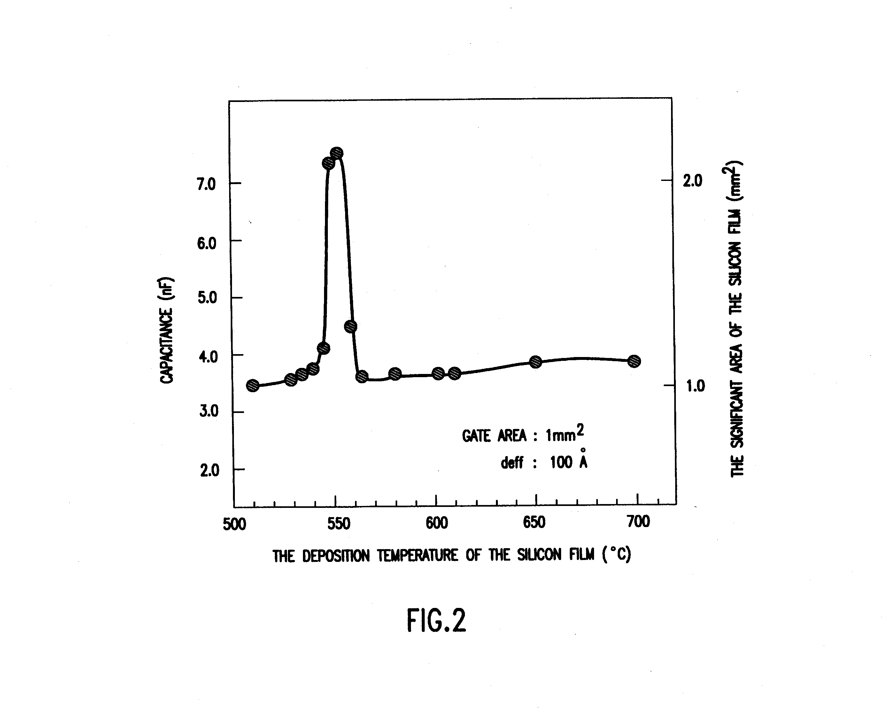
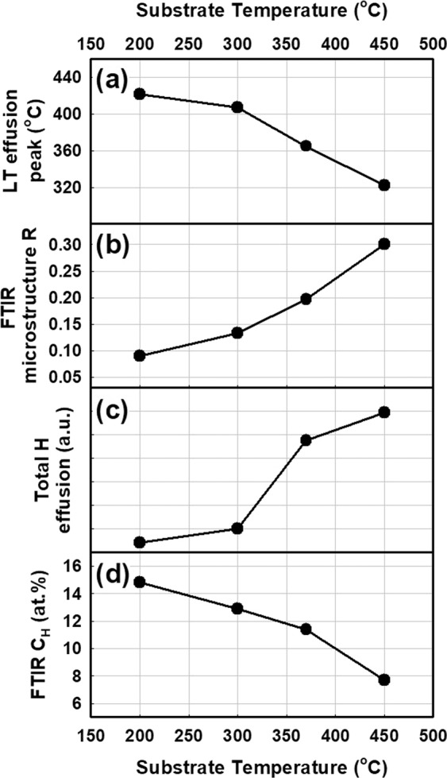
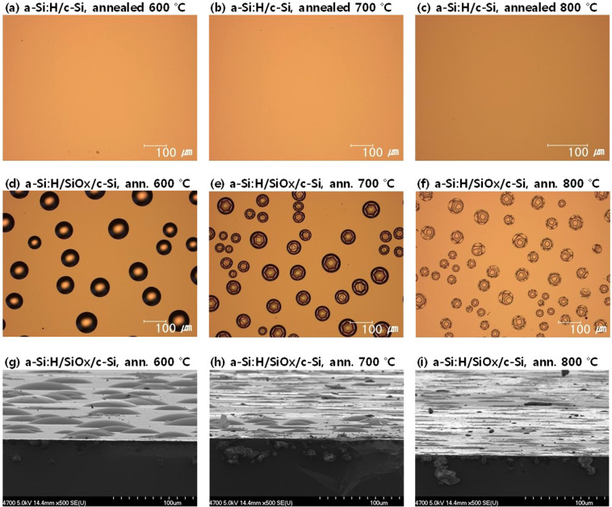

# 03-13 · a-Si — Amorphous Silicon 

> 근거 번호 `[S##]`는 `03-13_a-Si_자료수집.md`의 ID다. 논문 전문은 열람하지 못했다.
>
> 근거 표시 — **[논문]** 논문·학회에 보고된 값 · **[특허]** 특허의 주장·실시예 · **[리뷰]** 교과서 수준의 정설 · **[계산]** 가정을 명시한 교육용 계산 · **[현장]** 문헌으로 못 박지 못한 현장 통념. 자기 장비에서 확인이 필요하다.

---

## 0. 요약

a-Si는 결정 구조가 없는 실리콘 막이다. 반도체 공정에서 a-Si를 쓰는 이유는 크게 둘이다. 하나는 **매끄러워서**다. 결정립이 없으니 표면과 측벽이 매끈하고 식각이 균일하다. 다른 하나는 **나중에 결정화하려고**다. 비정질로 증착한 뒤 결정화하면 처음부터 다결정으로 증착한 것보다 결정립이 크고 표면이 매끄럽다. 증착 방식에 따라 수소가 거의 없는 LPCVD a-Si와 수소가 많은 PECVD a-Si:H로 나뉜다.

| 방식 | 화학 | 온도 | 수소 | 특징 | 주 용도 |
|---|---|---|---|---|---|
| LPCVD | SiH₄ 또는 Si₂H₆ 열분해 | 약 580 °C 아래 [S01] | 매우 적다 | Conformal, 매끄럽다 | 채널(결정화 전), Gate, Gap-fill, Seed |
| PECVD | SiH₄ (+ H₂ · He · Ar) | 200–400 °C | 10²⁰–10²² cm⁻³, 최대 40 at% [S07, S08] | 저온, 빠르다. 열에 불안정 | Hardmask, Mandrel, 희생막, TFT·태양전지 |

| 핵심 사실 | 내용 |
|---|---|
| 조성식 | a-Si(LPCVD, 수소가 거의 없다)와 a-Si:H(PECVD, 수소 함유). 결정 Si와 같은 사면체 결합이지만 결합 길이·각이 흩어져 장거리 질서가 없고, 끊긴 결합(Dangling Bond)을 수소가 막는다 |
| 비정질/다결정 전이 | SiH₄ LPCVD에서 약 580 °C. 조건에 따라 550–600 °C [S01–S05] |
| 가장 거친 온도 | 전이 부근(약 580 °C). 그 위아래는 더 매끄럽다 [S02, S04] |
| a-Si:H의 최대 약점 | 가열하면 수소가 빠져나와 Blister를 만든다 [S07] |

**증착 반응식.** LPCVD는 수소가 거의 다 빠져 Si만 남는다. PECVD 막은 막을 SiHₓ로 놓고 원소 수를 맞췄다 [계산]. x는 막의 H/Si 원자 비이고, 수소 최대 40 at%는 x 약 0.67이다 [계산]. 마지막 줄은 a-Si:H를 가열할 때 수소가 빠져나와 Blister를 만드는 반응이다.

$$
\mathrm{SiH_4} \rightarrow \mathrm{Si} + 2\,\mathrm{H_2} \qquad (\text{LPCVD, 약 580 °C 아래})
\mathrm{Si_2H_6} \rightarrow 2\,\mathrm{Si} + 3\,\mathrm{H_2} \qquad (\text{LPCVD, 더 낮은 온도})
\mathrm{SiH_4} \rightarrow \mathrm{SiH}_x(\text{a-Si:H}) + \left(2 - \tfrac{x}{2}\right)\mathrm{H_2} \qquad (\text{PECVD, 200–400 °C})
\mathrm{SiH}_x(\text{막}) \rightarrow \mathrm{Si} + \tfrac{x}{2}\,\mathrm{H_2}\uparrow \qquad (\text{가열, Blister의 원인})
$$

---

## 1. 용도와 필요성

a-Si는 반도체 본 공정에서 주로 구조재나 중간 단계의 막으로 쓰인다. 아래 표는 용도마다 a-Si를 고르는 이유를 정리한 것이다.

| 용도 | a-Si를 고르는 이유 |
|---|---|
| 3D NAND 채널 | 고종횡비 Hole 안에 Conformal하게 증착한 뒤 Anneal로 Poly-Si로 바꾼다 [논문 S13]. 두께 10–20 nm의 속 빈 원통(Macaroni) [논문 S14] |
| Hardmask | 산화막·질화막과 다른 식각 선택비. 결정립이 없어 패턴 가장자리가 매끈하다. |
| SADP/SAQP Mandrel (Core) | 측벽이 매끈하고 수직이어야 Spacer가 고르게 선다. Spacer 증착 온도를 견뎌야 한다. |
| Dummy Gate | Replacement Metal Gate에서 나중에 제거할 임시 게이트. 식각 Profile과 제거 선택비 |
| Gap-fill · Plug | 좁은 틈을 Seam 없이 채운 뒤 결정화하거나 그대로 쓴다. |
| Seed · 핵생성 층 | 산화막 위에 얇고 연속적인 Si를 먼저 깐다. |
| Capacitor 전극의 표면적 확대 | 전이 온도 부근의 거친 표면(HSG)을 일부러 만든다 [특허 S06]. |
| TFT · 태양전지 | a-Si:H 자체를 반도체로 쓴다. 수소가 결함을 메워 준다. |

이 표는 현장의 경험을 정리한 것이며, 표시한 칸만 문헌에 근거한다 [현장, 표시한 칸은 문헌]. 반도체 본 공정에서 a-Si는 대개 **구조재나 중간 단계**다. 그래서 전기적 품질보다 거칠기, 응력, 식각 거동, 열 안정성이 사양이 된다.

> 이해 확인: a-Si를 Hardmask나 Mandrel로 쓸 때, 전기적 품질보다 거칠기와 열 안정성이 중요한 이유는 무엇인가?

---

## 2. 재료의 구조와 물성

a-Si의 성질은 원자가 결정 자리를 찾아갈 시간이 있었는지, 그리고 막 속에 수소가 얼마나 남았는지로 정해진다. 이 절에서는 비정질과 다결정의 경계를 정하는 요인, 그 경계 부근에서 표면이 가장 거칠어지는 이유, 수소의 역할, 그리고 결정화를 설명한다.

### 2.1 비정질–다결정 전이

막이 비정질이 될지 다결정이 될지는 무엇이 정할까? Si 원자가 표면에 도착했을 때 결정 자리를 찾아갈 시간이 있으면 결정이 되고, 그 전에 다음 원자에 덮이면 비정질이 된다. 온도가 원자의 이동을, 증착 속도가 덮이기까지의 시간을 정한다.

| 증착 온도 (SiH₄ LPCVD) | 구조 | 표면 | 근거 |
|---|---|---|---|
| 550 °C | 비정질 | 매우 매끄럽고 연속 | [논문 S02] |
| 580 °C | 부분 비정질 + 결정. 성장 속도 최저 | **가장 거칠다.** 다공성 | [논문 S02, S03, S04] |
| 600 °C | 무작위 방위의 등축 결정립 | 580 °C보다 매끄럽다. | [논문 S02, S03] |
| 620 °C | 주상 결정립, 강한 우선 방위 | | [논문 S03] |

전이 온도는 고정된 값이 아니다. 통상 조건(100 % SiH₄, 약 200 mTorr)에서 580 °C로 인용되지만 [S01], 증착 변수에 따라 달라지고 [S04], 고속 증착에서는 약 600 °C로 올라간다 [S05]. 증착이 빠를수록 원자가 자리 잡을 시간이 줄어 더 높은 온도까지 비정질로 남는다.

### 2.2 전이 온도 부근의 표면 거칠기

580 °C 부근에서는 비정질 바탕에 결정 핵이 드문드문 생긴다. 결정은 비정질보다 빨리 자라므로 핵이 생긴 곳만 솟아오른다. 그래서 표면이 가장 거칠다. 이 현상을 일부러 쓰는 것이 HSG(Hemispherical Grain)다. 580 °C, 200 mTorr에서 표면적이 43.7 % 늘고 거칠기 RMS 16 nm, 최대 고저차 106 nm인 막이, 590 °C에서 지름 300–1,700 Å(중심 약 700 Å)의 반구형 결정립이 보고됐다 [특허 S06].

실무 규칙은 단순하다. **매끄러운 막이 필요하면 전이 온도에서 확실히 떨어져서 증착한다.** 히터 온도가 Wafer 내에서 수 °C 흔들릴 때 전이 온도 근처라면 Wafer 일부만 거칠어진다.

전이 창이 얼마나 좁은지는 같은 특허의 그래프가 보여 준다 [특허 S06].

*증착 온도에 따른 Capacitor 정전용량(왼쪽 축)과 Si 막의 실효 표면적(오른쪽 축). 전극 면적 1 mm², 유전막 환산 두께 100 Å다. 좁은 온도 구간에서만 표면적이 2.1 mm²로, 정전용량이 3.5 nF에서 7.3 nF로 두 배가 된다. 가로축은 로(Furnace) 바깥쪽 온도다. 특허는 그 550 °C가 Wafer 온도 590 °C에 해당하고 거친 막이 생기는 구간이 ±10 °C라고 적었다.*

*출처: US 5,366,917 (NEC, 1994), FIG. 2. 미국 특허 도면. [Google Patents](https://patents.google.com/patent/US5366917A/en)*

### 2.3 수소: a-Si와 a-Si:H

LPCVD a-Si와 PECVD a-Si:H의 가장 큰 차이는 수소이다. 두 막을 비교하면 다음과 같다.

| 항목 | LPCVD a-Si | PECVD a-Si:H |
|---|---|---|
| 수소 | 매우 적다(고온이라 탈리) | 10²⁰–10²² cm⁻³ [S07]. 최대 40 at% [S08] |
| Dangling Bond | 많다 | 수소가 메운다 |
| 밀도 | c-Si에 가깝다 | 낮다. 미세 Void |
| 열 안정성 | 좋다 | 250–350 °C부터 수소가 움직인다 [S10] |
| 광학 | 불투명에 가깝다 | Optical Gap 약 1.7 eV. 수소가 많을수록 넓다 [리뷰] |

a-Si:H의 수소는 고립된 Si–H로도, 미세 Void 안쪽에 뭉친 형태로도 있다. 열처리 초기(250–350 °C)에 원자 수소가 고립 자리에서 뭉친 자리로 옮겨 간다 [논문 S10]. 기판 온도 200 °C 이상에서 증착한 막은 방출 Spectrum에 날카로운 피크가 나타나고, 이 피크가 있는 막에서 손상이 관찰된다 [논문 S08].

### 2.4 결정화

비정질 막을 약 600 °C에서 가열하면 결정화한다(고상 결정화). 핵생성은 느리고 한 번 생긴 결정은 빨리 자라므로, **처음부터 다결정으로 증착한 막보다 결정립이 크다** [리뷰 S21]. 표면은 비정질일 때의 매끄러움을 대체로 유지한다. 얇은 막이나 좁은 구조에서는 결정립이 막 두께에서 막혀 더 커지지 못한다. 3D NAND의 10–20 nm 채널에서는 결정립 크기가 막 두께와 비슷해진다 [논문 S13, S14].

> 이해 확인: 히터 온도가 Wafer 안에서 ±5 °C 흔들린다. 매끄러운 a-Si를 얻으려면 증착 온도를 어디에 두어야 하는가?

---

## 3. 전구체와 반응

a-Si는 LPCVD와 PECVD로 만들며, 두 방식은 반응과 막 속 수소가 크게 다르다. 이 절에서는 LPCVD의 반응 단계, 산화막 위에서 막이 처음 생기는 과정, PECVD의 성장종, 그리고 In-situ 도핑이 증착에 주는 영향을 살펴본다.

### 3.1 LPCVD

LPCVD a-Si는 SiH₄를 열로 분해해 증착하며, 반응은 다음과 같은 단계로 일어난다.

$$
\mathrm{SiH_4(g)} \rightarrow \mathrm{SiH_2} + \mathrm{H_2} \qquad (\text{기상 분해, 고압·고온에서 중요})
\mathrm{SiH_4} + \text{표면 자리} \rightarrow \mathrm{Si(s)} + 2\,\mathrm{H_2} \qquad (\text{표면 반응})
\text{표면}\ \mathrm{Si–H} \rightarrow \mathrm{Si} + \tfrac{1}{2}\,\mathrm{H_2} \qquad (\text{수소 탈착, 저온에서 속도 결정})
$$

저온에서는 표면이 수소로 덮여 있고, 수소가 떨어져 나가야 다음 SiH₄가 붙는다. 그래서 증착 속도가 온도에 강하게 의존한다(→ 03-14 §3).

| 전구체 | 특징 |
|---|---|
| SiH₄ | 표준. 약 550–580 °C에서 a-Si |
| Si₂H₆ | Si–Si 결합이 약해 더 낮은 온도(450–500 °C대)에서 분해. 저온 증착 후 결정화하면 결정립이 크고 매끄럽다. 반응성이 커서 Conformality는 떨어질 수 있다 [리뷰 S19]. |
| 고차 Silane | 더 낮은 온도. 기상 반응과 Particle 관리가 어렵다. |

### 3.2 산화막 위의 핵생성

Si는 산화막 표면에 잘 붙지 않는다. 처음에는 드문드문 핵이 생기고(Incubation), 핵이 섬으로 자라 서로 만나야 연속 막이 된다. 수 nm의 얇은 막은 이 과정 때문에 거칠고 구멍이 있다 [리뷰 S20].

- 핵 밀도를 올리면 더 얇은 두께에서 연속 막이 된다.
- Si₂H₆나 Aminosilane 계 전구체로 먼저 표면을 덮는 Seed 단계를 넣는다 [리뷰 S20, 현장].
- 하부가 산화막이냐 질화막이냐 Si냐에 따라 Incubation이 다르다. **같은 시간 증착해도 표면마다 두께가 다르다.** 03-05의 O₃-TEOS 하부막 의존성과 같은 성격의 문제다.

### 3.3 PECVD

SiH₄가 Plasma에서 깨져 SiH₃, SiH₂, SiH와 H가 된다. 주 성장종은 SiH₃다. 표면 반응 확률이 낮아 수소로 덮인 표면을 돌아다니다 빈 자리를 찾아 붙는다 [리뷰 S18]. 이것이 a-Si:H가 PECVD치고는 매끄럽고 치밀한 이유다. SiH₂와 SiH는 반응성이 커서 닿는 대로 붙고 기상에서 고차 Silane과 분말을 만든다.

| 공정 변수 | 방향 |
|---|---|
| Power·압력을 낮게 | SiH₃ 위주. 치밀하고 수소가 Si–H 형태 |
| Power·압력을 높게 | SiH₂ 증가, 기상 중합. 성기고 수소가 뭉친 형태, 분말 |
| H₂ 희석 | 표면 수소 추출과 약한 결합 식각. 치밀화. 심하면 미세 결정질로 |

### 3.4 In-situ 도핑

PH₃는 증착 속도를 크게 낮추고 B₂H₆는 올린다 [리뷰 S22]. 인이 표면 자리를 차지해 SiH₄ 흡착을 막고, 붕소는 수소 탈착을 돕는다(→ 03-02 §3.2, 03-14 §3).

> 이해 확인: 같은 시간 동안 a-Si를 증착했는데 산화막 위와 Si 위의 두께가 달랐다. 그 이유는 무엇이며, 어떻게 줄일 수 있는가?

---

## 4. Process Window와 공정 변수별 응답

이 절에서는 LPCVD a-Si와 PECVD a-Si:H 각각에서 조절 변수가 막을 어떻게 바꾸는지 정리하고, 기판 온도가 수소에 주는 영향을 실측 그림으로 확인한다.

### 4.1 LPCVD a-Si

LPCVD a-Si에서는 온도와 압력이 막의 구조와 거칠기를 정한다.

| 조절 변수 ↑ | DR | 구조 | 거칠기 | Conformality |
|---|---|---|---|---|
| 온도 (전이 아래에서) | ↑↑ | 전이에 접근 | 전이 근처에서 급증 [S02] | — |
| 압력 | ↑ | 더 높은 온도까지 비정질 유지 [S05] | — | ↓ (기상 반응 증가) |
| SiH₄ 분압 | ↑ | 위와 같음 | — | — |
| Si₂H₆ 사용 | 저온에서 ↑ | 저온 비정질 | 매끄럽다 | ↓ 가능 |

이 표는 리뷰 수준의 정리이며, 표시한 칸만 문헌에 근거한다 [리뷰, 표시한 칸은 문헌].

### 4.2 PECVD a-Si:H

PECVD a-Si:H에서는 수소와 열 안정성이 주된 관심사이다.

| 조절 변수 ↑ | DR | 수소 | 밀도 | 응력 | 열 안정성 |
|---|---|---|---|---|---|
| 온도 | — | ↓ | ↑ | 인장 쪽 | ↑ |
| RF Power | ↑ | 뭉친 수소 ↑ | ↓ | 압축 ↑ | ↓ |
| 압력 | ↑ | ↑ | ↓ | — | ↓ |
| H₂ 희석 | ↓ | 변화 | ↑ | 압축 ↑ | ↑ |

이 표의 값은 문헌과 현장에서 통용되는 범위이며, 자기 장비에서 확인해야 한다 [리뷰·현장]. Hardmask나 Mandrel처럼 이후 열 공정을 견뎌야 하는 용도는 **증착 온도를 가능한 한 높여 수소를 줄이는 것**이 기본이다.

기판 온도가 수소의 양과 결합 상태를 어떻게 바꾸는지는 다음 실측이 보여 준다 [논문 S07].

*PECVD a-Si:H의 기판 온도(200–450 °C)에 따른 변화. (a) 저온 수소 방출 피크가 422 °C에서 322 °C로 내려간다. (b) FTIR Microstructure Factor R이 0.09에서 0.30으로 오른다. (c) 총 수소 방출량이 늘어난다. (d) FTIR로 잰 결합 수소는 14.8 at%에서 7.7 at%로 줄어든다(그림에서 읽은 값).*

*출처: Choi 등, Sci. Rep. 10, 9672 (2020), Figure 11. CC BY 4.0. [PMC](https://pmc.ncbi.nlm.nih.gov/articles/PMC7295771/)*

표는 “온도를 올리면 수소가 준다”고 했다. 이 그림에서 그 말은 FTIR 결합 수소 (d)에만 맞는다. 같은 시편에서 R (b)와 총 방출량 (c)은 오히려 늘었고, 방출이 시작되는 온도 (a)는 내려갔다. FTIR의 수소 총량 하나로 열 안정성을 판단하지 않는다. R과 방출 스펙트럼을 함께 본다. 이 연구는 태양전지용 얇은 막의 결과이므로 자기 장비에서 다시 확인한다.

> 이해 확인: PECVD a-Si:H의 FTIR 결합 수소가 줄었는데 Blister는 오히려 늘었다. 그림 11의 어떤 지표로 이를 설명할 수 있는가?

---

## 5. 계산 [계산]

a-Si:H 막의 수소가 왜 그렇게 문제를 일으키는지 숫자로 확인해 보자. 이 절에서는 막 속 수소가 기체로 나오면 얼마나 되는지, 그리고 그 수소가 막에서 빠져나가는 데 얼마나 걸리는지 계산한다.

### 5.1 막 내 수소량 계산

a-Si:H 막 속에 수소가 얼마나 들어 있는지 계산해 보자. Si의 원자 밀도는 5.0×10²² cm⁻³이다 [S23]. 수소가 10 at%인 a-Si:H 100 nm 막을 생각하자.

$$
\text{수소 농도} = 5.0\times10^{22} \times \frac{10}{90} \approx 5.6\times10^{21}\ \mathrm{cm^{-3}}
\text{면적당 수소} = 5.6\times10^{21}\ \mathrm{cm^{-3}} \times 100\ \mathrm{nm} \approx 5.6\times10^{16}\ \mathrm{cm^{-2}}
\mathrm{H_2}\ \text{로 모두 나오면} \quad 2.8\times10^{16}\ \text{분자/cm²}
$$

표준 상태 기체로 환산하면 두께 약 10 µm의 기체층이다.

| 수소 | 막 두께 | 방출 H₂의 기체층 두께 (표준 상태) |
|---|---|---|
| 10 at% | 100 nm | 약 10 µm |
| 15 at% | 100 nm | 약 16 µm |
| 10 at% | 300 nm | 약 31 µm |
| 20 at% | 50 nm | 약 12 µm |

100 nm 막이 자기 두께의 100배에 해당하는 기체를 품고 있다. 이 기체가 빠져나갈 길이 없으면 계면을 밀어 올린다. **Blister는 예외적인 불량이 아니라 수소가 갈 곳이 없을 때 당연히 생기는 결과**다.

### 5.2 수소 탈리 시간 계산

그렇다면 이 수소가 막에서 빠져나가는 데에는 얼마나 걸릴까? 400 °C에서 수소의 확산 계수는 약 3.2×10⁻¹⁴ cm²/s이다 [논문 S09]. 시간에 따른 확산 거리 √(Dt)는 다음과 같다.

| 400 °C 유지 시간 | √(Dt) |
|---|---|
| 10분 | 약 44 nm |
| 1시간 | 약 107 nm |
| 4시간 | 약 215 nm |
| 12시간 | 약 372 nm |

100 nm 막에서 수소를 빼려면 400 °C에서 시간 단위가 필요하다. 수백 nm 막에서 550 °C까지 12시간 이상의 Anneal이 필요했다는 보고와 맞는 규모다 [논문 S11]. 빨리 가열하면 수소가 확산해 나가기 전에 기체로 뭉친다. **탈수소는 온도가 아니라 Ramp 속도의 문제**다.

> 이해 확인: 수소 15 at%인 a-Si:H 200 nm에서 수소가 모두 H₂로 나오면 표준 상태 기체층 두께는 대략 얼마인가?

---

## 6. 집적 이슈와 불량 모드

a-Si는 수소, 거칠기, 결정화, Gap-fill, 얇은 막의 연속성에서 문제가 생긴다. 이 절에서는 Blister와 Peeling, 거칠기, 의도하지 않은 결정화, Seam과 Void, 3D NAND 채널, Particle을 차례로 살펴본다.

### 6.1 Blister와 Peeling

a-Si:H를 증착 온도 이상으로 가열하면 수소가 나온다. 어디로 가느냐가 결과를 정한다.

| 하부 | 600–800 °C Anneal 결과 | 해석 |
|---|---|---|
| Bare c-Si | Blister 없음 | 수소가 Si 쪽으로도 빠진다. |
| SiOₓ / c-Si | 심한 Blister | 산화막이 수소를 막아 a-Si:H/SiOₓ 계면에 모인다. |

이 표의 값은 논문에 보고된 것이다 [논문 S07]. 700·800 °C에서는 Blister가 터지고 600 °C에서는 부푼 채 남는다 [S07]. 반도체 공정에서 a-Si:H는 대개 산화막이나 질화막 위에 있고 위에도 치밀한 막이 덮인다. 가장 나쁜 조건이다.

*Anneal한 a-Si:H 표면의 광학 현미경·SEM 사진. c-Si 위에 바로 올린 a-Si:H는 600–800 °C에서 Blister가 없고, 약 1.5 nm SiOₓ 위에 올린 a-Si:H는 Blister로 덮인다. 200 °C PECVD 막이다.*

*출처: Choi 등, Sci. Rep. 10, 9672 (2020), Figure 1. CC BY 4.0. [PMC](https://pmc.ncbi.nlm.nih.gov/articles/PMC7295771/)*

| 대책 | 내용 | 근거 |
|---|---|---|
| 수소를 적게 넣는다 | 증착 온도 상향, H₂ 희석, LPCVD로 변경 | [리뷰] |
| 천천히 뺀다 | 낮은 온도에서 길게, 완만한 Ramp. 다단계 Anneal | [논문 S11, S12] |
| 빠질 길을 만든다 | 위를 덮기 전에 탈수소. 서로 이어진 Void가 있는 막은 빨리 빠진다. | [논문 S11] |
| 후속 온도 제한 | a-Si:H 증착 온도 이하로 유지 | [현장] |

ACL의 “후속 공정 온도 ≤ 증착 온도” 규칙(→ 03-01 §6.3)과 같은 원리다. 수소를 품은 저온 PECVD 막 전부에 적용된다.

### 6.2 거칠기

- **전이 온도 근처**에서 증착하면 거칠다(§2.2). Wafer 내 온도 분포가 거칠기 분포가 된다.
- **얇은 막**은 핵생성 단계의 섬 구조가 남아 거칠다(§3.2).
- 거칠기는 Hardmask·Mandrel에서 선폭 거칠기(LER)로, 게이트에서는 계면 산란으로, 채널에서는 두께 편차로 나타난다.

### 6.3 의도하지 않은 결정화

a-Si로 남아 있어야 할 막이 후속 열 공정에서 결정화하면 문제가 된다.

- 부피 수축과 응력 변화. 인장 쪽으로 간다.
- 결정립계를 따라 식각 속도가 달라져 표면과 측벽이 거칠어진다.
- Mandrel이 결정화하면 Spacer를 뗀 뒤의 선폭이 흔들린다.

결정화는 약 600 °C에서 시간 단위지만, 도펀트와 금속 오염이 있으면 훨씬 낮은 온도에서 일어난다 [리뷰]. a-Si 위에 올리는 막의 증착 온도와 시간을 결정화 예산으로 관리한다 [현장].

### 6.4 Gap-fill의 Seam과 Void

LPCVD a-Si는 Conformal해서 좁은 틈에 중앙 Seam을 남긴다(→ 03-05 §5.1). 결정화 Anneal에서 Seam이 벌어져 Void가 되기도 한다. 증착과 식각을 번갈아 하거나, 틈 위쪽의 증착만 억제해 바닥부터 채우는 방법을 쓴다 [현장].

### 6.5 3D NAND 채널

채널 a-Si는 수 µm 깊이의 Hole 안쪽 벽에 10–20 nm 두께로 올린다 [논문 S14]. 문제는 다음과 같다.

- **깊이 방향 두께 균일도.** 위와 아래의 두께 차이가 Cell 특성 차이가 된다. 표면 반응 지배 조건(낮은 온도, 낮은 반응 확률)이 필요하다.
- **핵생성.** 하부는 Tunnel 산화막이다. Incubation과 섬 성장이 얇은 막의 연속성을 해친다(§3.2).
- **결정화 후 결정립.** 결정화가 무작위 자리에서 시작해 방위가 다른 결정립이 여럿 생긴다. 결정립계가 전류를 막는다 [논문 S13]. 결정립이 작으면 이동도가 낮고, 크면 소자 간 편차가 커진다 [현장 S17].

### 6.6 Particle

SiH₄는 기상에서 SiH₂를 거쳐 고차 Silane과 분말을 만든다. LPCVD에서는 압력과 온도가 높을수록, PECVD에서는 Power와 압력이 높을수록 심하다. SiH₄는 자연발화성이라 배기 쪽 분말도 위험물이다.

> 이해 확인: a-Si:H 위에 치밀한 산화막을 덮고 600 °C로 빨리 가열했더니 Blister가 생겼다. 어떤 두 가지를 바꾸어 볼 수 있는가?

---

## 7. 챔버 · 하드웨어 관리

a-Si 공정은 SiH₄를 쓰므로 기상 분말과 안전 관리가 중요하고, 온도 분포가 막의 구조를 정하므로 히터 관리도 중요하다. 아래 표는 그 주요 항목을 정리한 것이다.

| 항목 | 내용 |
|---|---|
| 온도 정밀도 | LPCVD a-Si는 증착 속도가 온도에 지수적으로 의존한다. 1 %의 온도 오차가 수 %의 두께 오차가 된다. 전이 근처에서는 구조와 거칠기까지 바뀐다. |
| Furnace 누적 막 | Tube와 Boat에 Si가 쌓인다. 누적 막이 두꺼워지면 박리. 주기적 세정 또는 In-situ Clean(ClF₃ 계 등) [현장] |
| PECVD Clean | NF₃ 계. Si는 SiF₄로 잘 제거된다. |
| Seasoning | Clean 후 벽의 F가 다음 막에 들어가고 증착 초기를 바꾼다. |
| 산소·수분 Leak | Si 막에 산소가 들어가면 결정화와 전기 특성이 변한다. Load-lock과 Leak 관리 |
| 계면 산화막 | 증착 전 Wafer 표면의 자연 산화막이 핵생성과 접촉 저항을 정한다. Q-time 관리 |
| 안전 | SiH₄·Si₂H₆ 자연발화성. PH₃·B₂H₆ 고독성. 배기 분말 |

---

## 8. 계측과 해석

a-Si는 구조(비정질인지 결정인지), 거칠기, 수소를 함께 측정해야 한다. 아래 표는 각 계측이 무엇을 알려 주고 어떤 함정이 있는지 정리한 것이다.

| 계측 | 얻는 것 | 읽는 법과 함정 |
|---|---|---|
| Ellipsometry | 두께, n, k | 비정질과 다결정은 광학 상수가 다르다. **n, k로 결정화 정도를 Inline으로 본다.** 비정질 Model로 다결정 막을 재면 두께가 틀린다. |
| Raman | 결정성 | 비정질은 약 480 cm⁻¹의 넓은 봉우리, 결정은 약 520 cm⁻¹의 날카로운 봉우리. 두 봉우리의 면적 비가 결정 분율 [리뷰] |
| XRD | 결정 방위, 결정립 크기 | [논문 S03] |
| AFM | 거칠기 | 전이 온도 근접 여부, 핵생성 상태 [논문 S02] |
| FTIR | Si–H 약 2,000 cm⁻¹(고립), 약 2,100 cm⁻¹(뭉침·Void 표면) | 2,100 쪽 비율이 높으면 성기고 열에 약하다 [리뷰]. |
| TDS (수소 방출) | 방출 온도와 양 | 날카로운 저온 피크는 Blister 위험의 신호 [논문 S08] |
| SIMS · ERD | 수소, 도펀트, 산소 | |
| Wafer Bow | 응력 | 열처리 전후. 결정화와 수소 방출에서 인장 쪽 이동 |
| 단면 TEM | 두께 균일도, 결정립, Seam | 고종횡비 구조 |
| 면저항 | 도핑 활성화 | 결정화 후 |

> 이해 확인: a-Si 막이 비정질로 남았는지, 일부 결정화되었는지 확인하려면 어떤 계측을 쓸 수 있는가?

---

## 9. 파생 막과 차세대 기술

a-Si는 새로운 소자 구조에서 계속 새로운 쓰임을 얻고 있다. 아래 표는 그 방향을 정리한 것이다.

| 방향 | 내용 | 근거 |
|---|---|---|
| 채널 결정립 공학 | 결정립이 크면 On 전류와 Program 속도가 좋지만 Endurance·신뢰성은 나쁘다. | [논문 S15] |
| Ge 유도 결정화 | a-Ge/Si 적층을 결정화해 결정립을 키우고 이동도를 최대 약 100 % 올린다. | [논문 S16] |
| 다른 결정화 방법 | Laser Anneal, 금속 유도 결정화. 수소가 있는 막은 다단계 Laser로 | [논문 S12] |
| HSG | 전이 온도 부근의 거친 표면으로 Capacitor 전극 면적을 늘린다(역사적 기술) | [특허 S06] |
| 초박막 연속 Si | Seed로 핵 밀도를 올려 수 nm에서 연속 막 | [현장] |
| 단결정 채널 | 다결정의 한계를 넘으려는 Epitaxy 기반 채널 | → 03-15 |

---

## 10. Troubleshooting

아래 표는 a-Si 공정에서 흔히 나타나는 증상과 유력한 원인, 확인할 데이터, 조치 방향을 정리한 것이다. 표의 원인은 현장 경험에서 나온 출발점이므로 [현장], “확인할 데이터” 열로 가설을 좁힌 뒤에 조치해야 한다.

| 증상 | 유력 원인 | 확인할 데이터 | 조치 방향 |
|---|---|---|---|
| 후속 열 공정에서 Blister·Peeling | a-Si:H의 수소 방출 | TDS, FTIR Si–H, 열 이력 | 증착 온도 상향, 탈수소 Anneal(완만한 Ramp), LPCVD로 변경 |
| Wafer 일부만 거칠다 | 전이 온도 근접 + 온도 분포 | AFM Map, 히터 온도 | 증착 온도를 전이에서 멀리 |
| 얇은 막이 불연속·Pinhole | 핵생성 지연 | AFM, 하부막 종류 | Seed 단계, 전구체 변경 |
| 하부막에 따라 두께가 다르다 | Incubation 차이 | 표면별 두께 | Seed, 표면 처리 |
| Mandrel 선폭 흔들림 | 후속 공정에서 결정화 | Raman, 열 이력 | 열 예산, 증착 조건 |
| 두께 Wafer 간·Tube 위치별 편차 | 온도 편차, SiH₄ 소모 | 위치별 두께, 온도 Profile | 온도 구배 보정 |
| Gap에 Seam·Void | Conformal 증착의 한계 | 단면 TEM | 증착–식각 반복, 형상 변경 |
| Particle | 기상 핵생성, 누적 막 박리 | 압력·온도·Power 이력, 누적 두께 | 조건 완화, Clean 주기 |
| 결정화 후 저항 높음 | 결정립 작음, 산소 혼입, 도핑 부족 | Raman·XRD, SIMS | 증착 온도 하향(비정질 확보), Leak 점검 |

> 이해 확인: Mandrel용 a-Si의 LER이 갑자기 나빠졌다. 증착 온도와 후속 열 공정에서 어떤 원인을 먼저 확인해야 하는가?

---

## 11. 자가 점검

이 장의 핵심 내용을 질문으로 확인해 보자.

**Q1. 다결정으로 바로 증착하지 않고 비정질로 증착한 뒤 결정화하는 이유는?**
결정립이 더 크고 표면이 더 매끄럽다. 결정화에서는 핵생성이 느리고 성장이 빠르기 때문이다.

**Q2. SiH₄ LPCVD에서 표면이 가장 거친 온도와 그 이유는?**
전이 온도 부근(약 580 °C)이다. 비정질 바탕에 드문드문 생긴 결정 핵이 더 빨리 자라 솟아오른다.

**Q3. 증착 속도를 올리면 전이 온도는 어떻게 되는가?**
올라간다. 원자가 결정 자리를 찾기 전에 덮이므로 더 높은 온도까지 비정질로 남는다.

**Q4. 수소 10 at%인 a-Si:H 100 nm에서 수소가 모두 H₂로 나오면 표준 상태 기체층 두께는?**
약 10 µm. 막 두께의 100배다.

**Q5. 같은 a-Si:H가 Bare Si 위에서는 멀쩡하고 산화막 위에서는 Blister가 생겼다. 왜인가?**
산화막이 수소를 막아 계면에 모이게 한다. Si 위에서는 수소가 기판 쪽으로도 빠진다.

**Q6. 탈수소 Anneal에서 온도보다 Ramp 속도가 중요한 이유는?**
수소의 확산이 느리다(400 °C에서 1시간에 약 100 nm). 빨리 가열하면 확산해 나가기 전에 기체로 뭉쳐 Blister가 된다.

**Q7. 산화막 위에 수 nm의 연속 a-Si를 올리기 어려운 이유와 대책은?**
Si가 산화막에 잘 붙지 않아 섬으로 자란다. Seed 단계로 핵 밀도를 올린다.

**Q8. 3D NAND 채널에서 결정립이 크면 좋은 점과 나쁜 점은?**
이동도와 On 전류가 좋아진다. 소자 간 편차가 커지고 Endurance·신뢰성이 나빠질 수 있다.

---

## 12. 참고 문헌

- [S02] MRS Proc. — 550·580·600·625 °C 막의 표면 형상(AFM)
- [S03] MRS Proc. — 580·600·620 °C 막의 미세 구조(XRD·TEM)
- [S06] US 5,366,917 — 전이 온도 부근의 거친 막(HSG)
- [S07] *Sci. Rep.* (2020) — a-Si:H 수소와 Blister, 하부막 의존성
- [S09] Thermal dehydrogenation 연구 — 400 °C 수소 확산 계수
- [S11] 탈수소 Anneal 연구 — 550 °C까지 12시간
- [S13, S14] 3D NAND 채널 — a-Si 증착 후 결정화, Macaroni 10–20 nm
- [S15, S16] 채널 결정립과 소자 특성, Ge 유도 결정화
