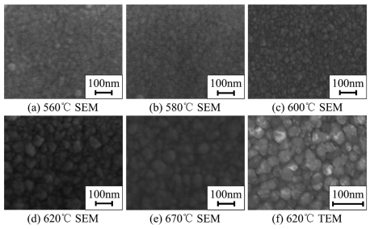
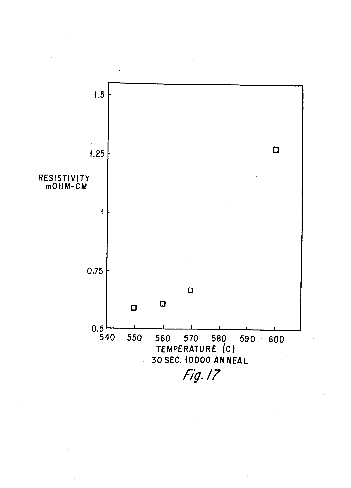
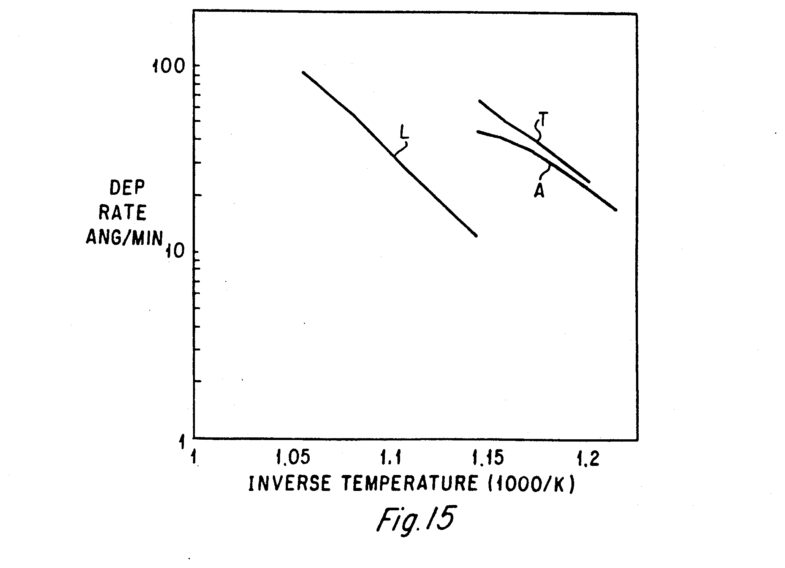

# 03-14 · Poly-Si — Polycrystalline Silicon 

> 근거 번호 `[S##]`는 `03-14_Poly-Si_자료수집.md`의 ID다. 논문 전문은 열람하지 못했다.
>
> 근거 표시 — **[논문]** 논문·학회에 보고된 값 · **[특허]** 특허의 주장·실시예 · **[리뷰]** 교과서 수준의 정설 · **[계산]** 가정을 명시한 교육용 계산 · **[현장]** 문헌으로 못 박지 못한 현장 통념. 자기 장비에서 확인이 필요하다.

---

## 0. 한 장 요약

이 장에서는 작은 Si 결정립이 모인 막인 Poly-Si를 다룬다. Poly-Si는 도핑하면 도체가 되고 고온을 견디며 Conformal하게 증착되므로 오랫동안 여러 곳에 쓰였다. 먼저 이 막의 성질을 정리한 뒤, 공정의 중심인 온도가 구조, 증착 속도, 응력을 어떻게 정하는지 차례로 설명한다.

Poly-Si는 작은 Si 결정립이 모인 막이다. 도핑하면 도체가 되고, 고온을 견디며, 산화막과 궁합이 좋고, Conformal하게 증착된다. 이 조합 때문에 수십 년 동안 게이트 전극, 메모리의 저장 전극과 Word Line, Contact Plug, 3D NAND의 채널로 쓰였다. 공정의 중심은 **온도**다. 증착 속도가 온도에 지수적으로 의존하고, 온도 수십 °C 차이로 결정 구조와 응력의 부호가 바뀐다.

| 항목 | 내용 |
|---|---|
| 역할 | 게이트·Word Line 전극, 저장 전극, Contact Plug, 채널(3D NAND), 희생 구조 |
| 증착 방식 | LPCVD. Batch Furnace 또는 단일 Wafer |
| 반응 | SiH₄ → Si + 2H₂. 580–650 °C [웹 S01] |
| 활성화 에너지 | 약 1.7 eV (39 ± 2 kcal/mol) [웹 S01, 논문 S02] |
| 증착 속도 | 10–20 nm/min [웹 S01] |
| 구조 | 580 °C 부분 비정질 → 600 °C 등축 미세 결정립 → 620 °C 이상 주상 [논문 S05] |
| 집합 조직 | 600–650 °C {110}, 650–700 °C {100} [S08] |
| In-situ 도핑 | PH₃: 증착 속도 ↓. B₂H₆: 증착 속도 ↑ [특허 S10, 학위 논문 S11] |
| 핵심 Trade-off | 증착 온도(구조·거칠기·응력) ↔ 생산성 ↔ 도핑 균일도 |

---

## 1. 어디에, 왜 쓰는가

Poly-Si의 쓰임은 시대에 따라 변해 왔다. 아래 표는 용도마다 Poly-Si를 쓰는 이유와 현재의 상황을 정리한 것이다.

| 용도 | Poly-Si를 쓰는 이유 | 현재 |
|---|---|---|
| 게이트 전극 | 고온 공정을 견디고 자기정렬 도핑이 된다. 일함수를 도핑으로 조절 | Logic은 Metal Gate로 전환. 메모리 주변 회로 등에 남음 |
| Floating Gate | 전하를 저장하는 도체 | 평면 NAND |
| 3D NAND 채널 | 깊은 Hole 벽에 Conformal하게. 비정질로 증착 후 결정화(→ 03-13) | 주력 |
| 3D NAND 소스·선택 게이트 | 도핑 Poly | 주력 |
| DRAM Contact Plug | 좁고 깊은 Contact를 채우는 도핑 Poly | 주력. 금속과 병용 |
| Capacitor 전극 | 표면적을 키운 Poly(HSG) | 금속 전극으로 대체 |
| Dummy Gate, Hardmask, 희생막 | 식각 선택비와 열 안정성 | a-Si와 병용 |
| MEMS 구조재 | 기계적 성질과 응력 제어 | |

이 표의 내용은 리뷰와 현장에서 통용되는 정리이다 [리뷰·현장]. 게이트에서는 Poly 공핍(게이트가 완전한 도체가 아니라 유효 산화막 두께가 늘어나는 현상)과 붕소 침투 때문에 Logic이 Metal Gate로 넘어갔다 [리뷰 S17]. 반면 3차원 메모리에서는 **깊은 구조 안에 Conformal하게 증착할 수 있는 반도체**라는 점 때문에 Poly-Si의 역할이 오히려 커졌다.

> 이해 확인: Logic 게이트에서는 Poly-Si가 Metal Gate로 바뀌었는데, 3차원 메모리에서는 Poly-Si의 역할이 오히려 커졌다. 그 이유는 무엇인가?

---

## 2. 재료: 결정립과 그 경계

Poly-Si의 성질은 결정립의 크기와 방위, 그리고 결정립 사이의 경계에서 나온다. 이 절에서는 증착 온도가 막의 구조를 어떻게 정하는지, 결정 방위가 왜 중요한지, 그리고 결정립계가 전기적 성질에 어떤 영향을 주는지 설명한다.

### 2.1 증착 온도가 구조를 정한다

Poly-Si 공정에서 가장 중요한 손잡이는 온도이다. 같은 SiH₄ LPCVD라도 증착 온도에 따라 막의 구조가 다음과 같이 달라진다.

| 증착 온도 (SiH₄ LPCVD) | 구조 | 근거 |
|---|---|---|
| 약 580 °C 아래 | 비정질 | → 03-13 |
| 580 °C | 부분 비정질. 성장 속도 최저 | [논문 S05] |
| 600 °C | 무작위 방위의 등축 결정립. 매우 미세 | [논문 S05, 웹 S01] |
| 605 °C 부근, 고압(약 400 mTorr) | 비정질로 증착된 뒤 **증착 중에 결정화.** 등축 결정립 | [논문 S06] |
| 620–625 °C | 주상 결정립, 강한 우선 방위 | [논문 S05, 웹 S01] |
| 630 °C 초과 | SiO₂ 계면의 미세 결정립 전이층 위로 주상 구조가 자란다. | [논문 S06] |

여기서 주상 구조란 하부에서 표면까지 이어진 기둥 모양의 결정립을 말한다. 처음에는 작은 결정립이 무작위로 생기고, 그중 빨리 자라는 방위의 결정립이 이웃을 덮으며 위로 갈수록 굵어진다. 그래서 **두꺼운 막일수록 결정립이 크고 표면이 거칠다.**

증착 온도에 따라 결정립이 어떻게 달라지는지 전자현미경으로 보자 [논문 S18].

*LPCVD로 560–670 °C에서 증착한 80 nm Poly-Si. (a)–(e) 표면 SEM, (f) 620 °C 막의 TEM. 평균 결정립 크기는 560 °C 약 30 nm에서 670 °C 약 70 nm로 커졌고, 620 °C 막은 약 40 nm였다. 560–600 °C 막은 비정질에 가깝게 증착되므로 950 °C Anneal로 재결정화한 뒤 찍었다. 이 막들과 670 °C 막은 결정립 경계가 흐릿하다. 경계에 비정질 상이 많다는 뜻이다. (f)에서는 경계가 뚜렷한 결정립이 보인다.*

*출처: Shi 등, Sensors 9(2), 1141 (2009), Figure 1. CC BY 3.0. [PMC](https://pmc.ncbi.nlm.nih.gov/articles/PMC3280852/)*

저자들은 Piezo 저항 특성까지 고려해 620 °C 부근을 가장 좋은 증착 온도로 꼽았다. 표의 경계(약 600–620 °C)에서 증착 중에 바로 결정이 되는 막과 Anneal로 재결정화해야 하는 막이 갈린다는 것을 사진으로 확인할 수 있다.

증착 온도가 Anneal 뒤의 비저항까지 정한다는 것을 보여 주는 특허 자료다 [특허 S10].

*In-situ P 도핑 Si를 550–600 °C에서 증착하고 1,000 °C 30초 Anneal한 뒤의 비저항. 550 °C 증착 0.58, 560 °C 0.61, 570 °C 0.67, 600 °C 1.27 mΩ·cm다(그래프에서 읽은 값). 특허는 이 공정의 비정질–다결정 전이 온도가 약 550 °C이고 600 °C에서 증착한 막의 결정립이 약 300 Å라고 적었다. 전이 온도 가까이에서 증착해 나중에 결정화한 막의 비저항이 낮다.*

*출처: US 5,256,566 (Texas Instruments, 1993), FIG. 17. 미국 특허 도면. [Google Patents](https://patents.google.com/patent/US5256566A/en)*

### 2.2 집합 조직

표준 조건에서 600–650 °C는 {110}, 650–700 °C는 {100} 방위가 우세하다 [S08]. 620 °C, 100 mTorr 막은 뚜렷한 (110) 집합 조직과 약 55 nm의 결정립을 보였다 [논문 S09]. 집합 조직은 이후 공정에 영향을 준다. 결정 방위마다 산화 속도와 식각 속도가 다르기 때문이다 [리뷰 S15].

### 2.3 결정립계가 하는 일

Poly-Si의 전기적·화학적 성질은 대부분 결정립계에서 나온다 [리뷰 S14].

| 결정립계의 작용 | 결과 |
|---|---|
| 전하 Trap | 결정립계에 전위 장벽이 생겨 캐리어가 넘기 어렵다. 이동도가 낮다. |
| 도펀트 편석 | P와 As가 결정립계에 모여 전기적으로 죽는다. |
| 빠른 확산 경로 | 도펀트가 결정립계를 따라 결정 내부보다 훨씬 빨리 퍼진다. |
| 빠른 산화·식각 경로 | 결정립계를 따라 먼저 산화·식각된다. 표면이 거칠어진다. |

저농도로 도핑한 Poly-Si는 도펀트가 결정립계 Trap을 채우는 데 다 쓰여 비저항이 단결정보다 몇 자릿수 높다. 농도가 Trap을 채우고 남는 수준을 넘으면 비저항이 급격히 떨어진다. **Poly-Si의 비저항은 도핑 농도만이 아니라 결정립 크기가 함께 정한다.** 결정립이 클수록 결정립계가 적어 같은 도핑에서 저항이 낮다.

> 이해 확인: 같은 도핑 농도의 두 Poly-Si 막의 비저항이 다르다. 결정립 크기와 결정립계의 관점에서 설명해 보자.

---

## 3. 전구체와 반응

Poly-Si는 주로 SiH₄를 열로 분해해 증착한다. 이 절에서는 SiH₄의 분해 반응과 LPCVD가 저압인 이유를 설명하고, 도핑 가스인 PH₃와 B₂H₆가 증착 속도를 서로 반대로 바꾸는 이유를 살펴본다.

### 3.1 SiH₄ 열분해

Poly-Si는 SiH₄가 표면에서 분해되며 자란다. 반응은 다음과 같은 단계로 일어난다.

$$
\mathrm{SiH_4} + 2\ \text{표면 자리} \rightarrow \mathrm{SiH_3(ads)} + \mathrm{H(ads)} \rightarrow \cdots \rightarrow \mathrm{Si(s)} + 2\,\mathrm{H_2}
\mathrm{H(ads)} + \mathrm{H(ads)} \rightarrow \mathrm{H_2}\uparrow \qquad (\text{수소 탈착이 자리를 비운다})
\mathrm{SiH_4(g)} \rightarrow \mathrm{SiH_2} + \mathrm{H_2} \qquad (\text{기상 분해, 고온·고압에서 증가})
$$

약 780 °C 아래에서는 표면 반응이 속도를 정하고 활성화 에너지가 39 ± 2 kcal/mol(약 1.7 eV)이다. 그 위에서는 활성화 에너지가 줄어든다(물질 전달과 기상 반응의 기여) [논문 S02].

LPCVD가 저압인 이유는 두 가지다. 확산이 빨라져 표면 반응 지배 영역이 넓어지고(Wafer를 촘촘히 세워도 균일하다), 기상 분해와 분말 생성이 줄어든다. 온도와 Wafer 간격을 바꿔 가며 측정하면 표면 반응과 기상 반응의 기여를 분리할 수 있다 [학회 S03].

### 3.2 PH₃는 왜 증착을 늦추는가

In-situ로 인을 도핑하려고 PH₃를 넣으면 증착 속도가 크게 떨어진다. PH₃가 표면에 강하게 흡착해 SiH₄가 붙을 자리를 차지하기 때문이다 [학위 논문 S11, 특허 S10]. SiH₄와 PH₃의 흡착과 탈착으로 이 현상을 기술한 속도 모델이 있다 [논문 S12]. PH₃가 SiH₄ 반응에 미치는 영향은 상당히 크다 [학회 S03].

이 현상은 실무에서 세 가지 결과로 이어진다.

- **생산성.** PH₃ 농도를 올릴수록 공정이 길어진다 [특허 S10]. 온도와 Carrier·PH₃ 유량을 최적화해 저하를 줄인 예가 0.078 nm/s(약 4.7 nm/min)다 [논문 S13]. 도핑하지 않은 Poly의 10–20 nm/min [S01]과 비교하면 여전히 느리다.
- **균일도.** PH₃가 Wafer 가장자리에서 먼저 소모된다. 가장자리는 PH₃가 많아 얇고 고농도, 중앙은 PH₃가 적어 두껍고 저농도가 된다. 두께와 비저항이 서로 반대로 틀어진다 [리뷰 S16].
- **낮은 한계.** PH₃/SiH₄ 비가 0.001 아래면 도펀트가 고용 한계에 못 미쳐 면저항이 높다 [특허 S10, 미재확인]. 검색 요약에서 가져온 문장이고 특허 본문에서는 찾지 못했다. 같은 특허의 실시예는 비 0.0008에서 Anneal 후 0.58–0.67 mΩ·cm를 얻었다(§2.1 그림).

PH₃ 농도에 따라 속도와 활성화 에너지가 어떻게 달라지는지는 다음 Arrhenius 그래프에 모여 있다 [특허 S10].

*In-situ P 도핑 Si의 증착 속도(Å/min, log)와 온도의 역수. A는 이 특허의 조건(PH₃/SiH₄ = 0.0008, 300 mTorr, 550–600 °C)으로 활성화 에너지 1.5 eV다. T는 TBP로 도핑한 문헌 값으로 역시 1.5 eV, L은 PH₃/SiH₄ 비가 높은 문헌 값으로 2.0 eV다. L은 같은 속도를 내는 데 훨씬 높은 온도가 필요하다.*

*출처: US 5,256,566 (Texas Instruments, 1993), FIG. 15. 미국 특허 도면. [Google Patents](https://patents.google.com/patent/US5256566A/en)*

### 3.3 B₂H₆는 반대다

B₂H₆는 증착 속도를 크게 올린다 [학위 논문 S11]. 표면의 붕소가 수소 탈착을 쉽게 해 자리를 빨리 비우는 효과로 이해한다(→ 03-02 §3.2). 붕소 도핑 Poly는 더 낮은 온도에서 증착할 수 있고, 표면 반응이 빨라지는 만큼 Conformality는 나빠질 수 있다.

### 3.4 다른 전구체

| 전구체 | 용도 |
|---|---|
| Si₂H₆ | 저온 비정질 증착 후 결정화. 큰 결정립과 매끄러운 표면(→ 03-13) |
| SiH₂Cl₂ | 고온. Epitaxy와 선택 증착 쪽(→ 03-15) |

> 이해 확인: In-situ 인 도핑 Poly-Si에서 Wafer 가장자리가 얇고 면저항이 낮다. 그 이유를 PH₃의 거동으로 설명해 보자.

---

## 4. 공정 윈도우와 손잡이별 응답

이 절에서는 문헌에 나타난 조건의 범위와 손잡이별 응답을 정리하고, 증착 온도에 따라 응력의 부호가 바뀌는 현상을 자세히 살펴본다.

### 4.1 문헌 조건

아래 표는 Recipe가 아니라 문헌에서 확인되는 조건의 범위이다.

| 항목 | 값 | 출처 |
|---|---|---|
| 온도 | 580–650 °C | [웹 S01] |
| 증착 속도 | 10–20 nm/min | [웹 S01] |
| 압력 | 100–550 mTorr 범위의 연구들 | [논문 S05, S06, S09] |
| In-situ P 도핑 | 약 560 °C, $\mathrm{PH_3/SiH_4} = 0.0008$, 약 300 mTorr | [특허 S10] |
| In-situ P 도핑의 활성화 에너지 | 1.5 eV | [특허 S10] |

### 4.2 손잡이별 응답

다른 조건을 그대로 두고 손잡이 하나만 올렸을 때의 경향은 다음과 같다.

| 손잡이 ↑ | DR | 구조 | 거칠기 | Conformality | 근거 |
|---|---|---|---|---|---|
| 온도 | ↑↑ (지수적) | 등축 → 주상 | 전이 부근 최대(→ 03-13), 이후 주상 성장과 함께 ↑ | — (표면 반응 영역 내) | [S01, S05] |
| 압력 (SiH₄ 분압) | ↑ | 더 높은 온도까지 비정질·등축 유지 | — | ↓ | [논문 S06] |
| PH₃ / SiH₄ 비 | ↓↓ | 결정립 성장 변화 | — | ↑ | [특허 S10] |
| B₂H₆ / SiH₄ 비 | ↑↑ | — | — | ↓ | [학위 논문 S11] |
| 막 두께 | — | 결정립 ↑ | ↑ | — | §2.1 |
| H₂ Carrier | ↓ 소폭 | — | — | — | 수소가 표면 자리를 차지 |

### 4.3 응력: 온도에 따라 부호가 바뀐다

Poly-Si의 응력은 증착 온도에 따라 압축과 인장을 오간다. 보고는 다음과 같다.

| 보고 | 내용 |
|---|---|
| [논문 S05] | 580 °C 압축, **600 °C 부근의 좁은 영역에서 인장**, 620 °C 압축 |
| [논문 S06] | **605 °C 부근 막은 인장.** 비정질 → 결정 상변화에서 유래. 630 °C 초과는 주상 |
| [논문 S07] | 570–620 °C에서 압축 → 인장 → 압축. **580–587 °C가 인장** |
| [논문 S09] | 620 °C, 100 mTorr 막은 증착 직후 항상 압축 |

인장 구간의 온도가 출처마다 580 °C대에서 605 °C까지 다르다. 장비, 압력, 증착 속도가 다르기 때문이다. 그러나 구도는 일치한다.

| 구조 | 응력 | 이유 |
|---|---|---|
| 비정질로 증착돼 증착 중 결정화한 등축 막 | 인장 | 결정화하며 부피가 줄어든다. 기판에 붙들려 있어 인장이 된다. |
| 주상 다결정 막 | 압축 | 성장 중 결정립계에 원자가 끼어든다. |
| 비정질 막 | 압축 | |

이 표는 논문의 보고를 정리한 것이다 [논문 S05, S06]. **응력의 부호가 바뀌는 온도가 곧 그 장비의 비정질/다결정 전이 온도**다. 응력을 0 근처로 맞추려고 전이 구간에서 증착하면 온도의 작은 변동에 응력이 크게 흔들린다. 잔류 응력은 막 두께, Anneal 온도, 이온 주입에도 크게 좌우된다 [논문 S09]. MEMS처럼 응력이 사양인 용도에서는 증착 후 Anneal로 맞추는 것이 일반적이다.

> 이해 확인: 응력을 0에 가깝게 하려고 전이 구간에서 증착하면 어떤 문제가 생길 수 있는가?

---

## 5. 계산 [계산]

Poly-Si 공정에서 온도가 얼마나 중요한지 숫자로 확인해 보자. 이 절에서는 온도 1 °C가 두께를 얼마나 바꾸는지 계산하고, Poly-Si의 면저항을 구해 금속과 비교한다.

### 5.1 온도 1 °C가 두께를 얼마나 바꾸는가

증착 속도가 Arrhenius 식을 따른다면, 온도가 조금 변할 때 속도가 얼마나 변하는지는 다음 식으로 구할 수 있다.

$$
\frac{d(\ln R)}{dT} = \frac{E_a}{k T^2}
$$

| Ea | 580 °C | 620 °C | 650 °C | 620 °C에서 +10 °C |
|---|---|---|---|---|
| 1.7 eV (도핑 안 함) | 2.7 %/°C | 2.5 %/°C | 2.3 %/°C | 1.28배 |
| 1.5 eV (In-situ P) | 2.4 %/°C | 2.2 %/°C | 2.0 %/°C | 1.24배 |

**온도 1 °C가 두께 약 2.5 %다.** 두께 균일도 1 %를 원하면 온도를 0.4 °C 안에서 맞춰야 한다. Batch Furnace가 온도 Zone을 여럿 두고 Profile을 정밀하게 맞추는 이유이고, 단일 Wafer 장비에서 히터 균일도가 곧 두께 균일도인 이유다. 03-13 §2.2에서 본 대로 전이 온도 근처에서는 여기에 구조와 거칠기 변화까지 겹친다.

### 5.2 면저항

$$
R_s = \frac{\rho}{t}
$$

| 비저항 ρ | 두께 t | 면저항 $R_{s}$ |
|---|---|---|
| 1 mΩ·cm | 100 nm | 100 Ω/□ |
| 0.5 mΩ·cm | 100 nm | 50 Ω/□ |
| 1 mΩ·cm | 50 nm | 200 Ω/□ |
| 1 mΩ·cm | 20 nm | 500 Ω/□ |

고농도 도핑 Poly-Si의 비저항은 mΩ·cm 수준이다 [리뷰]. 금속(µΩ·cm 수준)보다 100배 이상 높다. 배선이 길거나 가늘면 Poly만으로는 저항이 너무 크다. 그래서 위에 Silicide나 금속을 올리거나(Polycide, Poly-Metal Gate), 금속으로 바꾼다(→ 03-16 W, 03-18 Mo). 얇아질수록 결정립이 작아져 비저항 자체도 오른다. 표의 얇은 막 값은 낙관적인 쪽이다.

> 이해 확인: 활성화 에너지 1.7 eV에서 두께 균일도 2 %를 얻으려면 Wafer 안의 온도 차이를 대략 몇 °C 안에 맞추어야 하는가?

---

## 6. 집적 이슈와 불량 모드

Poly-Si는 결정립과 도펀트 때문에 거칠기, 도펀트 거동, Seam, 계면 산화막, 불균일한 산화, 결정립 성장 같은 문제가 생긴다. 이 절에서는 이 문제들을 차례로 살펴본다.

### 6.1 거칠기

Poly-Si의 표면이 거칠어지는 원인과 그 결과는 다음과 같다.

| 원인 | 결과 |
|---|---|
| 주상 결정립의 끝이 표면에 드러남 | 위에 올리는 유전체의 두께 불균일, 전계 집중 → 누설·절연 파괴 |
| 전이 온도 부근 증착 | 가장 거칠다(→ 03-13 §2.2). |
| 결정립계의 우선 산화·식각 | 세정과 산화를 거칠수록 거칠어진다 [리뷰 S15]. |
| 게이트·채널 계면의 거칠기 | 이동도 저하, 문턱 전압 편차 |

매끄러운 표면이 필요하면 비정질로 증착해 결정화하는 쪽이 유리하다(→ 03-13).

### 6.2 도펀트의 거동

- **활성화.** 도펀트의 일부만 전기적으로 활성이다. 나머지는 결정립계에 편석해 있다. Anneal 조건이 활성 비율을 정한다 [리뷰 S14].
- **빠른 확산.** 결정립계를 따라 도펀트가 빨리 퍼진다. 얇은 게이트 산화막을 지나 채널로 들어가는 붕소 침투가 대표적이다 [리뷰 S17].
- **외확산과 자동 도핑.** 고온에서 도펀트가 표면으로 빠져나가 다른 곳에 붙는다.
- **깊이 방향 분포.** In-situ 도핑은 증착 초기와 말기에 PH₃와 SiH₄의 도달 시점이 달라 계면 농도가 튄다. 계면 농도는 접촉 저항과 공핍을 좌우한다 [현장].

### 6.3 Gap-fill과 Seam

Contact나 Trench를 채울 때 Conformal 증착은 중앙에 Seam을 남긴다(→ 03-05 §5.1). Seam은 이후 식각에서 벌어지고, 열처리에서 Void로 모인다. Plug의 저항이 오르고 신뢰성이 나빠진다. PH₃로 도핑하면 표면 반응이 느려져 Conformality는 좋아지지만 Seam 자체는 남는다 [현장].

### 6.4 계면 산화막

증착 전 Si 표면의 자연 산화막은 Poly Plug와 기판 사이의 접촉 저항을 올린다. HF 세정에서 증착까지의 Q-time, Furnace에 넣을 때의 공기 유입(온도가 높은 Tube에 Wafer를 넣으면 산화된다)이 관건이다. Load-lock과 저온 Loading으로 대응한다 [현장].

### 6.5 산화

Poly-Si는 단결정보다 빨리, 불균일하게 산화된다. 결정 방위마다 속도가 다르고 결정립계를 따라 먼저 진행한다. 고농도 인 도핑 막은 특히 빨리 산화된다 [리뷰 S15]. Poly 위에 열산화막을 기르면 두께가 고르지 않고 계면이 거칠다. Poly 사이의 절연막(Inter-poly Dielectric)의 품질 문제로 이어진다.

### 6.6 후속 열처리에서의 결정립 성장

증착 후 고온을 거치면 결정립이 자란다. 저항은 내려가지만 표면이 거칠어지고 응력이 변한다. 고농도 인 도핑은 결정립 성장을 크게 촉진한다 [리뷰]. 증착 직후의 구조가 아니라 **모든 열 이력을 거친 뒤의 구조**가 소자에 남는다.

> 이해 확인: Poly-Si 위에 기른 열산화막의 두께가 고르지 않다. 그 이유는 무엇인가?

---

## 7. 챔버 · 하드웨어 관리

Poly-Si는 주로 Batch Furnace에서 증착하므로 Tube의 온도 Profile과 누적 막의 관리가 중요하다. 아래 표는 그 주요 항목을 정리한 것이다.

| 항목 | 내용 |
|---|---|
| 온도 Profile | §5.1. Zone별 온도, Wafer 위치별 실제 온도의 교정. Thermocouple의 Drift가 두께 Drift다. |
| SiH₄ 소모 보상 | Batch Furnace에서 가스가 Tube를 따라 흐르며 소모된다. 뒤쪽 온도를 올려 보상한다. 그러면 뒤쪽 Wafer의 결정 구조가 달라진다. 균일한 두께와 균일한 구조가 충돌한다 [리뷰 S16]. |
| In-situ 도핑의 Wafer 내 균일도 | PH₃가 가장자리에서 소모된다. Wafer 간격, Cage Boat, 가스 분사 방식으로 대응 [리뷰 S16] |
| 누적 막 | Tube와 Boat에 Poly가 쌓인다. 열팽창 차이로 박리해 Particle이 된다. 누적 두께 기준으로 Wet 세정 또는 In-situ Clean |
| Tube 이력 | 도핑 공정을 돈 Tube는 벽에서 도펀트를 낸다. 도핑하지 않는 막과 Tube를 나눈다. |
| Loading 조건 | 넣을 때의 온도와 분위기가 계면 산화막을 정한다(§6.4). |
| 배기 | 미반응 SiH₄(자연발화성), PH₃·B₂H₆(고독성), Si 분말 |

---

## 8. 계측과 해석

Poly-Si는 두께, 구조, 거칠기, 저항, 응력을 함께 측정해야 한다. 아래 표는 각 계측이 무엇을 알려 주고 어떤 함정이 있는지 정리한 것이다.

| 계측 | 얻는 것 | 읽는 법과 함정 |
|---|---|---|
| Ellipsometry · Reflectometry | 두께, n, k | 광학 상수가 결정성과 결정립 크기에 따라 다르다. **고정된 광학 Model로 재면 구조가 바뀔 때 두께가 틀리게 나온다.** n, k의 변화 자체가 구조 변화의 신호다. |
| 면저항 (4-point Probe) | 도핑 × 활성화 × 결정립의 종합 지표 | 두께와 함께 봐야 비저항이 된다. 두께와 면저항 Map이 반대로 움직이면 PH₃ 소모(§3.2) |
| XRD | 집합 조직, 결정립 크기 | [논문 S05, S09] |
| AFM · Haze | 거칠기 | Haze는 거칠기의 빠른 Inline 지표 |
| TEM · SEM | 결정립 구조, Seam, 계면 | 주상인지 등축인지 |
| SIMS | 도펀트 깊이 분포, 계면 산소 | 계면의 산소 봉우리가 자연 산화막이다. |
| Wafer Bow | 응력 | 증착 직후와 Anneal 후 |
| Raman | 결정 분율, 응력 | 약 520 cm⁻¹ 봉우리의 위치 이동이 응력 |

여러 계측을 조합해 읽는 예를 들어 보자. 두께가 늘고 Haze가 늘고 응력이 압축 쪽으로 갔다면 실제 온도가 올라 주상 성장 쪽으로 간 것이다. 두께만 줄고 면저항이 내려갔다면 PH₃가 많아진 것이다.

> 이해 확인: 두께가 늘고 Haze가 늘고 응력이 압축 쪽으로 갔다. 어떤 공정 변화를 의심해야 하는가?

---

## 9. 파생 · 차세대

Poly-Si는 게이트에서는 물러났지만 3차원 메모리에서 새로운 역할을 얻었다. 아래 표는 그 방향을 정리한 것이다.

| 방향 | 내용 |
|---|---|
| 금속으로의 대체 | Word Line·Gate·Plug가 W, Mo 등 금속으로(→ 03-16, 03-18). Poly는 계면층이나 일부 구간에 남는다. |
| 3D NAND 채널 | 비정질 증착 후 결정화. 결정립 공학(→ 03-13 §9). 층수가 늘수록 채널이 길어져 저항이 문제 |
| Epitaxy와의 경계 | Plug 바닥을 선택 Epitaxy로 채워 단결정에 가깝게(→ 03-15) |
| 저온·단일 Wafer화 | 열 예산과 두께 제어 때문에 Batch에서 단일 Wafer로, 더 낮은 온도의 전구체로 |
| Poly-SiGe | Ge를 넣어 저온에서 결정화하고 일함수·저항을 조절 |

> 이해 확인: 3D NAND 채널에서 Poly-Si의 결정립 크기를 키우려는 노력이 계속되는 이유는 무엇인가?

---

## 10. Troubleshooting

아래 표는 Poly-Si 공정에서 흔히 나타나는 증상과 유력한 원인, 확인할 데이터, 조치 방향을 정리한 것이다. 표의 원인은 현장 경험에서 나온 출발점이므로 [현장], “확인할 데이터” 열로 가설을 좁힌 뒤에 조치해야 한다.

| 증상 | 유력 원인 | 확인할 데이터 | 조치 방향 |
|---|---|---|---|
| 두께 Drift (전 Wafer) | 온도 Drift (Thermocouple, 히터) | 온도 교정 이력, n·k 동반 변화 | 온도 교정 |
| Tube 위치별 두께 편차 | SiH₄ 소모 보상 불일치 | 위치별 두께 | 온도 구배 재조정 |
| 두께와 면저항이 Wafer 내에서 반대로 | PH₃ 가장자리 소모 | 두께·면저항 Map | Wafer 간격, PH₃ 비, 가스 분사 |
| 면저항 상승 | 도핑 저하, 활성화 부족, 결정립 작음 | SIMS, XRD, Anneal 이력 | PH₃ 유량·MFC, Anneal |
| Haze·거칠기 증가 | 전이 온도 접근, 온도 상승, 계면 오염 | Haze Map, 온도 | 온도 재설정, 전세정 |
| 접촉 저항 상승 | 계면 자연 산화막 | SIMS 계면 산소, Q-time, Loading 조건 | Q-time 단축, 저온 Loading, Load-lock |
| Plug에 Seam·Void | Conformal 증착 한계, 후속 열처리 | 단면 SEM·TEM | Contact 형상, 증착–식각 반복 |
| 응력 변동 | 전이 구간에서 증착 | 응력과 온도의 상관 | 증착 온도를 전이에서 멀리, Anneal로 조정 |
| Particle | 누적 막 박리, 기상 분말 | 누적 두께, 압력 | 세정 주기, 압력 하향 |
| 도핑 안 한 막에서 도펀트 검출 | Tube 이력 | SIMS | Tube 전용화 |

> 이해 확인: Furnace의 Tube 앞쪽 Wafer와 뒤쪽 Wafer의 면저항이 다르다. 온도와 PH₃ 가운데 무엇을 먼저 확인해야 하는가?

---

## 11. 자가 점검

이 장의 핵심 내용을 질문으로 확인해 보자. 각 질문을 먼저 스스로 풀어 본 뒤 답을 펼쳐 비교한다.

**Q1. Poly-Si 증착에서 온도 1 °C가 두께에 미치는 영향은?**
약 2.5 %. 활성화 에너지 1.7 eV에서 620 °C 기준이다.

**Q2. 600 °C 막과 620 °C 막의 구조 차이는?**
600 °C는 무작위 방위의 미세한 등축 결정립, 620 °C는 우선 방위가 강한 주상 결정립이다.

**Q3. PH₃를 넣으면 증착 속도가 떨어지는 이유와, 그로 인한 균일도 문제는?**
PH₃가 표면에 흡착해 SiH₄가 붙을 자리를 차지한다. PH₃가 Wafer 가장자리에서 먼저 소모돼 가장자리는 얇고 고농도, 중앙은 두껍고 저농도가 된다.

**Q4. 증착 온도에 따라 응력의 부호가 바뀌는 이유는?**
비정질로 증착돼 증착 중 결정화하는 구간에서는 부피 수축으로 인장이 된다. 그 위의 주상 다결정과 그 아래의 비정질은 압축이다.

**Q5. 저농도로 도핑한 Poly-Si의 비저항이 단결정보다 훨씬 높은 이유는?**
도펀트가 결정립계에 편석하고, 캐리어가 결정립계 Trap에 잡혀 전위 장벽이 생긴다.

**Q6. 비저항 1 mΩ·cm, 두께 50 nm인 Poly의 면저항은?**
200 Ω/□.

**Q7. 두께 균일도를 위해 Tube 뒤쪽 온도를 올리면 생기는 부작용은?**
뒤쪽 Wafer의 결정 구조·거칠기·응력이 달라진다. 두께는 맞아도 막질이 다르다.

**Q8. Poly Plug의 접촉 저항이 Lot마다 흔들린다. 가장 먼저 볼 것은?**
계면의 자연 산화막이다. 세정 후 Q-time과 Furnace Loading 조건, SIMS의 계면 산소를 확인한다.

---

## 12. 참고문헌

전체 서지, 링크, 확인 수준은 `03-14_Poly-Si_자료수집.md`에 있다.

- [S01] EESemi, Polysilicon Deposition — 온도 범위, 활성화 에너지, 증착 속도
- [S02] 급속 열 LPCVD 연구 — 39 ± 2 kcal/mol, 780 °C 위의 변화
- [S05] MRS Proc. (Ford) — 580·600·620 °C의 구조와 응력
- [S06] MRS Proc. — 605–700 °C의 구조와 응력, 증착 중 결정화
- [S09] Young’s Modulus 연구 — 620 °C 막의 집합 조직·결정립·응력
- [S10] US 5,256,566 — In-situ P 도핑의 조건과 속도 저하
- [S11] Puchner 박사 논문 — PH₃의 표면 차단, B₂H₆의 촉진
- [S13] UHasselt — In-situ P 도핑의 증착 속도
- [S18] Shi 등, *Sensors* 9, 1141 (2009) — 증착 온도별 LPCVD Poly-Si 결정립 SEM·TEM(그림 출처)
