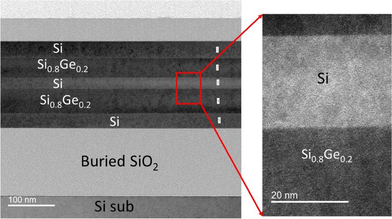
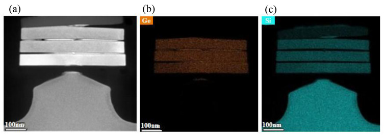
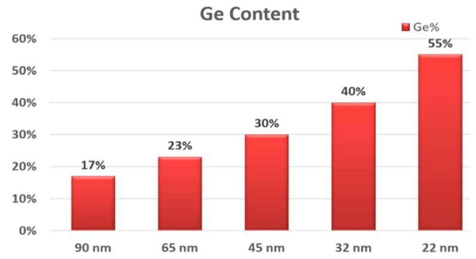

# 03-15 · SiGe & Epitaxy 

> 근거 번호 `[S##]`는 `03-15_SiGe_Epitaxy_자료수집.md`의 ID다. 논문 전문은 열람하지 못했다.
>
> 근거 표시 — **[논문]** 논문·학회에 보고된 값 · **[특허]** 특허의 주장·실시예 · **[리뷰]** 교과서 수준의 정설 · **[계산]** 가정을 명시한 교육용 계산 · **[현장]** 문헌으로 못 박지 못한 현장 통념. 자기 장비에서 확인이 필요하다.

---

## 0. 요약

Epitaxy는 기판의 결정 격자를 그대로 이어받아 단결정 막을 기르는 증착이다. 이 Chapter 앞쪽의 막들은 모두 비정질이거나 다결정이었다. Epitaxy는 **원자 하나하나가 정해진 격자 자리에 들어가야 한다**는 점에서 전혀 다른 공정이다. 표면이 원자 수준으로 깨끗해야 하고, 격자 상수가 다른 물질(SiGe)을 올리면 변형과 결함이 따라온다.

| 항목 | 내용 |
|---|---|
| 조성식 | Si₁₋ₓGeₓ(x는 Ge 원자 분율). Si와 Ge는 모든 비율에서 섞여 같은 다이아몬드 구조의 단결정을 이룬다. 예: Ge 30 %는 Si₀.₇Ge₀.₃이다. 붕소를 넣은 S/D 막은 SiGe:B, 인을 넣은 Si 막은 Si:P로 쓴다 |
| 역할 | Source/Drain 응력원, 채널, Nanosheet 적층의 희생층, 기판 Epi 층 |
| 증착 방식 | RPCVD(감압 CVD). 단일 Wafer, 수 ~ 수십 Torr |
| Si 전구체 | SiH₂Cl₂(DCS), SiH₄, Si₂H₆ 등 |
| Ge 전구체 | GeH₄ |
| 식각·선택성 가스 | HCl |
| 도펀트 | B₂H₆(p형), PH₃(n형) |
| 격자 불일치 | Si 5.431 Å, Ge 5.658 Å. 차이 4.18 % [리뷰 S16] |
| 임계 두께 | Ge 30 %에서 약 52 nm(People–Bean). 실용 한계는 그 70 % 이하 [특허 S13] |
| 선택 성장 | HCl로 유전체 위 증착을 막는다. HCl은 성장 속도를 낮춘다 [현장 S03] |
| 핵심 Trade-off | 낮은 온도(급준한 계면, 준안정 유지) ↔ 성장 속도·결정 품질 / 선택성 ↔ 성장 속도 / Ge 농도(변형·식각 선택비) ↔ 임계 두께 |

**증착 반응식.** 첫 줄은 막의 Ge 원자 분율을 x로 놓고 원소 수를 맞춘 식이다 [계산]. DCS는 분해하며 HCl을 스스로 내놓는다. 둘째 줄은 선택 성장의 원리로, HCl이 유전체 위에 생긴 작은 Si 핵을 깎아 낸다(§3). 셋째 줄은 붕소 도핑이다.

$$
(1-x)\,\mathrm{SiH_2Cl_2} + x\,\mathrm{GeH_4} \rightarrow \mathrm{Si}_{1-x}\mathrm{Ge}_x + 2(1-x)\,\mathrm{HCl} + 2x\,\mathrm{H_2} \qquad (\text{x = Ge 원자 분율})
\mathrm{Si} + 2\,\mathrm{HCl} \rightarrow \mathrm{SiCl_2} + \mathrm{H_2} \qquad (\text{선택 성장, HCl 식각})
\mathrm{B_2H_6} \rightarrow 2\,\mathrm{B} + 3\,\mathrm{H_2} \qquad (\text{SiGe:B 도핑})
$$

---

## 1. 용도와 필요성

SiGe Epitaxy는 응력원, 희생층, 채널 등 여러 곳에 쓰인다. 아래 표에서 용도를 정리한 뒤, Ge 농도가 왜 중요한 설계 변수인지 살펴보자.

| 용도 | 내용 |
|---|---|
| Source/Drain 응력원 | pFET의 Source/Drain을 파내고 SiGe:B를 채운다. SiGe가 Si보다 격자가 커서 채널을 눌러 정공 이동도를 올린다. nFET은 Si:P [리뷰 S18]. |
| Source/Drain 저항 저감 | 고농도 In-situ 도핑으로 접촉 저항을 낮춘다. |
| Nanosheet(GAA) 적층 | Si와 SiGe를 번갈아 쌓고, 나중에 SiGe만 선택 식각으로 빼내 Si 채널을 띄운다. **SiGe는 채널 사이 간격을 정하는 희생층**이다 [논문 S07]. |
| SiGe 채널 | pFET 채널 자체를 SiGe로 |
| 선택 Epi Plug | Contact 바닥을 단결정 Si로 채운다(DRAM, 3D NAND 하부) [현장]. |
| 기판 Epi | 결함이 적고 도핑이 제어된 표면층 |

Nanosheet 적층에서는 SiGe의 Ge 농도가 설계 변수다. 희생 SiGe 약 35 % Ge, 채널 쪽 약 10 % Ge의 예처럼 **Ge 농도 차이가 식각 선택비를 준다** [특허 S10]. Ge를 올리면 선택비가 좋아지지만 변형이 커져 임계 두께가 줄어든다(§2.3).

실제 적층은 다음과 같다 [논문 S22]. 이 예는 SiGe를 채널로 남기고 Si를 희생층으로 빼내는 pFET용 구성이라 위 표와 역할이 반대이다. 두 층을 번갈아 쌓고 한쪽만 선택 식각한다는 원리는 같다.

*SOI 기판 위에 LPCVD(DCS + GeH₄)로 Si₀.₈Ge₀.₂(60 nm)와 Si(25 nm)를 두 주기 쌓은 단면 TEM. GeH₄ 25 sccm, DCS 130 sccm으로 키웠고, Si 층은 GeH₄만 끊어 키웠다. 오른쪽 확대 사진에서 격자 무늬가 Si와 SiGe의 계면을 지나 끊기지 않고 이어진다. 전위 없이 정합 성장(§2.1)했다는 뜻이다.*

*출처: Chu 등, Sci. Rep. 13, 9433 (2023), Figure 2. CC BY 4.0. [PMC](https://pmc.ncbi.nlm.nih.gov/articles/PMC10256751/)*

*RPCVD로 키운 Si/SiGe 초격자(Si 30 nm, SiGe 50 nm, Ge 25 %)에서 CF₄/O₂/N₂ Plasma로 Si만 등방성 식각한 뒤의 단면. (a) TEM, (b) Ge, (c) Si의 EDS 지도. SiGe 세 장이 아래 Fin 위에 떠 있고 그 사이의 Si는 남김없이 빠졌다. Epi로 정한 층 두께가 그대로 채널 두께와 채널 사이 간격이 된다.*

*출처: Li 등, Nanomaterials 15(19), 1469 (2025), Figure 7. CC BY 4.0. [PMC](https://pmc.ncbi.nlm.nih.gov/articles/PMC12525734/)*

Source/Drain 응력원으로 쓰는 SiGe의 Ge 농도는 세대마다 올라갔다 [리뷰 S21].

*기술 노드별 Source/Drain SiGe의 Ge 농도. 90 nm 17 %, 65 nm 23 %, 45 nm 30 %, 32 nm 40 %, 22 nm 55 %로 표시돼 있다. 같은 논문의 본문은 90 nm에서 22 nm 사이에 19 %에서 45 %로 올랐다고 적어 그림과 조금 다르다. 방향은 같다. Ge가 많을수록 변형이 커지고 임계 두께가 줄어든다(§2.3).*

*출처: Radamson 등, Nanomaterials 10(8), 1555 (2020), Figure 17. CC BY 4.0. [PMC](https://pmc.ncbi.nlm.nih.gov/articles/PMC7466708/)*

> 이해 확인: Nanosheet의 희생 SiGe에서 Ge 농도를 높이면 얻는 것과 잃는 것은 무엇인가?

---

## 2. 격자 불일치와 변형

SiGe의 성질은 Si와의 격자 불일치에서 나온다. 이 절에서는 격자 불일치가 어떻게 응력을 만드는지, 막을 얼마나 두껍게 기를 수 있는지를 정하는 임계 두께, 그리고 준안정 상태가 공정에서 뜻하는 바를 설명한다.

### 2.1 Pseudomorphic 성장

Si 위에 SiGe를 기르면 무슨 일이 생길까? SiGe의 격자는 Si보다 크다. 얇은 SiGe를 Si 위에 기르면 SiGe는 옆 방향으로 Si 격자에 맞춰 눌리고, 그만큼 위아래로 늘어난다. 격자가 끊기지 않고 이어진 이 상태를 Pseudomorphic(정합) 성장이라 한다. 막은 큰 이축 압축 응력을 품는다.

$$
\text{격자 상수}: \quad a(x) \approx 5.431 + 0.200\,x + 0.027\,x^2\ \mathrm{Å} \qquad (\mathrm{Si_{1-x}Ge_x})
\text{불일치}: \quad f = \frac{a(x) - a_{\mathrm{Si}}}{a_{\mathrm{Si}}}
\text{이축 응력}: \quad \sigma \approx M f,\qquad M \approx 180\ \mathrm{GPa}
$$

위 식은 리뷰 수준의 정리이다 [리뷰 S16]. 이 식으로 Ge 분율에 따른 값을 계산하면 다음과 같다.

| Ge 분율 x | 격자 상수 (Å) | 불일치 f | 이축 압축 응력 [계산] |
|---|---|---|---|
| 0.10 | 5.451 | 0.37 % | 약 0.7 GPa |
| 0.20 | 5.472 | 0.76 % | 약 1.4 GPa |
| 0.30 | 5.493 | 1.15 % | 약 2.1 GPa |
| 0.50 | 5.538 | 1.97 % | 약 3.5 GPa |
| 1.00 (Ge) | 5.658 | 4.18 % | — |

Ge 30 % 막은 약 2 GPa의 압축을 품는다. PECVD SiN의 응력 Liner(→ 03-11)와 같은 규모의 응력을 **재료의 격자 자체로** 만드는 것이다. Source/Drain 응력원이 효과적인 이유다.

### 2.2 임계 두께와 이완

그렇다면 SiGe를 얼마나 두껍게 기를 수 있을까? 변형 에너지는 두께에 비례해 쌓인다. 어느 두께를 넘으면 계면에 Misfit 전위를 만들어 변형을 푸는 편이 에너지가 낮아진다. 이 두께가 임계 두께다. 두 가지 기준이 있다 [논문 S12, 특허 S14].

| 모델 | 뜻 | 성격 |
|---|---|---|
| Matthews–Blakeslee | 기존 전위가 변형에 밀려 Misfit 전위로 늘어나는 역학적 평형 | **안정 한계.** 750–900 °C에서 약 30분 Anneal해야 도달한다. |
| People–Bean | 전위를 만드는 에너지와 변형 에너지의 균형 | **준안정 한계.** 550 °C 성장 막의 실험과 일치. Ge가 높을 때 실험과 잘 맞는다. |

두 한계 사이의 막은 **준안정** 상태다. 성장 직후에는 결함이 없지만, 이후 고온을 거치면 이완한다.

### 2.3 임계 두께 수치

임계 두께가 Ge 분율에 따라 얼마나 달라지는지 보고된 값을 보자.

| Ge 분율 | 안정 한계 | 준안정 한계 | 출처 |
|---|---|---|---|
| 10 % | 약 30 nm (약 700 °C) | 약 200 nm | [특허 S14] |
| 30 % | — | 약 52 nm (People–Bean) | [특허 S13] |
| 50 % | — | 약 10 nm | [특허 S14] |

- 실용 임계 두께는 People–Bean 값의 70 % 이하로 잡는다 [특허 S13].
- 성장 온도가 높을수록 임계 두께가 작다 [특허 S14].
- 이 곡선들은 Ge 40 % 미만에서만 실험적으로 검증됐다. 더 높은 Ge에서는 전위가 아니라 표면이 울퉁불퉁해지는 탄성 이완(섬 형성)이 먼저 일어난다 [논문 S15].

Ge 농도가 10 %에서 50 %로 가면 준안정 한계가 200 nm에서 10 nm로 줄어든다. **Ge를 올릴수록 쓸 수 있는 두께가 급격히 얇아진다.**

### 2.4 준안정 상태

Nanosheet 적층과 Source/Drain SiGe는 대부분 준안정 영역에 있다. 그래서 **Epi 이후의 모든 열 공정이 Epi 사양의 일부**가 된다.

- 고온을 거치면 Misfit 전위가 생기며 이완한다. 변형이 풀리면 응력원의 효과가 사라지고 전위가 누설 경로가 된다.
- Ge가 Si 쪽으로 확산해 계면이 흐려진다(§6.2).

IBM의 Nanosheet 보고가 “저온 STI 공정으로 Ge 상호 확산과 SiGe의 소성 이완을 억제했다”고 적은 것이 이 때문이다 [논문 S07].

> 이해 확인: Ge 20 % SiGe 막을 준안정 한계보다 조금 얇게 길렀다. 성장 직후에는 결함이 없었는데 이후 고온 Anneal 뒤 누설이 늘었다. 무슨 일이 일어났는가?

---

## 3. 전구체와 반응

Epitaxy의 성장 속도와 선택성은 표면에서 일어나는 반응으로 정해진다. 이 절에서는 표면이 수소와 염소로 덮여 있다는 사실에서 출발해, Ge와 B가 성장을 빠르게 하는 이유, HCl로 선택 성장을 하는 원리, 그리고 Epi 전 표면 준비를 설명한다.

### 3.1 표면 반응과 수소·염소 피복

Epi가 일어나는 온도에서 Si 표면은 수소(와 염소)로 덮여 있다. 전구체가 붙으려면 빈 자리가 있어야 하고, 빈 자리는 수소가 떨어져 나가야 생긴다.

| 온도 영역 | 속도를 정하는 것 | 특징 |
|---|---|---|
| 저온 | 표면에서의 수소·염소 탈착 | 온도에 지수적으로 의존. 전구체 유량을 올려도 잘 안 오른다. |
| 고온 | 기상에서 표면으로의 물질전달 | 온도 영향이 작다. DCS 유량을 두 배로 하면 성장 속도가 두 배 [현장 S03] |

미세 소자의 Epi는 열 예산 때문에 대부분 저온 영역에서 한다. **저온 Epi의 성장 속도는 “표면을 얼마나 빨리 비우느냐”의 문제**다.

### 3.2 Ge·B 첨가에 의한 성장 속도 증가

- **GeH₄.** GeH₄ 유량이 늘면 SiGe 성장 속도가 가속된다. Ge 함량은 그보다 완만하게 는다 [논문 S01]. 다결정 SiGe에서도 GeH₄ 분압과 온도와 함께 성장이 빨라진다 [논문 S02]. 표면의 Ge 자리에서 수소가 Si 자리에서보다 쉽게 떨어진다는 것이 통상의 설명이다 [리뷰].
- **B₂H₆.** Si:B와 SiGe:B의 성장 속도는 화학계에 관계없이 B₂H₆ 유량과 함께 오른다. **붕소 표면 자리에서 수소 탈착이 늘기 때문**이다 [논문 S02]. Poly-Si(→ 03-14 §3.3), SiB(→ 03-02 §3.2)에서 본 것과 같은 효과다.
- **PH₃.** 반대로 표면을 막아 성장을 늦춘다(→ 03-14 §3.2).

이 사실은 실무에서 중요한 결과를 낳는다. **조성과 성장 속도가 묶여 있다.** GeH₄나 B₂H₆ 유량을 바꾸면 조성만이 아니라 두께도 변한다. 조성을 맞춘 뒤 시간으로 두께를 다시 맞춰야 한다.

### 3.3 선택 성장과 HCl

패턴 Wafer에는 Si가 드러난 곳과 산화막·질화막으로 덮인 곳이 함께 있다. 이 가운데 Si 위에만 막을 기르는 것을 선택 Epi라고 한다. 선택 성장은 다음 원리로 일어난다.

- Si 표면: 증착이 식각보다 빨라 단결정이 자란다.
- 유전체 표면: 핵생성이 어렵고, 생긴 핵은 HCl이 식각한다. 그래서 증착되지 않는다.

HCl이 유전체 위의 작은 핵을 Si 위의 막보다 빨리 깎아낸다 [리뷰 S20]. DCS는 분해하며 스스로 HCl을 내놓아 선택성이 좋고, SiH₄는 선택성이 나빠 HCl을 따로 넣어야 한다.

대가는 속도다. **HCl은 Si 성장 속도를 낮추고, 쓸 수 있는 온도 범위의 하한을 위로 민다** [현장 S03]. SiGe 성장도 HCl을 넣으면 느려진다 [논문 S02]. 선택성과 성장 속도, 그리고 저온화는 서로 당긴다. 온도를 더 낮추려면 증착과 식각을 번갈아 하는 Cyclic 방식으로 간다 [리뷰 S20].

### 3.4 Epi 전 표면 준비

Epi는 표면의 격자를 이어받는다. 표면에 자연 산화막이나 탄소가 한 겹만 있어도 그 위는 결정이 어긋난다 [리뷰 S17].

| 단계 | 하는 일 | 제약 |
|---|---|---|
| HF-last 세정 | 산화막 제거, 표면을 수소로 종결 | 대기 중에서 다시 산화된다. Q-time |
| H₂ Bake | 남은 산화막과 탄소를 고온에서 제거 | 800 °C 이상이 필요. 미세 구조의 열 예산과 형상(Si가 흘러 모서리가 둥글어진다) |
| 저온 건식 화학 세정 | Remote Plasma의 NF₃/NH₃ 계로 산화막을 승화성 염으로 바꿔 제거 | 잔류 F, 선택성 |

Chamber 쪽에서는 수분과 산소의 분압이 ppb 수준으로 낮아야 한다. 저온일수록 표면에 붙은 산소가 떨어져 나가지 않아 더 엄격해진다.

> 이해 확인: 선택 Epi에서 HCl 유량을 늘리면 선택성은 좋아지지만 다른 무엇이 나빠지는가? 저온화와는 어떤 관계가 있는가?

---

## 4. Process Window와 공정 변수별 응답

Epitaxy에서는 조절 변수 하나가 성장 속도, 조성, 선택성, 결정 품질을 함께 움직인다. 아래 표는 그 경향을 정리한 것이다.

| 조절 변수 ↑ | 성장 속도 | Ge 함량 | 선택성 | 결정 품질 · 계면 | 근거 |
|---|---|---|---|---|---|
| 온도 | ↑↑ (저온 영역) | ↓ (같은 유량 비에서) | — | 결정 품질 ↑. 편석·확산 ↑, 임계 두께 ↓ | [S03, S08, S14] |
| GeH₄ 유량 | ↑ (가속) | ↑ (완만) | — | 변형 ↑ | [논문 S01] |
| 압력 | ↑ | ↑ | ↓ | 기상 반응 ↑ | [논문 S01] |
| DCS 유량 | ↑ (고온에서 비례) | ↓ | — | — | [현장 S03] |
| HCl 유량 | ↓ | 변화 | ↑ | 패턴 의존성 ↓ | [S02, S03, S04] |
| B₂H₆ 유량 | ↑ | — | ↓ | 변형 일부 상쇄(B는 작은 원자) | [논문 S02] |
| H₂ Carrier 유량 | ↓ 소폭 | — | — | 균일도 | [현장] |

온도가 가장 큰 변수다. 저온 영역에서는 성장 속도가 온도에 지수적으로 의존하므로 **온도 균일도가 곧 두께·조성 균일도**다. Epi 장비가 Lamp 가열과 Wafer 회전, 다점 온도 측정에 공을 들이는 이유다.

> 이해 확인: 저온 Epi에서 Wafer 안의 온도가 1 °C 다르면 두께와 조성 균일도에 어떤 영향을 주는가? 그 이유는 무엇인가?

---

## 5. 계산 [계산]

이 절에서는 Nanosheet 적층을 예로 두 가지 계산을 해 본다. 먼저 적층의 총 두께가 임계 두께와 어떻게 비교되는지 보고, 다음으로 후속 열 공정에서 계면이 얼마나 흐려지는지 어림한다.

### 5.1 적층 설계와 임계 두께

Nanosheet 적층을 설계한다고 가정해 보자. 아래 숫자는 계산 방법을 익히기 위한 가상의 예이다.

| 층 | 두께 | Ge | 그 Ge에서의 준안정 한계 [특허 S13, S14] |
|---|---|---|---|
| SiGe 희생층 | 10 nm | 30 % | 약 52 nm, 실용 약 36 nm 이하 |
| Si 채널 | 8 nm | 0 | — |
| × 3–4쌍 | | | |

층 하나(10 nm)는 한계의 3분의 1 이하다. 그러나 **변형 에너지는 SiGe 층을 다 합친 두께로 쌓인다.** 4쌍이면 SiGe 합계 40 nm로 실용 한계를 넘는다. Si 층이 사이에 있어 단순 합보다는 유리하지만, 층수를 늘리거나 Ge를 올리면 여유가 빠르게 사라진다. Ge를 35 %로 올리면 한계는 더 줄어든다. 적층 수를 늘리려는 방향과 식각 선택비를 위해 Ge를 올리려는 방향이 임계 두께에서 부딪힌다.

### 5.2 계면 확산 폭 계산

이번에는 적층 뒤의 열 공정에서 계면이 얼마나 흐려지는지 어림해 보자. Ge의 상호 확산 길이는 대략 2√(Dt)이다. 확산 계수 D는 온도와 Ge 농도에 강하게 의존하므로, 아래 표는 D를 몇 가지 크기로 가정해 확산 길이의 규모만 본다.

| D (cm²/s) | 시간 | 2√(Dt) |
|---|---|---|
| 10⁻¹⁸ | 60 s | 약 0.15 nm |
| 10⁻¹⁷ | 60 s | 약 0.5 nm |
| 10⁻¹⁶ | 60 s | 약 1.5 nm |
| 10⁻¹⁷ | 600 s | 약 1.5 nm |

두께 8–10 nm인 층에서 계면이 1.5 nm씩 흐려지면 양쪽 합쳐 3 nm, 층 두께의 3분의 1이 혼합 영역이 된다. 확산 계수가 한 자릿수 변하면(온도 수십 °C) 결과가 크게 달라진다. **적층 Epi 이후의 열 공정 온도가 수십 °C 단위로 관리돼야 하는 이유**다.

> 이해 확인: Ge 25 % SiGe 10 nm 층을 Si와 번갈아 6쌍 쌓으려 한다. 임계 두께의 관점에서 어떤 위험이 있는가?

---

## 6. 집적 이슈와 불량 모드

Epitaxy는 원자 수준의 정밀도가 필요하므로 작은 변화도 불량이 된다. 이 절에서는 계면 급준성, 열 예산, Loading 효과, 선택성 상실, Facet과 형상, 계면 오염, 도펀트의 문제를 차례로 살펴본다.

### 6.1 Ge 편석과 계면 급준성

SiGe 위에 Si를 기를 때, Ge 원자가 새로 덮이는 Si 층 속에 묻히지 않고 표면으로 떠오른다. 그래서 SiGe → Si 계면이 Si → SiGe 계면보다 흐리다. **조성 변화의 급준성을 제한하는 것이 이 Ge 편석**이다 [논문 S08].

| 대책 | 원리 | 근거 |
|---|---|---|
| 저온 성장 | 편석과 확산이 모두 줄어든다. | [논문 S08] |
| Chlorosilane 전구체 | 표면이 염소로 종결돼 Ge가 떠오르기 어렵다. 성장 속도도 높다. | [특허 S09] |
| 가스 전환 순서 | GeH₄를 끊고 Purge한 뒤 Si 성장 | [현장] |

계면이 급준해야 하는 이유는 식각이다. 채널 Release에서 SiGe만 빼낼 때 흐린 계면의 혼합 영역은 중간 속도로 깎인다. 급준한 계면이 SiGe와 Si의 식각 선택비를 높인다 [특허 S09]. 혼합 영역은 Inner Spacer 형성과 Release의 선택 식각에서 함께 제거해야 한다 [논문 S07]. 남으면 채널 두께와 표면이 불균일해진다.

### 6.2 열 예산에 따른 상호 확산과 이완

§2.4와 §5.2에서 본 대로 Epi 이후의 고온 공정이 계면을 흐리고 준안정 막을 이완시킨다. 저온 STI 같은 **후속 공정의 저온화**가 Epi 적층의 전제 조건이다 [논문 S07]. Epi 엔지니어의 사양은 “증착 직후”가 아니라 “열 이력 후”로 정해진다.

### 6.3 Loading 효과

같은 Recipe라도 패턴에 따라 성장 속도와 조성이 달라진다.

| 종류 | 내용 |
|---|---|
| Global Loading | Wafer 전체에서 Si가 드러난 면적 비율에 따라 속도가 변한다. 유전체 위에서 소모되지 않은 전구체가 Si 영역으로 몰린다. |
| Local Loading | 같은 Wafer 안에서도 Window 크기와 주변 패턴 밀도에 따라 달라진다. |

- 선택 Si 성장의 Global Loading은 온도에 따라 완만히 줄지만, **저온 SiGe 성장 속도는 산화막 피복률에 강하게 의존**한다 [논문 S04].
- HCl을 넣으면 SiGe 성장 속도의 산화막 피복률과 Window 크기 의존성이 최소화된다 [논문 S04].
- SiH₄는 Window가 작을수록 느리고 SiH₂Cl₂는 작을수록 빠르다. 두 전구체의 비를 골라 의존성을 상쇄할 수 있다. 최적 비는 온도와 HCl·GeH₄ 유량에 따라 달라진다 [특허 S05].

**Blanket Monitor Wafer로 맞춘 Recipe는 제품 Wafer에서 다른 두께와 조성을 낸다.** 제품마다, Mask마다 보정이 필요하다.

### 6.4 선택성 상실

유전체 위에 Si 핵이 남으면(Nodule) 이후 공정에서 단락과 Defect가 된다. 원인은 HCl 부족, 유전체 표면의 손상이나 오염(핵생성 자리), 과도한 성장 시간이다. 성장이 길어질수록 유전체 위 핵생성 확률이 누적된다 [리뷰].

### 6.5 Facet과 형상

선택 Epi는 결정면마다 성장 속도가 달라 Facet이 생긴다. Source/Drain Epi가 마름모꼴이 되는 이유다. 이웃 Fin의 Epi가 서로 붙으면(Merge) 그 아래 빈 공간이 남는다. 형상은 접촉 면적과 응력 전달, 기생 정전용량을 정한다 [리뷰 S18].

### 6.6 계면 오염과 결함

Epi 전 표면의 산소·탄소는 그 위에 적층 결함과 전위를 만든다(§3.4). 결함은 표면의 Haze와 작은 돌기로 나타난다. 원인은 세정 후 Q-time, Bake 부족, Chamber의 수분·산소 Leak, Load-lock 오염이다.

### 6.7 도펀트

고농도 In-situ 도핑에서는 도펀트가 격자 자리에 들어가지 못하고 뭉치거나, 표면에 편석하거나(P, As), 이웃 층으로 확산한다. 붕소는 Ge보다 작은 원자라 SiGe의 압축 변형을 일부 상쇄한다 [리뷰]. 조성·변형·도핑이 서로 얽혀 있다.

> 이해 확인: Monitor Wafer에서 맞춘 SiGe Recipe를 제품에 적용했더니 Ge 함량과 두께가 달라졌다. 그 원인은 무엇이며 어떻게 보정하는가?

---

## 7. 챔버 · 하드웨어 관리

Epi 장비는 원자 수준으로 깨끗한 표면을 유지해야 하므로 수분과 산소의 관리가 특히 엄격하다. 아래 표는 Chamber와 하드웨어 관리의 주요 항목을 정리한 것이다.

| 항목 | 내용 |
|---|---|
| 온도 제어 | 저온 영역에서 성장 속도가 온도에 지수적으로 의존. Lamp Zone 균형, Wafer 회전, Pyrometer 교정. 벽에 막이 쌓이면 복사가 변해 온도 읽기가 틀어진다. |
| Chamber Etch | 매 Wafer 또는 수 Wafer마다 HCl로 Quartz 벽과 Susceptor의 Si·SiGe 퇴적물을 식각. 퇴적물은 온도 제어와 Particle 모두를 해친다. |
| Susceptor Coating | Etch 후 Susceptor에 Si를 얇게 입혀 표면 상태를 일정하게 한다. |
| 수분·산소 | 가스 정제기, Load-lock의 산소·수분 농도, Leak 점검. 저온 Epi의 가장 민감한 관리 항목 |
| Memory Effect | 도펀트(특히 P, As, B)와 Ge가 벽에 남아 다음 막에 들어간다. 급준한 도핑 분포를 해친다. |
| 가스 전환 | 적층에서는 층마다 가스를 바꾼다. Vent/Run 방식의 빠른 전환과 Purge 시간이 계면 폭을 정한다. |
| 안전 | SiH₄·GeH₄·B₂H₆·PH₃(자연발화성·고독성), HCl(부식성), H₂(대유량 가연성) |

---

## 8. 계측과 해석

Epi 막은 두께, 조성, 변형, 결함을 함께 측정해야 하며, 이들은 서로 얽혀 있다. 아래 표는 각 계측이 무엇을 알려 주고 어떤 함정이 있는지 정리한 것이다.

| 계측 | 얻는 것 | 읽는 법과 함정 |
|---|---|---|
| HR-XRD | Ge 농도, 두께, 변형 | 기판 피크와 막 피크의 각도 차가 격자 상수(Ge 농도 × 변형 상태)다. 간섭 무늬 간격이 두께. **피크가 넓어지고 무늬가 사라지면 이완이나 계면 흐림**이다 [리뷰 S19]. |
| 역격자 공간 Map | 이완도 | 정합인지 이완했는지를 직접 판정 |
| Ellipsometry | 두께, 조성 | 다층 Model. 층이 많으면 변수끼리 물린다. XRD·TEM으로 교정 |
| SIMS | Ge·도펀트 깊이 분포 | 계면 폭. 측정 자체의 깊이 분해능이 nm 수준이라 급준한 계면은 과대평가된다. |
| HAADF-STEM | 층 두께, 계면 | 두께와 계면 품질 평가에 적합 [논문 S08] |
| Haze · 표면 검사 | 결함, 거칠기 | 계면 오염, 이완(Cross-hatch 무늬), 선택성 상실(유전체 위 Nodule) |
| AFM | 표면 거칠기, 섬 형성 | 고 Ge 막의 탄성 이완 |
| 면저항 | 활성 도펀트 | Source/Drain |
| Raman | 변형, 조성 | 국부 측정 |
| 패턴 위 측정 | 실제 구조의 두께·조성 | Loading 효과 때문에 Blanket과 다르다. TEM·EDS, 산란 계측 |

> 이해 확인: XRD로 측정한 SiGe 층의 Ge 함량이 SIMS 값과 다르다. 어떤 가능성을 생각할 수 있는가?

---

## 9. 파생 막과 차세대 기술

소자 구조가 Nanosheet와 그 이후로 바뀌면서 Epitaxy의 역할은 더 커지고 있다. 아래 표는 그 방향을 정리한 것이다.

| 방향 | 내용 | 근거 |
|---|---|---|
| 적층 수 증가 | Nanosheet 수를 늘리면 SiGe 합계 두께가 늘어 임계 두께에 닿는다. Ge가 낮은 Core와 높은 Cladding을 조합해 전위를 줄이는 구조 | [특허 S09] |
| Ge/Si 다층 | SiGe 대신 Ge와 Si의 큰 물성 차이로 선택 식각. Ge 채널 | [논문 S11] |
| 저온 고속 Epi | 고차 Silane·Germane, Chlorosilane으로 저온에서 성장 속도와 급준성 확보 | [특허 S09] |
| 고농도 Source/Drain | 접촉 저항 저감을 위한 초고농도 SiGe:B, Si:P | [리뷰 S18] |
| CFET | n형과 p형을 위아래로 쌓는다. 서로 다른 Epi를 수직으로 정렬 | [리뷰] |
| 메모리의 Epi | 3D NAND 하부 선택 Epi, 단결정 채널 시도(→ 03-13 §9) | [현장] |

---

## 10. Troubleshooting

아래 표는 Epitaxy 공정에서 흔히 나타나는 증상과 유력한 원인, 확인할 데이터, 조치 방향을 정리한 것이다. 표의 원인은 현장 경험에서 나온 출발점이므로 [현장], “확인할 데이터” 열로 가설을 좁힌 뒤에 조치해야 한다.

| 증상 | 유력 원인 | 확인할 데이터 | 조치 방향 |
|---|---|---|---|
| Haze, 표면 돌기 | 계면 산소·탄소 | SIMS 계면, Q-time, Bake 조건, Chamber 수분 | 세정·Q-time, Bake, Leak 점검 |
| XRD 무늬 소실, Cross-hatch | 이완 (임계 두께 초과, 열 이력) | 역격자 Map, 두께·Ge 농도 | 두께·Ge 하향, 성장·후속 온도 하향 |
| 유전체 위 Nodule | 선택성 상실 | HCl 유량, 유전체 표면 상태 | HCl 상향, 전 공정의 표면 손상 점검 |
| 제품 Wafer에서 두께·조성 이탈 | Loading 효과 | 패턴 밀도별 두께 | HCl·전구체 비 조정, 제품별 보정 |
| 계면 흐림, Release 후 채널 불균일 | Ge 편석, 상호 확산, 가스 전환 | STEM, SIMS, 열 이력 | 성장 온도 하향, 전구체, Purge, 후속 열 예산 |
| 두께 Wafer 내 불균일 | 온도 분포, 벽 퇴적물 | 두께·조성 Map(같은 모양이면 온도) | Lamp 균형, Chamber Etch |
| Wafer 간 Drift | 벽 퇴적물 누적, Pyrometer 오차 | Etch 후 경과 Wafer 수와의 상관 | Etch 주기, 온도 교정 |
| 도핑 분포 꼬리 | Memory Effect, 편석 | SIMS | Etch·Coating, Purge |
| Source/Drain 형상 이상 | Facet, Merge, Loading | 단면 TEM | 온도·HCl·압력 조정 |

> 이해 확인: Epi 표면에 Haze와 작은 돌기가 늘었다. Epi 전 표면 준비와 Chamber에서 무엇을 먼저 확인해야 하는가?

---

## 11. 자가 점검

이 장의 핵심 내용을 질문으로 확인해 보자.

**Q1. Si 위의 얇은 SiGe가 압축 응력을 받는 이유는?**
SiGe의 격자가 Si보다 크다. 옆 방향으로 Si 격자에 맞춰 눌린다.

**Q2. Ge 30 % SiGe의 격자 불일치와 응력 규모는?**
약 1.15 %, 약 2 GPa 압축.

**Q3. “준안정” 막이란 무엇이고, 왜 Epi 이후의 열 공정이 문제 되는가?**
안정 한계는 넘었지만 준안정 한계 아래라 성장 직후에는 결함이 없는 막이다. 고온을 거치면 Misfit 전위를 만들며 이완한다.

**Q4. Ge 농도를 10 %에서 50 %로 올리면 준안정 임계 두께는?**
약 200 nm에서 약 10 nm로 줄어든다.

**Q5. 선택 Epi에서 HCl의 역할과 대가는?**
유전체 위의 핵을 식각해 Si 위에만 자라게 한다. 성장 속도가 내려가고 쓸 수 있는 온도 하한이 올라간다.

**Q6. GeH₄나 B₂H₆ 유량을 바꾸면 조성 외에 무엇이 변하는가?**
성장 속도다. 둘 다 성장을 빠르게 한다. 두께를 다시 맞춰야 한다.

**Q7. SiGe → Si 계면이 Si → SiGe 계면보다 흐린 이유는?**
Ge 편석이다. Si를 덮는 동안 Ge가 묻히지 않고 표면으로 떠오른다.

**Q8. Blanket Wafer로 맞춘 Recipe가 제품 Wafer에서 다른 결과를 내는 이유는?**
Loading 효과다. Si가 드러난 면적 비율과 Window 크기에 따라 성장 속도와 조성이 달라진다.

---

## 12. 참고 문헌

- [S01] *Chin. Sci. Bull.* (2012) — RPCVD SiGe의 성장 속도와 Ge 함량
- [S02] ECS MA 206, 1345 — B₂H₆와 수소 탈착, HCl의 영향
- [S04] 선택 Si·SiGe의 Loading 효과와 HCl
- [S05] US 8,415,236 — SiH₄·DCS의 Window 의존성 상쇄
- [S07] IBM·GlobalFoundries, ECS AiMES 2018 — Nanosheet용 SiGe/Si 적층
- [S08] RPCVD 초격자 연구 — Ge 편석과 계면 급준성
- [S09] US 12,363,971 — Chlorosilane과 계면 급준성, Graded 구조
- [S13, S14] 임계 두께 특허군 — People–Bean·Matthews–Blakeslee 인용 값
- [S21] Radamson 등, *Nanomaterials* 10, 1555 (2020) — CMOS 미세화 리뷰. 노드별 S/D Ge 농도(그림 출처)
- [S22] Chu 등, *Sci. Rep.* 13, 9433 (2023) — LPCVD SiGe/Si 다층 단면 TEM(그림 출처)
- [S23] Li 등, *Nanomaterials* 15, 1469 (2025) — Si 선택 식각 뒤 SiGe Nanosheet 단면 TEM(그림 출처)
