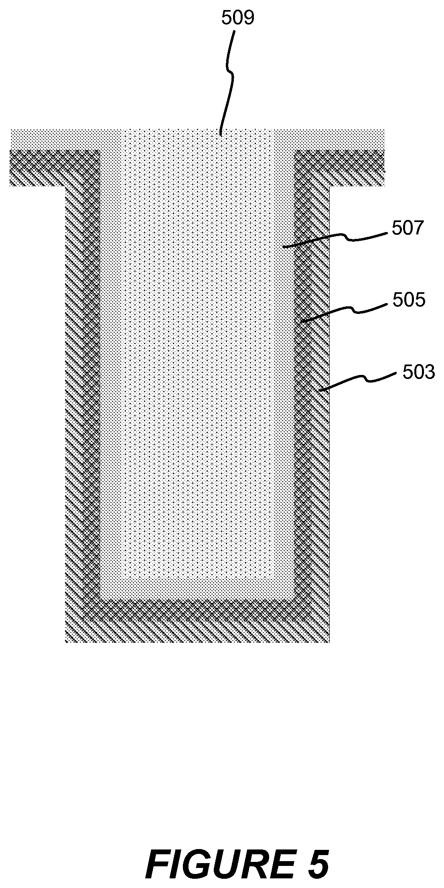
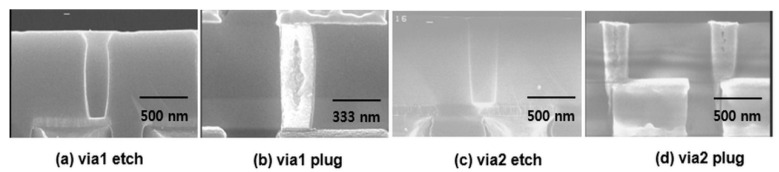

# 03-16 · W — Tungsten 

> 근거 번호 `[S##]`는 `03-16_W_자료수집.md`의 ID다. 논문 전문은 열람하지 못했다.
>
> 근거 표시 — **[논문]** 논문·학회에 보고된 값 · **[특허]** 특허의 주장·실시예 · **[리뷰]** 교과서 수준의 정설 · **[계산]** 가정을 명시한 교육용 계산 · **[현장]** 문헌으로 못 박지 못한 현장 통념. 자기 장비에서 확인이 필요하다.

---

## 0. 요약

이 장에서는 CVD로 증착하는 대표적인 금속인 W를 다룬다. W는 좁고 깊은 구멍을 Conformal하게 채울 수 있어 Contact Plug에서 3D NAND의 Word Line까지 쓰임이 넓다. 그러나 원료인 WF₆가 남기는 불소가 많은 문제를 일으킨다. 먼저 이 막의 성질을 정리한 뒤, 상과 결정립, 반응과 핵생성, 그리고 불소가 일으키는 불량을 차례로 설명한다.

W는 CVD로 증착하는 대표적인 금속이다. 좁고 깊은 구멍을 Conformal하게 채울 수 있고, 고온을 견디며, Electromigration에 강하다. Contact·Via Plug에서 시작해 DRAM의 Buried Word Line, 3D NAND의 Word Line으로 쓰임이 넓어졌다. 전구체 WF₆가 주는 것이 두 가지다. 뛰어난 단차 피복, 그리고 **불소**다. W 공정 기술의 절반은 불소가 일으키는 문제를 막는 일이다.

| 항목 | 내용 |
|---|---|
| 역할 | Contact·Via Plug, Word Line(DRAM·3D NAND), Bit Line, 국부 배선 |
| 증착 방식 | CVD(Bulk 채움) + ALD 또는 Pulse 방식(핵생성층) |
| 전구체 | WF₆. 환원제 H₂(Bulk), SiH₄ 또는 B₂H₆(핵생성) |
| 하부층 | Ti/TiN 또는 TiN. W는 산화막에 붙지 않는다 [리뷰 S21] |
| Bulk 반응 | WF₆ + 3H₂ → W + 6HF |
| 속도론 | WF₆ 0차, H₂ 1/2차 [통설, S01 서지만 확인]. 활성화 에너지 55.7 kJ/mol의 보고 [학위 논문 S02] |
| 비저항 | Bulk 약 5.3 µΩ·cm [리뷰 S19]. 50 nm 막: B₂H₆ 핵생성 약 10, SiH₄ 핵생성 약 25 µΩ·cm [논문 S07] |
| 대표 문제 | Volcano, 불소 확산, Seam·Void, 얇은 막의 높은 비저항, 응력에 의한 Bow |
| 핵심 Trade-off | 낮은 비저항(B₂H₆ 핵생성, 큰 결정립) ↔ 접착·붕소 확산 / 채움 ↔ 불소 잔류 |

---

## 1. 용도와 필요성

W는 Plug와 Word Line처럼 좁은 구조를 금속으로 채워야 하는 곳에 쓰인다. 아래 표에서 용도를 정리한 뒤, 왜 다른 금속이 아니라 W를 쓰는지, 그리고 W의 약점은 무엇인지 살펴보자.

| 용도 | 구조 | 요구 |
|---|---|---|
| Contact·Via Plug | 수직 구멍 | Void 없는 채움, 낮은 접촉 저항, 하부 손상 없음 |
| DRAM Buried Word Line | Si에 판 좁은 Trench 안의 TiN/W | 가는 선의 낮은 저항, Line Bending 없음 |
| 3D NAND Word Line | 질화막을 빼낸 수평 빈 공간을 Slit에서 옆으로 채운다. | 길고 좁은 수평 틈의 채움, 불소·응력 관리 |
| Bit Line, 국부 배선 | 선 | 저항, 식각 가공성 |

W를 쓰는 이유는 다음과 같다 [리뷰].

- **CVD로 채울 수 있다.** Al과 Cu는 CVD가 실용적이지 않다. WF₆ + H₂ 반응은 넓은 조건에서 표면 반응 지배라 종횡비가 큰 구조도 Conformal하게 채운다.
- **Si·산화막으로 확산하지 않는다.** Cu와 달리 두꺼운 확산 Barrier가 필요 없다. 접착층이 주 목적이다.
- **고온을 견딘다.** 녹는점이 높아 이후 공정의 열에 변하지 않는다. Front-end 가까이에 쓸 수 있다.

단점은 비저항이다. Bulk가 약 5.3 µΩ·cm로 Cu(약 1.7)의 세 배다. 얇아지면 더 나빠진다(§2.3). 3D NAND에서는 층수가 늘며 두 가지가 새로 문제 됐다. W에서 유전체로의 불소 확산, 그리고 48쌍을 넘으며 커진 누적 응력에 의한 Bow다 [기사 S13].

> 이해 확인: Cu는 W보다 비저항이 낮은데도 Contact Plug에는 W를 쓰는 이유는 무엇인가?

---

## 2. 상, 결정립, 비저항

W 막의 비저항과 응력은 어떤 상이 생기는지, 결정립이 얼마나 큰지에 따라 정해진다. 이 절에서는 두 가지 상의 차이, 얇은 핵생성층이 Bulk W의 결정립을 정하는 원리, 얇은 막에서 비저항이 오르는 이유, 그리고 W의 인장 응력을 설명한다.

### 2.1 α-W와 β-W

W에는 결정 구조가 다른 두 가지 상이 있으며, 두 상은 비저항이 크게 다르다.

| 상 | 구조 | 비저항 | 어디서 나오는가 |
|---|---|---|---|
| α-W | 체심 입방. 안정상 | 낮다 | H₂ 환원 Bulk 막, SiH₄ 핵생성층 |
| β-W | A15 구조. 준안정상 | 높다 | 얇은 막, 불순물(O, F, B)이 있을 때, B₂H₆ 핵생성층 |

이 표는 리뷰와 논문의 보고를 정리한 것이다 [리뷰 S19, 논문 S06]. β-W는 열을 받거나 두꺼워지면 α-W로 바뀐다.

### 2.2 핵생성층과 Bulk W의 결정립

핵생성층은 수 nm지만 그 위에 자라는 Bulk W의 결정립 크기를 좌우한다 [논문 S06].

| 핵생성 환원제 | 핵생성층 | 그 위 CVD-W | 50 nm 막 비저항 |
|---|---|---|---|
| SiH₄ | 결정성 좋은 α-W | 결정립이 작다. 핵생성층의 작은 결정립을 이어받는다. | 약 25 µΩ·cm |
| B₂H₆ | 결정성이 낮은 준안정 β-W(비정질에 가깝다) | **결정립이 뚜렷이 크다.** | 약 10 µΩ·cm |

이 표의 값은 논문에 보고된 것이다 [논문 S06, S07]. 결정성이 좋은 핵생성층은 그 작은 결정립이 Bulk의 씨앗이 돼 결정립이 잘게 유지된다. 결정성이 낮은 층 위에서는 Bulk W가 드문드문 핵을 만들어 크게 자란다. **나쁜 결정성의 핵생성층이 좋은 Bulk를 만든다.** 큰 결정립은 결정립계 산란을 줄여 크기 효과에 의한 비저항 증가를 줄인다 [논문 S06].

### 2.3 두께에 따른 비저항 변화

금속 막이 전자의 평균 자유 행로 수준으로 얇아지면 표면과 결정립계에서의 산란이 비저항을 올린다 [리뷰 S22]. W는 여기에 층 구성의 문제가 겹친다. 배선 단면에서 실제로 전류를 나르는 저저항 Bulk W는 일부뿐이다.

| 층 | 비저항 규모 | 비고 |
|---|---|---|
| TiN 접착층 | 수백 µΩ·cm | 사실상 전류를 못 나른다(→ 03-17). |
| 핵생성층 | 높다 (β-W, 불순물) | 약 50 Å 아래에서는 비저항이 훨씬 높다 [특허 S11]. |
| Bulk W | 10–25 µΩ·cm (50 nm) | 결정립 크기에 의존 |

선폭이 줄면 TiN과 핵생성층이 차지하는 비율이 커진다(§5.2). 이것이 W를 Mo·Ru로 바꾸려는 이유의 하나다(→ 03-18).

### 2.4 응력

CVD W는 인장 응력이 크다. 성장 중 이웃 결정립이 만나 결정립계가 닫힐 때 서로 당기는 힘이 생긴다 [리뷰 S20]. 이 힘이 3D NAND에서는 Wafer Bow로 [기사 S13], 좁은 선 구조에서는 Line Bending으로 나타난다(§6.5).

> 이해 확인: 핵생성 환원제를 SiH₄에서 B₂H₆로 바꾸었더니 50 nm 막의 비저항이 낮아졌다. 핵생성층의 결정성과 Bulk 결정립으로 설명해 보자.

---

## 3. 전구체와 반응

W CVD는 WF₆를 여러 환원제로 환원해 증착한다. 이 절에서는 네 가지 반응을 정리하고, 왜 핵생성층이 필요한지, H₂ 환원의 속도론이 왜 뛰어난 단차 피복을 주는지, 그리고 Si가 드러난 곳에서 생기는 Encroachment를 설명한다.

### 3.1 W CVD의 주요 반응

W CVD에서는 WF₆를 무엇으로 환원하느냐에 따라 네 가지 반응이 쓰인다.

| 반응 | 식 | 쓰임 |
|---|---|---|
| Si 환원 | 2WF₆ + 3Si → 2W + 3SiF₄ | Si가 드러난 곳에서 저절로 일어난다. 기판 Si를 소모한다. |
| SiH₄ 환원 | 2WF₆ + 3SiH₄ → 2W + 3SiF₄ + 6H₂ | 핵생성층. 빠르고 저온에서 된다. |
| B₂H₆ 환원 | WF₆ + B₂H₆ → W + 2BF₃ + 3H₂ | 핵생성층. 저저항 Bulk로 이어진다. |
| H₂ 환원 | WF₆ + 3H₂ → W + 6HF | Bulk 채움. 단차 피복이 좋다. |

이 표의 값은 리뷰와 교과서 수준에서 정리된 것이다 [리뷰 S18].

### 3.2 핵생성층의 필요성

그렇다면 왜 곧바로 H₂ 환원으로 W를 채우지 않을까? H₂ 환원은 W 표면에서만 잘 일어나기 때문이다. H₂가 표면에서 원자 H로 쪼개져야 하는데, TiN이나 산화막 위에서는 그것이 느리다. TiN 위에 바로 WF₆ + H₂를 흘리면 한동안 아무것도 안 자라다가(Incubation) 드문드문 핵이 생겨 거칠고 불균일한 막이 된다. 그래서 반응성이 큰 SiH₄나 B₂H₆로 먼저 얇고 연속적인 W를 깐다.

핵생성층은 ALD나 Pulse 방식(환원제와 WF₆를 번갈아 넣는다)으로 수 nm를 Conformal하게 올린다. SiH₄/WF₆ 3 Cycle 뒤 B₂H₆/WF₆ 3 Cycle처럼 두 환원제를 조합하기도 한다 [특허 S11]. 수소 없이 핵생성층을 증착하고 B₂H₆/WF₆ Cycle을 여러 번 쓰면 비저항이 낮고 접착이 좋다는 주장이 있다. 결정립계가 없는 비정질 W가 Barrier를 불소 공격에서 보호한다는 설명이다 [특허 S09].

*W를 채운 구조의 막 적층(모식도). 기판 쪽부터 Ti 접착층(503), TiN Barrier(505), W 핵생성층(507), Bulk W(509) 순서다. 특허는 TiN이 아래의 Ti와 Si를 WF₆로부터 보호한다고 적었다. 선이 가늘어질수록 Ti·TiN·핵생성층이 단면에서 차지하는 비율이 커진다(§5.2).*

*출처: US 8,409,987 (Novellus Systems, 2013), FIG. 5. 미국 특허 도면. [Google Patents](https://patents.google.com/patent/US8409987B2/en)*

### 3.3 H₂ 환원의 속도론

통상의 공정 영역에서 증착 속도는 다음과 같이 알려져 있다 [통설, S01 서지만 확인].

$$
R \propto P(\mathrm{WF_6})^{0} \times P(\mathrm{H_2})^{1/2} \times \exp\left(-\frac{E_a}{k T}\right)
$$

- **WF₆에 0차.** 표면이 WF₆에서 온 불소 종으로 덮여 있어 WF₆를 더 넣어도 빨라지지 않는다.
- **H₂에 1/2차.** H₂가 표면에서 원자 둘로 쪼개지는 단계가 관여한다.
- 활성화 에너지는 300–500 °C에서 55.7 kJ/mol(약 0.58 eV)이라는 보고가 있다 [학위 논문 S02]. 교과서의 통설 값은 약 70 kJ/mol이다 [리뷰 S18]. Reactor와 조건에 따라 다르다.
- WF₆ 유량 영역에 따라 속도 기구가 둘로 나뉜다는 보고가 있다 [학회 S03]. WF₆가 부족한 영역에서는 0차가 깨진다.

**WF₆ 0차가 W의 뛰어난 단차 피복의 이유다.** 구멍 깊은 곳에서 WF₆ 농도가 떨어져도 0차 영역 안에 있는 한 증착 속도가 같다. 구멍 바닥에서 WF₆가 고갈돼 0차가 깨지는 순간부터 바닥이 얇아진다. 종횡비가 큰 구조에서 WF₆ 분압을 충분히 주고 온도를 낮추는 이유다.

### 3.4 Si 환원과 Encroachment

Si가 드러난 곳에서는 WF₆가 Si를 직접 먹으며 W를 만든다. H₂가 있어도 이 반응이 일어난다 [논문 S05]. Contact 바닥의 Si가 소모되고 W가 Si 속과 산화막 계면을 따라 파고든다(Encroachment, Wormhole). 접합이 얕으면 뚫린다. Contact 바닥에 Silicide와 TiN Barrier를 두는 이유다.

> 이해 확인: 종횡비가 큰 구멍에서 바닥이 얇아지기 시작했다. 속도론의 관점에서 무슨 일이 일어난 것이며, 어떤 조건을 바꾸어야 하는가?

---

## 4. 공정 윈도우와 공정 변수별 응답

이 절에서는 Bulk W를 채우는 H₂ 환원 단계와 그 아래의 핵생성층 단계로 나누어, 각 조절 변수가 막에 주는 영향을 정리한다.

### 4.1 Bulk (H₂ 환원)

Bulk W를 채우는 H₂ 환원에서 조절 변수 하나를 올릴 때의 경향은 다음과 같다.

| 조절 변수 ↑ | DR | 단차 피복 | 비저항 | 응력 | 메커니즘 |
|---|---|---|---|---|---|
| 온도 | ↑ | ↓ (WF₆ 고갈이 빨라짐) | ↓ (결정립 ↑, 불순물 ↓) | 변화 | 표면 반응 가속 |
| H₂ 분압 | ↑ (제곱근) | — | — | — | 1/2차 |
| WF₆ 분압 | — (0차 영역) | ↑ | — | — | 깊은 곳의 고갈 방지 |
| 압력 | ↑ | 조건에 따라 | — | — | 분압 증가 |
| 증착 속도 자체 | — | ↓ | — | — | 빠르게 채울수록 입구가 먼저 닫힌다. |

이 표의 값은 문헌과 현장에서 통용되는 범위이며, 자기 장비에서 확인해야 한다 [리뷰·현장].

### 4.2 핵생성층

핵생성층에서는 환원제의 종류와 Cycle 조건이 막의 성질을 정한다.

| 공정 변수 | 영향 | 근거 |
|---|---|---|
| 환원제 종류 | SiH₄: α-W, 접착 좋음, Bulk 결정립 작음. B₂H₆: β-W, Bulk 결정립 큼, 접착 불리 | [논문 S06, S08] |
| 두께 | 얇을수록 단면에서 저저항 W의 비율이 커진다. 너무 얇으면 불연속 → Bulk의 Incubation과 거칠기 | [특허 S11] |
| Cycle 수와 순서 | SiH₄ 계와 B₂H₆ 계의 조합으로 접착과 저항을 절충 | [특허 S11] |
| B₂H₆ 노출량 | 과잉 붕소가 남는다. WF₆ 유량·Pulse 시간으로 제한 | [특허 S10] |
| 수소 유무 | 수소 없는 핵생성이 비저항과 접착에 유리하다는 주장 | [특허 S09] |
| 온도 | 낮을수록 Conformal. B₂H₆는 열분해하므로 온도가 높으면 CVD 성분이 섞인다(→ 03-02 §3.1). | [리뷰] |

> 이해 확인: 증착 온도를 올려 생산성을 높이면 단차 피복은 어떻게 변할 것으로 예상되는가? 그 이유는 무엇인가?

---

## 5. 계산 [계산]

이 절에서는 두 가지 계산을 해 본다. 먼저 공정 조건이 변할 때 증착 속도가 얼마나 변하는지 계산하고, 다음으로 선이 가늘어질 때 단면에서 저저항 Bulk W가 차지하는 비율이 얼마나 줄어드는지 계산한다.

### 5.1 증착 속도의 민감도

앞에서 본 속도식을 이용하면, 공정 조건이 조금 변할 때 증착 속도가 얼마나 변하는지 계산할 수 있다.

| 변화 | 증착 속도 변화 |
|---|---|
| H₂ 분압 2배 | 1.41배 (제곱근) |
| H₂ 분압 4배 | 2배 |
| WF₆ 분압 2배 (0차 영역) | 변화 없음 |
| 온도 +1 °C (400 °C, Ea 0.58 eV) | +1.5 % |
| 온도 +1 °C (400 °C, Ea 0.72 eV) | +1.8 % |

Poly-Si의 2.5 %/°C(→ 03-14 §5.1)보다는 덜 민감하지만, 온도 1 °C가 두께 1.5–2 %다.

### 5.2 선폭에 따른 W 단면 비율 계산

Trench 단면에서 접착층과 핵생성층은 양쪽 벽과 바닥을 차지한다. 저저항 Bulk W가 차지하는 면적 비율은 다음과 같다.

$$
\text{Bulk W 면적 비} = \frac{\bigl(w - 2(b+n)\bigr)\bigl(h - (b+n)\bigr)}{w\, h}
$$

여기서 $w$는 선폭, $h$는 높이, $b$는 TiN 두께, $n$은 핵생성층 두께이다.

| 선폭 w | 높이 h | TiN b | 핵생성 n | Bulk W 면적 비 |
|---|---|---|---|---|
| 40 nm | 80 nm | 3 nm | 2 nm | 70 % |
| 20 nm | 40 nm | 3 nm | 2 nm | 44 % |
| 15 nm | 30 nm | 3 nm | 2 nm | 28 % |
| 12 nm | 30 nm | 3 nm | 2 nm | 14 % |
| 15 nm | 30 nm | 2 nm | 1 nm | 54 % |
| 15 nm | 30 nm | 0 | 0 | 100 % |

선폭 15 nm에서 단면의 72 %가 고저항 층이다. 남은 28 %의 W도 폭이 5 nm라 크기 효과로 비저항이 Bulk보다 훨씬 높다. **가는 선에서 W 배선의 저항은 W가 아니라 접착층과 핵생성층이 정한다.** 대응은 세 가지다.

1. 접착층과 핵생성층을 얇게(표의 다섯째 줄).
2. 핵생성층을 없앤다. 핵생성층 없는 공정으로 17.7 µΩ·cm, 2–3 nm 핵생성층이 있을 때 20.2 µΩ·cm라는 비교가 있다 [특허 S11].
3. 접착층이 필요 없는 금속으로 바꾼다(표의 마지막 줄, → 03-18 Mo·Ru).

> 이해 확인: 선폭 20 nm, 높이 40 nm Trench에 TiN 2 nm, 핵생성층 1 nm를 쓰면 Bulk W는 단면의 몇 %인가?

---

## 6. 집적 이슈와 불량 모드

W의 불량은 대부분 불소, 채움 방식, 접착, 응력에서 나온다. 이 절에서는 Volcano, 불소의 이동, Seam과 Void, 접착과 붕소, 그리고 Bow와 Line Bending을 차례로 살펴본다.

### 6.1 Volcano

Volcano는 W Plug 공정의 고전적인 불량이다. 특허들이 서술하는 진행은 다음과 같다 [특허 S12].

1. WF₆가 TiN의 결함(주상 결정립 사이 틈, Pinhole, Crack)을 통과한다.
2. 아래의 Ti와 반응한다. Ti는 WF₆와 쉽게 반응한다.
3. 반응한 Ti의 부피가 늘고, 휘발성 Ti 불화물이 증발하며 TiN을 들어 올린다.
4. 들뜬 자리 주위로 W가 계속 증착되어 화산 모양의 W 덩어리가 된다(보통 1 µm 초과).
5. 이 덩어리는 이후 식각으로 제거되지 않아 금속 단락이 된다.

TiN이 뚫리는 자리는 정해져 있다.

| 약한 곳 | 이유 |
|---|---|
| Contact 입구 모서리 | Sputter TiN의 응력이 단차 모서리에 집중돼 Pinhole과 Crack이 많다. |
| Overhang 아래 그늘 | Sputter Ti가 입구에 Overhang을 만들고 그 아래는 TiN이 얇다. |
| 주상 결정립계 전체 | Sputter TiN은 기둥 모양 결정립 사이로 불소가 지나간다. |
| Wafer 가장자리 | 막이 얇아지거나 끊긴다. |

| 대책 | 원리 |
|---|---|
| CVD·ALD TiN | 단차 피복이 좋고 결정립 구조가 다르다. |
| 2층 TiN | 두 층의 결정립계가 어긋나 불소의 직통로가 끊긴다. |
| TiN Anneal · 질화 | 결정립계를 메우고 Ti를 TiN으로 바꾼다. |
| 증착 시작 시 SiH₄ Passivation | WF₆보다 SiH₄를 먼저 흘려 표면을 보호한다. |
| 핵생성층 조건 | 낮은 온도, 낮은 WF₆ 분압으로 시작. 결정립계 없는 비정질 핵생성층 [특허 S09] |

이 표의 내용은 특허에 공개된 것이며, 독립된 검증을 거친 값은 아니다 [특허 S12]. CVD 엔지니어가 맡는 것은 마지막 두 줄이다. **W 공정의 첫 수 초, WF₆가 맨 TiN을 만나는 순간**이 Volcano를 정한다. 가스를 넣는 순서(SiH₄ 먼저)와 초기 조건이 사양이다.

### 6.2 불소

W 막에는 불소가 남는다. 남은 불소는 이후 열 공정에서 움직인다.

| 경로 | 결과 |
|---|---|
| 게이트 산화막으로 | 산화막 두께 증가, 문턱 전압 이동, 신뢰성 저하 [리뷰] |
| Ti/TiN으로 | Volcano, 접착 불량 |
| 주변 산화막으로 (3D NAND) | Word Line 누설 [논문 S14] |
| Seam·Void 안에 갇힘 | HF 등 불소 함유 불순물이 갇혔다가 나중에 나온다 [특허 S16]. |

3D NAND에서는 채움 경로가 길어질수록 Void가 생기기 쉽고 불소 부산물이 그 안에 쌓인다. 이후 고온 공정에서 주변 산화막으로 들어가 Word Line 누설을 일으킨다. 저압 Anneal로 잔류 불소를 미리 방출시키면 누설이 줄어든다. 방출 경로에 가까운 산화막일수록 영향이 크다 [논문 S14].

FSG(→ 03-09)에서 본 것과 같은 구도다. **불소는 막 안에 머물지 않고 Ti와 산화막을 찾아간다.**

### 6.3 Seam과 Void

Conformal 증착은 양쪽 벽에서 자란 막이 가운데서 만나 Seam을 남긴다. 입구가 먼저 닫히면 Void가 된다.

채움의 성패는 W 공정만이 아니라 앞 공정이 만든 구멍의 모양에도 달려 있다. 아래는 같은 Barrier와 W 조건으로 두 층의 Via를 채운 단면이다 [논문 S23].

*CMOS Logic 다층 배선 Via의 단면 SEM. (a) Via 1 식각 직후, (b) Via 1을 W로 채운 뒤, (c) Via 2 식각 직후, (d) Via 2를 W로 채운 뒤. 식각 모양이 나빴던 Via 1은 W가 다 채우지 못해 가운데에 Void가 남았다. 모양이 좋은 Via 2는 끝까지 찼다. W는 SiH₄ 환원으로 Seed를 12초 만든 뒤 WF₆ 0.28 slm, H₂ 6 slm, 395 °C에서 채웠고, Bulk W의 비저항은 약 11.5 µΩ·cm였다.*

*출처: Cui 등, Micromachines 11(1), 32 (2020), Figure 3. CC BY 4.0. [PMC](https://pmc.ncbi.nlm.nih.gov/articles/PMC7019522/)*

- CMP에서 Seam이 열려 Slurry가 들어간다. Plug 저항 상승과 부식
- Seam이 불소를 가둔다 [특허 S16].
- 3D NAND의 수평 틈은 Slit에서 멀수록 가스가 닿기 어렵다. 채널 Hole의 기둥들이 길을 막는다 [특허 S16].

대책은 **입구 쪽의 성장을 억제해 안쪽부터 채우는 것**(Inhibition)이다 [특허 S16].

1. 얇은 W를 Conformal하게 깐다.
2. 질소 함유 Plasma(또는 NH₃)에 노출한다. 노출량은 입구에서 크고 안쪽에서 작게 한다. 그러면 입구 쪽 W 표면이 WN으로 바뀌어 핵생성이 늦어진다.
3. W를 다시 증착한다. 억제되지 않은 안쪽에서 먼저 자란다.
4. 이를 반복한다.

Plasma를 Bias 없이 또는 낮은 Bias로 써서 질소가 바닥까지 가지 않게 한다 [특허 S16]. 억제가 과하면 입구가 끝내 안 채워지고, 부족하면 Seam이 남는다. 억제에 쓴 질소가 막에 남아 비저항을 올리는 것이 대가다.

### 6.4 접착과 붕소

B₂H₆ 핵생성은 저항을 낮추지만 접착이 약하다. 핵생성 중 붕소가 TiN/SiO₂ 계면까지 침투한 것과 관련된다 [논문 S08]. 붕소 확산은 전기 특성도 해칠 수 있다 [특허 S10]. 과잉 붕소는 WF₆ 노출로 걷어내되, 그 양을 제한해야 한다 [특허 S10]. 핵생성 조건과 Barrier 재료를 고르면 접착 불량 없이 50 nm에서 약 12 µΩ·cm를 얻는다 [논문 S08]. 최저 저항(약 10)에서 조금 물러난 값이다. **저항과 접착 사이의 절충점**이다.

W는 산화막에 붙지 않는다 [리뷰 S21]. Wafer 가장자리에서 TiN이 끊긴 곳에 W가 올라가면 벗겨져 Particle이 된다. 가장자리 배제가 필요하다(§7).

### 6.5 응력에 의한 Bow와 Line Bending

- **3D NAND.** Word Line 층이 수십~수백 개다. W의 인장 응력이 층수만큼 누적돼 Wafer가 휜다. 48쌍을 넘으며 문제가 됐다 [기사 S13].
- **가는 선 구조.** 좁은 Trench 양쪽 벽에서 자란 W가 만나며 서로 당긴다. 사이의 얇은 벽(Si나 산화막)이 휘어 이웃 선끼리 붙거나 간격이 흔들린다. 금속 채움 중의 Line Bending은 별도 특허 주제다 [특허 S17].

대책은 저응력 조건(온도, 핵생성 방식, 불순물), 채움 순서, 억제 처리로 결정립계가 닫히는 방식을 바꾸는 것이다 [현장].

> 이해 확인: W Plug 위에 1 µm가 넘는 W 덩어리가 생겼다. 어떤 불량을 의심하며, CVD 쪽에서 무엇을 바꿀 수 있는가?

---

## 7. 챔버 · 하드웨어 관리

W 공정은 불소 부산물과 Wafer 가장자리의 막을 관리해야 한다. 아래 표는 Chamber와 하드웨어 관리의 주요 항목을 정리한 것이다.

| 항목 | 내용 |
|---|---|
| 가장자리 배제 | Wafer 가장자리와 뒷면에 W가 증착되면 박리한다. 가장자리 Ring과 Edge Purge 가스로 막는다. 배제 폭과 가장자리 두께 균일도가 Trade-off [리뷰 S21, 현장] |
| Chamber Clean | NF₃ 계 F 라디칼로 W를 WF₆로 제거. Showerhead와 가장자리 Ring의 누적 W가 주 대상 |
| Clean 후 상태 | 잔류 F와 벽 상태가 다음 Wafer의 핵생성을 바꾼다. Seasoning |
| 핵생성과 Bulk의 분리 | 다중 Station에서 핵생성과 Bulk를 다른 Station·온도에서 진행. Station 간 이동 중 표면 상태 유지 |
| WF₆ 공급 | 상온에서 증기압이 높은 액화가스(끓는점 약 17 °C). 수분과 만나면 HF와 W 산화물. 배관의 미세 Leak가 부식과 Particle |
| B₂H₆ | 용기 안에서 분해해 농도가 변한다(→ 03-02 §7). 핵생성층 두께와 붕소 잔류가 Drift |
| 배기 | HF(Bulk 반응의 주 부산물, W 원자 하나당 6분자), 미반응 WF₆. 부식성. 배기 라인 가열과 제해 |
| Heater 표면 | 가장자리에 W가 쌓여 온도 분포와 Wafer 안착을 바꾼다. |

---

## 8. 계측과 해석

W 막에서는 두께, 비저항, 결정 구조, 불소, 채움 상태를 함께 측정해야 한다. 아래 표는 각 계측이 무엇을 알려 주고 어떤 함정이 있는지 정리한 것이다.

| 계측 | 얻는 것 | 읽는 법과 함정 |
|---|---|---|
| 면저항 (4-point Probe) | 두께 × 비저항 | 두께의 Inline 지표로 쓰지만 비저항이 변하면 틀린다. 두께 계측과 함께 봐야 한다. |
| XRF · XRR | 두께 | 면저항과 독립된 두께. 둘을 합쳐 비저항 |
| 반사율 | 표면 거칠기 | 거친 막은 반사율이 낮다. 핵생성 불량과 Incubation의 빠른 지표 |
| XRD | α/β 상, 결정립 크기, 집합 조직 | β-W가 남아 있으면 비저항이 높다 [논문 S06]. |
| SIMS | F, B, Cl, O 깊이 분포 | 불소 잔류와 계면 축적. TiN·산화막 쪽으로의 확산 |
| Wafer Bow | 응력 | 3D NAND에서는 누적 Bow |
| 단면 SEM·TEM | 채움, Seam, Void, 결정립 | |
| Defect 검사 | Volcano, Particle | Volcano는 CMP 후 뚜렷해진다. 위치 분포(가장자리, 패턴 모서리)가 원인을 가리킨다. |
| 접착 시험 | 박리 | Tape, Scratch, 4-point Bend |
| 전기 측정 | Plug·선 저항, 누설 | 최종 판정 |

여러 계측을 조합해 읽는 예를 들어 보자. 면저항이 올랐는데 XRF 두께가 같다면 비저항이 오른 것이다. 결정립이 작아졌거나(핵생성 변화) 불순물이 늘었다. 반사율이 함께 떨어졌다면 핵생성 불량으로 거칠어진 것이다.

> 이해 확인: 면저항이 올랐는데 XRF로 잰 두께는 그대로이다. 어떤 변화가 일어났을 가능성이 있는가?

---

## 9. 파생 막과 차세대 기술

선폭이 줄면서 W는 저항과 불소 문제로 한계에 가까워지고 있다. 아래 표는 이에 대응하는 방향을 정리한 것이다.

| 방향 | 내용 | 근거 |
|---|---|---|
| 저불소 W | ALD 방식으로 막 안의 불소를 줄이고 응력을 낮춘다. 3D NAND Word Line용 | [기사 S13] |
| 무불소 W | 염소 함유 전구체(WCl₆ 등)나 금속 유기 전구체. 불소에 의한 Cell 손상을 없앤다. | [특허 S15] |
| 핵생성층 없는 W | 고저항 핵생성층을 없애 가는 선의 저항을 낮춘다. | [특허 S11] |
| Inhibition 채움 | 입구의 핵생성을 억제해 안쪽부터 채운다. 다단계 억제 | [특허 S16] |
| 불소 방출 처리 | 채움 후 저압 Anneal로 잔류 불소 제거 | [논문 S14] |
| 선택 W | 금속 위에만 W를 길러 접착층과 Seam을 없앤다. | [리뷰] |
| Mo·Ru로의 대체 | 접착층이 필요 없고 가는 선에서 저항이 낮다. | → 03-18 |

> 이해 확인: Mo나 Ru가 W를 대체할 후보가 되는 가장 큰 이유는 무엇인가?

---

## 10. Troubleshooting

아래 표는 W 공정에서 흔히 나타나는 증상과 유력한 원인, 확인할 데이터, 조치 방향을 정리한 것이다. 표의 원인은 현장 경험에서 나온 출발점이므로 [현장], “확인할 데이터” 열로 가설을 좁힌 뒤에 조치해야 한다.

| 증상 | 유력 원인 | 확인할 데이터 | 조치 방향 |
|---|---|---|---|
| Volcano | TiN 결함 + 초기 WF₆ 노출 | Defect 위치(모서리·가장자리), TiN 공정 이력 | SiH₄ 선행, 초기 조건 완화, TiN 개선 |
| 면저항 상승 (두께 동일) | 결정립 작음, β-W 잔류, 불순물 | XRD, SIMS, 핵생성 조건 | 핵생성 환원제·Cycle, 온도 |
| 반사율 저하, 거친 막 | 핵생성층 불연속, Incubation | 핵생성 두께, B₂H₆·SiH₄ 공급 | 핵생성 조건, 가스 공급 점검 |
| Plug Seam·Void | 입구 선폐색, WF₆ 고갈 | 단면, WF₆ 분압·온도 | WF₆ 분압 상향, 온도 하향, Inhibition |
| W 박리 | B₂H₆ 핵생성의 접착 약화, 가장자리 TiN 끊김 | 박리 위치, 핵생성 방식 | 핵생성 조합, 가장자리 배제 |
| Word Line 누설 (3D NAND) | 잔류 불소의 산화막 침투 | SIMS F, Void 유무 | 채움 개선, 불소 방출 Anneal, 저불소 공정 |
| Wafer Bow 과다 | W 인장 응력 누적 | Bow, 층수 | 저응력 조건, 저불소 ALD |
| Line Bending | 채움 중 결정립계가 닫히며 당김 | Top-down SEM | 채움 순서, 억제 처리, 핵생성 조건 |
| 접합 누설 | Si 환원에 의한 Encroachment | 단면 TEM | Barrier 보강, 초기 조건 |
| 가장자리 Particle | Backside·Bevel 증착 박리 | Particle 위치 | Edge Purge, Ring 점검 |

> 이해 확인: 3D NAND에서 Slit에서 먼 쪽의 Word Line에만 누설이 많다. 채움과 불소의 관점에서 어떤 원인을 의심해야 하는가?

---

## 11. 자가 점검

이 장의 핵심 내용을 질문으로 확인해 보자. 각 질문을 먼저 스스로 풀어 본 뒤 답을 펼쳐 비교한다.

**Q1. W CVD가 종횡비 큰 구멍을 잘 채우는 이유를 속도론으로 설명하라.**
H₂ 환원이 WF₆에 0차다. 구멍 깊은 곳에서 WF₆ 농도가 떨어져도 0차 영역 안에서는 증착 속도가 같다.

**Q2. H₂ 분압을 두 배로 올리면 증착 속도는?**
약 1.41배. H₂에 1/2차다.

**Q3. TiN 위에 WF₆ + H₂로 바로 증착하지 않고 핵생성층을 먼저 까는 이유는?**
H₂ 환원은 W 표면에서만 잘 일어난다. TiN 위에서는 Incubation 뒤 드문드문 핵이 생겨 거친 막이 된다.

**Q4. B₂H₆ 핵생성층의 결정성이 나쁜데 Bulk W의 비저항이 낮은 이유는?**
결정성이 낮은 층 위에서 Bulk W가 드문드문 핵을 만들어 결정립이 크게 자란다. 결정립계 산란이 줄어든다.

**Q5. Volcano가 생기는 순서를 설명하라.**
WF₆가 TiN의 결함을 통과해 Ti와 반응한다. Ti가 부풀고 휘발성 불화물이 TiN을 들어 올린다. 그 주위로 W가 증착해 덩어리가 된다.

**Q6. 선폭 15 nm, 높이 30 nm Trench에 TiN 3 nm, 핵생성층 2 nm를 쓰면 Bulk W는 단면의 몇 %인가?**
$(15 - 10) \times (30 - 5) / (15 \times 30) \approx 28$ %.

**Q7. 3D NAND Word Line에서 Void가 누설로 이어지는 경로는?**
Void에 불소 부산물이 쌓인다. 이후 고온 공정에서 주변 산화막으로 확산해 누설을 일으킨다.

**Q8. Inhibition 채움에서 질소 Plasma를 낮은 Bias로 쓰는 이유는?**
질소가 구조 바닥까지 가지 않고 입구 쪽에만 작용하게 하기 위해서다. 입구의 핵생성만 늦춰 안쪽부터 채운다.

---

## 12. 참고문헌

전체 서지, 링크, 확인 수준은 `03-16_W_자료수집.md`에 있다.

- [S01] J. R. Creighton, "The surface chemistry and kinetics of tungsten chemical vapor deposition and selectivity loss", *Thin Solid Films* 241, 310 (1994). [DOI](https://doi.org/10.1016/0040-6090(94)90448-0) — H₂ 환원 속도론(이전 판에서 인용. 서지는 Crossref로 확인했으나 초록을 열람하지 못해 반응 차수는 미확인). 같은 주제의 고전: C. M. McConica, K. Krishnamani, "The Kinetics of LPCVD Tungsten Deposition in a Single Wafer Reactor", *J. Electrochem. Soc.* 133, 2542 (1986). [DOI](https://doi.org/10.1149/1.2108468) — 서지 확인
- [S02] NJIT 석사 논문 — 활성화 에너지 55.7 kJ/mol
- [S06, S07, S08] UNIST 기록의 2007년 논문들 — B₂H₆·SiH₄ 핵생성층의 상·결정립·비저항·접착
- [S09, S10, S11] 핵생성층 특허 — Pulse 핵생성, 붕소, 핵생성층 없는 공정
- [S12] Volcano 특허군 — 메커니즘과 대책
- [S13] EDFAS 기사 — 3D NAND의 불소와 Bow, 저불소 W
- [S14] *Acta Physica Sinica* 73 (2024) — 잔류 불소와 Word Line 누설
- [S16] Inhibition 채움 특허군 — 질소에 의한 핵생성 억제
- [S23] Cui 등, *Micromachines* 11, 32 (2020) — Logic Via의 Ti/TiN Barrier와 W Plug 단면 SEM·TEM(그림 출처)
