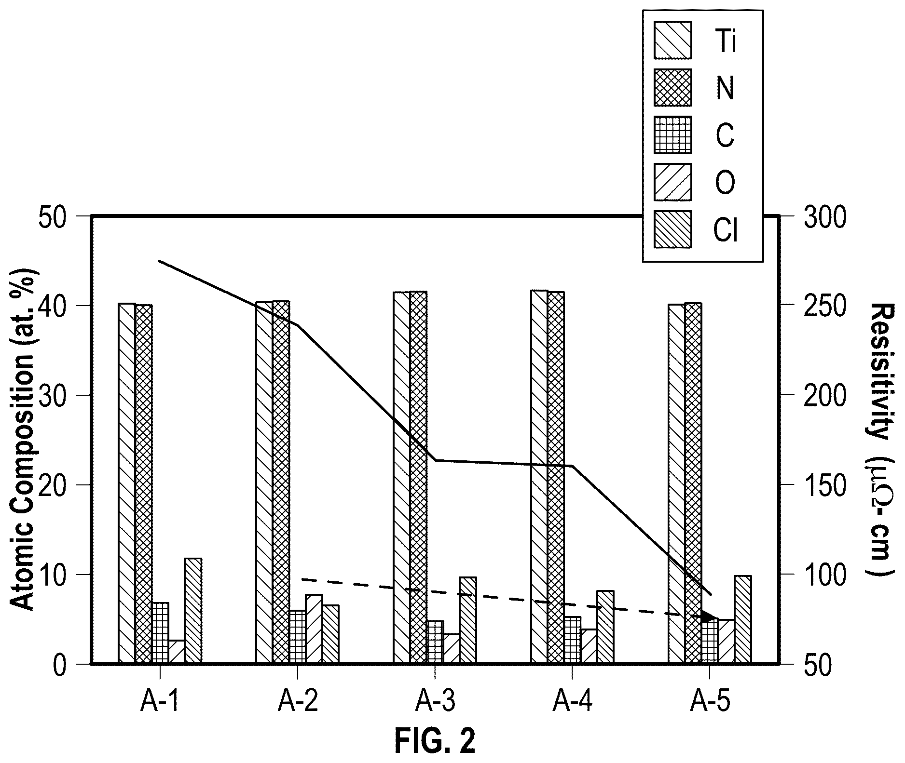
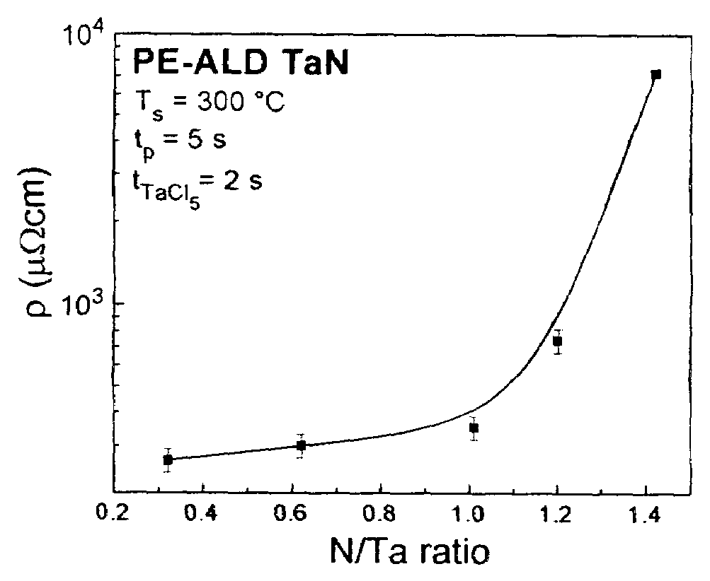
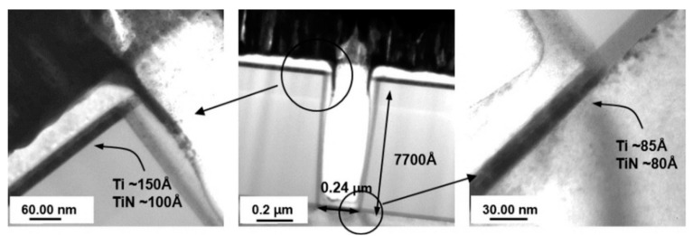
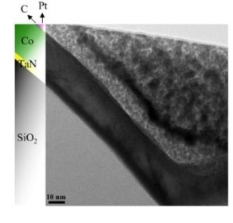

# 03-17 · TiN / WN / TaN 

> 근거 번호 `[S##]`는 `03-17_TiN_WN_TaN_자료수집.md`의 ID다. 논문 전문은 열람하지 못했다.
>
> 근거 표시 — **[논문]** 논문·학회에 보고된 값 · **[특허]** 특허의 주장·실시예 · **[리뷰]** 교과서·기사 수준의 정설 · **[계산]** 가정을 명시한 교육용 계산 · **[현장]** 문헌으로 못 박지 못한 현장 통념. 자기 장비에서 확인이 필요하다.

---

## 0. 요약

TiN, TaN, WN은 전이 금속 질화물이다. 전기가 통하면서 화학적으로 안정하고 치밀해서, 금속과 그 주변 사이에 끼워 넣는 **얇은 도체 막**으로 쓴다. 맡는 일은 Barrier(확산 차단), 접착층, 전극이다. 공통된 설계 과제는 하나다. **가능한 한 얇으면서 연속이고, 막을 만큼 치밀하며, 전류를 방해하지 않을 만큼 저항이 낮아야 한다.** 이 셋이 서로 당긴다.

| 막 | 주 용도 | 주 증착 방식 | 비저항 규모 | 근거 |
|---|---|---|---|---|
| TiN | W의 접착층·Barrier, DRAM Capacitor 전극, Metal Gate, Hardmask | ALD·CVD(TiCl₄ + NH₃), MOCVD(TDMAT) + Plasma 처리, PVD | 86–450 µΩ·cm (조건에 따라) | [S01, S02] |
| TaN | Cu 배선 Barrier(TaN/Ta) | PVD, ALD(PDMAT + NH₃) | PVD 약 240 µΩ·cm. ALD는 수천 µΩ·cm 이상 | [S12, S13] |
| WN · WNₓCᵧ | Cu·W Barrier | ALD(WF₆ + NH₃ + TEB) | 약 350 µΩ·cm | [S16] |

| 핵심 사실 | 내용 |
|---|---|
| TiN의 염소 | 증착 온도가 낮을수록 많이 남고 비저항이 오른다 [S01, S02] |
| TDMAT TiN | 증착 직후는 탄소가 든 막. H₂/N₂ Plasma로 탄소를 빼야 한다 [S06] |
| ALD TaN | NH₃로는 절연상 Ta₃N₅가 된다 [S10] |
| Blanket 비저항 ≠ 소자 저항 | 3 nm ALD TaN이 PVD보다 Via 저항이 28 % 낮았다 [S12] |

---

## 1. 용도와 필요성

질화물 도체 막은 Contact, 배선, 게이트, Capacitor 등 금속이 있는 거의 모든 곳에 쓰인다. 아래 표는 자리마다 어떤 막이 어떤 일을 하는지 정리한 것이다.

| 자리 | 막 | 하는 일 |
|---|---|---|
| W Plug·Word Line의 하부 | Ti/TiN 또는 TiN | W는 산화막에 붙지 않는다. TiN이 접착층. WF₆의 불소가 아래로 가는 것을 막는다(→ 03-16 §6.1). |
| Cu 배선의 측벽과 바닥 | TaN/Ta | Cu가 유전체로 확산하는 것을 막는다. TaN이 유전체 쪽 접착과 Barrier, Ta가 Cu 쪽 접착 [리뷰 S20]. |
| DRAM Capacitor 전극 | TiN | 깊은 구조 안에 Conformal하게 올라가는 도체. High-k와 맞닿는다(→ 03-19). |
| Metal Gate | TiN, TaN 등 | 일함수로 문턱 전압을 정한다. 수 nm 두께와 조성이 곧 소자 특성 [리뷰 S21] |
| DRAM Buried Word Line | TiN (+ W) | 좁은 Trench 안의 전극 |
| Hardmask | PVD TiN | Low-k 식각의 Metal Hardmask(→ 03-10 §6.1) |

Barrier 두께는 세대마다 줄어든다. Cu Barrier 목표가 45 nm 노드 5 nm, 32 nm 노드 3.5 nm였다 [현장 S11]. 지금은 그보다 얇다. **수 nm에서 연속이고 치밀한 막**이라는 요구가 PVD에서 ALD로의 이동을 이끌었다. PVD는 깊은 구조의 측벽과 바닥에 고르게 올리지 못한다.

> 이해 확인: Barrier 두께가 줄어들면서 PVD에서 ALD로 증착 방식이 바뀐 이유는 무엇인가?

---

## 2. 재료

질화물 막의 성능은 조성보다 미세 구조와 불순물이 정하는 경우가 많다. 이 절에서는 질화물이 Barrier가 되는 이유를 먼저 설명하고, TiN에서는 불순물이, TaN에서는 상이, WNₓCᵧ에서는 미세 구조가 어떻게 성질을 정하는지 살펴본다.

### 2.1 금속 질화물의 확산 방지 특성

전이 금속 질화물이 왜 좋은 Barrier가 되는지는 다음 성질들로 설명된다.

| 성질 | 내용 |
|---|---|
| 높은 녹는점과 강한 결합 | 원자가 잘 움직이지 않는다. 다른 원자가 격자를 지나가기 어렵다. |
| 화학적 안정성 | Cu, W, Si와 잘 반응하지 않는다. |
| 전도성 | 금속적 전도. 다만 순금속보다 한두 자릿수 높은 비저항 |
| 미세 구조 | **Barrier의 약점은 격자가 아니라 결정립계다.** 확산은 결정립계를 따라 일어난다. |

이 표의 값은 리뷰와 교과서 수준에서 정리된 것이다 [리뷰]. 그래서 Barrier 성능은 조성보다 미세 구조가 정한다. 기둥 모양 결정립은 막을 관통하는 결정립계가 있어 불리하고, 등축이거나 비정질에 가까운 막이 유리하다. Sputter TiN의 주상 결정립 사이로 WF₆가 지나가 Volcano를 만드는 것이 그 예다(→ 03-16 §6.1).

### 2.2 TiN의 불순물과 비저항

TiN의 비저항은 화학양론 단결정에서 수십 µΩ·cm지만 증착 막은 그보다 훨씬 높다. 차이는 불순물과 결정립계에서 온다.

**TiCl₄ 계: 염소**

| 조건 | 염소 | 비저항 | 근거 |
|---|---|---|---|
| LPCVD 450 °C | 7.2 at% | — | [논문 S01] |
| LPCVD 600 °C, $\mathrm{NH_3/TiCl_4} = 10$ | — | 86 µΩ·cm (최저) | [논문 S01] |
| LPCVD 850 °C | 0.15 at% | — | [논문 S01] |
| ALD 400 °C | 1.5 wt% 미만 | 약 200 µΩ·cm | [특허 S02] |
| ALD 350 °C | 4.0 wt% | 450 µΩ·cm | [특허 S02] |
| 유량 변조 CVD 380 °C | 2 at% | 250 µΩ·cm | [논문 S05] |
| CVD 600 °C + NH₃ 후처리 | 2 at% 미만 | 약 180 µΩ·cm | [논문 S04] |

**온도를 50 °C 낮추면 염소가 2–3배, 비저항이 두 배가 된다** [특허 S02]. 염소는 Ti–Cl 결합으로 남아 네트워크를 끊고 전자를 산란시킨다. 500 °C 아래에서는 Cl이 더 많이 갇힌다 [논문 S03]. 염소는 비저항만의 문제가 아니다. 위에 올리는 금속(Al, Cu)을 부식시키고 High-k 계면으로 확산한다.

*TiCl₄와 N₂H₄(Hydrazine)로 만든 ALD TiN의 조성(막대, 왼쪽 축)과 비저항(선, 오른쪽 축). A-1–A-4는 425 °C에서 N₂H₄ Pulse를 1.2, 2.4, 3.6, 7.2초로 늘린 시료이고 A-5는 500 °C, 3.6초다(TiCl₄ Pulse는 모두 0.3초). 실선과 점선의 구분은 이 그림만으로는 알 수 없다 [특허 S06].*

*출처: US 12,180,583 (Merck Patent, 2024), FIG. 2. 미국 특허 도면. [Google Patents](https://patents.google.com/patent/US12180583B2/en)*

특허는 N₂H₄ Pulse를 1.2초에서 3.6초로 늘리자 산소가 줄며 비저항이 내려갔고, 500 °C에서는 90 µΩ·cm 아래로 내려갔다고 적었다. 질소원이 NH₃가 아니라 N₂H₄라는 점이 이 절의 다른 자료와 다르다.

**금속 유기 계: 탄소와 산소**

TDMAT로 열증착한 막은 TiN이 아니라 Titanium Nitride Carbide다 [특허 S06]. 탄소와 수소가 많고 성기다. 성긴 막은 대기에 나오면 산소를 빨아들여 비저항이 더 오른다 [리뷰 S19]. 그래서 Plasma 처리가 필수다(§3.2).

### 2.3 TaN의 상 제어

Tantalum Nitride에는 조성이 다른 여러 상이 있다. 전도성인 TaN(Ta³⁺)과 절연체인 Ta₃N₅(Ta⁵⁺)가 양 끝이다.

- **NH₃를 쓰는 기상 증착은 절연상 Ta₃N₅가 되기 쉽다.** 전구체의 Ta는 5가다. NH₃의 환원력이 Ta⁵⁺를 Ta³⁺로 내리기에 너무 약하다 [특허 S10].
- 그 결과 ALD TaN의 비저항은 PVD보다 한두 자릿수 높다. Blanket ALD 막 약 5,000 µΩ·cm 대 PVD 약 240 µΩ·cm [논문 S12]. 약 50 mΩ·cm라는 보고도 있다 [논문 S13].
- TaCl₅ 기반 Ta₃N₅는 약 10 nm 아래에서 저항이 너무 커 측정되지 않았다 [논문 S14].
- **조성이 하부막에 따라 달라진다.** N/Ta 비가 SiO₂ 위에서는 약 4/5, Ta 위에서는 약 1/2였다. Ta 위의 Ta-rich 막은 약 2 mΩ·cm로 훨씬 낮다 [논문 S13].
- ALD TaN은 밀도가 낮고 불순물이 많아 같은 두께에서 PVD TaN보다 Barrier 성능이 대체로 떨어진다 [논문 S15].

비저항 값이 출처마다 240 µΩ·cm에서 50 mΩ·cm까지 흩어져 있다. 상, 조성, 두께, 하부막이 모두 다르기 때문이다. **ALD TaN에 대해 “비저항이 얼마”라고 한 숫자로 말할 수 없다.**

*TaCl₅와 H₂/N₂ Plasma로 만든 PE-ALD TaN(300 °C)의 N/Ta 비와 비저항(세로축은 로그). N/Ta가 1 근처까지는 수백 µΩ·cm로 완만하지만 그 위에서 급격히 올라 1.4 부근에서 약 7,000 µΩ·cm에 이른다. 특허는 입방정 TaN이 보통 350–400 µΩ·cm이고, 질소가 많을 때의 높은 비저항은 절연성 Ta₃N₅ 상 때문이라고 설명한다. 같은 TaN이라도 조성에 따라 비저항이 한 자릿수 넘게 달라진다 [특허 S10].*

*출처: US 7,186,446 (IBM, 2007), FIG. 3. 미국 특허 도면. [Google Patents](https://patents.google.com/patent/US7186446B2/en)*

### 2.4 WNₓCᵧ

WF₆ + NH₃에 Triethylboron(TEB)을 환원제로 더한 ALD 막이다 [논문 S16].

| 항목 | 값 |
|---|---|
| 증착 온도 | 275–325 °C |
| 조성 | W 48, C 32, N 20 at% |
| 불순물 | O·F·B 각 0.5 at% 미만, H 4 at% 미만 |
| 비저항 | 약 350 µΩ·cm |
| 밀도 | 15.37 g/cm³ |
| 구조 | 면심 입방, 등축 미세 구조 |
| 단차 피복 | 종횡비 40 : 1에서 90 % 초과 |
| Barrier (12 nm, Cu/Si 사이) | 700 °C 30분에서 파괴. Sputter Ta 650 °C, ALD TiN 600 °C |

낮은 비저항은 Tungsten Carbide 성분에서 온다. Barrier 성능은 **등축 미세 구조와 높은 밀도** 덕으로 설명된다 [논문 S16]. §2.1의 원리, 즉 Barrier는 결정립계 구조가 정한다는 것의 실례다. 같은 두께에서 주상 구조의 ALD TiN보다 100 °C 더 버텼다.

> 이해 확인: 같은 TiN이라도 TiCl₄ 계와 TDMAT 계에서 비저항을 올리는 불순물은 각각 무엇인가?

---

## 3. 전구체와 반응

질화물 막은 할로겐화물 원료나 금속 유기 원료로 만든다. 원료에 따라 막에 남는 불순물이 다르고, 이를 없애는 방법도 다르다. 이 절에서는 TiCl₄ + NH₃, TDMAT + Plasma, PDMAT + NH₃, 그리고 WF₆ + NH₃ + TEB의 네 가지 공정을 설명한다.

### 3.1 TiCl₄ + NH₃

$$
6\,\mathrm{TiCl_4} + 8\,\mathrm{NH_3} \rightarrow 6\,\mathrm{TiN} + 24\,\mathrm{HCl} + \mathrm{N_2}
\mathrm{HCl} + \mathrm{NH_3} \rightarrow \mathrm{NH_4Cl}\ (\text{고체, 약 340 °C 아래})
$$

위 반응식은 리뷰 수준의 정리이다 [리뷰 S18]. ALD로는 TiCl₄와 NH₃를 번갈아 넣는다.

| 특징 | 내용 | 근거 |
|---|---|---|
| 성장이 느리다 | Cycle당 약 0.17–0.2 Å. 큰 Cl이 표면을 가려 한 Cycle에 단층의 일부만 붙는다. | [특허 S02, 논문 S03] |
| 온도가 높아야 막질이 좋다 | Cl을 떼어내는 반응이 온도에 의존(§2.2) | [논문 S01] |
| 단차 피복이 좋다 | 종횡비 6에서 95 % 초과(CVD) | [논문 S04] |
| 탄소가 없다 | 전구체에 탄소가 없다. | |
| 부산물 | HCl(부식성), NH₄Cl(고체) | [리뷰 S18] |

느린 성장을 보완하는 방법이 Pulsed CVD다. TiCl₄와 NH₃를 함께 흘려 CVD로 증착한 뒤, NH₃만 흘려 표면의 Cl을 정리하는 단계를 반복한다. 350–500 °C에서 조사됐다 [논문 S03]. 증착 후 NH₃ 처리로 잔류 염소를 HCl로 빼내는 것도 같은 원리다 [특허 S05].

### 3.2 TDMAT + Plasma 처리

TDMAT Ti[N(CH₃)₂]₄는 Ti–N 결합을 이미 갖고 있어 300–400 °C대에서 열분해만으로 막이 된다. 염소가 없고 저온이라는 장점이 있지만, Ligand의 탄소가 막에 남는다 [특허 S06].

1. 열증착: 얇은 층(약 15 Å)을 올린다. 탄소와 수소가 많은 성긴 막이다.
2. H₂/N₂ Plasma 처리(10–20초): 탄소를 제거하고 질화하며 치밀하게 만든다.
3. 1과 2를 반복해 목표 두께까지 쌓는다.

위 순서는 특허에 공개된 공정이다 [특허 S06, S07]. Plasma 처리의 효과는 탄소·산소·수소 불순물 감소, 비저항 감소, 결정립 성장, 치밀화다 [특허 S07].

- **수소의 역할.** 활성 수소가 금속–Ligand 결합을 공격해 Ligand를 떼어낸다 [논문 S09]. H₂를 넣은 Plasma로 만든 막이 탄소가 적고 비저항이 낮다. N 라디칼만으로는 탄화수소가 훨씬 많이 남는다 [논문 S08].
- **얇게 나눠 처리하는 이유.** Plasma는 표면 수 nm까지만 닿는다. 두껍게 증착한 뒤 처리하면 속이 그대로 남는다.
- **측벽 문제.** Plasma 이온은 수직으로 내려온다. 깊은 구조의 측벽은 처리가 덜 된다. 측벽 막이 탄소가 많고 성기며 저항이 높다 [현장].
- **Power의 최적점.** 낮은 Power(40 W)에서는 결정성이 높고 거칠며 저저항, 높은 Power(80 W)에서는 결정성이 낮고 매끄러우며 고저항이었다는 보고가 있다 [논문 S08]. 세게 한다고 좋아지지 않는다.

### 3.3 PDMAT + NH₃ (TaN)

PDMAT Ta[N(CH₃)₂]₅ Pulse와 NH₃를 번갈아 넣는다 [현장 S11].

- 금속 유기 전구체를 쓰는 이유: Halide(TaCl₅ 등)는 집적 문제를 일으킨다. PDMAT의 부피 큰 Ligand는 다공성 Low-k 속으로의 침투를 줄인다 [특허 S10]. PDMAT는 고체라 승화 공급의 안정성이 관리 항목이다 [현장].
- NH₃만으로는 Ta를 환원하지 못해 N-rich 절연상이 된다(§2.3). N-rich 막은 Barrier로는 유리하다 [특허 S10].
- 전도성을 얻으려면 환원이 필요하다. 약한 Ar Plasma 처리로 조성비가 1.6에서 1.1로 내려가 전도성 TaN이 됐다는 보고가 있다 [특허 S10]. Plasma ALD(H₂ Plasma)도 같은 목적이다.

### 3.4 WF₆ + NH₃ + TEB (WNₓCᵧ)

WF₆와 NH₃만으로는 저항이 높은 질화물이 된다. TEB가 환원제로 들어가 탄소를 함께 넣는다. 금속 단계 뒤 표면은 불소로, 질소 단계 뒤는 N과 NHₓ로 종결돼 자기 제한 성장이 된다. TEB의 표면 반응 기구는 밝혀지지 않았다고 저자들이 적고 있다 [논문 S16].

> 이해 확인: TDMAT TiN을 두껍게 증착한 뒤 한 번에 Plasma 처리하면 어떤 문제가 생기는가? 깊은 구조의 측벽에서는 어떤 문제가 더 생기는가?

---

## 4. Process Window와 공정 변수별 응답

이 절에서는 막과 원료별로 조절 변수가 불순물, 비저항, 단차 피복에 어떤 영향을 주는지 정리한다.

### 4.1 TiCl₄ 계 TiN

TiCl₄ 계 TiN에서는 온도와 NH₃ 노출이 염소와 비저항을 정한다.

| 조절 변수 ↑ | 염소 | 비저항 | 단차 피복 | 주의 |
|---|---|---|---|---|
| 온도 | ↓↓ | ↓↓ | CVD 성분이 늘면 ↓ | 하부 소자의 열 예산 |
| NH₃ 노출 (분압·시간) | ↓ | ↓ | — | 화학양론에 접근 [S01] |
| NH₃ 후처리 | ↓ | ↓ | — | [S04, S05] |
| TiCl₄ 노출 | — | — | 포화되면 영향 없음 | 과하면 하부 식각(TiCl₄는 일부 막을 깎는다) |
| Purge 시간 | — | — | ↑ | 부족하면 기상 반응 → NH₄Cl Particle |

### 4.2 TDMAT 계 TiN

TDMAT 계 TiN에서는 Plasma 처리 조건이 탄소와 비저항을 정한다.

| 조절 변수 ↑ | 탄소 | 비저항 | 주의 |
|---|---|---|---|
| Plasma 처리 시간 | ↓ | ↓ 후 포화 | 하부 손상, 생산성 |
| Plasma Power | ↓ | 최적점 존재 [S08] | 하부 Low-k·게이트 손상 |
| H₂ 비율 | ↓ | ↓ | [S08, S09] |
| 한 층의 두께 | 속의 탄소 ↑ | ↑ | 얇게 나눠야 한다. Cycle 수 증가 |
| 증착 온도 | ↑ (분해가 빨라져 CVD 성분 증가) | — | 단차 피복 ↓ |

### 4.3 ALD TaN · WNₓCᵧ

ALD TaN과 WNₓCᵧ에서는 환원 단계와 하부막이 조성과 저항을 정한다.

| 공정 변수 | 영향 | 근거 |
|---|---|---|
| 환원 수단 (Plasma, 환원제) | 절연상 → 전도상. 비저항 수 자릿수 변화 | [S10] |
| 두께 | 얇을수록 연속성 한계. 두꺼울수록 Via 저항 급증 | [S13] |
| 하부막 | 조성과 핵생성이 달라진다. | [S13] |
| 온도 (WNₓCᵧ) | 275–325 °C 창 | [S16] |

> 이해 확인: TiCl₄ 계 TiN의 증착 온도를 낮추어 열 예산을 줄이려 할 때 무엇이 나빠지며, 이를 보완하는 방법은 무엇인가?

---

## 5. 계산 [계산]

Barrier가 배선 저항에 얼마나 영향을 주는지 숫자로 확인해 보자. 이 절에서는 Via 바닥의 Barrier가 만드는 저항과, 측벽 Barrier가 금속이 차지할 폭을 얼마나 줄이는지 계산한다.

### 5.1 Via 바닥 Barrier의 저항 계산

Barrier가 저항에 얼마나 영향을 주는지 계산해 보자. Via 바닥에서는 전류가 Barrier를 두께 방향으로 뚫고 지나간다.

$$
R = \frac{\rho\, t}{A}
$$

| Barrier | 비저항 | Via 20 × 20 nm, 2 nm | Via 12 × 12 nm, 2 nm |
|---|---|---|---|
| ALD TiN | 200 µΩ·cm | 10 Ω | 28 Ω |
| PVD TaN | 240 µΩ·cm | 12 Ω | 33 Ω |
| ALD WNₓCᵧ | 350 µΩ·cm | 18 Ω | 49 Ω |
| ALD TaN | 5,000 µΩ·cm | 250 Ω | 694 Ω |
| ALD TaN (고저항 보고) | 50 mΩ·cm | 2,500 Ω | 6,944 Ω |

이 계산에서 세 가지를 읽을 수 있다.

1. **Via가 작아질수록 Barrier 저항이 면적에 반비례해 커진다.** 20 nm에서 12 nm로 줄면 2.8배다.
2. 비저항이 높은 Barrier는 수 nm만으로도 Via 저항 전체를 지배한다. ALD-TaN에서 두께가 1 nm에서 2 nm로 늘 때 Via 저항이 급증했다는 보고와 맞는다 [논문 S13].
3. **그런데 이 계산은 실제를 다 설명하지 못한다.** Blanket 비저항이 20배 높은 3 nm ALD TaN이 PVD TaN보다 Via 저항이 28 % 낮았다 [논문 S12]. ALD 막이 Via 바닥에서 더 얇고 고르게 올라가고, 계면이 깨끗했기 때문으로 해석된다. Via 저항에는 Barrier 벌크 저항 외에 **계면 저항과 실제 바닥 두께**가 들어간다.

### 5.2 측벽 Barrier에 의한 도체 단면적 감소

선폭 w인 배선에서 양쪽 측벽의 Barrier 두께 b만큼 저저항 금속이 줄어든다(→ 03-16 §5.2, 03-18 §5).

| 선폭 | Barrier 2 nm × 양쪽 | 금속이 차지하는 폭 |
|---|---|---|
| 30 nm | 4 nm | 87 % |
| 20 nm | 4 nm | 80 % |
| 12 nm | 4 nm | 67 % |
| 8 nm | 4 nm | 50 % |

Barrier를 1 nm 줄이는 것이 금속 비저항을 개선하는 것보다 효과가 크다. Barrier 연구의 방향이 “더 좋은 Barrier”에서 “더 얇은 Barrier”, 다시 “Barrier가 필요 없는 금속”(→ 03-18)으로 간 이유다.

> 이해 확인: 비저항 300 µΩ·cm, 두께 2 nm인 Barrier가 20 × 20 nm Via 바닥에서 만드는 저항은 대략 얼마인가?

---

## 6. 집적 이슈와 불량 모드

얇은 질화물 막은 연속성, 측벽 막질, 불순물, 산화, 접착, 일함수에서 문제가 생긴다. 이 절에서는 이 문제들을 차례로 살펴본다.

### 6.1 얇은 막의 연속성

ALD라도 처음 수 Cycle은 섬으로 자란다. 연속 막이 되는 두께 아래에서는 구멍이 있다. 구멍은 곧 확산 경로다. 핵생성은 하부 표면에 달려 있다.

- 하부막에 따라 핵생성 밀도가 다르다. 유전체 위, 금속 위, 다공성 Low-k 위가 모두 다르다.
- TaN은 조성 자체가 하부막에 따라 달라진다 [논문 S13].
- 다공성 Low-k 위에서는 전구체가 기공으로 들어간다(→ 03-10 §6.3). 부피 큰 Ligand의 전구체가 유리하다 [특허 S10].

**Barrier의 사양은 “평균 두께”가 아니라 “가장 얇은 곳의 두께”** 다.

### 6.2 측벽과 바닥의 막질 차이

Barrier는 깊은 구조의 측벽과 바닥에서 가장 약하다. 증착 방식마다 측벽에서 생기는 문제가 다르다.

| 방식 | 측벽의 문제 |
|---|---|
| PVD | 측벽과 바닥 모서리가 얇다. Overhang |
| MOCVD + Plasma 처리 | 측벽이 처리가 덜 돼 탄소가 많고 성기다(§3.2). |
| Plasma ALD | 이온이 닿는 수평면과 닿지 않는 측벽의 조성·밀도 차이 |
| 열 ALD | 가장 균일. 대신 온도가 높아야 막질이 나온다. |

Barrier가 뚫리는 곳은 대개 측벽 아래쪽과 바닥 모서리다.

PVD와 CVD의 차이를 한 구멍 안에서 비교한 TEM이 있다 [논문 S23].

*바닥 폭 0.24 µm, 깊이 약 7,700 Å(종횡비 약 3.2)의 Contact에 IMP(이온화 PVD) Ti 150 Å과 CVD TiN 100 Å(50 Å × 2)을 차례로 올린 단면 TEM. 가운데가 전체, 왼쪽이 입구 모서리, 오른쪽이 바닥 모서리 확대이다. 입구는 Ti 약 150 Å, TiN 약 100 Å이고 바닥은 Ti 약 85 Å, TiN 약 80 Å이다. 바닥 피복률로 환산하면 PVD Ti 약 57 %, CVD TiN 약 80 %이다.*

*출처: Cui 등, Micromachines 11(1), 32 (2020), Figure 2. CC BY 4.0. [PMC](https://pmc.ncbi.nlm.nih.gov/articles/PMC7019522/)*

PVD는 원자가 직진하므로 깊은 곳일수록 덜 쌓인다. CVD는 기체 분자가 바닥까지 들어가 표면 반응으로 쌓이므로 차이가 작다. 이 Contact의 종횡비는 3.2에 불과하다. 종횡비가 10을 넘는 구조에서는 이 차이가 훨씬 커지고, ALD가 필요해진다.

ALD TaN이 깊은 구멍의 측벽을 실제로 어떻게 덮는지도 보자 [논문 S24].

*깊은 TSV(Through-Silicon Via) 측벽 아래쪽의 단면 TEM. 왼쪽 띠는 층 순서를 표시한다. SiO₂(절연층) 위에 ALD TaN(Cu 확산 Barrier), 그 위에 Co 막이 있고, 맨 위는 TEM 시편 보호용 C·Pt이다. 막들이 측벽 아래쪽의 굽은 면을 따라 끊기지 않고 이어진다(눈금 10 nm). 막은 Applied Materials Endura에서 진공을 깨지 않고 연속 증착했다.*

*출처: Kia 등, Nanomaterials 9(7), 1035 (2019), Figure 5(b). CC BY 4.0. [PMC](https://pmc.ncbi.nlm.nih.gov/articles/PMC6669757/)*

### 6.3 염소

TiCl₄ 계 TiN의 잔류 염소는 다음을 일으킨다 [리뷰·현장].

- 위에 올린 Al·Cu의 부식
- 수분과 만나 HCl 생성
- High-k 유전체와 게이트 산화막으로의 확산 → 누설, 신뢰성
- 저온 공정일수록 심하다(§2.2). 열 예산을 줄이려는 방향과 충돌한다.

### 6.4 산화

TiN은 대기에 나오면 표면이 산화되고 결정립계를 따라 산소가 들어간다. 성긴 막일수록 심하다 [리뷰 S19].

- 비저항 상승, 접촉 저항 상승
- W 증착 전 TiN 표면 상태가 핵생성을 바꾼다. TiN → W 사이의 Q-time이 관리 항목이다.
- DRAM Capacitor에서는 TiN 전극 위에 O₃로 High-k를 ALD할 때 TiN 표면이 산화돼 TiOₓNᵧ 계면층이 생긴다. 이 층이 유효 유전율을 깎고 누설에 관여한다(→ 03-19 §6).

### 6.5 접착과 응력

- TaN/Ta에서 Ta가 Cu를 붙잡는다. ALD TaN만으로는 Cu 접착이 약해 그 위에 금속 Liner(Ta, Co, Ru)가 필요하다 [리뷰 S20].
- TiN은 압축 응력이 클 수 있다. 얇은 벽 사이를 채우는 구조에서 변형을 일으킨다.
- B₂H₆ 핵생성 W와 TiN 계면의 붕소 침투(→ 03-16 §6.4)

### 6.6 일함수 변동 (Metal Gate)

Metal Gate의 TiN은 두께, 조성(N/Ti, 산소, 탄소, 염소), 결정성에 따라 일함수가 변한다 [리뷰 S21]. 수 Å의 두께 차이, 대기 노출에 의한 산소 흡수가 문턱 전압을 움직인다. 이 용도에서는 **ALD Cycle 한 번이 소자 특성**이다.

> 이해 확인: TiN 위에 W를 증착하기 전 Q-time이 길어지면 어떤 문제가 생길 수 있는가?

---

## 7. 챔버 · 하드웨어 관리

질화물 공정은 원료에 따라 부산물과 공급 관리의 주의점이 다르다. 아래 표는 Chamber와 하드웨어 관리의 주요 항목을 정리한 것이다.

| 항목 | 내용 |
|---|---|
| NH₄Cl | TiCl₄·TaCl₅ 등 Chloride + NH₃ 공정의 부산물. 약 340 °C 아래에서 고체. 배기 라인, 밸브, Pump, Chamber의 찬 면에 쌓인다. 배기계 가열과 Trap. 떨어져 나오면 Particle [리뷰 S18] |
| 저온 부가물 | TiCl₄와 NH₃가 낮은 온도에서 만나면 고체 부가물을 만든다. Showerhead와 가스 혼합 지점의 온도 관리, 두 가스의 분리 공급 [리뷰 S18] |
| HCl 부식 | 배기계와 Chamber 금속 부품 |
| TiCl₄ 공급 | 액체(끓는점 약 136 °C). 수분과 격렬히 반응해 TiO₂ 분말과 HCl. 배관 Leak가 곧 막힘과 부식 |
| 고체 전구체 (PDMAT 등) | 승화 공급. 용기 안 고체의 표면적이 줄며 공급량이 Drift한다. 농도 Monitor [현장] |
| TDMAT | 열에 약하다. 용기와 배관에서 분해하면 Particle과 공급 저하 |
| Plasma 처리의 벽 영향 | 벽에 쌓인 탄소 함유 막이 Plasma 조건을 바꾼다. |
| Clean | TiN은 NF₃·Cl 계로 제거. 누적 막의 박리 전 Clean |
| Purge | ALD의 Purge가 부족하면 기상 반응. 깊은 구조일수록 긴 Purge가 필요해 생산성과 충돌 |

---

## 8. 계측과 해석

수 nm 두께의 질화물 막은 두께, 조성, 불순물, 연속성을 측정하기가 어렵다. 아래 표는 각 계측이 무엇을 알려 주고 어떤 함정이 있는지 정리한 것이다.

| 계측 | 얻는 것 | 읽는 법과 함정 |
|---|---|---|
| 면저항 | 두께 × 비저항 | 수 nm 막은 표면 산화층의 영향이 크다. 측정까지의 대기 시간을 일정하게 |
| XRR | 두께, 밀도, 거칠기 | 초박막 두께의 기준 계측. **밀도가 Barrier 성능의 가장 좋은 대리 지표** |
| XRF | 금속 원자의 면적당 양 | 두께가 아니라 “원자 수”를 본다. 밀도 변화와 구별 |
| XPS | 조성, 결합 상태, 불순물(Cl, C, O) | 표면 산화층과 속을 구분해 읽는다. TaN의 Ta 4f 위치로 Ta⁵⁺(절연상)와 Ta³⁺ 구별 |
| SIMS | Cl·C·O·F 깊이 분포 | 계면 축적 |
| XRD | 상, 결정립, 집합 조직 | 초박막은 신호가 약하다. |
| TEM | 측벽·바닥의 실제 두께, 연속성 | 가장 얇은 곳을 찾는다. |
| Barrier 시험 | 파괴 온도, 누설 | Cu/Barrier/Si를 열처리해 Silicide 생성 온도를 본다 [논문 S16]. BTS |
| 전기 측정 | Via 저항, Contact 저항 | Blanket 비저항과 다르다(§5.1). 최종 판정 |
| C–V | 일함수 | Metal Gate |

> 이해 확인: 수 nm Barrier가 연속인지 확인하려면 어떤 방법을 쓸 수 있으며, 평균 두께만 재면 어떤 위험이 있는가?

---

## 9. 파생 막과 차세대 기술

배선이 미세해지면서 Barrier는 더 얇아져야 하고, 결국 Barrier가 필요 없는 금속으로 가는 방향도 나타났다. 아래 표는 그 방향을 정리한 것이다.

| 방향 | 내용 | 근거 |
|---|---|---|
| 더 얇은 Barrier | 2 nm 이하. 연속성과 조성 제어가 한계 | [S13] |
| 저온 고품질 TiN | 염소·탄소 없는 전구체, 강한 환원제, Plasma. 낮은 온도에서 낮은 비저항 | [S03, S05] |
| 등축·비정질 Barrier | 결정립계를 끊는다. WNₓCᵧ의 등축 구조, 적층(Nanolaminate) | [S16] |
| 금속 Liner | Ta 대신 Co, Ru로 Cu 접착과 채움 개선 | → 03-18 |
| Barrier 없는 금속 | Mo, Ru는 유전체로 확산하지 않아 Barrier가 필요 없다. | → 03-18 |
| 자기 형성 Barrier | Cu에 Mn을 넣어 열처리 중 계면에 Barrier가 생기게 한다. | → 03-12 [S01] |
| 영역 선택 증착 | Via 바닥(금속 위)에는 Barrier를 올리지 않고 측벽(유전체 위)에만 | [리뷰] |

방향은 일관된다. **Barrier가 차지하는 부피와 저항을 0에 가깝게.**

> 이해 확인: Barrier를 1 nm 줄이는 것이 금속의 비저항을 개선하는 것보다 효과가 클 수 있는 이유는 무엇인가?

---

## 10. Troubleshooting

아래 표는 질화물 Barrier 공정에서 흔히 나타나는 증상과 유력한 원인, 확인할 데이터, 조치 방향을 정리한 것이다. 표의 원인은 현장 경험에서 나온 출발점이므로 [현장], “확인할 데이터” 열로 가설을 좁힌 뒤에 조치해야 한다.

| 증상 | 유력 원인 | 확인할 데이터 | 조치 방향 |
|---|---|---|---|
| TiN 비저항 상승 | 염소 증가(온도 저하), 산소 혼입, 탄소(Plasma 처리 부족) | SIMS·XPS, 온도·Plasma 이력 | 온도 복귀, NH₃ 노출·후처리, Plasma 조건 |
| W Volcano | TiN 결함, 연속성 부족 | Defect 위치, TiN 두께·방식 | → 03-16 §6.1 |
| Contact·Via 저항 상승 | TiN 표면 산화, Barrier 과두께, 절연상 | Q-time, 두께, XPS | Q-time, 두께, 환원 처리 |
| Cu 확산 불량 (BTS, 누설) | Barrier 불연속, 측벽 얇음 | TEM 측벽·바닥 두께 | Cycle 수, 핵생성 조건, 하부 표면 처리 |
| Particle (Chloride 공정) | NH₄Cl, 저온 부가물 | 입자 성분, 배기·Showerhead 온도 | 가열, Purge, 가스 분리 |
| 두께 Drift (고체 전구체) | 승화 공급 저하 | 공급 농도 이력 | 용기 교체 기준, 농도 제어 |
| 측벽만 고저항·성김 (MOCVD) | Plasma 처리가 측벽에 못 미침 | TEM·EELS 측벽 조성 | 열 ALD로 변경, 처리 조건 |
| 금속 부식 | 잔류 염소 | SIMS Cl | 온도·NH₃ 처리 |
| 문턱 전압 변동 (Metal Gate) | 두께·조성·산소 변동 | XRF, XPS, Q-time | Cycle 제어, In-situ Cap |
| Capacitor EOT 상승 | TiN 전극 계면 산화 | TEM 계면층 | 산화제·초기 Cycle 조건(→ 03-19) |

> 이해 확인: Metal Gate의 문턱 전압이 Lot마다 흔들린다. TiN 공정에서 어떤 변수를 먼저 확인해야 하는가?

---

## 11. 자가 점검

이 장의 핵심 내용을 질문으로 확인해 보자.

**Q1. Barrier 성능을 조성보다 미세 구조가 정한다는 말의 뜻은?**
확산이 격자가 아니라 결정립계를 따라 일어난다. 막을 관통하는 주상 결정립계가 있으면 뚫리고, 등축이거나 비정질에 가까우면 버틴다.

**Q2. TiCl₄ 계 TiN의 증착 온도를 400 °C에서 350 °C로 낮추면?**
염소가 1.5 wt% 미만에서 4.0 wt%로 늘고 비저항이 약 200에서 450 µΩ·cm로 오른다.

**Q3. TDMAT TiN을 얇게 증착하고 Plasma 처리하는 것을 반복하는 이유는?**
열증착 막은 탄소가 많다. Plasma는 표면 수 nm까지만 작용하므로 얇게 나눠 처리해야 속까지 탄소가 빠진다.

**Q4. NH₃를 쓰는 ALD TaN이 저항이 높은 이유는?**
전구체의 Ta가 5가인데 NH₃의 환원력이 약해 절연상 Ta₃N₅가 된다.

**Q5. 비저항 5,000 µΩ·cm, 두께 2 nm인 Barrier가 12 × 12 nm Via 바닥에서 만드는 저항은?**
약 694 Ω.

**Q6. Blanket 비저항이 높은 ALD TaN이 PVD TaN보다 Via 저항이 낮게 나올 수 있는 이유는?**
Via 저항에는 Barrier 벌크 저항 외에 계면 저항과 바닥의 실제 두께가 들어간다. ALD 막이 바닥에서 더 얇고 고르며 계면이 깨끗할 수 있다.

**Q7. WNₓCᵧ가 같은 두께의 ALD TiN보다 Barrier로 100 °C 더 버틴 이유로 제시된 것은?**
등축 미세 구조와 높은 밀도다.

**Q8. Chloride + NH₃ 공정에서 배기계를 가열하는 이유는?**
부산물 NH₄Cl이 약 340 °C 아래에서 고체로 석출해 배기 라인과 Pump를 막고 Particle이 된다.

---

## 12. 참고 문헌

- [S01] NJIT, LPCVD TiN — 온도와 염소, 최저 비저항
- [S02] ALD TiN 특허 — 400·350 °C의 염소와 비저항
- [S03] Pulsed CVD TiN — ALD의 낮은 성장, 500 °C 아래의 Cl
- [S04] MRS Proc. — CVD와 ALD TiN 비교
- [S06, S07] TDMAT TiN 특허 — H₂/N₂ Plasma 처리
- [S08] POSTECH — Remote Plasma MOCVD, 수소와 Power의 영향
- [S10] US 7,928,006 등 — Ta₃N₅ 상과 환원
- [S12, S13] ECS 초록 — ALD TaN의 비저항과 Via 저항
- [S16] ALD WNₓCᵧ — 조성·구조·Barrier 성능
- [S23] Cui 등, *Micromachines* 11, 32 (2020) — Contact의 PVD Ti·CVD TiN 바닥 피복 단면 TEM(그림 출처)
- [S24] Kia 등, *Nanomaterials* 9, 1035 (2019) — TSV 측벽의 ALD TaN 단면 TEM(그림 출처)
