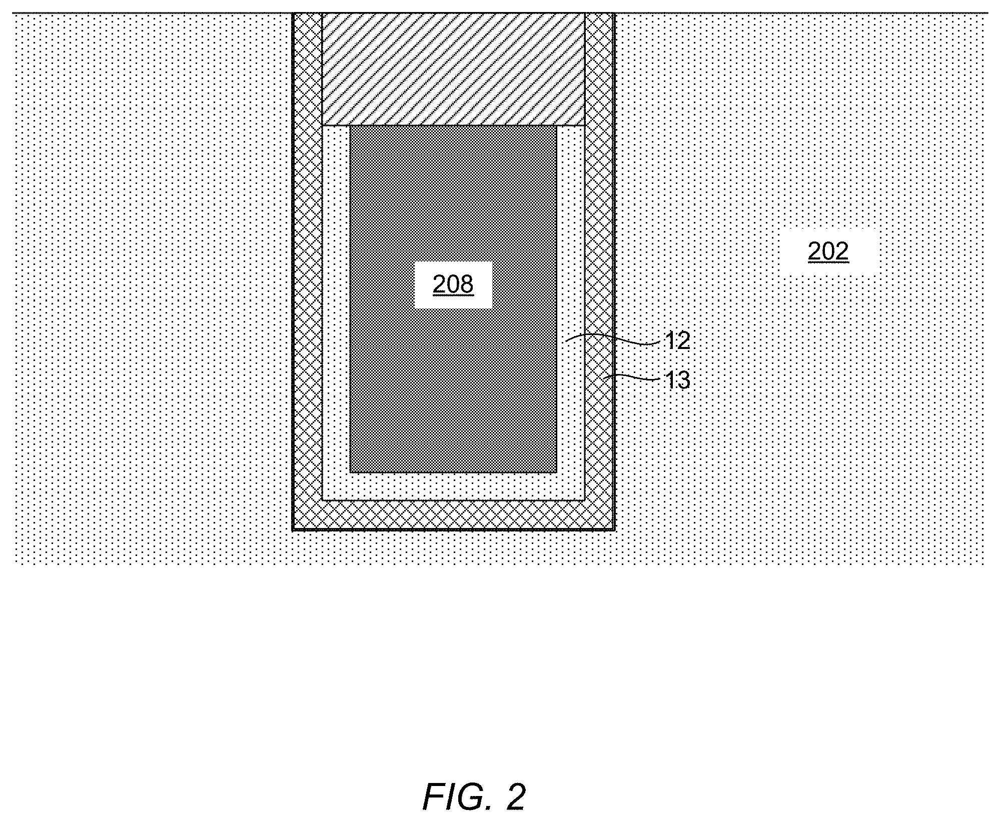
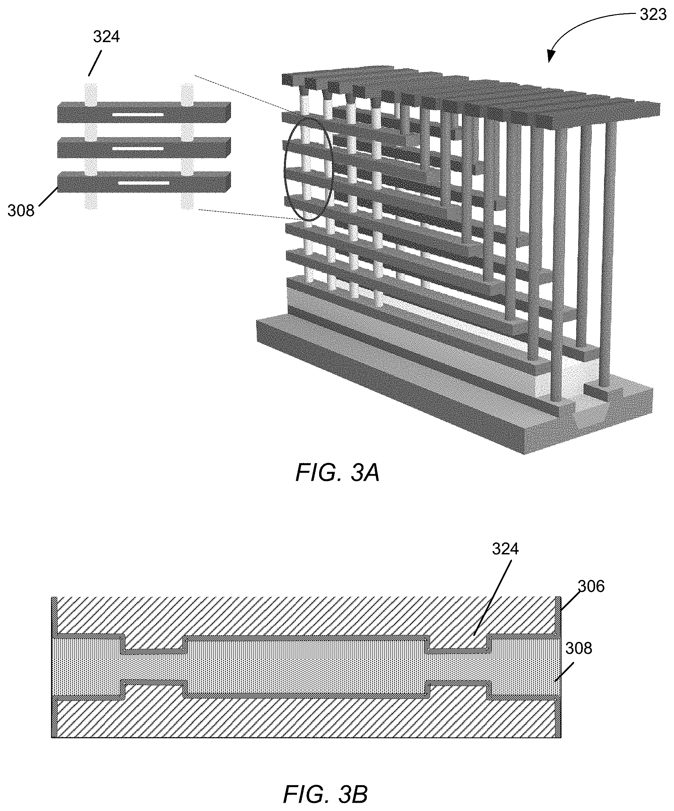
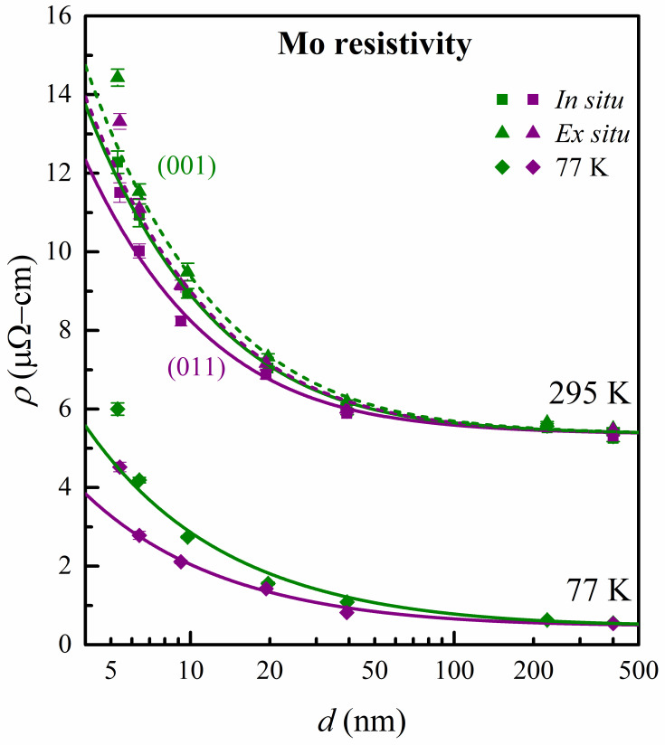
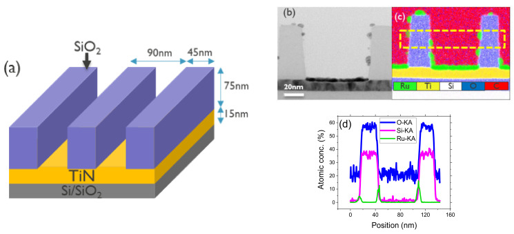
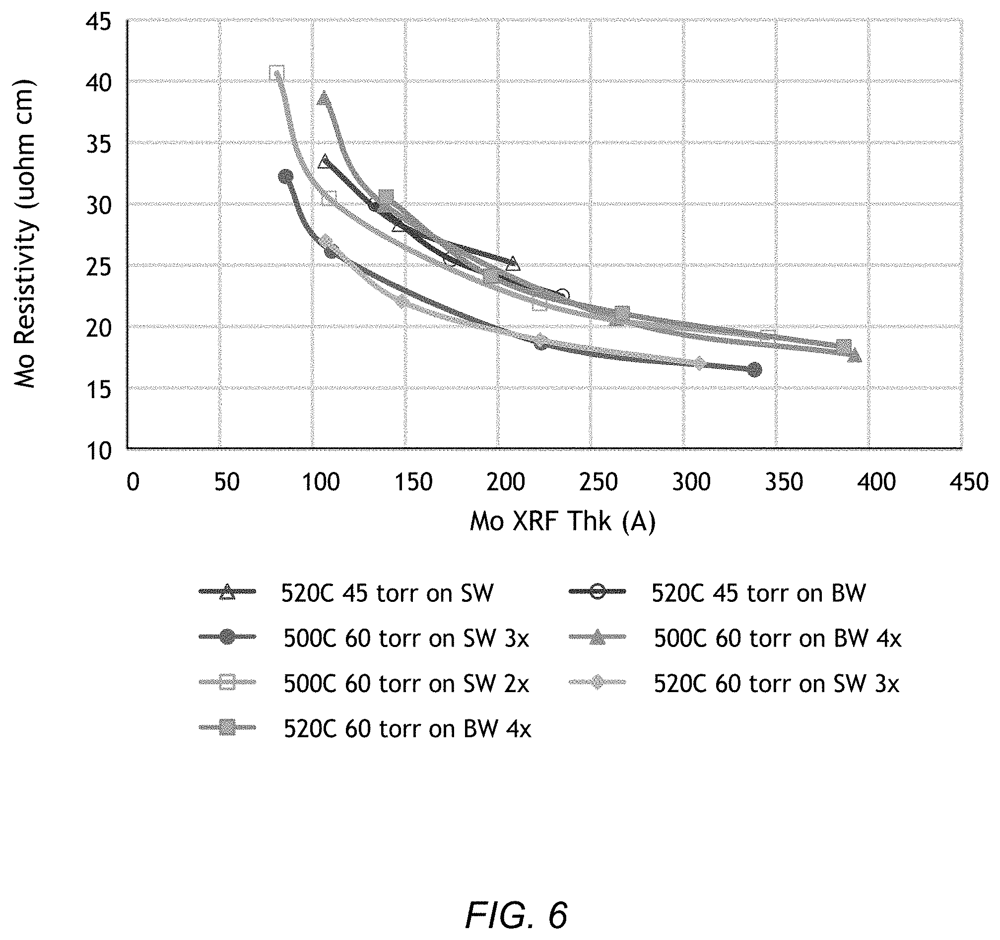
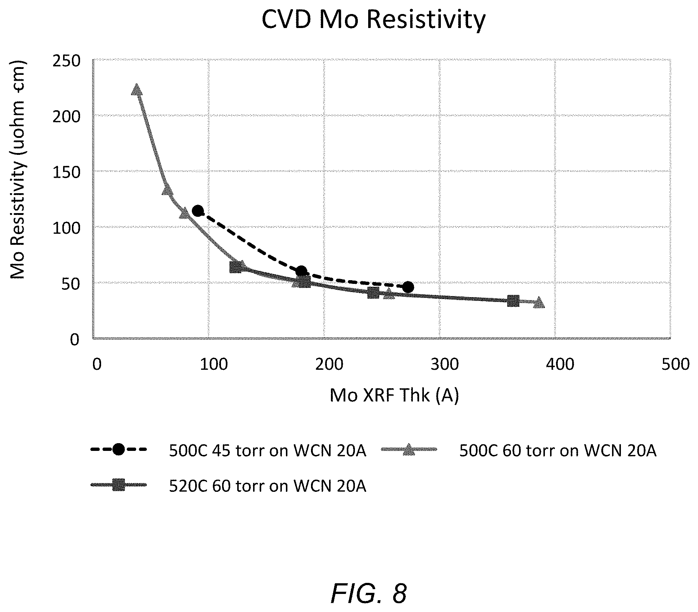
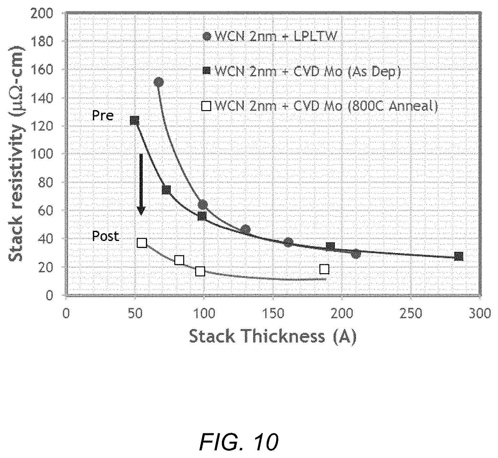

# 03-18 · Mo / Ru & Advanced Metals 

> 근거 번호 `[S##]`는 `03-18_Mo_Ru_자료수집.md`의 ID다. 논문 전문은 열람하지 못했다.
>
> **이 장은 공개 근거가 적다.** 금속별 ρ₀λ 값은 CC BY 논문으로 대조했으나 개별 ρ₀·λ 값의 일부는 1차 문헌으로 확인하지 않은 대표값이고, Mo의 공정 자료는 장비사·재료사 발표와 특허가 대부분이다. 근거 표시 — **[논문]** 논문·학회에 보고된 값 · **[특허]** 특허의 주장·실시예 · **[발표]** 장비사·연구소·재료사의 발표(자기 주장) · **[리뷰]** 교과서 수준의 정설 또는 기억 기반 값 · **[계산]** 가정을 명시한 교육용 계산 · **[현장]** 문헌으로 못 박지 못한 현장 통념.

---

## 0. 요약

Cu와 W는 Bulk 비저항으로 고른 금속이다. 배선 폭이 10 nm대로 내려오자 기준이 바뀌었다. **가는 선에서는 Bulk 비저항이 낮은 금속보다, 얇아져도 비저항이 덜 오르고 Barrier 없이 쓸 수 있는 금속이 유리하다.** Mo와 Ru가 그 후보다.

| 항목 | Mo | Ru |
|---|---|---|
| 대체 대상 | W (Word Line, Contact, 국부 배선) | Cu·W·Co (최하층 배선, Via, Contact) |
| Bulk 비저항 | 약 5.3 µΩ·cm [리뷰 S02]. 두께 400 nm 에피택시 막 5.25 µΩ·cm [논문 S22] | 약 7.1–7.8 µΩ·cm [현장 S10, 리뷰 S02] |
| 평균 자유 행로 | 약 11 nm [리뷰 S02] | 6.7 ± 0.3 nm [논문 S03] |
| 강점 | W보다 가는 선에서 저저항. 무불소 전구체 가능 [현장 S07] | Barrier 없이 가능. 직접 식각 가능. 선폭 12 nm 아래에서 이득 [현장 S10] |
| 전구체 | MoO₂Cl₂, MoCl₅ + H₂ [현장 S07, 리뷰 S16] | Ru(EtCp)₂, 0가 Diene 계 등 + O₂ [논문 S11, S12] |
| 대표 문제 | 산화되기 쉽다. 하부막·핵생성 | 산화막 위 핵생성과 접착 [논문 S13] |
| 현황 | Mo ALD 양산 장비 발표(2025). 3D NAND에서 초기 채택 [현장 S06] | 16–18 nm Pitch 선 시연 [현장 S10] |

---

## 1. 용도와 필요성

Mo와 Ru가 왜 필요해졌는지는 지금까지 쓰던 W와 Cu의 한계에서 출발하면 이해하기 쉽다. 이 절에서는 두 금속의 한계를 정리하고, Mo와 Ru가 각각 어느 자리에 들어가는지 살펴본다.

### 1.1 W와 Cu의 한계

먼저 지금까지 쓰던 W와 Cu가 가는 선에서 어떤 문제를 겪는지 정리해 보자.

| 금속 | 가는 선에서의 문제 | 앞 Chapter |
|---|---|---|
| W | TiN 접착층과 고저항 핵생성층이 단면을 차지한다. 불소가 유전체를 공격한다. 응력이 크다. | → 03-16 §5.2, §6.2 |
| Cu | 유전체로 확산하므로 Barrier와 Liner가 필수다. 평균 자유 행로가 약 40 nm로 길어 얇아지면 비저항이 급등한다. | → 03-17 §5.2 |

두 금속 모두 **선폭이 줄수록 “금속이 아닌 것”이 단면에서 차지하는 비율이 커진다.**

### 1.2 Mo의 적용 분야

Mo는 주로 W가 쓰이던 자리를 대체한다.

| 자리 | W 대신 Mo를 쓰는 이유 |
|---|---|
| 3D NAND Word Line | 층이 얇아질수록 W의 TiN·핵생성층 비율이 커진다. WF₆의 불소가 Void에 갇혀 유전체를 열화시키고 누설을 일으킨다. 무불소 Mo 전구체는 이 문제를 피한다 [현장 S07]. |
| DRAM Buried Word Line | 좁은 Trench 안의 전극. Mo Buried Word Line 구조가 특허에 서술돼 있다 [특허 S08]. |
| Logic Contact·국부 배선 | 가는 Contact의 저항 |

Lam Research는 2025년 Mo ALD 장비를 발표하며 대부분의 경우 기존 W 배선 대비 저항이 50 % 이상 개선된다고 주장했다. 대상은 1,000층 3D NAND, 4F² DRAM, GAA Logic이고, 3D NAND 양산 Fab과 Logic Fab에서 초기 채택이 시작됐다고 한다 [현장 S06]. 장비사의 주장이며 독립 검증 자료는 확보하지 못했다.

특허에 실린 두 구조의 모식도다 [특허 S08].

*DRAM의 Mo Buried Word Line(모식도). Si 기판(202)에 판 Trench 안에 절연층(204, 게이트 산화막), Conformal Barrier 층(206), Mo Word Line(208)이 차례로 들어 있다.*

*출처: US 10,510,590 (Lam Research, 2019), FIG. 2. 미국 특허 도면. [Google Patents](https://patents.google.com/patent/US10510590B2/en)*

*3D NAND의 Mo Word Line(모식도). 위(FIG. 3A)는 구조(323) 안의 Word Line(308)이다. 아래(FIG. 3B)는 Mo를 채운 뒤의 단면으로 Conformal Barrier 층(306), Word Line(308), Pillar가 만드는 좁은 목(324)을 보여 준다. 채움은 이 좁은 목을 지나 수평 공간 끝까지 들어가야 한다.*

*출처: US 10,510,590 (Lam Research, 2019), FIG. 3A, 3B. 미국 특허 도면. [Google Patents](https://patents.google.com/patent/US10510590B2/en)*

### 1.3 Ru의 적용 분야

Ru는 주로 Cu 배선의 가장 가는 층과 Via를 대체할 후보이다.

| 자리 | Ru를 쓰는 이유 |
|---|---|
| 최하층 미세 배선 | Barrier 없이 쓸 수 있어 선폭 12 nm 아래에서 바로 저항 이득 [현장 S10] |
| Via | Barrier가 없으면 Via 바닥 저항이 사라진다(→ 03-17 §5.1). |
| Cu의 Liner | Cu가 Ru에 잘 젖는다. Cu 채움을 돕는다. |
| Capacitor 전극 | 일함수가 높아 누설에 유리(→ 03-19) |

Ru의 또 다른 특징은 **직접 식각이 된다**는 것이다. Cu는 휘발성 생성물이 없어 식각이 안 되고, 그래서 Damascene(유전체에 홈을 파고 금속을 채운 뒤 CMP)으로 만든다. Ru는 산소 Plasma에서 휘발성 산화물이 돼 식각된다 [리뷰 S18]. imec의 Semi-damascene은 이것을 이용한다 [현장 S10].

1. Low-k에 Via만 식각한다.
2. Via와 그 위의 금속 층을 한 번에 증착한다(Ru).
3. 금속을 직접 식각해 선을 만든다.
4. 선 사이를 유전체로 채우거나 비운다(Air Gap).

Low-k에 Trench를 식각하지 않으므로 Low-k의 Plasma 손상(→ 03-10 §6.1)이 줄고, 금속 CMP가 필요 없으며, 선의 종횡비를 자유롭게 높일 수 있다. 종횡비 6의 Ru 선은 종횡비 3 대비 선 저항이 약 40 % 낮았다 [현장 S10]. 16 nm Pitch에서 평균 656 Ω/µm가 보고됐다 [현장 S10].

> 이해 확인: Ru를 직접 식각해 배선을 만드는 Semi-damascene이 Low-k의 손상을 줄이는 이유는 무엇인가?

---

## 2. 미세 배선에서의 비저항

가는 선에서 금속의 순위가 바뀌는 이유는 전자가 금속 속을 이동하는 방식에서 나온다. 이 절에서는 크기 효과를 설명하고, Barrier가 필요 없다는 것의 의미, 그리고 결정립과 열의 관계를 살펴본다.

### 2.1 크기 효과

왜 가는 선에서는 금속의 순위가 바뀔까? 금속 안의 전자는 격자 진동에 부딪히기 전까지 평균 자유 행로 λ만큼 날아간다. 선이나 막의 치수가 λ보다 작아지면 전자가 **표면과 결정립계에 먼저 부딪힌다.** 그만큼 비저항이 오른다.

표면·결정립계 산란에 의한 비저항 증가분은 **ρ₀λ**(Bulk 비저항과 평균 자유 행로의 곱)에 비례한다. 그래서 가는 선에서 유리한 금속은 ρ₀가 작은 금속이 아니라 **ρ₀λ가 작은 금속**이다 [논문 S01].

| 금속 | Bulk 비저항 ρ₀ (µΩ·cm) | 평균 자유 행로 λ (nm) | ρ₀λ (10⁻¹⁶ Ω·m²) | 녹는점 (°C) |
|---|---|---|---|---|
| Cu | 1.68 | 39.9 | 6.70 | 1,085 |
| W | 5.28 | 15.5 | 8.20 | 3,420 |
| Mo | 5.34 | 11.2 | 5.99 | 2,620 |
| Ru | 7.8 | 6.6 | 5.14 | 2,330 |

ρ₀λ 값은 Gall(2016)의 제일원리 계산값이다. 원문 표 대신 이 값을 인용한 CC BY 논문으로 대조했다 [논문 S22]. 그 논문에 따르면 Mo의 ρ₀λ는 5.99 × 10⁻¹⁶ Ω·m²이고 Cu보다 10 %, W보다 27 % 작으며, Ru는 Mo보다 15 % 작다. 이 비율로 거꾸로 계산한 Cu 약 6.7, W 약 8.2, Ru 약 5.1은 표의 값과 맞는다. 같은 논문은 에피택시 Mo(011) 막에서 ρ₀λ* = 6.2 × 10⁻¹⁶ Ω·m²를 측정해 계산값과 잘 맞음을 보였다. 표의 W·Mo·Ru 개별 ρ₀와 λ, 녹는점은 1차 문헌으로 확인하지 않은 대표값이다 [리뷰 S02, S20]. Cu의 약 39 nm와 Ru의 6.7 ± 0.3 nm는 다른 출처로 확인됐다 [논문 S03, 논문 S22].

이 표에서 읽어 낼 점은 다음과 같다.

- **Bulk에서는 Cu가 압도적이다.** W·Mo의 3분의 1, Ru의 4분의 1 이하다.
- **Cu는 λ가 가장 길다.** 40 nm보다 가는 선에서는 이미 크기 효과가 지배한다.
- **Mo는 W와 Bulk 비저항이 거의 같은데 ρ₀λ가 27 % 작다.** 얇아질수록 Mo가 W보다 낮아진다.
- **Ru는 Bulk 비저항이 가장 높지만 ρ₀λ가 가장 작다.** 충분히 가늘어지면 역전된다. 에피택시 Ru 막에서 측정한 평균 자유 행로를 반 Pitch 10 nm 다결정 배선에 적용하면 Ru 선의 저항이 Cu 선의 절반이라는 추정이 있다 [논문 S03].

Mo 막이 얇아질 때 비저항이 실제로 얼마나 오르는지 측정한 예를 보자.

*Sputter로 기른 에피택시 Mo(001)(초록)과 Mo(011)(보라) 막의 두께 d에 따른 비저항 ρ. 네모는 진공을 깨지 않고 잰 값(in situ), 세모는 공기에 노출한 뒤 잰 값(ex situ), 마름모는 77 K에서 잰 값이다.*

*출처: A. Jog, P. Zheng, T. Zhou, D. Gall, Nanomaterials 13, 957 (2023), Figure 3. CC BY 4.0. [PMC](https://pmc.ncbi.nlm.nih.gov/articles/PMC10052566/)*

상온에서 400 nm 막은 약 5.3 µΩ·cm(논문 값 Mo(001) 5.25 µΩ·cm)로 Bulk에 가깝지만, 20 nm에서 약 7, 10 nm에서 약 9, 5 nm 근처에서 약 12–14 µΩ·cm로 오른다(그래프에서 읽음). 공기에 노출하면 표면이 산화되어 비저항이 조금 더 오르며, 결정 방향에 따라서도 오르는 정도가 다르다. 논문은 이 곡선을 맞추어 ρ₀λ* = 6.2(Mo(011))·7.7(Mo(001)) × 10⁻¹⁶ Ω·m²를 얻었다. CVD로 만든 다결정 Mo는 결정립계 산란이 더해지므로 같은 두께에서 이보다 비저항이 높다. 아래 특허 그림들의 CVD Mo 값과 비교해 보자.

### 2.2 Barrierless 배선

크기 효과만 보면 Cu가 여전히 꽤 버틴다(§5). 결정적인 차이는 Barrier다.

| 금속 | 유전체로의 확산 | 필요한 층 |
|---|---|---|
| Cu | 빠르다 | Barrier(TaN) + Liner(Ta·Co·Ru). 합쳐 수 nm |
| W | 느리다 | 접착층(TiN) + 핵생성층. 합쳐 수 nm |
| Mo | 느리다 | 조건에 따라 얇은 접착·핵생성층 [특허 S08] 또는 없음 |
| Ru | 느리다 | 없음 가능 [현장 S10]. 접착층이 필요할 수 있다. |

선폭 10 nm에서 양쪽 2 nm씩의 Barrier는 단면의 40 %다. **Barrier가 없으면 그 40 %가 도체가 된다.**

### 2.3 결정립과 열처리

얇은 막의 비저항은 결정립이 클수록 낮다. 결정립을 키우려면 열이 필요하고, 녹는점이 높은 금속일수록 더 높은 온도가 필요하다 [리뷰 S20]. Mo와 Ru는 녹는점이 높아 Cu처럼 상온 부근에서 결정립이 자라지 않는다. 증착 직후에는 결정립이 작고 Anneal로 키운다. Mo의 결정립계 산란 계수로 0.46 ± 0.03이 보고돼 있다 [논문 S04]. Semi-damascene은 평평한 막을 먼저 증착하고 Anneal한 뒤 식각하므로, 좁은 홈 안에서 증착할 때보다 결정립을 키우기 쉽다 [현장 S10].

높은 녹는점의 이점도 있다. 원자가 잘 움직이지 않아 Electromigration에 강하다.

> 이해 확인: Mo와 W는 Bulk 비저항이 거의 같은데, 막이 얇아질수록 Mo가 유리해지는 이유를 ρ₀λ로 설명해 보자.

---

## 3. 전구체와 반응

Mo와 Ru는 원료와 반응의 성격이 매우 다르다. Mo는 W처럼 원료를 환원해 증착하고, Ru는 원료를 산소로 태워 증착한다. 이 절에서는 두 금속의 원료와 반응, 그리고 Ru가 산화막 위에서 잘 자라지 않는 핵생성 문제를 설명한다.

### 3.1 Mo

Mo의 CVD와 ALD에는 다음과 같은 원료가 쓰인다.

| 전구체 | 상태 | 반응 | 특징 |
|---|---|---|---|
| MoO₂Cl₂ | 고체 | H₂ 환원 | 불소가 없다 [현장 S07]. 분자에 산소가 있어 막에 산소가 남지 않도록 충분히 환원해야 한다. |
| MoCl₅ | 고체 | H₂ 환원 | 불소·산소가 없다. 하부막을 식각할 수 있다. |
| MoF₆ | 기체 | H₂·SiH₄ 환원 | 공급이 쉽다. W와 같은 불소 문제 |

이 표의 값은 리뷰와 교과서 수준에서 정리된 것이다 [리뷰 S16]. 무불소 전구체는 모두 고체다. 승화 공급의 안정성이 공정 반복성을 좌우한다(→ 03-17 §7).

Mo의 증착 방식은 W와 같은 틀을 따른다. 3D NAND의 Word Line은 수 µm 깊이의 Slit에서 절연층 사이의 수평 공간까지 채워야 한다 [특허 S09]. 특허에 서술된 공정은 Conformal Barrier 층과 W 핵생성층 위에 CVD로 Mo를 증착한다 [특허 S08]. 재료사 자료가 무불소를 강조하는 것과 달리, **공개된 공정 서술에서는 Barrier와 핵생성층이 여전히 쓰인다.** 실제 양산 구조는 공개 자료만으로는 알 수 없다.

Mo의 핵생성은 하부 표면에 민감하다. 금속이나 질화물 위에서는 잘 자라고 산화막 위에서는 지연이 있다 [현장]. 이 차이를 선택 증착에 쓸 수 있고, 반대로 균일한 채움을 방해하기도 한다.

### 3.2 Ru

Ru ALD는 대부분 유기금속 전구체와 O₂를 번갈아 넣는다. 반응은 **연소**다. O₂가 Ru 표면에서 원자로 쪼개져 흡착하고, 다음에 들어온 전구체의 Ligand를 태운다 [리뷰 S17].

| 전구체 | 특징 | 근거 |
|---|---|---|
| Ru(EtCp)₂ | 널리 쓰인다. 산화막 위 핵생성 지연이 길다. | [논문 S12] |
| 0가 전구체 (Ru(DMBD)(CO)₃ 등) | 금속이 이미 환원 상태라 짧은 O₂ Pulse(2초)로 된다. | [논문 S11] |
| RuO₄ 계 | H₂와 반응. 핵생성이 빠르다. 독성과 취급 | [리뷰 S17] |

O₂를 쓰는 것이 문제다. **하부의 금속이나 Barrier를 산화시킨다.** O₂ 노출이 과하면 Ru 자체도 RuO₂가 된다. O₂ Pulse를 짧게 하거나 환원성 공반응물(H₂, NH₃, Plasma)을 쓴다.

### 3.3 Ru의 핵생성 문제

산화막 위에 연속적이고 Pinhole 없는 Ru 막을 얻기 어렵다. 원인은 핵생성 자리가 부족하고, 표면 에너지가 낮은 산화막을 금속이 적시지 못하는 데 있다 [논문 S13]. 귀금속은 산화막과 결합하기보다 자기들끼리 뭉치려 한다.

| 대책 | 내용 | 근거 |
|---|---|---|
| 질화막 위에 증착 | Ru의 핵생성은 산화막보다 질화막 위에서 훨씬 잘 된다. | [논문 S12] |
| 유기금속 전처리 | TMA·DEZ로 표면을 처리하면 핵생성 지연이 줄고 핵 밀도와 입자 크기가 커진다. | [논문 S13] |
| 희생 RuO₂ 층 | RuO₂는 SiO₂ 위에서 핵생성 지연이 없다. 증착 중 Ru로 환원되며 완충층 역할을 한다. | [논문 S14] |
| Plasma 전처리 | 표면 Amine이 전구체 환원을 돕지만 접착은 나빠진다. 고종횡비 구조에 불리 | [논문 S14] |
| 접착층 | 얇은 TiN 등. Barrier 없는 이점을 일부 내준다. | [현장] |

산화막 위에서 핵생성이 늦다는 성질은 거꾸로 이용할 수도 있다. 금속 위에만 막을 올리고 산화막 위에는 올리지 않는 **영역 선택 증착**(Area-Selective Deposition)이다. 산화막 표면을 억제제로 덮어 지연을 더 늘린다 [논문 S21].

*(a) TiN(15 nm) 위에 폭 45 nm, 높이 75 nm의 SiO₂ 선이 서 있는 패턴. SiO₂ 표면을 Silane 계 억제제(DMATMS)로 덮은 뒤 Carbonyl 계 Ru 전구체와 O₂로 220 °C에서 ALD 40 Cycle을 했다. (b) 명시야 TEM, (c) EDS Map(Ru 초록, Ti 노랑, Si 흰색, O 파랑), (d) 노란 상자를 가로지른 원소 분포.*

*출처: Lodha 등, Nanomaterials 14(14), 1212 (2024), Figure 7. CC BY 4.0. [PMC](https://pmc.ncbi.nlm.nih.gov/articles/PMC11280396/)*

Ru는 SiO₂ 선 사이 바닥의 TiN 위에 쌓였다. SiO₂ 선 안에서는 Ru 신호가 거의 없고 선 가장자리에서만 작게 나온다. (b)의 SiO₂ 위에 드문드문 보이는 점은 억제를 뚫고 생긴 Ru 핵이다. 이런 결함이 선택성을 깬다.

핵생성이 나쁘면 두 가지가 생긴다. 얇은 막이 불연속이 되고, 드문 핵에서 자란 결정립이 만나 거친 표면이 된다. 반대로 핵 밀도가 너무 높으면 결정립이 작아 비저항이 오른다. **핵생성은 연속성과 결정립 크기 사이의 절충**이다. W의 핵생성층에서 본 것(→ 03-16 §2.2)과 같은 구도다.

> 이해 확인: Ru ALD에서 O₂ 노출을 늘리면 탄소 불순물은 줄지만 다른 어떤 문제가 생길 수 있는가?

---

## 4. Process Window와 공정 변수별 응답

Mo와 Ru는 공정의 실측 자료가 부족하다. 그래서 이 절의 표들은 일반 원리에 따른 경향을 정리한 것이다 [리뷰·현장].

### 4.1 Mo (Chloride + H₂)

Chloride 원료를 H₂로 환원하는 Mo 공정에서 조절 변수의 경향은 다음과 같다.

| 조절 변수 ↑ | 증착 속도 | 불순물 (O, Cl) | 비저항 | 주의 |
|---|---|---|---|---|
| 온도 | ↑ | ↓ | ↓ | CVD 성분이 늘어 단차 피복 ↓. 하부 식각 위험 |
| H₂ 분압·노출 | ↑ | ↓ | ↓ | 환원이 부족하면 Mo 산화물·염화물이 남는다. |
| 전구체 노출 | 포화까지 ↑ | — | — | 과하면 하부막·먼저 증착된 Mo를 식각(Chloride의 성질) |
| Purge | — | — | — | 부족하면 기상 반응, HCl 잔류 |

얇은 Mo의 비저항이 두께와 하부층에 따라 어떻게 달라지는지 특허에 실측이 있다 [특허 S08]. 그림의 조건별 범례(온도·압력)는 특허 본문과 대조하지 못했다.

*W 핵생성층 위에 CVD로 올린 Mo의 두께와 비저항. 약 100 Å에서 약 33 µΩ·cm이던 것이 약 330 Å에서 약 17 µΩ·cm로 내려간다(그래프에서 읽은 값). 얇을수록 표면·결정립계 산란이 커지는 크기 효과다(§2.1).*

*출처: US 10,510,590 (Lam Research, 2019), FIG. 6. 미국 특허 도면. [Google Patents](https://patents.google.com/patent/US10510590B2/en)*

*WCN 위에 올린 Mo의 두께와 비저항. 가장 얇은 쪽에서 약 220 µΩ·cm, 두꺼워지면 약 35 µΩ·cm까지 내려간다(그래프에서 읽은 값). 특허는 45 Torr에서는 WCN이 식각됐고 60 Torr에서는 Mo가 고르게 증착됐으며, WCN이 얇을수록 비저항이 낮았다고 적었다. 전구체가 하부막을 깎을 수 있다는 것(§3.1, §4.1)의 실례다.*

*출처: US 10,510,590 (Lam Research, 2019), FIG. 8. 미국 특허 도면. [Google Patents](https://patents.google.com/patent/US10510590B2/en)*

### 4.2 Ru (유기금속 + O₂)

Ru ALD에서는 O₂ 노출과 온도가 불순물과 산화를 정한다.

| 조절 변수 ↑ | 증착 속도 | 탄소 | 산소 (RuO₂) | 주의 |
|---|---|---|---|---|
| O₂ 노출 | ↑ | ↓ | ↑ | 과하면 RuO₂, 하부 산화. 부족하면 탄소 잔류 |
| 온도 | ↑ | ↓ | — | 전구체 분해 온도를 넘으면 CVD가 된다. |
| 전처리 | 핵생성 ↑ | — | — | §3.3 |

### 4.3 증착 후 Anneal

Mo와 Ru는 증착 직후 결정립이 작으므로 Anneal로 결정립을 키운다. Anneal 조건의 영향은 다음과 같다.

| 조절 변수 ↑ | 결정립 | 비저항 | 주의 |
|---|---|---|---|
| Anneal 온도·시간 | ↑ | ↓ | 열 예산. 응집(얇은 막이 뭉쳐 끊어진다) |
| 분위기 | — | 환원 분위기에서 불순물 ↓ | 산소가 있으면 Mo는 산화 |

얇은 금속 막을 가열하면 표면 에너지를 줄이려고 뭉친다. 산화막에 잘 붙지 않는 Ru에서 특히 문제다. **결정립을 키우려는 Anneal이 막을 끊을 수 있다.**

Anneal의 효과를 보여 주는 특허 실측이다 [특허 S08].

*WCN 2 nm 위 적층의 두께와 비저항. ■는 CVD Mo 증착 직후, □는 800 °C Anneal 후, ●는 비교용 W 적층이다. Mo는 증착 직후 약 50 Å에서 약 124, 약 100 Å에서 약 56 µΩ·cm이고, Anneal 후에는 약 55 Å에서 약 37, 약 100 Å에서 약 17 µΩ·cm다(그래프에서 읽은 값). 특허는 감소의 원인을 결정립 성장으로 설명한다(평균 결정 크기 14.5 → 33.5 nm, H₂ 분위기 Anneal).*

*출처: US 10,510,590 (Lam Research, 2019), FIG. 10. 미국 특허 도면. [Google Patents](https://patents.google.com/patent/US10510590B2/en)*

> 이해 확인: 결정립을 키우려고 Ru 막을 높은 온도에서 Anneal했더니 저항이 오히려 올랐다. 무엇을 의심해야 하는가?

---

## 5. 금속별 선 저항 비교 [계산]

크기 효과와 Barrier를 함께 고려하면 금속별 선 저항이 어떻게 달라지는지 계산해 보자. 이 계산은 정확한 값보다 선폭에 따라 금속의 순위가 어떻게 바뀌는지를 보는 데 목적이 있다.

이제 크기 효과와 Barrier를 함께 넣어 금속별 선 저항을 비교해 보자. 박막 비저항의 1차 근사식을 쓴다 [리뷰 S15].

$$
\rho \approx \rho_0 + \rho_0 \lambda \left[\frac{3(1-p)}{8d} + \frac{3R}{2g(1-R)}\right]
$$

여기서 $d$는 도체의 폭, $g$는 결정립 크기, $p$는 표면 정반사 비율, $R$은 결정립계 반사 계수이다. $p = 0$, $R = 0.4$로 두고 결정립이 선폭만 하다고($g = d$) 가정하면 다음과 같이 된다.

$$
\rho \approx \rho_0 + 1.375\,\frac{\rho_0 \lambda}{d}
$$

선의 높이를 폭의 두 배로 놓고, 측벽과 바닥에 다음 두께의 비도체 층이 있다고 가정한다. Cu는 2 nm(Barrier + Liner), W는 3 nm(TiN + 핵생성층), Mo와 Ru는 0.

**유효 비저항 (µΩ·cm) = 도체의 비저항 ÷ 도체가 차지하는 단면 비율**

| 선폭 | Cu | W | Mo | Ru |
|---|---|---|---|---|
| 30 nm | 6.2 | 13.1 | 8.1 | 10.2 |
| 20 nm | 9.8 | 20.6 | 9.5 | 11.3 |
| 15 nm | 14.7 | 33.0 | 10.8 | 12.5 |
| 10 nm | 31.5 | 98.4 | 13.6 | 14.9 |
| 8 nm | 56.5 | 약 300 | 15.6 | 16.6 |

**이 표는 방향을 보는 용도다.** 금속별 값이 1차 문헌으로 확인하지 않은 대표값이고, 모든 금속에 같은 산란 계수를 썼고, 1차 근사식은 d가 λ보다 작은 영역에서 정확하지 않다. Mo와 Ru도 실제로는 얇은 접착층이 필요할 수 있다. 그래도 구도는 분명하다.

1. **30 nm에서는 Cu가 가장 낮다.** Barrier를 감안해도 그렇다.
2. **20 nm 부근에서 Mo가 Cu를 따라잡고, 15 nm 아래에서는 Mo와 Ru가 확실히 낮다.**
3. **W는 모든 폭에서 가장 높고 가늘수록 급격히 나빠진다.** 접착층과 핵생성층 때문이다. W를 Mo로 바꾸는 이유가 여기 있다. 선폭 15–20 nm에서 Mo의 유효 비저항이 W의 절반 이하다. “W 대비 50 % 이상 개선”이라는 장비사 주장 [현장 S06]과 같은 규모다.
4. Cu와 W의 급등은 금속 자체가 아니라 **비도체 층이 차지하는 비율**에서 온다. 10 nm 선에서 Cu의 도체 폭은 6 nm, W는 4 nm다.
5. Mo와 Ru의 차이는 작다. 둘 사이의 선택은 저항보다 집적(식각 가능성, 접착, 전구체, 비용)이 정한다.

> 이해 확인: 선폭 12 nm에서 Cu에 Barrier와 Liner가 양쪽 2 nm씩 있다면 도체가 차지하는 폭은 몇 nm인가? Mo에 Barrier가 없다면 도체 폭은 얼마인가?

---

## 6. 집적 이슈와 불량 모드

Barrier 없이 쓰는 새로운 금속은 접착, 산화, 불순물, 채움, 직접 식각, 오염에서 새로운 문제를 일으킨다. 이 절에서는 이 문제들을 차례로 살펴본다.

### 6.1 접착과 박리

Barrier가 없다는 것은 접착층도 없다는 뜻이다. Ru는 산화막을 적시지 못하고 결합이 약하다 [논문 S13]. CMP의 전단력, 열 Cycle의 응력에서 벗겨진다. 대책은 §3.3의 핵생성 개선과 같다. 접착과 핵생성은 같은 문제의 두 얼굴이다. 얇은 접착층을 넣으면 해결되지만 Barrier 없는 이점을 내준다.

### 6.2 산화

- **Mo.** 대기에서 쉽게 산화된다. Mo 산화물은 휘발성이라 고온에서 산소가 있으면 막이 줄어든다 [리뷰 S16]. 증착 후 대기 노출, 이후의 산화성 공정(산화막 증착, Ash, 세정)이 모두 위험하다. Mo 위를 덮을 때까지의 Q-time과, 덮는 공정의 초기 조건(산화성 Plasma를 피한다)이 사양이다 [현장].
- **Ru.** 산화에 강하지만 강한 산화 조건에서 RuO₂가 되고, 더 가면 휘발성 RuO₄가 된다. 식각에는 쓰지만 의도하지 않은 곳에서는 손실과 오염이다 [리뷰 S17, S18].
- **하부 산화.** Ru ALD의 O₂가 아래의 TiN이나 금속을 산화시켜 접촉 저항을 올린다.

### 6.3 불순물과 비저항

Mo 막의 산소와 염소, Ru 막의 탄소와 산소가 비저항을 올린다. 환원이 부족하거나(Mo), 연소가 부족하거나 지나칠 때(Ru) 생긴다. 가는 선에서 Bulk 값에 가까운 비저항을 얻으려면 불순물을 at% 아래로 관리해야 한다 [현장].

### 6.4 채움

- 3D NAND의 수평 틈, DRAM의 좁은 Trench를 Void 없이 채우는 문제는 W와 같다(→ 03-16 §6.3).
- Mo는 하부막에 따라 핵생성이 달라 틈 안에서 불균일하게 자랄 수 있다.
- Chloride 전구체는 먼저 증착된 금속을 다시 식각한다. 이 성질이 입구의 과증착을 줄여 채움을 돕기도 하고, 조건이 어긋나면 막을 손상시킨다 [현장].
- Semi-damascene은 좁은 홈을 채우지 않는다. 채움 문제가 식각 문제로 바뀐다 [현장 S10].

### 6.5 직접 식각 (Ru)

Ru를 식각해 16–18 nm Pitch의 선을 만들면 선폭 거칠기, 측벽 손상, 식각 잔류물이 저항과 신뢰성을 정한다. 16 nm Pitch 구조 중 모델이 예측한 저항 목표를 만족한 비율이 40 %였고, 18–22 nm Pitch에서는 수율이 90 % 이상이었다 [현장 S10]. 2 nm의 Pitch 차이가 수율을 크게 가른다. CVD 쪽에서는 **식각하기 전 막의 균일도, 결정립, 표면 거칠기**가 식각 결과의 출발점이다.

### 6.6 오염 관리

Mo와 Ru는 기존 Fab에 없던 금속이다. Ru는 Si 안에서 깊은 준위를 만든다. 장비와 Wafer 흐름의 교차 오염 관리가 도입의 전제다 [현장].

> 이해 확인: Mo 증착 뒤 산화막을 덮는 공정의 초기 조건에서 산화성 Plasma를 피해야 하는 이유는 무엇인가?

---

## 7. 챔버 · 하드웨어 관리

Mo와 Ru는 기존 Fab에 없던 금속이므로 원료 공급과 오염 관리가 특히 중요하다. 아래 표는 Chamber와 하드웨어 관리의 주요 항목을 정리한 것이다.

| 항목 | 내용 |
|---|---|
| 고체 전구체 공급 | MoO₂Cl₂·MoCl₅는 고체다. 승화 공급에서 용기 안 고체의 표면적과 온도에 따라 공급량이 변한다. 농도 Monitor와 용기 관리가 반복성의 핵심 [리뷰 S16, 현장] |
| 배관 응축 | 용기부터 Chamber까지 온도가 단조롭게 올라가야 한다. 찬 곳에 전구체가 다시 굳는다. |
| HCl | Chloride + H₂ 반응의 부산물. 부식성. NH₃를 쓰지 않으면 NH₄Cl은 없다. |
| 수분·산소 | Mo 전구체와 Mo 막 모두 산소에 민감하다. Leak와 Load-lock 관리 |
| Ru 전구체 | 유기금속은 열에 약하다. RuO₄ 계는 독성이 크고 불안정해 전용 공급·제해가 필요하다 [리뷰 S17]. |
| Chamber Clean | Ru는 산소 계 Plasma로 휘발시킨다. 생성물 RuO₄의 독성 때문에 배기 처리가 필요하다. Mo는 F·Cl 계 |
| 벽 증착 | 금속은 벽의 금속 위에서 더 잘 자란다. 한 번 벽에 붙으면 증착이 가속된다. Chamber 상태에 따라 Wafer 위 증착이 변한다. |
| 귀금속 회수 | Ru는 비싸다. 전구체 이용 효율과 폐기물 회수 [현장] |

---

## 8. 계측과 해석

얇은 금속 막의 비저항, 결정립, 불순물, 연속성을 함께 측정해야 한다. 아래 표는 각 계측이 무엇을 알려 주고 어떤 함정이 있는지 정리한 것이다.

| 계측 | 얻는 것 | 읽는 법과 함정 |
|---|---|---|
| 면저항 + XRF·XRR 두께 | 비저항 | 수 nm 막에서는 표면 산화층이 두께의 상당 부분이다. 대기 노출 시간을 맞춘다. |
| 두께별 비저항 곡선 | 크기 효과의 실측 | **한 두께의 비저항이 아니라 두께에 따른 곡선**을 본다. ρ를 1/d에 대해 그리면 기울기가 산란의 세기다(§5의 식). |
| XRD | 상, 결정립 크기, 집합 조직 | Anneal 전후 결정립 변화 |
| TEM · EBSD 계 | 선 안의 결정립 구조 | 선폭을 가로지르는 결정립계의 수 |
| XPS · SIMS | 불순물(O, C, Cl), 산화 상태 | Mo의 산화 상태, Ru의 RuO₂ 여부 |
| AFM | 거칠기, 연속성 | 핵생성 상태. 얇은 막의 섬 구조 |
| 접착 시험 | 박리 | 4-point Bend, Tape. CMP 후 박리 검사 |
| Wafer Bow | 응력 | |
| 전기 측정 | 선 저항, Via 저항, EM, TDDB | 선 저항을 단면적으로 환산해 유효 비저항 |
| 오염 분석 | 표면·Backside의 금속 | TXRF, ICP-MS |

> 이해 확인: 얇은 Mo 막의 면저항이 높게 나왔다. 두께, 결정립, 불순물 가운데 무엇이 원인인지 구별하려면 어떤 계측을 조합해야 하는가?

---

## 9. 파생 막과 차세대 기술

Mo와 Ru 이후에도 더 가는 선을 위한 금속과 구조가 연구되고 있다. 아래 표는 그 방향을 정리한 것이다.

| 방향 | 내용 | 근거 |
|---|---|---|
| Mo의 확산 | 3D NAND Word Line에서 시작해 DRAM, Logic Contact로 | [현장 S06] |
| Semi-damascene + Air Gap | 직접 식각한 금속 선 사이를 비워 정전용량까지 낮춘다. | [현장 S10] |
| 고종횡비 선 | 선을 높게 만들어 단면적을 키운다. 종횡비 6에서 40 % 저감 | [현장 S10] |
| 핵생성·접착 공학 | 전처리, 희생 산화물 층으로 Barrier 없는 접착 | [논문 S13, S14] |
| Co | Cu의 Liner·Cap, 가는 Contact. 얇은 Barrier로 충분 | [리뷰 S19] |
| 영역 선택 증착 | 금속 위에만 금속을 길러 Via를 바닥부터 채운다. Seam과 Barrier가 없다. | [리뷰] |
| 다른 후보 | Rh, Ir, 금속간 화합물, 이방성 도체. ρ₀λ가 더 작은 재료 탐색 | [논문 S01의 취지] |

---

## 10. Troubleshooting

아래 표는 Mo와 Ru 공정에서 나타날 수 있는 증상과 유력한 원인, 확인할 데이터, 조치 방향을 정리한 것이다. 이 금속들의 양산 경험은 공개 자료에 거의 없어 원리에 따른 추정이 많으므로 [현장], “확인할 데이터” 열로 가설을 좁힌 뒤에 조치해야 한다.

| 증상 | 유력 원인 | 확인할 데이터 | 조치 방향 |
|---|---|---|---|
| 비저항이 높다 (두께 정상) | 불순물(O, C, Cl), 결정립 작음 | XPS·SIMS, XRD | 환원·산화제 노출, 온도, Anneal |
| 두께 Drift | 고체 전구체 공급 저하 | 공급 농도 이력, 용기 사용량 | 용기 교체 기준, 농도 제어 |
| 얇은 막이 불연속·거침 | 핵생성 지연 | AFM, 하부막 종류 | 전처리, 하부막 변경, 접착층 |
| CMP·열처리 후 박리 | 산화막 위 접착 부족 | 박리 계면, 접착 시험 | 핵생성·접착 개선, 접착층 |
| Anneal 후 막 끊김 | 응집 | SEM, 두께 | Anneal 온도 하향, Cap 후 Anneal, 접착 개선 |
| Mo 막 손실·저항 상승 | 산화 (대기 노출, 후속 산화성 공정) | XPS 산화 상태, Q-time | Q-time, In-situ Cap, 후속 공정 초기 조건 |
| 접촉 저항 상승 (Ru) | O₂에 의한 하부 산화 | TEM 계면, O₂ 노출 | O₂ Pulse 단축, 환원성 공반응물 |
| 채움 Void | 입구 선폐색, 불균일 핵생성 | 단면 | 조건·순서, 억제 처리(→ 03-16 §6.3) |
| 하부막 손상 | Chloride 전구체의 식각 | 단면, 하부막 두께 | 전구체 노출·온도 하향, 보호층 |
| 교차 오염 | 신규 금속의 확산 | TXRF, ICP-MS | 장비 전용화, 흐름 분리 |

> 이해 확인: Ru 배선이 CMP 뒤 벗겨졌다. 접착과 핵생성의 관점에서 어떤 원인을 먼저 확인해야 하는가?

---

## 11. 자가 점검

이 장의 핵심 내용을 질문으로 확인해 보자.

**Q1. 가는 선에서 금속을 고르는 기준이 Bulk 비저항이 아니라 ρ₀λ인 이유는?**
선이 평균 자유 행로보다 가늘면 전자가 표면과 결정립계에 먼저 부딪힌다. 그 산란에 의한 비저항 증가분이 ρ₀λ에 비례한다.

**Q2. Mo와 W는 Bulk 비저항이 거의 같다. 가는 선에서 Mo가 유리한 이유 두 가지는?**
ρ₀λ가 더 작아 크기 효과가 덜하다. 그리고 W에 필요한 TiN 접착층과 고저항 핵생성층, 불소 문제를 줄이거나 없앨 수 있다.

**Q3. Ru는 Bulk 비저항이 Cu의 네 배가 넘는데 왜 후보인가?**
평균 자유 행로가 약 6.7 nm로 짧아 얇아져도 비저항이 덜 오른다. Barrier 없이 쓸 수 있어 단면 전체가 도체다.

**Q4. 선폭 10 nm에서 양쪽 2 nm씩 Barrier가 있으면 도체 폭은?**
6 nm. 폭의 60 %다.

**Q5. Ru를 Damascene이 아니라 직접 식각으로 만들 수 있는 이유와 그 이점은?**
산소 Plasma에서 휘발성 산화물이 돼 식각된다. Low-k에 Trench를 식각하지 않아 손상이 줄고, 금속 CMP가 필요 없고, 선의 종횡비를 높일 수 있다.

**Q6. 산화막 위에 Ru ALD가 어려운 이유와 대책 두 가지는?**
핵생성 자리가 부족하고 귀금속이 산화막을 적시지 못한다. 유기금속 전처리, 희생 RuO₂ 층, 질화막 하부 등이 대책이다.

**Q7. Mo 증착 후 다음 막을 덮기 전까지 Q-time을 관리하는 이유는?**
Mo가 대기에서 쉽게 산화되고, Mo 산화물이 휘발성이라 이후 고온에서 막이 손실된다.

**Q8. 결정립을 키우려고 Anneal 온도를 올렸더니 얇은 막의 저항이 오히려 올랐다. 가능한 원인은?**
응집이다. 얇은 금속 막이 표면 에너지를 줄이려고 뭉쳐 끊어졌다. 접착이 약한 Ru에서 특히 일어난다.

---

## 12. 참고 문헌

- [S01] Gall, *J. Appl. Phys.* 119, 085101 (2016) — ρ₀λ 기준(수치 표 미열람)
- [S03] RPI 학위 논문 — Ru 평균 자유 행로 6.7 nm
- [S06] Lam Research ALTUS Halo 발표 (2025) — Mo ALD 양산
- [S07] Entegris Blog — Mo와 무불소 전구체
- [S08] US 10,510,590 — Mo Word Line 구조
- [S10] imec Semi-damascene 발표 (2022–2025) — Ru 선
- [S12] Ru 핵생성 연구 — 산화막 대 질화막
- [S13] MRS 2023·2024 초록 — 유기금속 전처리
- [S14] 한국진공학회 — 희생 RuO₂ 층, Plasma 전처리와 접착
- [S21] Lodha 등, *Nanomaterials* 14, 1212 (2024) — 영역 선택 Ru ALD와 결함, 단면 TEM(그림 출처)
- [S22] A. Jog, P. Zheng, T. Zhou, D. Gall, "Anisotropic Resistivity Size Effect in Epitaxial Mo(001) and Mo(011) Layers", *Nanomaterials* 13, 957 (2023). CC BY 4.0. [PMC10052566](https://pmc.ncbi.nlm.nih.gov/articles/PMC10052566/) — Mo ρ₀λ 계산값 5.99 × 10⁻¹⁶ Ω·m²(Cu보다 10 %, W보다 27 % 작음), Ru는 Mo보다 15 % 작음, 측정 ρ₀λ* 6.2(Mo(011))·7.7(Mo(001)), Cu 평균 자유 행로 39 nm
