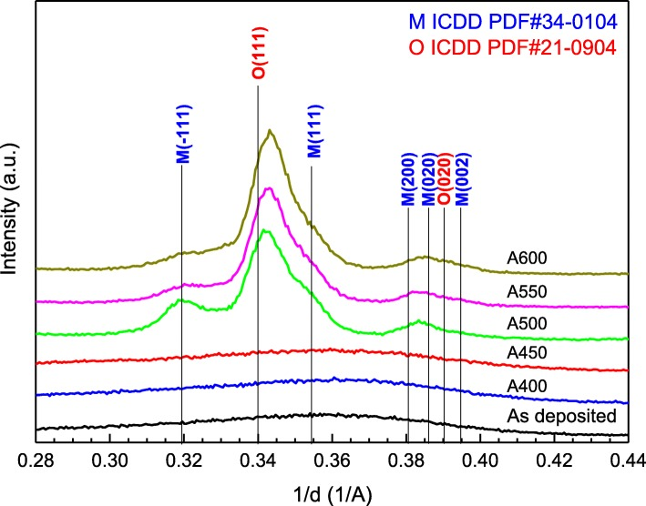
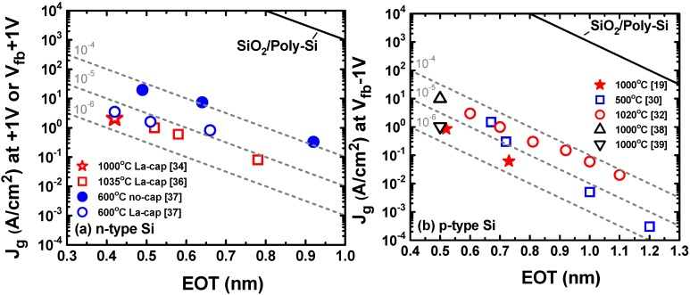
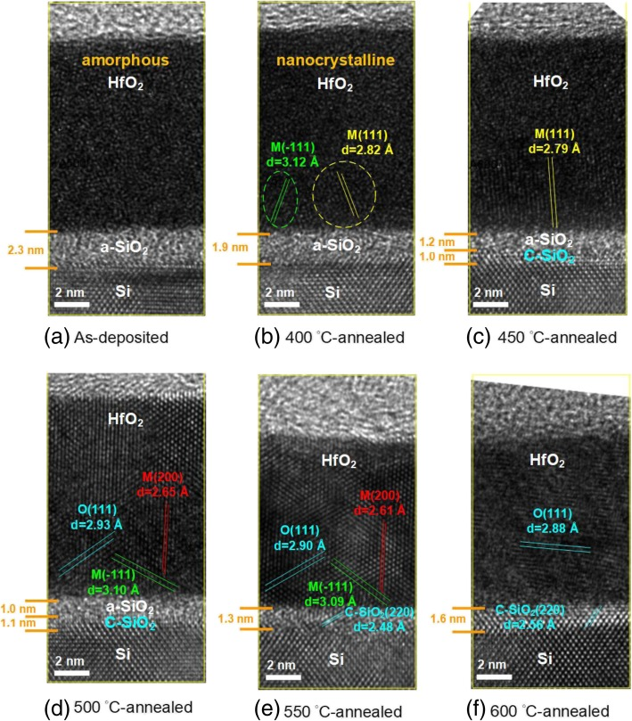

# 03-19 · High-k Dielectrics 

> 근거 번호 `[S##]`는 `03-19_High-k_자료수집.md`의 ID다. 논문 전문은 열람하지 못했다.
>
> 근거 표시 — **[논문]** 논문·학회에 보고된 값 · **[특허]** 특허의 주장·실시예 · **[리뷰]** 교과서·2차 정리 수준의 값 · **[계산]** 가정을 명시한 교육용 계산 · **[현장]** 문헌으로 못 박지 못한 현장 통념. 자기 장비에서 확인이 필요하다.

---

## 0. 요약

이 장에서는 SiO₂보다 유전율이 높은 절연막인 High-k를 다룬다. High-k는 트랜지스터의 게이트 절연막과 DRAM의 Capacitor 유전체에 쓰인다. 먼저 두 용도의 차이를 정리한 뒤, 유전율과 누설이 왜 서로 당기는지, 결정상과 계면층이 성능을 어떻게 정하는지를 차례로 설명한다.

High-k는 $\mathrm{SiO_{2}}(k = 3.9)$보다 유전율이 높은 절연막이다. 같은 정전용량을 **더 두꺼운 막**으로 얻을 수 있어 누설을 줄인다. 쓰이는 곳은 둘이다. 트랜지스터의 **게이트 절연막**(HfO₂ 계)과 DRAM의 **Capacitor 유전체**(ZrO₂ 계)다. 수 nm 두께를 원자층 단위로 제어해야 하므로 증착은 ALD다. 이 Chapter의 요점은 세 가지다. 유전율이 높을수록 Band Gap이 작아 누설이 는다. 높은 유전율은 결정상에서 나오는데 결정화가 누설을 부른다. 그리고 **계면층이 이득을 깎는다.**

| 항목 | 게이트 | DRAM Capacitor |
|---|---|---|
| 주 재료 | HfO₂ | ZrO₂/Al₂O₃/ZrO₂ (ZAZ) |
| 유전율 | 약 20–25 [리뷰 S01, 논문 S12] | 정방정 ZrO₂ 약 40 [논문 S13]. ZAZ 전체 약 28 [논문 S14] |
| 두께 | 1.5–3 nm | 5–10 nm |
| 전극 | Metal Gate (TiN 등) | TiN |
| 하부 | Si 위 SiO₂ 계면층 | TiN 하부 전극 |
| 주 제약 | 계면층 때문에 EOT 1 nm 아래가 어렵다 [S06, S10] | 누설 기준 100 nA/cm² [S13]. 얇아지면 결정화가 안 된다 [S16] |
| 증착 | ALD (HfCl₄ 또는 Amide 계 + H₂O·O₃) | ALD (Zr Amide·Cp 계, TMA + O₃) |

---

## 1. 용도와 필요성

High-k가 왜 필요해졌는지는 게이트와 DRAM Capacitor가 각각 부딪힌 한계에서 출발하면 이해하기 쉽다. 이 절에서는 두 용도에서 High-k가 맡는 일과 요구의 차이를 살펴본다.

### 1.1 Gate 절연막

트랜지스터의 구동력은 게이트 정전용량에 비례한다. 정전용량을 키우려고 SiO₂를 얇게 만들다가 1 nm대에서 전자가 막을 그대로 뚫고 지나가는 터널링 누설에 막혔다. 유전율이 큰 재료를 쓰면 같은 정전용량을 몇 배 두꺼운 막으로 얻을 수 있고, 터널링은 두께에 지수적으로 줄어든다. HfO₂ 계가 그 자리를 차지했다 [리뷰 S05].

High-k는 Poly-Si 게이트와 함께 쓰기 어려웠다. 문턱 전압이 고정되고 이동도가 떨어졌다. 그래서 **High-k와 Metal Gate가 한 묶음**으로 도입됐다(→ 03-14 §1, 03-17 §1).

### 1.2 DRAM Capacitor

DRAM은 Capacitor에 전하를 저장한다. Cell이 작아져도 저장 전하량은 유지해야 한다. Cell이 차지하는 면적이 줄어드니 Capacitor를 위로 길게 세우고(면적), 유전체를 얇게 하고(두께), 유전율을 올린다. 유전체는 SiO₂/Si₃N₄ → Al₂O₃ → HfO₂ → ZrO₂ 계로 바뀌어 왔다. 현재 가장 일반적인 것이 **ZrO₂/Al₂O₃/ZrO₂(ZAZ) 적층**이다 [논문 S13]. 전극은 TiN이다(→ 03-17).

요구가 게이트와 다르다. 누설 기준이 훨씬 엄격하다(전하를 수십 ms 이상 붙잡아야 한다). 통용되는 기준은 약 100 nA/cm²다 [논문 S13]. 그리고 종횡비가 수십 대 1인 구조의 안쪽 벽 전체에 같은 두께로 올려야 한다.

### 1.3 기타 용도

High-k는 게이트와 DRAM 외에도 여러 곳에 쓰인다.

| 용도 | 재료 |
|---|---|
| 3D NAND Blocking 산화막 | Al₂O₃ 등 |
| Etch Stop, Hardmask | Al₂O₃, AlN 등 |
| Passivation, Liner | Al₂O₃ |
| 강유전 메모리·트랜지스터 | HfZrO |

이 표의 값은 문헌과 현장에서 통용되는 범위이며, 자기 장비에서 확인해야 한다 [현장·리뷰].

> 이해 확인: 게이트용 High-k와 DRAM Capacitor용 High-k는 누설 기준과 단차 피복의 요구가 어떻게 다른가?

---

## 2. 재료

High-k 재료를 고를 때는 유전율만 볼 수 없다. 유전율이 높을수록 누설을 막는 장벽이 낮아지기 때문이다. 이 절에서는 유전율과 Band Gap의 관계, 높은 유전율이 어디에서 오는지, 결정화의 대가, 그리고 이 딜레마에 대한 답인 ZAZ 적층을 설명한다.

### 2.1 유전율과 Band Gap의 관계

먼저 절연막이 누설을 어떻게 막는지 생각해 보자. 절연막이 누설을 막으려면 전극의 전자가 넘지 못할 높은 장벽이 필요하다. 장벽 높이는 Band Gap과 전극·기판에 대한 Band Offset이 정한다. 그런데 **유전율이 큰 재료일수록 Band Gap이 대체로 작다** [리뷰 S02].

| 재료 | 유전율 k | Band Gap (eV) | Si 대비 전도대 Offset (eV) |
|---|---|---|---|
| SiO₂ | 3.9 | 9 | 3.2 |
| Si₃N₄ | 7 | 5.3 | 2.4 |
| Al₂O₃ | 9 | 8.8 | 2.8 |
| La₂O₃ | 30 | 6 | 2.3 |
| HfO₂ | 25 | 5.8 | 1.4 |
| ZrO₂ | 25 | 5.8 | 1.5 |
| Ta₂O₅ | 22 | 4.4 | 0.35 |
| TiO₂ | 80 | 3.5 | 0 |
| SrTiO₃ | 2000 | 3.2 | 0 |

이 표는 2차 정리표의 값이다 [리뷰 S01]. 원 리뷰와 대조하지 못했다. 문헌에 따라 값이 폭넓게 흩어져 있다 [리뷰 S02]. 예를 들어 ZrO₂의 k는 표에서 25지만 얇은 정방정 막은 약 40으로 보고되고 [논문 S13], 한 특허는 20–25에 Band Gap 7.8 eV로 적고 있다 [특허 S19]. TiO₂의 k는 같은 출처의 다른 표에서 60이다. **상과 측정법에 따라 달라지는 값**이므로 같은 연구 안에서만 비교한다.

표가 말해 주는 것은 다음과 같다.

- **TiO₂와 SrTiO₃는 유전율이 압도적이지만 전도대 Offset이 0이다.** Si 위에서는 장벽이 없다. 금속 전극 사이(MIM)에서도 Gap이 작아 누설이 크다.
- **HfO₂와 ZrO₂가 절충점이다.** k 20–40에 Offset 1.4–1.5 eV.
- **Al₂O₃는 k는 낮지만 Gap이 SiO₂에 가깝다.** 누설을 막는 층으로 쓴다. ZAZ의 가운데 층이 이것이다.
- 전도대 Offset은 Band Gap에 거의 선형으로 비례한다 [논문 S04]. Gap이 작으면 Offset도 작다.

### 2.2 높은 유전율의 기원

유전율에는 전자의 분극과 이온(격자)의 분극이 기여한다. 전자 분극은 작고, Gap이 작은 재료일수록 크다. **Gap을 유지하면서 유전율을 높이려면 이온 분극이 커야 한다** [리뷰 S02]. 이온 분극은 결정 구조에 따라 크게 달라진다. 무거운 금속 이온이 산소에 대해 쉽게 움직일 수 있는 구조일수록 크다.

그래서 HfO₂와 ZrO₂는 **상(결정 구조)이 유전율을 정한다.**

| 상 | 유전율 | 안정 조건 |
|---|---|---|
| 비정질 | 낮다 (약 20 안팎) | 증착 직후, 얇은 막 |
| 단사정 | 낮다 | Bulk의 상온 안정상 |
| 정방정 | 높다 (ZrO₂ 약 40) | 고온 안정상. 얇은 막·작은 결정립·도핑으로 상온에서 유지 |
| 입방정 | 높다 | 도핑으로 안정화 |

이 표의 값은 논문에 보고된 것이다 [논문 S03, S13, 리뷰]. ZrO₂는 정방정이 높은 유전율과 높은 Gap을 겸한다 [논문 S03]. 얇은 ZrO₂ 막은 정방정으로 결정화하기 쉽다 [논문 S13]. DRAM이 HfO₂가 아니라 ZrO₂를 쓰는 이유다. HfO₂는 같은 상에서 Gap이 약 0.6 eV 크지만 [논문 S03] 정방정을 얻기가 더 어렵다.

### 2.3 결정화에 따른 누설 증가

k > 30을 얻으려면 정방정이 필요하고, 정방정은 고온 증착이나 증착 후 Anneal로 얻는다. **그런데 둘 다 누설을 키운다** [논문 S13]. 결정화하면 결정립계가 생기고, 막을 위에서 아래까지 관통하는 결정립계가 누설 경로가 된다.

HfO₂의 결정화 온도는 다음과 같이 보고된다 [논문 S11].

| Anneal 온도 | HfO₂ | 계면층 |
|---|---|---|
| 400 °C 아래 | 비정질 | 비정질 (HfO₂ + SiO₂) |
| 450–550 °C | 다상 다결정 | — |
| 550 °C 초과 | 단일상 다결정이 지배 | 결정질 SiO₂로 |

*Remote Plasma ALD HfO₂(약 15 nm, 250 °C 증착)를 N₂ RTA한 뒤의 GIXRD. 450 °C까지는 결정 피크가 보이지 않고 500 °C부터 나타난다. 표의 450 °C 경계와 50 °C 차이가 난다. 표는 논문 초록의 서술이고 그림은 XRD 결과다.*

*출처: Zhang 등, Nanoscale Res. Lett. 14, 83 (2019), Figure 2. CC BY 4.0. [PMC](https://pmc.ncbi.nlm.nih.gov/articles/PMC6405792/)*

게이트 공정은 이후 수백 °C의 열을 거치므로 HfO₂는 결국 결정화한다. 600 °C Anneal 후 유전율 약 24가 보고된다 [논문 S12].

### 2.4 ZAZ 적층 구조

그렇다면 높은 유전율을 얻으면서 결정립계 누설을 막을 방법은 없을까? ZAZ는 §2.3의 딜레마에 대한 답이다. 두 ZrO₂ 층 사이에 얇은 비정질 Al₂O₃를 넣는다 [논문 S13].

| Al₂O₃ 층의 역할 | 내용 | 근거 |
|---|---|---|
| 결정립계 차단 | Anneal 중 ZrO₂ 결정립이 막 전체를 관통하지 못하게 한다. 누설 경로가 끊긴다. | [논문 S13] |
| 높은 장벽 | Gap 8.8 eV. 전자가 넘기 어렵다. | [리뷰 S01] |
| 누설 억제 | 0.3 nm Al₂O₃만으로 누설이 ZrO₂ 단일막의 1/6 | [논문 S14] |
| 대가 | k 9의 층이 직렬로 들어가 유효 유전율이 내려간다. | [논문 S13] |

Al₂O₃ 0.4 nm 이하에서는 전체 유전율이 약 28로 유지됐다 [논문 S14]. **원자층 한두 겹의 Al₂O₃ 두께가 누설과 정전용량 사이의 절충을 정한다.**

> 이해 확인: 유전율 40의 정방정 ZrO₂를 얻으려고 Anneal 온도를 올렸더니 누설이 늘었다. 그 이유는 무엇이며, ZAZ는 이 문제를 어떻게 줄이는가?

---

## 3. 전구체와 반응

High-k는 수 nm 두께를 원자층 단위로 맞추어야 하므로 ALD로 증착한다. 이 절에서는 ALD가 필요한 이유와 원리, HfO₂의 원료, ALD 온도 창, 산화제, 그리고 Al₂O₃ ALD를 설명한다.

### 3.1 ALD의 필요성

High-k는 수 nm 막을 종횡비 수십 대 1의 구조 벽 전체에 균일하게 올려야 한다. 이런 일을 할 수 있는 방법이 ALD이다. ALD는 전구체와 산화제를 번갈아 넣고, 각 단계가 표면이 다 덮이면 스스로 멈춘다(자기 제한). 깊은 곳까지 전구체가 닿을 시간만 주면 어디나 같은 두께가 된다.

1. 금속 전구체 Pulse: 표면의 –OH와 반응해 한 층이 흡착한다. Ligand가 표면을 덮으면 멈춘다.
2. Purge
3. 산화제 Pulse(H₂O 또는 O₃): Ligand를 떼어내고 표면을 다시 –OH로 만든다.
4. Purge

### 3.2 HfO₂ 전구체

HfO₂ ALD에는 할로겐화물과 금속 유기 원료가 쓰이며, 원료마다 성장 속도와 특징이 다르다.

| 전구체 | Cycle당 성장 | 특징 | 근거 |
|---|---|---|---|
| HfCl₄ + H₂O | 300 °C에서 단층의 15–17 % | 탄소가 없다. 막질이 좋다. 성장이 느리고 Cl이 남는다. 고체 전구체. HCl 부산물 | [특허 S06] |
| TEMAH + H₂O | 약 1.2 Å (250 °C) | 성장이 빠르다. 액체. 열에 약하다(분해). 탄소·질소 잔류 | [논문 S08] |
| TDMAH + H₂O | 약 1.0 Å (275 °C) | 위와 비슷 | [논문 S08] |

HfCl₄ 공정의 성장이 느린 이유는 반응 자리인 표면 –OH가 부족하기 때문이다. 온도가 오를수록 표면의 –OH가 줄어 성장이 더 줄어든다 [특허 S06]. Cl이 배위가 부족한 표면 Hf에 강하게 붙어 H₂O Pulse로 잘 떨어지지 않는다는 계산 결과도 있다 [학회 S07].

### 3.3 ALD 온도 창

ALD는 정해진 온도 범위에서만 자기 제한 성장을 한다. 이 범위를 ALD 온도 창이라고 하며, 그 아래와 위에서는 다음과 같은 일이 일어난다.

| 온도 | 일어나는 일 |
|---|---|
| 너무 낮다 | 반응이 불완전. Ligand·Cl·탄소가 남는다. 전구체가 응축하기도 한다. |
| 창 안 | 자기 제한 성장. Cycle당 성장이 일정하거나 완만히 변한다. |
| 너무 높다 | **전구체가 스스로 분해한다.** 자기 제한이 깨져 CVD가 된다. 단차 피복이 무너지고 불순물이 는다. |

Cycle당 성장이 280 °C까지 온도와 함께 줄다가 325 °C 위에서 전구체 열분해로 급증한 보고가 이 그림을 그대로 보여 준다 [논문 S09]. Amide 계 전구체는 분해 온도가 낮아 창이 좁다. DRAM처럼 깊은 구조에서는 전구체가 바닥에 닿기 전에 분해하면 위쪽만 두꺼워진다. **열 안정성이 높은 전구체**(Cp 계 등)를 쓰면 더 높은 온도에서 ALD할 수 있고, 온도가 높을수록 불순물이 적고 결정성이 좋다 [리뷰 S21].

### 3.4 산화제

산화제로는 H₂O와 O₃가 주로 쓰이며, 각각 장단점이 있다.

| 산화제 | 특징 |
|---|---|
| H₂O | 순하다. 하부를 덜 산화시킨다. 깊은 구조에서 Purge가 어렵다(벽에 붙어 잘 안 빠진다). |
| O₃ | 강하다. Ligand를 잘 태워 불순물이 적다. Purge가 쉽다. **하부를 산화시킨다.** Si 위에서는 계면 SiO₂를 키우고, TiN 전극 위에서는 TiOₓNᵧ를 만든다 [리뷰 S23]. |

DRAM Capacitor는 깊은 구조의 Purge 때문에 O₃를 쓰는 경우가 많고, 그 대가가 전극 산화다(§6.3).

### 3.5 Al₂O₃

Al₂O₃는 TMA Al(CH₃)₃와 H₂O 또는 O₃로 만들며, Cycle당 약 1.1 Å씩 자란다. 반응이 빠르고 깨끗해 ALD의 표준 모델로 쓰인다 [리뷰 S22]. ZAZ의 0.3 nm Al₂O₃는 **ALD 서너 Cycle**이다. Cycle 하나의 차이가 누설과 정전용량을 바꾼다.

> 이해 확인: 깊은 Capacitor 구조에서 Amide 계 전구체를 높은 온도로 쓰면 어떤 문제가 생기는가? 이를 피하려면 어떤 전구체가 유리한가?

---

## 4. 공정 윈도우와 공정 변수별 응답

High-k ALD에서는 온도, 노출량, 산화제가 성장, 불순물, 결정성, 단차 피복을 함께 정한다. 아래 표는 그 경향을 정리한 것이다.

| 조절 변수 ↑ | Cycle당 성장 | 불순물 | 결정성 · k | 단차 피복 | 근거 |
|---|---|---|---|---|---|
| 온도 (창 안) | ↓ 또는 일정 | ↓ | ↑ | — | [S06, S09] |
| 온도 (분해 온도 초과) | ↑↑ | ↑ | — | ↓↓ | [S09] |
| 전구체 노출 | 포화까지 ↑ | — | — | ↑ (깊은 곳까지 포화) | [리뷰] |
| 산화제 노출 | 포화까지 ↑ | ↓ | — | ↑ | 하부 산화 ↑ |
| O₃ 농도 | — | ↓ | — | — | 하부 산화 ↑ |
| Purge 시간 | — | ↓ | — | ↑ | 부족하면 CVD 성분, Particle |
| Cycle 수 | 두께 | — | 두꺼울수록 결정화 쉬움 | — | [S16] |
| 증착 후 Anneal | — | ↓ | ↑ | — | 누설 ↑, 계면층 ↑ [S13] |

**깊은 구조에서의 포화가 핵심이다.** 전구체 분자가 종횡비 수십 대 1의 구멍 바닥까지 확산해 표면을 다 덮으려면 평면에서보다 훨씬 긴 노출이 필요하다. 필요한 노출량은 종횡비의 제곱에 대략 비례한다 [리뷰]. 노출이 부족하면 바닥이 얇고, 바닥이 얇은 Capacitor는 그곳에서 누설과 파괴가 일어난다.

> 이해 확인: 종횡비가 두 배인 구조에서 바닥까지 포화시키려면 전구체 노출량을 대략 얼마나 늘려야 하는가?

---

## 5. 계산 [계산]

High-k의 효과는 EOT라는 값으로 나타낸다. 이 절에서는 EOT를 계산하는 방법을 익혀 계면층이 EOT를 얼마나 차지하는지 확인하고, DRAM Capacitor가 왜 그렇게 높이 서야 하는지 계산해 본다.

### 5.1 EOT

High-k 막을 “같은 정전용량을 내는 SiO₂ 두께”로 환산한 것이 EOT다.

$$
\mathrm{EOT} = t \times \frac{3.9}{k}
$$

적층이라면 각 층의 EOT를 더한다.

**게이트 Stack**

| 계면 SiO₂ | HfO₂ | k (HfO₂) | EOT |
|---|---|---|---|
| 0.7 nm | 3 nm | 20 | 1.28 nm |
| 0.7 nm | 2 nm | 20 | 1.09 nm |
| 0.5 nm | 2 nm | 20 | 0.89 nm |
| 0.5 nm | 1.5 nm | 25 | 0.73 nm |

첫 줄에서 EOT 1.28 nm 가운데 0.7 nm, 절반 넘게가 계면 SiO₂다. **High-k를 아무리 좋게 만들어도 계면층이 EOT의 바닥을 정한다.** 3 nm HfO₂에서 Anneal 재성장이 0이어도 최소 EOT가 1.23 nm이고, 1 nm 아래로 가려면 하부층을 없애야 한다는 보고와 같은 내용이다 [학회 S10]. TEMAH/H₂O ALD에서 계면층은 약 7 Å였다 [논문 S08]. 게이트 High-k 공정의 주제는 HfO₂ 자체보다 **계면층을 얼마나 얇게, 그러면서 좋은 품질로 만드느냐**다.

**ZAZ**

| 구성 | EOT | 비고 |
|---|---|---|
| ZrO₂ 6.3 nm (k 40) | 0.61 nm | 누설이 크다. |
| ZrO₂ 3 / Al₂O₃ 0.3 / ZrO₂ 3 nm | 0.72 nm | Al₂O₃(k 9) 0.3 nm가 EOT 0.13 nm를 더한다. |
| ZrO₂ 3 / Al₂O₃ 0.5 / ZrO₂ 3 nm | 0.80 nm | |

Al₂O₃ 0.3 nm가 전체 EOT의 18 %를 차지하고, 그 대가로 누설이 1/6로 줄어든다 [논문 S14]. 0.2 nm를 더 넣으면 EOT가 다시 12 % 오른다. 문헌의 실측과 비교하면, 10 nm ZAZ가 EOT 1.0 nm면 유효 유전율이 39 [논문 S15], 5.7 nm 막이 EOT 0.89 nm면 유효 유전율이 25다 [논문 S17]. 얇은 막일수록 유효 유전율이 낮다. 계면층과 결정화 부족 때문이다(§6.2, §6.3).

EOT를 줄이면 누설이 얼마나 느는지는 문헌 값을 모은 다음 그림이 보여 준다 [리뷰 S26].

*문헌에 보고된 HfO₂ 계 게이트 적층의 EOT와 누설 전류 밀도 $J_g$. (a) n형, (b) p형 MOS Capacitor다. 오른쪽 위 실선은 SiO₂/Poly-Si 적층이고, 점선은 그보다 누설이 10⁻⁴, 10⁻⁵, 10⁻⁶배인 선이다. 점선의 기울기는 이상적인 SiO₂ Scaling(EOT가 0.2 nm 줄 때마다 $J_g$ 10배)과 같다. 범례의 온도는 공정 최고 온도다. 계면층을 줄여 EOT 0.5 nm까지 간 점들도 이 기울기를 따라 올라간다. High-k를 써도 EOT를 줄이면 누설은 같은 비율로 는다.*

*출처: Ando, Materials 5(3), 478 (2012), Figure 6. CC BY 3.0. [PMC](https://pmc.ncbi.nlm.nih.gov/articles/PMC5448919/)*

### 5.2 DRAM Capacitor 높이 계산

DRAM Capacitor가 왜 그렇게 높이 서야 하는지 계산해 보자. Capacitor의 정전용량은 EOT를 써서 다음과 같이 나타낼 수 있다.

$$
C = \frac{\varepsilon_0 \times 3.9 \times A}{\mathrm{EOT}}
$$

| EOT | 단위 면적 정전용량 | 8 fF에 필요한 면적 | 지름 20 nm 기둥의 높이 | 종횡비 |
|---|---|---|---|---|
| 1.0 nm | 34.5 fF/µm² | 0.232 µm² | 3.7 µm | 약 185 |
| 0.7 nm | 49.3 fF/µm² | 0.162 µm² | 2.6 µm | 약 130 |
| 0.5 nm | 69.1 fF/µm² | 0.116 µm² | 1.8 µm | 약 90 |
| 0.4 nm | 86.3 fF/µm² | 0.093 µm² | 1.5 µm | 약 75 |

Cell 정전용량 8 fF, 기둥 바깥면만 쓰는 구조라는 가상의 조건이다. 실제 수치는 제품마다 다르다. 규모만 본다. **EOT 0.5 nm로도 지름 20 nm 기둥이 2 µm 가까이 서야 한다.** EOT를 0.1 nm 줄이면 높이가 수백 nm 줄어든다. 그만큼 Mold 식각(→ 03-01 ACL의 마스크 예산)과 기둥 쓰러짐의 부담이 준다. High-k의 유전율 한 단위, Al₂O₃ 한 Cycle이 DRAM 전체 구조의 높이와 연결돼 있다.

> 이해 확인: 계면 SiO₂ 0.5 nm, HfO₂ 2.5 nm(k 22)인 게이트 적층의 EOT는 얼마이며, 계면층의 몫은 몇 %인가?

---

## 6. 집적 이슈와 불량 모드

High-k는 누설, 결정화, 계면층, 단차 피복, 열 이력, 문턱 전압에서 문제가 생긴다. 이 절에서는 이 문제들이 왜 생기고 어떻게 대응하는지 차례로 살펴본다.

### 6.1 누설

High-k 막의 누설은 여러 경로로 생기며, 경로마다 원인과 대책이 다르다.

| 경로 | 원인 | 대책 |
|---|---|---|
| 결정립계 | 결정화로 생긴 관통 결정립계 | Al₂O₃ 삽입, 결정립 미세화 [S13] |
| 낮은 장벽 | Gap이 작은 재료, 전극 일함수 | 높은 Gap 층 삽입, 일함수 높은 전극 |
| 결함 준위 | 산소 공공, 불순물(C, Cl, N) | 충분한 산화, 온도, 후처리 |
| 국부적으로 얇은 곳 | 단차 피복 불량, 전극 거칠기 | 노출량, 전극 평탄도 |

산소 공공이 가장 흔한 결함이다. 전자가 공공을 징검다리 삼아 지나간다 [리뷰]. 산화제를 세게 하면 줄지만 하부 산화가 는다(§6.3).

### 6.2 두께에 따른 결정화 거동

Design Rule 20 nm 아래에서는 ZAZ가 너무 얇아 결정화가 어렵고, 유전율이 기대에 못 미친다. 특히 상부 ZrO₂ 층이 그렇다 [학회 S16]. 결정화에는 최소 두께가 필요하다. Al₂O₃ 위에 올린 상부 ZrO₂는 결정의 씨앗이 없는 비정질 표면에서 시작하므로 더 불리하다.

**유전체를 얇게 하면 정전용량이 느는 것이 아니라 유전율이 떨어져 이득이 사라진다.** 두께와 유전율이 독립이 아니다. §5.1에서 5.7 nm 막의 유효 유전율(25)이 10 nm 막(39)보다 낮은 것이 그 예다.

### 6.3 계면층

**게이트: Si 위 SiO₂**

Si 위에 High-k를 직접 올리면 계면에 SiOₓ나 Silicate 층이 생긴다. ALD의 산화제와 이후 Anneal이 키운다. TEMAH/H₂O에서 약 7 Å [논문 S08]. Anneal에서의 계면 재성장 때문에 EOT 1 nm 이하가 어렵다 [특허 S06]. 계면층은 없애는 것이 아니라 조절하는 대상이다. Si/SiO₂ 계면이 전기적으로 가장 좋기 때문에 얇은 SiO₂를 의도적으로 깔고 그 위에 High-k를 올린다 [리뷰 S05].

*같은 시편의 HR-TEM 단면. HfO₂와 Si 사이 계면층 두께가 증착 직후 2.3 nm, 400 °C 1.9 nm, 450 °C 1.2 + 1.0 nm(두 층), 500 °C 1.0 + 1.1 nm, 550 °C 1.3 nm, 600 °C 1.6 nm로 표시돼 있다. O₂ Plasma를 산화제로 쓴 ALD라서 증착 직후 계면층이 H₂O ALD의 약 0.7 nm보다 훨씬 두껍다. 계면층은 Anneal 온도에 따라 두께와 구조가 함께 변한다.*

*출처: Zhang 등, Nanoscale Res. Lett. 14, 83 (2019), Figure 4. CC BY 4.0. [PMC](https://pmc.ncbi.nlm.nih.gov/articles/PMC6405792/)*

**Capacitor: TiN 위 TiOₓNᵧ**

TiN 하부 전극 위에 O₃로 ZrO₂를 ALD하면 TiN 표면이 산화된다 [리뷰 S23]. 생긴 TiOₓNᵧ 층은 유전율은 높지만 Gap이 작아 누설에 기여하고, 조성에 따라 정전용량을 깎는다. TiN의 염소(→ 03-17 §6.3)도 이 계면에 모인다. 초기 수 Cycle의 산화제 조건(농도를 낮추거나 H₂O로 시작)이 계면을 정한다 [현장].

상부 전극 쪽도 문제다. ZrO₂ 위에 TiN을 증착할 때 TiCl₄와 NH₃가 유전체 표면을 환원시켜 산소 공공을 만든다 [현장].

### 6.4 단차 피복

Capacitor의 종횡비는 수십 대 1을 넘는다(§5.2). 실패 양상은 두 가지다.

| 양상 | 원인 |
|---|---|
| 바닥이 얇다 | 노출 부족. 전구체가 바닥까지 포화되지 못함 |
| 위가 두껍다 | 전구체 열분해(CVD 성분), Purge 부족 |

깊이 방향으로 두께만이 아니라 **조성과 결정성**도 달라질 수 있다. ZAZ의 Al₂O₃가 바닥에서 한 Cycle 덜 올라가면 그곳의 누설이 달라진다.

### 6.5 열 이력

High-k는 증착 후의 열 공정에서 변한다. 결정화(§2.3), 계면층 성장(§6.3), 전극과의 반응, 산소의 이동. 게이트에서는 Source/Drain 활성화 Anneal(1,000 °C 이상)을 High-k 형성 뒤에 하느냐 앞에 하느냐(Gate-first·Gate-last)가 이 문제에서 나왔다 [리뷰 S05]. DRAM에서는 Capacitor 형성 이후의 열 예산이 누설을 정한다.

### 6.6 문턱 전압과 고정 전하

High-k 막과 계면의 전하·쌍극자가 문턱 전압을 움직인다. 막 안의 산소 공공, 불순물, 계면의 조성이 모두 관여한다. 수 Å의 La₂O₃나 Al₂O₃ Cap을 넣어 계면 쌍극자로 문턱 전압을 조절하기도 한다 [리뷰 S25]. ALD 한두 Cycle이 소자의 문턱 전압이다.

> 이해 확인: ZAZ 유전체를 더 얇게 했는데 정전용량이 오히려 줄었다. 어떤 원인을 의심해야 하는가?

---

## 7. 챔버 · 하드웨어 관리

High-k ALD는 원료 공급과 산화제의 안정성, 그리고 Cycle 하나하나의 재현성이 중요하다. 아래 표는 Chamber와 하드웨어 관리의 주요 항목을 정리한 것이다.

| 항목 | 내용 |
|---|---|
| 전구체 공급 | HfCl₄는 고체(승화 공급, 공급량 Drift). Amide 계는 액체지만 열에 약해 용기·배관에서 분해한다. 분해물이 Particle과 공급 저하를 만든다 [리뷰 S21, 현장]. |
| 배관·Chamber 온도 | 전구체의 응축 온도보다 높고 분해 온도보다 낮게. 창이 좁은 전구체는 온도 균일도가 곧 공정 창이다. |
| Purge | 깊은 구조와 H₂O는 Purge가 길다. 생산성과 직접 충돌한다. Purge 부족은 CVD 성분과 Particle |
| O₃ 농도 | 발생기 상태에 따라 Drift(→ 03-05 §7). 농도가 불순물과 하부 산화를 모두 바꾼다. |
| 벽 증착 | Chamber 벽에도 ALD 막이 쌓인다. High-k는 식각이 어려워 In-situ Clean이 제한적이다. 누적 막의 박리 전에 부품 교체·세정 [현장] |
| Batch와 단일 Wafer | DRAM Capacitor는 긴 노출이 필요해 Batch Furnace ALD가 생산성에 유리. 게이트는 정밀도 때문에 단일 Wafer |
| 교차 오염 | Hf·Zr·La·Al이 다른 공정으로 가지 않게. Backside와 Bevel |
| Q-time | 전세정 → ALD, ALD → 전극 증착 사이. 표면 상태와 흡습이 계면을 바꾼다. |

---

## 8. 계측과 해석

High-k 막은 물리적 두께와 전기적 두께(EOT), 결정상, 계면층을 함께 측정해야 한다. 아래 표는 각 계측이 무엇을 알려 주고 어떤 함정이 있는지 정리한 것이다.

| 계측 | 얻는 것 | 읽는 법과 함정 |
|---|---|---|
| Ellipsometry | 두께 | 수 nm에서 두께와 굴절률이 물린다. 계면층과 High-k를 분리하기 어렵다. |
| XRR | 두께, 밀도, 계면 거칠기 | 초박막 두께의 기준. 층별 분리 가능 |
| XRF | 금속 원자의 면적당 양 | Cycle당 성장의 직접 지표. 두께가 아니라 원자 수 |
| XPS | 조성, 결합 상태, 계면층 | Si 2p의 산화 상태로 계면 SiO₂ 두께. Ti 2p로 TiN 전극 산화 |
| GIXRD | 결정상 | 정방정·단사정·비정질 구별. 얇은 막은 신호가 약하고 정방정·입방정·사방정의 구별이 어렵다. |
| TEM (+EELS·EDS) | 층 구조, 계면층, 단차 피복, 결정립 | 깊은 구조의 위·중간·바닥을 모두 본다. |
| SIMS | 불순물(C, N, Cl, H) | |
| C–V | 정전용량, EOT, 문턱 전압, 고정 전하 | 누설이 크면 C–V가 왜곡된다. |
| I–V | 누설, 절연 파괴 | 온도 의존성으로 누설 기구를 가린다. |
| 신뢰성 | TDDB, 전하 Trap | |

**EOT와 물리적 두께를 함께 재야 유전율이 나온다.** 그리고 그 유전율은 계면층을 포함한 유효값이다. 두께를 바꿔 가며 EOT를 재서 직선의 기울기에서 High-k의 유전율을, 절편에서 계면층 EOT를 분리한다 [리뷰].

> 이해 확인: 물리적 두께를 바꾸어 가며 EOT를 측정하면 계면층과 High-k의 기여를 어떻게 나눌 수 있는가?

---

## 9. 파생 막과 차세대 기술

EOT를 더 줄이고 누설을 억제하기 위해 새로운 재료와 구조가 연구되고 있다. 아래 표는 그 방향을 정리한 것이다.

| 방향 | 내용 | 근거 |
|---|---|---|
| ZAZ의 한계 돌파 | 상부 ZrO₂를 TiO₂로. TiO₂는 Gap이 3.4 eV로 작아 단독으로는 못 쓴다. | [학회 S16] |
| 계면층 공학 | AlZrO 합금 계면층으로 5.7 nm에서 EOT 0.89 nm, 누설 3×10⁻¹⁰ A/cm² | [논문 S17] |
| 상 안정화 | Bi₂O₃ 같은 초박 삽입층, 도핑으로 정방정 안정화 | [학회 S18] |
| 더 높은 k | TiO₂ 계(Rutile), SrTiO₃. 장벽이 낮아 일함수 높은 전극(Ru 계)이 필요(→ 03-18) | [리뷰 S01] |
| 강유전 HfZrO | 사방정 상의 강유전성. 메모리와 트랜지스터 | [리뷰 S24] |
| 게이트 Stack 조절 | 초박 Cap의 쌍극자로 다중 문턱 전압 | [리뷰 S25] |
| 고온 ALD 전구체 | 열 안정성이 높은 전구체로 더 높은 온도, 더 깨끗한 막 | [리뷰 S21] |
| 영역 선택 ALD | 필요한 표면에만 증착 | [리뷰] |

> 이해 확인: EOT를 계속 줄이면 누설은 어떻게 변하는가? Ando의 그림에서 읽은 경향으로 설명해 보자.

---

## 10. Troubleshooting

아래 표는 High-k 공정에서 흔히 나타나는 증상과 유력한 원인, 확인할 데이터, 조치 방향을 정리한 것이다. 표의 원인은 현장 경험에서 나온 출발점이므로 [현장], “확인할 데이터” 열로 가설을 좁힌 뒤에 조치해야 한다.

| 증상 | 유력 원인 | 확인할 데이터 | 조치 방향 |
|---|---|---|---|
| 누설 증가 | 결정립계 관통(Al₂O₃ 부족), 산소 공공, 불순물, 국부 박막 | TEM, GIXRD, SIMS, I–V 온도 의존성 | Al₂O₃ Cycle, 산화제 노출, 온도, 노출량 |
| 정전용량 저하 (EOT 상승) | 계면층 성장, 결정화 부족, 두께 상향 | XPS·TEM 계면, GIXRD, XRF | 초기 산화제 조건, Anneal, Cycle 수 |
| Capacitor 바닥에서 파괴 | 단차 피복 부족 | TEM 위·바닥 두께 | 전구체·산화제 노출 연장 |
| 위쪽만 두껍다 | 전구체 열분해, Purge 부족 | 깊이별 두께, 온도 | 온도 하향, Purge 연장, 전구체 변경 |
| Cycle당 성장 Drift | 전구체 공급 저하(고체·분해), O₃ 농도 | XRF 추이, 공급 이력 | 용기 관리, 농도 보정 |
| 문턱 전압 변동 | 막 두께·조성, 계면, Q-time | C–V, XRF, XPS | Cycle 제어, Q-time |
| Wafer 간·Batch 내 편차 | 온도 분포, 노출 불균일 | 위치별 XRF | 온도 Profile, 가스 분포 |
| Particle | 전구체 분해물, CVD 성분, 벽 박리 | 입자 성분 | 배관 온도, Purge, 부품 교체 |
| 얇게 했는데 정전용량이 안 는다 | 결정화 한계로 유전율 저하 | GIXRD, 두께별 EOT | 상 안정화(삽입층·도핑), 구조 변경 |

> 이해 확인: Capacitor의 누설이 Wafer 가장자리에서만 크다. ALD 노출과 하부 전극의 어떤 조건을 먼저 확인해야 하는가?

---

## 11. 자가 점검

이 장의 핵심 내용을 질문으로 확인해 보자.

**Q1. High-k를 쓰면 누설이 줄어드는 이유는?**
같은 정전용량을 더 두꺼운 막으로 얻을 수 있다. 터널링 누설은 두께에 지수적으로 줄어든다.

**Q2. 유전율이 가장 높은 TiO₂나 SrTiO₃를 그대로 쓰지 못하는 이유는?**
Band Gap이 작고 Si에 대한 전도대 Offset이 0이다. 전자를 막을 장벽이 없어 누설이 크다.

**Q3. DRAM이 ZrO₂를 쓰는 이유와 그 약점은?**
얇은 ZrO₂가 정방정으로 결정화해 유전율 약 40을 낸다. 결정화가 결정립계 누설을 부른다.

**Q4. ZAZ에서 Al₂O₃ 층이 하는 일 두 가지와 대가는?**
ZrO₂ 결정립이 막을 관통하지 못하게 끊고, 높은 Band Gap으로 장벽을 준다. k 9의 층이 직렬로 들어가 유효 유전율이 내려간다.

**Q5. 계면 SiO₂ 0.7 nm, HfO₂ 2 nm(k 20)의 EOT는? 계면층의 몫은?**
$0.7 + 2 \times 3.9/20 = 1.09\ \mathrm{nm}$. 계면층이 64 %다.

**Q6. ALD 온도를 올렸더니 Cycle당 성장이 갑자기 늘고 단차 피복이 나빠졌다. 무슨 일인가?**
전구체가 열분해하기 시작했다. 자기 제한이 깨져 CVD가 됐다.

**Q7. O₃를 산화제로 쓸 때의 장점과 대가는?**
Ligand를 잘 태워 불순물이 적고 깊은 구조에서 Purge가 쉽다. 하부를 산화시켜 Si 위에서는 계면 SiO₂를, TiN 위에서는 TiOₓNᵧ를 키운다.

**Q8. 유전체를 얇게 했는데 정전용량이 기대만큼 늘지 않았다. 가능한 원인은?**
너무 얇아 결정화가 안 돼 유전율이 떨어졌다. 계면층의 몫도 상대적으로 커졌다.

**Q9. EOT 0.5 nm인 유전체로 8 fF를 얻으려면 지름 20 nm 기둥(바깥면만 사용)의 높이는 대략 얼마인가?**
약 1.8 µm. 종횡비 약 90이다.

---

## 12. 참고문헌

- [S01] GlobalSino 정리표 — 재료별 k·Band Gap·Offset (2차 자료)
- [S03] Rutgers 그룹 — ZrO₂의 Gap·Offset, 상과 유전율
- [S06] US 7,851,377 등 — HfCl₄/H₂O ALD의 성장, 계면 재성장
- [S08] TEMAH·TDMAH ALD — Cycle당 성장, 계면층 두께
- [S09] KIST — 전구체 열분해와 Cycle당 성장
- [S10] ECS MA 203 — 3 nm HfO₂의 최소 EOT 1.23 nm
- [S11] Remote Plasma ALD HfO₂ — 결정화 온도
- [S13] Martin 등 — ZrO₂와 ZAZ, 정방정·누설·Al₂O₃의 역할
- [S14] IEICE 2016 — 0.3 nm Al₂O₃의 효과
- [S16] ECS 233 — 20 nm 아래에서의 결정화 한계
- [S17] *J. Semicond.* — AlZrO 계면층
- [S26] Ando, *Materials* 5, 478 (2012) — High-k 게이트 Scaling 리뷰. EOT–누설 문헌 비교(그림 출처)
